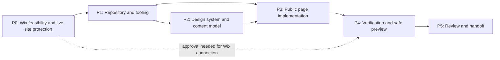
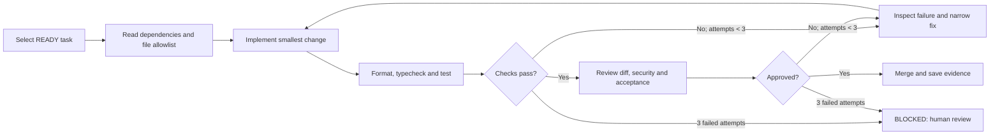
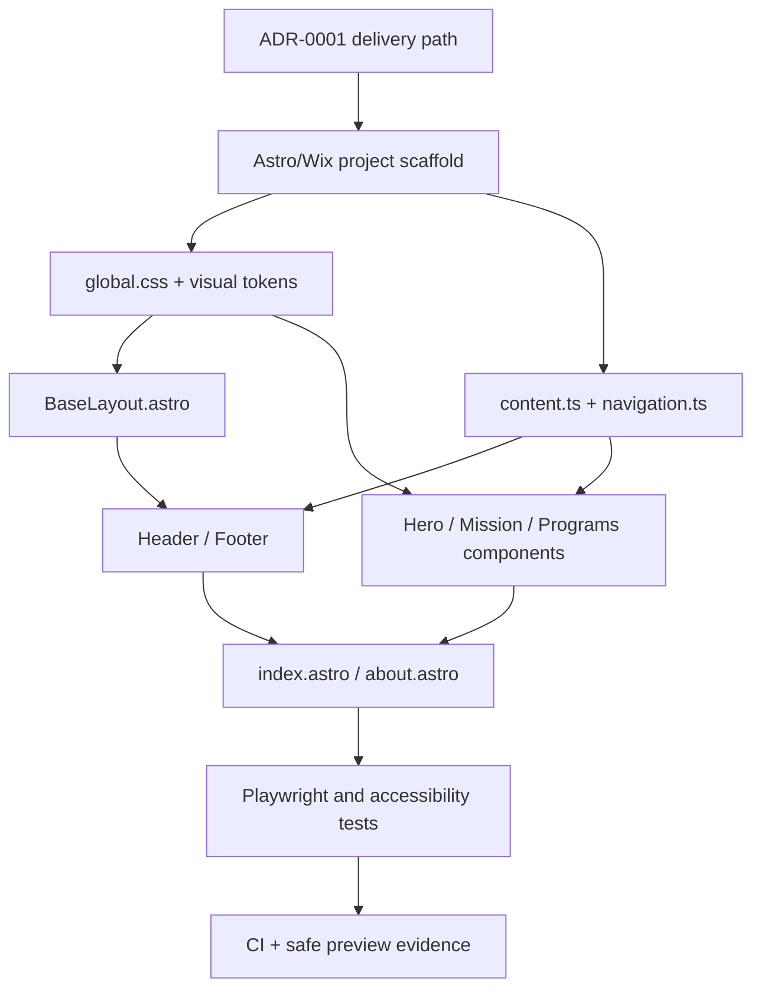

# Sprint 01 — Engineering Foundation and First Working Frontend

**Project:** PostBaby Bliss Foundation Digital Platform  
**Delivery model:** One-week sprint subdivided into independently verifiable phases  
**Method:** Dependency-graph planning + controlled build–test–review loops  
**Target stack:** Astro, TypeScript, Tailwind CSS, selective React, Wix Headless/SDK, Node.js, GitHub  
**Primary outcome:** A version-controlled, responsive **home-page prototype** with reusable layout components, an initial About page, automated checks, and a safe preview process. The existing live Wix website remains unchanged.

> **Scope boundary.** This sprint builds the frontend foundation; it does **not** deliver live donations, health-related intake forms, member accounts, database migrations, or a public-domain cutover. Those depend on subsequent sprints and approved platform, privacy, and payment decisions.

## 1. Why this sprint is structured this way

A chronological checklist is useful but insufficient for an AI-assisted, multi-developer project: it does not show which changes depend on others or when generated code has actually passed verification. Each phase therefore has a **phase ID, objective, prerequisites, file-operation manifest, implementation tasks, verifiable evidence, and exit gate**. Every task runs through a limited feedback loop. A dependency graph determines what can proceed in parallel.

**Planning unit:** `Sprint → Phase → Task → File change → Verification → Review → Evidence`.  
**Task identity:** `S01-Pn-Tnn` (for example, `S01-P3-T02`).  
**Status values:** `TODO`, `IN_PROGRESS`, `BLOCKED`, `IN_REVIEW`, `DONE`.  
**File operations:** `C` = create; `M` = modify; `G` = generated/maintained by tooling; `?` = conditional upon the approved Wix path.

**Operating rule:** The file list below is a planned change manifest, not a claim that these files already exist. If a Wix CLI scaffold produces a different authoritative structure, preserve the generated structure and record justified path changes in the sprint evidence; do not force a fictitious folder layout.

## 2. Sprint goal and measurable outcomes

At the end of five working days, a reviewer should be able to clone the repository, install dependencies, run the application locally, navigate the homepage and About page, inspect reusable components, run automated checks, and open a safely isolated preview when supported by the selected Wix development path.

**Sprint objectives**

1. Preserve the existing production site while documenting the supported way to connect or replace its frontend.
2. Establish a reproducible GitHub repository, local development environment, and continuous integration baseline.
3. Define a simple, original visual system appropriate to a U.S.-based maternal and family-support nonprofit.
4. Build responsive, accessible shared layout components and the first two public routes.
5. Establish repeatable task loops, a documented dependency graph, and automated acceptance checks.
6. Demonstrate a working increment and prepare a prioritized, evidence-based Sprint 02 backlog.

**Definition of successful delivery**

- `npm ci`, the development command, and the agreed lint/typecheck/test/build commands succeed on a clean machine or CI runner, except Wix-specific preview commands awaiting authorized credentials.
- `/` and `/about` render correctly at **375 px**, **768 px**, and **1440 px** viewport widths, without horizontal scrolling caused by layout defects.
- The header, navigation, main landmark, focus order, footer, and links work using keyboard-only navigation.
- No critical or serious issues are reported by the automated accessibility checks on the two routes; manual review supplements automation.
- The content is based only on approved Foundation information. Unverified fundraising, impact, nonprofit-registration, and medical-service claims are not published.
- No API secrets, donor records, medical information, or private family details are committed to Git.
- The original Wix site and its domain are **not** switched or republished as part of Sprint 01.

## 3. Phase schedule and dependency map

| Phase | Target window | Phase objective | Entry condition | Exit evidence |
|---|---|---|---|---|
| **S01-P0** | Day 1, first half | Validate Wix deployment and protect the existing site | Site owner is available for a short verification | Decision record, baseline inventory, explicit no-cutover rule |
| **S01-P1** | Day 1–2 | Bootstrap repository, framework and quality tooling | P0 path selected or a safe local-only fallback declared | Working local install and first green CI check |
| **S01-P2** | Day 2 | Create visual foundations and approved content model | Basic project scaffold exists | Tokens, content structures and approved-content register |
| **S01-P3** | Day 3–4 | Implement first usable pages | P1 complete; P2 tokens/content available | Responsive home and About routes |
| **S01-P4** | Day 4–5 | Verify behavior, accessibility and preview | P3 routes render locally | Passing tests, test evidence and preview instructions |
| **S01-P5** | Day 5 | Review, document and hand off | P4 evidence collected | Sprint demo, signed-off decisions and Sprint 02 backlog |

### 3.1 Dependency graph (Mermaid)



**Critical path:** P0 → P1 → P2 → P3 → P4 → P5. Repository documentation and image-permission review may proceed in parallel with P1. A blocked Wix subscription decision must **not** block local frontend construction; it blocks only Wix linking and hosted previews.

## 4. Development-loop contract

Loop engineering is treated here as an **execution and verification method**, not as permission to let an agent modify the entire project autonomously. Graph engineering is treated as **explicit task and file dependencies**, not as a requirement to introduce a graph database or orchestration framework.



**Mandatory task contract**

- **Input:** Task ID, objective, approved reference, dependencies, exact file allowlist, acceptance test and assigned reviewer.
- **Action:** Work on a short-lived feature branch. Change only allowed files; request approval before expanding scope.
- **Feedback:** Run the narrowest useful checks first, then the full CI suite. Preserve test output and any browser evidence.
- **Stop:** Mark `DONE` only after passing checks and review; after **three failed corrective iterations**, mark `BLOCKED` and escalate rather than continuing unbounded AI retries.
- **Security:** Never send production credentials, personal family information, payment details, or private Wix configuration to coding agents or commit them in files.
- **Merge:** At least one human review for changes that alter routing, authentication, data permissions, donation links, deployment or privacy behavior.

A task may be implemented with an AI coding assistant, but **test output and human acceptance**, rather than the assistant's assertion, determine completion.

---

## 5. Phase execution specifications

### Phase S01-P0 — Validate platform path and protect production

**Objective.** Establish a technically supported Wix deployment route that respects the existing subscription and domain; inventory migration risk before any hosting or domain change.

**Tasks**

- `S01-P0-T01`: Record the current Wix editor type, site ownership, connected domain, plan, installed apps, forms, current URLs and business services. Identify which facts require account-owner verification.
- `S01-P0-T02`: Compare two **distinct** routes: **A**—Wix-managed Astro Headless with staged frontend migration; **B**—retain Wix Editor/Studio and use Velo/Git integration for constrained customization.
- `S01-P0-T03`: Inventory supplied images and page content; flag uncertain licensing/consent for identifiable parents and children, text requiring approval, and any unverified claims.
- `S01-P0-T04`: Capture the live site's current navigation and routes as a rollback/reference baseline; confirm that Sprint 01 will not publish over them.

**File-operation manifest**

| Operation | Repository path | Purpose |
|---|---|---|
| C | `docs/audit/existing-site-inventory.md` | Current pages, installed services, domain, navigation, forms and URLs |
| C | `docs/audit/wix-hosting-feasibility.md` | Site-plan, permissions, Wix-supported deployment and preview findings |
| C | `docs/audit/asset-and-content-register.md` | Supplied image names, purpose, approvals, permissions and content status |
| C | `docs/architecture/ADR-0001-delivery-path.md` | Accepted architecture, alternatives, trade-offs, reviewer and date |
| C | `docs/architecture/migration-risk-register.md` | Widgets, redirects, forms and SEO features to retain or rebuild later |

**Exit gate `G0`.** An owner-approved `ADR-0001` selects A or B, or records **A pending verification with local-only development authorized**. The current site remains operational. **Do not assume that creating a fresh headless project automatically reuses the existing plan or site.**

**Fallback when unresolved.** Continue with an isolated, empty Astro frontend in local development; defer Wix configuration, SDK authentication, subscription changes and published previews. If option B is finally selected, adapt the code and file plan to the Wix site's CLI-managed structure before beginning integration work.

### Phase S01-P1 — Repository and reproducible development environment

**Objective.** Create a minimal, maintainable codebase with automated checks, no premade visual template, and predictable development commands.

**Tasks**

- `S01-P1-T01`: Initialize a private GitHub repository and protected main branch; define short-lived feature branches and pull-request review.
- `S01-P1-T02`: Scaffold a **minimal Astro project**, selecting a blank starter rather than a finished design. Use the appropriate Wix-managed workflow only after P0 is approved; preserve Wix-generated files if present.
- `S01-P1-T03`: Pin a Node.js version supported by the selected Wix CLI. Current Wix Headless documentation specifies **Node.js 24.22.1 or higher** for its CLI workflow; verify requirements at installation time.
- `S01-P1-T04`: Configure TypeScript strict mode, formatter, linter, Astro checks and a GitHub Actions workflow. Commit the lockfile and verify a clean install.
- `S01-P1-T05`: Document environment configuration and ensure `.env` files and local platform files are excluded from Git.

**File-operation manifest**

| Operation | Repository path | Purpose |
|---|---|---|
| C | `README.md` | Setup, commands, branch policy and development workflow |
| C/G | `package.json` | Project scripts and pinned dependencies |
| G | `package-lock.json` | Reproducible npm dependency tree |
| C | `.nvmrc` | Agreed Node.js version |
| C/M | `.gitignore` | Ignore secrets, build artifacts, logs and dependencies |
| C/M | `tsconfig.json` | Strict TypeScript and Astro-aware configuration |
| G/M | `astro.config.mjs` | Framework integration configured by the selected path |
| C | `.env.example` | Names of non-secret environment variables only |
| C | `.prettierrc.json` | Consistent formatting |
| C | `eslint.config.mjs` | Lint configuration compatible with installed versions |
| C | `.github/workflows/ci.yml` | Install, validate, test and build on pull requests |
| C | `docs/engineering/loop-contract.md` | Durable task-loop rules and stop conditions |
| C | `docs/engineering/task-graph.md` | Dependency ownership and update procedure |
| ?/G | `wix.config.json` | Only when created/required by an authorized Wix Headless workflow |

**Exit gate `G1`.** A fresh checkout can install and run locally; the CI workflow is active and passes baseline checks. The project contains **no real API credentials**. Wix-specific checks can be deferred with a documented reason if no owner-approved environment exists.

### Phase S01-P2 — Original design system and content foundations

**Objective.** Define an original, accessible component vocabulary and isolate content from rendering so later Wix CMS integration does not require rewriting the pages.

**Tasks**

- `S01-P2-T01`: Define typography, spacing, neutral layout conventions, a restrained brand palette, focus states and minimum accessible contrast. Use design tokens rather than scattered values.
- `S01-P2-T02`: Establish routing and navigation metadata; preserve meaningful paths from the existing website wherever appropriate.
- `S01-P2-T03`: Create typed data contracts for programs, navigation links, media and calls to action. Do not model medical records or other sensitive family data.
- `S01-P2-T04`: Populate a clearly labeled, **provisional** local content adapter based on the supplied Foundation material; require review before public release.
- `S01-P2-T05`: Register asset sources, captions, alt-text drafts and approval status; only approved images enter public pages.

**File-operation manifest**

| Operation | Repository path | Purpose |
|---|---|---|
| C | `src/styles/global.css` | Tailwind import, global resets, brand tokens and focus styling |
| C | `src/lib/site-config.ts` | Organization name, site routes and configuration types |
| C | `src/lib/navigation.ts` | Shared navigation model |
| C | `src/types/content.ts` | Interfaces for programs, CTAs and media |
| C | `src/data/provisional-content.ts` | Clearly marked content pending editorial approval |
| C | `docs/design/visual-system.md` | Typography, layout grids, tokens, states and accessibility rules |
| C | `docs/content/editorial-approval.md` | Claim verification, author and image-consent review trail |
| C | `public/images/README.md` | Rights/approval rules for assets placed in this directory |
| M | `package.json` | Add Tailwind or formatting dependencies after confirming compatibility |
| M | `astro.config.mjs` | Add required integrations without replacing Wix's generated configuration |

**Exit gate `G2`.** Approved direction for typography and spacing, typed content contracts, usable Tailwind styling, keyboard-visible focus indicators, and a content/asset approval register. **Unapproved photographs and impact figures do not appear as established public facts.**

### Phase S01-P3 — Build the first public-facing frontend

**Objective.** Deliver a visually coherent, mobile-first homepage and About page through reusable, semantic components.

**Tasks**

- `S01-P3-T01`: Build `BaseLayout`, SEO title/description defaults, skip link and semantic page landmarks.
- `S01-P3-T02`: Build responsive header, logo/wordmark treatment, mobile navigation and footer with usable links.
- `S01-P3-T03`: Build custom hero, mission introduction, program teaser section and an engagement call to action. No template-derived layouts.
- `S01-P3-T04`: Implement `/about` using approved organizational information and a consistent page hierarchy.
- `S01-P3-T05`: Ensure all calls to action resolve to approved, working destinations. If a donation destination is not verified, use a clearly labeled informational support link rather than a dead or fictitious payment flow.

**File-operation manifest**

| Operation | Repository path | Purpose |
|---|---|---|
| C | `src/layouts/BaseLayout.astro` | Reusable HTML shell, metadata and skip link |
| C | `src/components/layout/SiteHeader.astro` | Semantic navigation and responsive header |
| C | `src/components/layout/SiteFooter.astro` | Contact/navigation/footer treatment |
| C | `src/components/ui/Container.astro` | Shared readable-width content wrapper |
| C | `src/components/ui/ButtonLink.astro` | Accessible link styled as primary/secondary action |
| C | `src/components/home/Hero.astro` | Original hero layout and introduction |
| C | `src/components/home/MissionIntro.astro` | Short organizational introduction |
| C | `src/components/home/ProgramsPreview.astro` | Program summaries driven by typed content |
| C | `src/pages/index.astro` | Home page composition |
| C | `src/pages/about.astro` | About page composition |
| M | `src/styles/global.css` | Responsive styles and polished interaction states |
| M | `src/lib/navigation.ts` | Working final route labels and URLs |
| M | `src/data/provisional-content.ts` | Editorially controlled homepage/About copy |

**Exit gate `G3`.** Both routes load, use one coherent navigation and footer, have no obvious layout breaks at target widths, and contain no fabricated testimonials, beneficiary totals or claims. React is **not installed merely by habit**; use it in a later sprint when an interaction actually requires client-side state.

### Phase S01-P4 — Testing, accessibility and safe preview

**Objective.** Establish confidence that the delivered increment runs correctly, is usable, and can be reviewed without affecting the live website.

**Tasks**

- `S01-P4-T01`: Add route and navigation smoke tests in Playwright at desktop, tablet and mobile viewports.
- `S01-P4-T02`: Add accessibility checks (for example `@axe-core/playwright`) and manually test keyboard navigation, focus visibility, landmarks, headings, alt text and reduced motion.
- `S01-P4-T03`: Verify formatting, linting, Astro/TypeScript checking, production build and absence of committed secrets.
- `S01-P4-T04`: Check link behavior, metadata, image optimization and obvious mobile performance problems.
- `S01-P4-T05`: Generate an isolated local or Wix preview **only if** the selected deployment path and owner permissions support it; do not release or change the domain.

**File-operation manifest**

| Operation | Repository path | Purpose |
|---|---|---|
| C | `playwright.config.ts` | Browser project, local test URL and viewport defaults |
| C | `tests/e2e/home.spec.ts` | Homepage navigation and render smoke tests |
| C | `tests/e2e/about.spec.ts` | About page render and link tests |
| C | `tests/e2e/accessibility.spec.ts` | Automated accessibility baseline |
| C | `docs/quality/sprint-01-acceptance.md` | Signed checklist, defects and exceptions |
| C | `docs/quality/sprint-01-test-evidence.md` | CI run references, preview evidence and test results |
| M | `package.json` | `check`, `lint`, `test:e2e` and `build` scripts |
| M | `.github/workflows/ci.yml` | Execute supported checks on PRs |
| M | `src/components/**` and `src/pages/**` | Targeted fixes only, linked to failing tests |

**Exit gate `G4`.** All critical tests pass; any remaining minor issues are recorded with owners. A valid preview or local demo is available. No public release is performed.

**Suggested verification commands** (configure scripts in `package.json` to match the actual installed scaffold):

```bash
npm ci
npm run check
npm run lint
npm run build
npm run test:e2e
```

For an owner-approved Wix-managed Astro project, follow the *current* Wix CLI documentation for `npx wix preview` and `npx wix release`. **Preview is permitted in this sprint; release is not.**

### Phase S01-P5 — Demonstration, acceptance and handoff

**Objective.** Close the iteration with an inspectable working increment, a complete decision trail, and a ready-to-execute next sprint.

**Tasks**

- `S01-P5-T01`: Demonstrate the site in three viewport sizes and show the CI result, not just screenshots.
- `S01-P5-T02`: Review whether the delivery path remains feasible and list every account-dependent blocker.
- `S01-P5-T03`: Record deviations from the file manifest, unresolved claims/permissions, technical debt and any failed tests.
- `S01-P5-T04`: Create an ordered Sprint 02 backlog for program detail pages, CMS read integration, approved media and content migration.
- `S01-P5-T05`: Tag the accepted commit as `sprint-01-review` (or use an equivalent GitHub release marker) **after** review.

**File-operation manifest**

| Operation | Repository path | Purpose |
|---|---|---|
| C | `docs/reviews/sprint-01-review.md` | Demo record, approved outcomes and blockers |
| C | `docs/backlog/sprint-02-candidates.md` | Prioritized and dependency-aware next work |
| M | `README.md` | Final verified startup and test instructions |
| M | `docs/architecture/ADR-0001-delivery-path.md` | Record final decision and any constraints discovered |
| M | `docs/engineering/task-graph.md` | Actual dependency completion and open edges |
| M | `docs/quality/sprint-01-acceptance.md` | Final gate decisions and sign-off |

**Exit gate `G5`.** A reviewer accepts the build as a **working Sprint 01 increment**; the product owner signs off on content/branding decisions or records them as blockers. Next-sprint tasks are prioritized by dependency and outcome, not by arbitrary page order.

---

## 6. File ownership and implementation graph

The principal paths below are **intended dependency relationships**, not imports guaranteed by a future scaffold.



**Parallelization rule.** Once interfaces and tokens are agreed, one developer can own shared layout, another can own content and program components, and a third can set up testing. Two agents must not simultaneously edit the same file without an explicit merge owner. Design-token changes are reviewed before the dependent component branches merge.

## 7. Task acceptance format and working tickets

Copy this contract into every GitHub issue or agent task:

```yaml
task_id: S01-P3-T03
objective: "Implement the homepage hero and program preview"
status: TODO
depends_on: [S01-P2-T01, S01-P2-T03, S01-P3-T01]
allowed_files:
  - src/components/home/Hero.astro
  - src/components/home/ProgramsPreview.astro
  - src/pages/index.astro
acceptance:
  - "Semantic heading hierarchy and meaningful CTA labels"
  - "Works at 375px, 768px and 1440px"
  - "No unapproved impact statistics or medical claims"
verification:
  - "npm run check"
  - "npm run test:e2e"
max_corrective_loops: 3
reviewer: "Assigned developer or product reviewer"
evidence: "PR link, test run, screenshots and decision notes"
```

**Graph-update rule:** A task becomes `READY` only when all hard dependencies are `DONE`. A failed gate reopens only the affected task and its dependent verification tasks; do not restart an entire phase unnecessarily. Reprioritization must be recorded in the sprint review.

## 8. Scope control, risks and decision points

| Risk or unresolved input | Treatment in Sprint 01 | Responsible approver |
|---|---|---|
| Existing Wix subscription may not support the desired managed-hosting migration on unchanged terms | Verify in P0; document costs and supported path; local-only build if uncertain | Wix site owner |
| Wix Editor/Studio widgets, forms or code will not automatically become Astro components | Capture migration inventory and preserve existing site until later acceptance | Technical lead |
| Headless CLI may provision a **new** Wix business/site | Do not run a new-site provisioning command as a substitute for migrating the existing site | Site owner and technical lead |
| Current content and media include identifiable parents/children | Use only authorized assets; document consent and source status | Foundation representative |
| Some published impact numbers and nonprofit-status claims may be unverified | Treat as provisional; suppress from public prototype until substantiated | Foundation representative |
| User support requests could involve health or other sensitive data | No intake, medical-history or protected-case-data capture in Sprint 01 | Privacy/operations lead |
| Moving too fast can conceal quality regressions | Limit each coding loop and require independent tests and pull-request review | Technical lead |

## 9. Definition of Ready and Definition of Done

**Definition of Ready (per task)**

- [ ] The objective is testable in one short pull request.
- [ ] Its dependency nodes are complete or the blocking exception is explicit.
- [ ] The file allowlist and reviewer are specified.
- [ ] Content/data permissions relevant to the task are clear.
- [ ] The acceptance command or manual test is identified.

**Definition of Done (per task)**

- [ ] Modified files match the ticket allowlist, or an approved exception is documented.
- [ ] Formatting, lint, typecheck and relevant tests pass.
- [ ] Links, responsive behavior and keyboard interactions are reviewed where applicable.
- [ ] No credentials or sensitive personal information appear in code, logs or screenshots.
- [ ] Reviewer approves the pull request; evidence is attached.
- [ ] The dependency graph and task status are updated.

**Definition of Done (Sprint 01)**

- [ ] `G0`–`G5` completed, or blocked gates explicitly accepted with owner and consequence.
- [ ] A clean-clone setup works, and the homepage/About routes are demonstrable.
- [ ] The selected Wix path and its unresolved subscription/migration assumptions are documented.
- [ ] The existing production website, domain and donation configuration have not been altered.
- [ ] Sprint 02 has a prioritized development backlog with file-level targets.

## 10. Sprint ceremonies and lean timeline

- **Daily (10–15 minutes):** Review graph blockers, CI failures and pending reviews; assign the next ready tasks.
- **At each merge:** Perform a short task-level build–test–review loop and update evidence.
- **Mid-sprint (Day 3):** Demonstrate the site shell and reprioritize if hosting access remains unresolved.
- **End of Day 5 (30–45 minutes):** Review actual browser behavior, acceptance evidence, blocked items and Sprint 02 priorities.

**Capacity assumption:** The one-week target assumes approximately **2–3 contributors** and quick approval of content and hosting decisions. With one developer, preserve quality gates and reduce the planned page scope rather than removing tests. Dates begin when the team agrees on the sprint start day.

## 11. Forward link to Sprint 02

The default next increment is **Programs & CMS Integration**: detail pages for verified services, typed Wix CMS adapters, media management, navigation expansion, and improved mobile/SEO checks. Real donation checkout, volunteer submissions and family-support intake require separate authorization, data protection review and integration acceptance; they are **not implicit Sprint 02 commitments**.

## 12. Technical reference notes

These links support architecture and tooling decisions; they are not evidence that the Foundation's specific Wix plan or settings have been verified.

1. Wix Developers — [Choose Your Development Path](https://dev.wix.com/docs/go-headless/get-started/choose-your-development-path). Distinguishes Wix-managed and self-managed headless paths.
2. Wix Developers — [About Wix-Managed Headless](https://dev.wix.com/docs/go-headless/wix-managed-headless/about-wix-managed-headless). Describes managed hosting and the Astro integration.
3. Wix Developers — [Post-Migration Checklist: Wix Studio and Editor Sites to Headless](https://dev.wix.com/docs/go-headless/wix-managed-headless/full-integration-astro/get-started/post-migration-checklist-wix-studio-and-editor-sites-to-headless). Identifies code, widgets, forms, redirects and SEO work that may not transfer automatically.
4. Wix Developers — [Set Up Git Integration with Wix CLI](https://dev.wix.com/docs/develop-websites-sdk/code-your-site/developer-environments/ides/git-integration/set-up-git-integration-with-wix-cli). Relevant to the *existing editor/Velo* alternative, not interchangeable with headless scaffolding.
5. Wix Developers — [Connect an Existing Astro Project](https://dev.wix.com/docs/go-headless/wix-managed-headless/full-integration-astro/get-started/connect-an-existing-astro-project). Explains project prerequisites and linking; does not itself establish a migration of the existing production site.
6. Wix Developers — [About the Headless Project Structure](https://dev.wix.com/docs/wix-cli/cli-for-headless/project-structure/about-the-headless-project-structure). Authoritative description of generated Wix files.
7. Astro Documentation — [Styles and CSS](https://docs.astro.build/en/guides/styling/). Tailwind integration and styling approach.
8. IBM — [What Is Loop Engineering?](https://www.ibm.com/think/topics/loop-engineering). Background for iterative agent workflows; the concrete review and retry rules in this plan are project-defined.

---

**Sprint release rule:** A successful first sprint proves that the frontend can be **built, tested, reviewed and previewed safely**. It does not justify publishing a replacement site until Foundation approval, account entitlement verification, migration checks, and the later release gate are complete.
