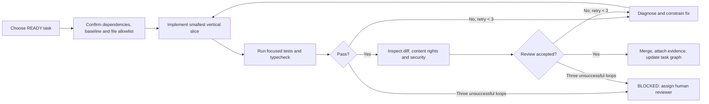
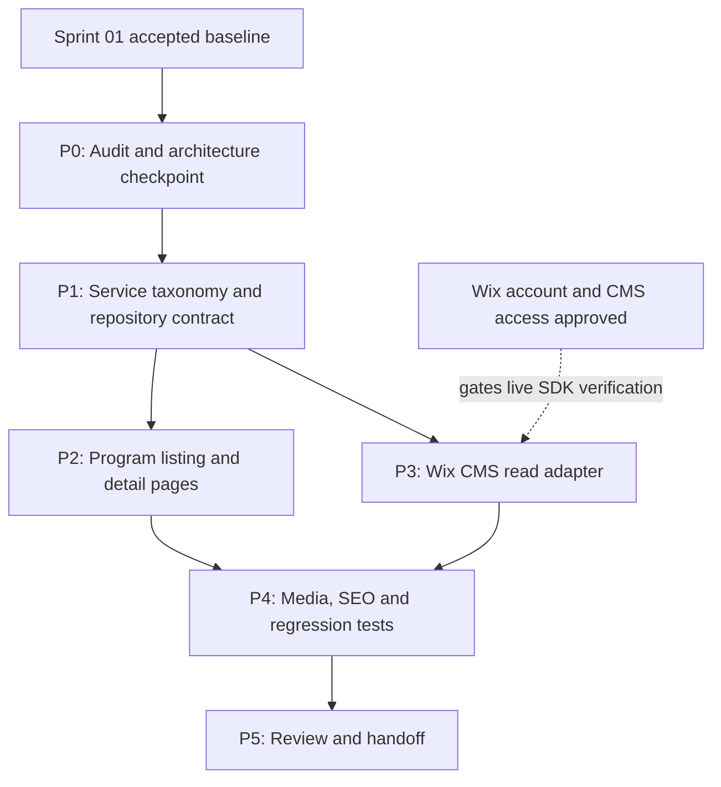
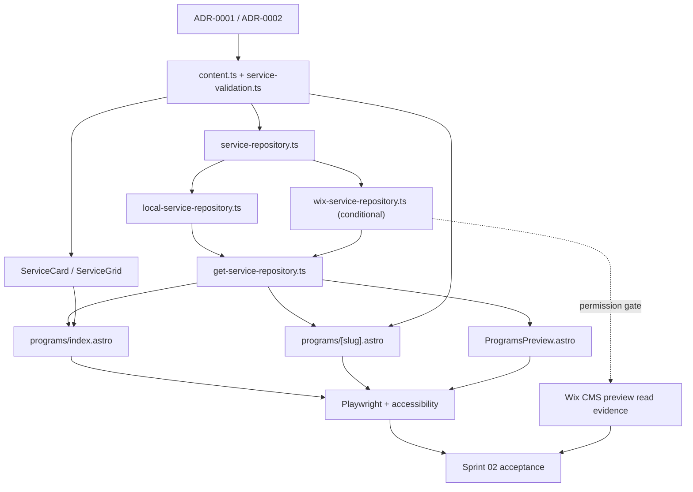

# Sprint 02 — Programs, Services and CMS Read Integration

**Project:** PostBaby Bliss Foundation Digital Platform  
**Delivery model:** One-week sprint divided into six gated engineering phases  
**Method:** Dependency-graph planning + bounded build–test–review loops  
**Working stack:** Astro, TypeScript, Tailwind CSS, Wix JavaScript SDK and Wix CMS where authorized; GitHub Actions, Playwright, and unit tests  
**Primary outcome:** A navigable, accessible **Programs & Services section**, including a public listing and individual detail pages, powered by validated local content and a replaceable **read-only Wix CMS adapter**. All changes remain in a non-production preview until separate release approval.

> **Architecture dependency.** Sprint 02 continues the architecture chosen in `docs/architecture/ADR-0001-delivery-path.md`. The file paths in this plan assume **Option A: a separate Astro frontend being prepared for Wix-managed Headless**. If Sprint 01 selected **Option B: existing Wix Editor/Studio + Velo**, retain the same objectives, content schema, tests and gates, but replace the Astro-specific paths and tasks with an approved Wix CLI/Velo file map **before assigning development tickets**. Do not pretend an Astro page can be deployed into the legacy Wix Editor page tree.
>
> **Non-release rule.** Connecting, provisioning, or editing a Wix business/site is not authorization to replace the Foundation's live website or change its domain. No `wix release`, live CMS permission modification, donation setup, or public cutover is authorized by this sprint plan.

## 1. Sprint context and carry-forward contract

Sprint 01 is expected to have delivered a minimal Astro project, approved frontend architecture, shared layout, a working home page and About page, design tokens, provisional content register, GitHub CI, and baseline browser/accessibility tests. These are **planned predecessor outputs**, not an assertion that implementation is complete.

Before starting Sprint 02, review the **actual repository** and the Sprint 01 review report. Do not create duplicate files merely because this plan predicts a path. Record any differences from the manifest in `docs/engineering/task-graph.md` and `docs/reviews/sprint-02-review.md`.

**Confirmed source material for content planning:** The supplied four-page Foundation website snapshot describes six service categories—mental health support, lactation support, respite care, educational workshops, emergency relief, and resource navigation—and names three activities/programs: Educational Workshops, Mommy Circles, and Paint My Feelings. The same snapshot states "5 Programs" and "250+ Individual Reach," but it does not establish a canonical five-program taxonomy or substantiate those impact figures. **Do not infer additional programs or publish the figures as independently verified.** Obtain the Foundation's current approved service descriptions, availability, contacts, eligibility, service boundaries, and image-use permission before releasing any pages publicly.

### 1.1 Sprint outcomes

1. Publish internally a coherent `/programs` listing with custom, responsive cards and program/service navigation.
2. Implement a reusable `/programs/[slug]` detail-page pattern with a proper not-found state.
3. Create one typed, validated service model and a repository interface capable of using either approved local records or Wix CMS items.
4. Integrate **read-only Wix CMS retrieval in an authorized development/preview environment**, if the Sprint 01 platform decision and access permit; otherwise deliver a contract-tested adapter with an explicit blocking note.
5. Establish editorial approvals, rights-aware image handling, accurate page metadata, and regression tests.
6. Hand off a functioning public-content foundation for later events, donations, volunteer registration and inquiry flows.

### 1.2 What is not in scope

- Payment checkout, donation receipts, fundraising administration or payment-provider onboarding.
- Volunteer submissions, event RSVP workflows, newsletter automation or user accounts.
- Clinical advice, telehealth, patient charts, health questionnaires, family case histories, or storage of sensitive medical information.
- A custom administration dashboard, PostgreSQL, a standalone Node API, Python jobs, C#/.NET, or a new authentication system.
- Unapproved testimonials, invented beneficiary totals, speculative eligibility promises, or mass import of identifiable family photographs.
- Migrating the production domain or deleting/replacing any current Wix Editor pages.

**Delivery principle:** Build a complete, reviewable public-information experience; do not scatter unfinished forms or dashboards across the codebase.

## 2. Work-item conventions and development controls

Planning unit: **`Sprint → Phase → Task → File allowlist → Test evidence → Review → Exit gate`**.  
Task ID: `S02-Pn-Tnn` (e.g., `S02-P2-T03`).  
Task status: `TODO`, `READY`, `IN_PROGRESS`, `BLOCKED`, `IN_REVIEW`, `DONE`.  
File operations: `C` = create; `M` = modify; `G` = generated/owned by CLI; `?` = conditional upon an authorized decision.  
Priority: `P0` = required for the sprint outcome; `P1` = required if a gated dependency is available; `P2` = stretch, never at the expense of tests.  
A file path in a manifest is a **planned operation**, not proof that the file exists. Preserve generated scaffold conventions and document justified path substitutions.

### 2.1 Bounded engineering loop



**Loop execution rules**

- Each task has one objective, one accountable file owner, a bounded allowlist, and visible tests.
- Start with the smallest runnable slice: one typed record → one card → one detail route → one CMS query → all records.
- Do not permit an AI agent to rewrite shared design files, deployment configuration, or CMS permissions merely to fix an unrelated page.
- Run local targeted checks after each change; run the complete suite before every merge.
- Record failed checks, the cause, the corrective change and final evidence in the PR.
- After three failed corrective loops, stop and request human diagnosis; do not create an indefinite agent retry chain.
- Never put private CMS credentials, family data, unpublished records, or identifiable children in prompts, fixtures, test screenshots, issue bodies, or logs.

## 3. Five-day schedule and dependency graph

| Phase | Target window | Objective | Hard dependencies | Exit gate |
|---|---|---|---|---|
| **S02-P0** | Day 1, first half | Review Sprint 01 build and lock the content-delivery approach | Accepted Sprint 01 or agreed exceptions | `G0`: baseline and decisions recorded |
| **S02-P1** | Day 1–2 | Establish approved service taxonomy, types, source contracts and fixtures | P0 | `G1`: valid content and testable repository interface |
| **S02-P2** | Day 2–3 | Build accessible listing/detail UI and navigation | P1; Sprint 01 design system | `G2`: routes and mobile UI demonstrated |
| **S02-P3** | Day 3–4 | Wire a read-only Wix CMS adapter or prove its contract under a recorded blocker | P1; Wix permission gate | `G3`: controlled content-source selection and adapter evidence |
| **S02-P4** | Day 4–5 | Integrate approved media, SEO and quality checks | P2; P3 interface/decision | `G4`: tests, editorial gate and safe preview pass |
| **S02-P5** | Day 5 | Demo, acceptance, backlog and handoff | P4 | `G5`: accepted working increment and Sprint 03 handoff |

### 3.1 Phase dependency graph



**Critical path:** Sprint 01 baseline → P0 → P1 → P2 → P4 → P5. P3 can run in parallel with UI implementation after P1, but live Wix connectivity remains permission-gated. A CMS blocker **must not** prevent completion of the validated local-content listing and details. A blocked CMS test **must not** be reported as a successful live integration.

## 4. Detailed phase implementation plans

### Phase S02-P0 — Validate the predecessor and freeze architectural assumptions

**Objective.** Start from the repository that actually exists, confirm the Wix route, select content URL patterns, and identify facts that may appear on public-facing pages.

**Tasks**

- `S02-P0-T01` (**P0**): Read `docs/reviews/sprint-01-review.md`, `ADR-0001`, previous acceptance results and the GitHub default branch. Check whether both `/` and `/about` pass baseline smoke tests.
- `S02-P0-T02` (**P0**): Compare the current site's approved URL inventory with proposed `/programs` and `/programs/[slug]` paths. Note necessary **future** redirects; do not publish redirects now.
- `S02-P0-T03` (**P0**): Confirm whether the content source is `local` for preview, Wix CMS for authorized preview, or `local` with the Wix adapter deferred. Obtain a technical approver for CMS collection access and schema changes.
- `S02-P0-T04` (**P0**): Request approval for current service names, claims, public contact/CTA destinations, and media. Separate confirmed service categories from aspirational program names and the snapshot's unverified program count.
- `S02-P0-T05` (**P1**): Verify Wix-managed Headless/Astro versus Velo outcome, CMS installation, access privileges and a safe nonproduction environment. **Do not invoke a headless linking command just to attach to the existing site:** some Wix CLI commands provision a new business/site.

**File-operation manifest**

| Op | File path | Responsibility |
|---|---|---|
| M | `docs/architecture/ADR-0001-delivery-path.md` | Confirm accepted path, account restrictions and what remains unresolved |
| C | `docs/architecture/ADR-0002-content-source-and-rendering.md` | Define local/Wix source switching, SSR/static route decision and fallback behavior |
| C | `docs/content/sprint-02-service-inventory.md` | List approved vs pending services, program names, CTAs and source evidence |
| M | `docs/audit/asset-and-content-register.md` | Record permitted photographs, releases, captions and status |
| M | `docs/engineering/task-graph.md` | Add dependencies, owners and authorization nodes for S02 |
| M | `docs/audit/existing-site-inventory.md` | Record currently published URLs to preserve or redirect later |

**Gate `G0`.** A reviewer confirms the working baseline, the selected architecture, the data-source policy, and the difference between **provisional source text** and **approved public copy**. No unapproved content or account changes are permitted.

**Rendering decision.** Record whether `/programs/[slug]` is on-demand rendered or prerendered. For a changing CMS catalogue, prefer on-demand rendering if the selected Wix-supported adapter/runtime permits it. If the architecture is static, use Astro `getStaticPaths()` and explicitly accept that new CMS records may require a rebuild. Never mix the two without a documented route strategy.

### Phase S02-P1 — Model program content and build a testable data boundary

**Objective.** Make the programs section independent of the eventual CMS implementation, with strict input validation, stable slugs, and editorial status handling.

**Tasks**

- `S02-P1-T01` (**P0**): Define a single public-facing `Service` model: stable `slug`, `title`, `summary`, structured approved body text, `category`, `displayOrder`, `publicationStatus`, optional approved media reference, optional SEO metadata, and a safe CTA. Exclude personal/client records.
- `S02-P1-T02` (**P0**): Create **six provisional source records** reflecting the six service categories documented by the Foundation. Each record must carry an editorial/approval flag; do not fill unknown eligibility, scheduling or contact details with guesses.
- `S02-P1-T03` (**P0**): Provide a `ServiceRepository` contract supporting `listPublished()` and `getPublishedBySlug(slug)`; normalize slugs, reject malformed items, reject duplicate slugs, and suppress unpublished content.
- `S02-P1-T04` (**P0**): Implement a local adapter and an explicit source-selection function. Default to the local adapter only in local/approved preview conditions. **Never silently replace a failing production CMS feed with stale fixtures.**
- `S02-P1-T05` (**P0**): Add unit tests for schema parsing, ordering, publication filtering, duplicates, unknown slugs and safe CTA destinations.
- `S02-P1-T06` (**P1**): Produce a proposed Wix CMS field map and publication-permission review before creating any collection. Existing collection IDs and field keys must be inspected, not guessed.

**File-operation manifest**

| Op | File path | Responsibility |
|---|---|---|
| M | `src/types/content.ts` | Define canonical `Service`, `ServiceMedia`, `ServiceCta` types |
| C | `src/lib/content/service-validation.ts` | Slug, publication, field and URL validation |
| C | `src/lib/content/service-repository.ts` | Read-only repository interface and typed results |
| C | `src/lib/content/adapters/local-service-repository.ts` | Local adapter independent of Wix packages |
| C | `src/lib/content/get-service-repository.ts` | Explicit source selection and environment rules |
| C | `src/data/service-fixtures.ts` | Clearly labeled records drawn from supplied material; no invented claims |
| C | `tests/unit/service-validation.test.ts` | Model and publication-status tests |
| C | `tests/unit/local-service-repository.test.ts` | Ordering, by-slug, missing-record and duplicate tests |
| C | `docs/content/cms-field-map.md` | Proposed CMS IDs, types, slug policy, fields and ownership |
| C | `docs/content/programs-editorial-approval.md` | Approved copy, pending claims and reviewer sign-off |
| M | `src/data/provisional-content.ts` | Remove duplication or delegate program content to repository |
| M | `package.json` | Add appropriate unit-test scripts/dependencies, if not present |
| M | `package-lock.json` | Generated dependency lock changes after installation |

**Proposed domain contract (specification, not implementation):**

```ts
export type PublicationStatus = 'draft' | 'approved' | 'published';

export interface Service {
  slug: string;                 // unique, immutable after initial publication without redirect
  title: string;
  summary: string;              // concise, approved public-language description
  body: string[];               // reviewed paragraphs; not untrusted HTML
  category: 'support-service' | 'education' | 'community-program';
  displayOrder: number;
  publicationStatus: PublicationStatus;
  image?: { src: string; alt: string; permissionRef: string };
  cta?: { label: string; href: string };
  seo?: { title: string; description: string };
}

export interface ServiceRepository {
  listPublished(): Promise<Service[]>;
  getPublishedBySlug(slug: string): Promise<Service | null>;
}
```

The real code may represent reviewed body content differently if the approved CMS uses rich text. Do not render arbitrary HTML from CMS fields. The `permissionRef` is an internal asset-approval identifier, **not** a public-facing document or proof that consent has been obtained.

**Gate `G1`.** Unit tests pass; all records are typed; duplicate or unpublished records cannot appear in public query results; content approval is traceable. The repository interface is stable enough for the UI and Wix adapter teams to work in parallel.

### Phase S02-P2 — Implement Programs & Services pages

**Objective.** Build complete, accessible pages using original components and repository-provided data, not copied Wix layouts or a purchased template.

**Tasks**

- `S02-P2-T01` (**P0**): Build a consistent service card displaying approved title, summary, media when authorized, and a descriptive detail-page link.
- `S02-P2-T02` (**P0**): Build the `/programs` listing with a heading, introductory approved copy, semantic card grid, sensible empty state, and links to the six service-category details **only when approved for preview**.
- `S02-P2-T03` (**P0**): Build `/programs/[slug]` to display the approved service description, accessible breadcrumb, relevant CTA and an explicit not-found response for invalid or unpublished slugs.
- `S02-P2-T04` (**P0**): Connect the homepage program preview to the same repository. Expand shared navigation to expose the Programs section without breaking existing Sprint 01 routes.
- `S02-P2-T05` (**P0**): Check responsive behavior at 375 px, 768 px and 1440 px, keyboard traversal, reduced-motion preference, touch targets, readable line length, and screen-reader heading order.
- `S02-P2-T06` (**P2**): Add client-side filtering only if useful content grouping is approved. Do **not** introduce React merely for static cards or add extra JavaScript without a measurable benefit.

**File-operation manifest**

| Op | File path | Responsibility |
|---|---|---|
| C | `src/components/programs/ServiceCard.astro` | Reusable semantic card |
| C | `src/components/programs/ServiceGrid.astro` | Accessible responsive collection layout |
| C | `src/components/programs/ServiceDetail.astro` | Common approved service detail structure |
| C | `src/components/ui/Breadcrumbs.astro` | Contextual navigation with usable link names |
| C | `src/pages/programs/index.astro` | Programs listing route |
| C | `src/pages/programs/[slug].astro` | Dynamic service detail route; route strategy per ADR-0002 |
| C | `src/pages/404.astro` | Friendly general not-found route, if scaffold lacks one |
| M | `src/components/home/ProgramsPreview.astro` | Pull previews from shared repository instead of independent copy |
| M | `src/pages/index.astro` | Pass validated service previews and working destination |
| M | `src/components/layout/SiteHeader.astro` | Add Programs navigation and verify mobile menu |
| M | `src/lib/navigation.ts` | Shared route metadata |
| M | `src/styles/global.css` | Responsive card states, layout spacing and focus styles |
| M | `src/layouts/BaseLayout.astro` | Add per-page metadata pass-through if needed |

**UI acceptance criteria**

1. Listing and detail pages share the same approved content source; no contradictory duplicated page copy.
2. A valid published slug resolves; an invalid, draft, or unknown slug produces a genuine not-found state (including HTTP 404 where the selected runtime supports it).
3. Every detail page has a unique H1, descriptive title and a return path to the listing.
4. A purely informational service never appears to promise medical treatment, urgent-response availability, or guaranteed aid unless approved by the Foundation.
5. At reference widths there is no horizontal overflow caused by application layout.
6. All interactive elements are usable without a pointer and visibly focused.
7. Component styling follows Sprint 01 tokens. Avoid introducing a second unrelated design system.

**Gate `G2`.** A reviewer can navigate homepage → Programs → service detail → Programs, on desktop and mobile, with no dead links or misleading CTAs. No custom backend, payment system, medical form, or member login is necessary.

### Phase S02-P3 — Read-only Wix CMS adapter and content governance

**Objective.** Connect the repository abstraction to Wix CMS in a safe, testable manner while retaining the ability to work offline when site authorization is pending.

**Tasks**

- `S02-P3-T01` (**P1**): Inspect the actual Wix CMS collections and permissions; confirm whether existing content can be mapped. Get explicit site-owner authorization before creating/modifying schema or records.
- `S02-P3-T02` (**P1**): Implement a Wix read adapter using the **currently installed** Wix SDK and its documented Data Items API. Query **public/published content only**; map CMS fields to the canonical `Service` type.
- `S02-P3-T03` (**P1**): Handle API errors, missing media, content permission failures, pagination and SDK version differences without exposing secrets or privileged responses. Avoid elevated calls for ordinary public-content reads.
- `S02-P3-T04` (**P0**): Add a contract test using a mocked CMS transport: prove normalization, unsupported fields, duplicates, zero records, and safe error behavior even if live connectivity is blocked.
- `S02-P3-T05` (**P1**): With explicit permission, test against **nonproduction or appropriately scoped read-only content** and record the collection IDs and observed access behavior.
- `S02-P3-T06` (**P0**): Record content update behavior: when pages reflect CMS changes, what happens on a failed fetch, how preview differs from production, and how edit rights are restricted.

**File-operation manifest**

| Op | File path | Responsibility |
|---|---|---|
| ?/C | `src/lib/content/adapters/wix-service-repository.ts` | Wix SDK implementation of repository contract |
| ?/C | `src/lib/content/map-wix-service.ts` | Normalize CMS item to validated `Service` |
| C | `tests/unit/wix-service-repository.test.ts` | Mocked read-adapter contract and error tests |
| C | `docs/architecture/cms-permissions-review.md` | Collection permissions, least privilege and access approvals |
| C | `docs/quality/sprint-02-cms-integration-evidence.md` | Integration test results or clearly identified blocker |
| M | `src/lib/content/get-service-repository.ts` | Select verified Wix/local source explicitly |
| M | `docs/content/cms-field-map.md` | Record actual collection/field mapping when verified |
| M | `.env.example` | Document safe non-secret source-mode configuration |
| ?/M | `package.json` | Add `@wix/data` only when the Wix adapter is being implemented |
| ?/G | `package-lock.json` | Lock Wix SDK dependencies as installed |
| ?/M | `wix.config.json` | **Only** if Wix CLI requires a generated change after approval; never hand-edit to fake a link |

**Rules for content-source selection**

- `local`: approved development fixtures; permitted for local preview and approved review environments. Fixture mode must be obvious in the preview's engineering documentation.
- `wix`: real Wix CMS read adapter; enabled only after permissions and runtime are verified. Do not bundle privileged credentials into client code.
- **No silent fallback:** If `wix` is configured and the CMS fails, record the failure and render a controlled error/empty-state behavior as agreed in ADR-0002; do not switch to potentially stale local data unnoticed.
- **No elevated reads by default:** Public records should be available through deliberately configured read permissions. Escalate any request to use elevated credentials for content reads to a security/architecture review.
- **No assumed CMS extension:** Wix offers a data-collections extension for certain Astro-based projects, but releasing such an extension can create or modify site collections. Use this only in a separately approved environment and follow generated project conventions.

**Gate `G3`.** The adapter's contract tests pass. If Wix permissions are available, document a successful authorized read from the intended CMS collection. If permissions or hosting remain unresolved, mark **live CMS connectivity `BLOCKED`**, leave the application in explicitly documented fixture mode, and list the missing approval and its owner. Never classify a mocked test as a successful live CMS integration.

### Phase S02-P4 — Media, SEO, accessibility and regression verification

**Objective.** Turn the service pages into a reliable, discoverable and professionally presented public-information section with traceable image rights.

**Tasks**

- `S02-P4-T01` (**P0**): Select only photographs approved for the relevant service pages. For photos involving children or identifiable families, confirm applicable permission, planned usage, source and retention before placing images on pages.
- `S02-P4-T02` (**P0**): Optimize approved images, provide accurate alternative text, maintain aspect ratios, avoid layout shifts, and test lazy-loading behavior. Nonessential placeholder imagery is acceptable only for **internal review** and must be labeled.
- `S02-P4-T03` (**P0**): Add unique page titles and descriptions, sensible canonical URL rules, meaningful heading structure, and social metadata using verified content. Preview domains/routes should be excluded from indexing where the deployment configuration permits.
- `S02-P4-T04` (**P0**): Expand Playwright tests to cover listing, valid/invalid slug, navigation, keyboard focus, responsive grids, image handling and publication filtering. Run automated accessibility tests; verify critical interactions manually.
- `S02-P4-T05` (**P0**): Check for obvious build and runtime failures, broken links, accidental publication of draft services, unauthorized asset usage and leaked configuration.
- `S02-P4-T06` (**P1**): Capture comparable mobile performance measurements in the chosen preview environment; prioritize image size, layout stability and low client-side JavaScript over ornamental animations.

**File-operation manifest**

| Op | File path | Responsibility |
|---|---|---|
| C | `src/components/ui/ServiceImage.astro` | Approved image and accessible fallback handling |
| C | `src/lib/seo/service-metadata.ts` | Per-route title, description, canonical and share metadata |
| C | `tests/e2e/programs.spec.ts` | Listing, valid slug, missing slug and mobile smoke tests |
| C | `tests/e2e/programs-accessibility.spec.ts` | Automated program-route accessibility checks |
| C | `docs/quality/sprint-02-acceptance.md` | Gate checklist, sign-off and defect severity |
| C | `docs/quality/sprint-02-test-evidence.md` | CI runs, viewport evidence and manual review results |
| M | `tests/e2e/home.spec.ts` | Program-preview regression assertions |
| M | `tests/e2e/accessibility.spec.ts` | Shared landmark/navigation regression checks |
| M | `src/components/programs/ServiceCard.astro` | Use approved image component |
| M | `src/components/programs/ServiceDetail.astro` | Media/metadata adjustments based on QA |
| M | `src/pages/programs/[slug].astro` | Meta, canonical and not-found handling |
| M | `src/styles/global.css` | Only QA-driven responsive/accessibility corrections |
| M | `.github/workflows/ci.yml` | Run unit, browser, accessibility and build jobs supported by CI |
| M | `docs/audit/asset-and-content-register.md` | Record which assets were approved and used |
| ?/C | `public/images/programs/README.md` | Approved image naming and provenance policy, if images live here |
| ?/G | `public/images/programs/*` | Approved, optimized images only; exact filenames recorded when known |

**Verification commands** (configure scripts to match the actual project and CI configuration):

```bash
npm ci
npm run check
npm run lint
npm run test:unit
npm run build
npm run test:e2e
```

**QA acceptance thresholds**

- All required commands succeed on the selected supported Node.js runtime; any skipped Wix-only check has a named blocker and is not labeled a pass.
- All six **approved** source-service records can be discovered through the listing/detail interaction; records not approved for public display remain hidden.
- No broken primary CTA, no in-page dead links, no invalid slug rendering the wrong content, and no exposed draft items.
- No critical or serious automated accessibility issues on `/programs` and representative detail pages; perform manual keyboard and screen-reader spot checks.
- No custom-layout horizontal overflow at 375, 768, or 1440 px; reduced motion does not hide essential information.
- Images used in review have recorded rights status; any unapproved photo is excluded from public-ready output.
- Preview behavior and production publish readiness are **separate** approvals.

**Gate `G4`.** CI and targeted browser checks are green, the editorial/asset review is traceable, and an isolated preview is available. Hosting-account failures are transparently recorded. A passing visual review alone is insufficient.

### Phase S02-P5 — Demonstration, acceptance and next-sprint transition

**Objective.** Close with a working software increment, clean evidence, unambiguous blockers, and a dependency-aware Sprint 03 backlog.

**Tasks**

- `S02-P5-T01` (**P0**): Demo mobile and desktop navigation from the homepage through Programs to at least one detail page and back. Demonstrate invalid-slug behavior and unpublished filtering.
- `S02-P5-T02` (**P0**): Show the repository boundary and run one automated test command live. If authorized Wix CMS is connected, demonstrate a controlled CMS content update in **nonproduction** and the resulting preview behavior; otherwise show the mock contract and state the blocker.
- `S02-P5-T03` (**P0**): Review changes with the Foundation's content approver; document unsupported facts, rights limitations, outstanding defects and architecture decisions.
- `S02-P5-T04` (**P0**): Update task-graph status and prepare Sprint 03 candidates: public donations and engagement flows, volunteering/events, or additional content sections according to verified dependencies and stakeholder priority.
- `S02-P5-T05` (**P0**): Merge reviewed branches, record verified startup instructions, and tag the accepted commit `sprint-02-review` (or equivalent) **without triggering a production release**.

**File-operation manifest**

| Op | File path | Responsibility |
|---|---|---|
| C | `docs/reviews/sprint-02-review.md` | Demo, approvals, deviations, defects and final gate results |
| C | `docs/backlog/sprint-03-candidates.md` | Prioritized, dependency-aware next increment |
| M | `docs/engineering/task-graph.md` | Mark actual completion and open dependency edges |
| M | `docs/quality/sprint-02-acceptance.md` | Final gate outcomes and named sign-off |
| M | `docs/quality/sprint-02-cms-integration-evidence.md` | Verified read or blocker and follow-up owner |
| M | `README.md` | Updated project run/test commands and content-source behavior |
| M | `docs/architecture/ADR-0002-content-source-and-rendering.md` | Confirm implemented rendering/source strategy |

**Gate `G5`.** The product owner accepts a usable program-information increment. Any unapproved public content, unverified Wix integration, or unavailable image rights remain explicit exceptions, not implied completion.

---

## 5. File dependency and ownership graph



**Recommended merge ownership:**

| Ownership area | Primary file group | Parallel work allowed after |
|---|---|---|
| Content/schema | `src/types/content.ts`, `src/lib/content/service-*`, `src/data/service-fixtures.ts` | G0 |
| Public UI | `src/components/programs/*`, `src/pages/programs/*`, shared navigation | G1 |
| Wix adapter | `src/lib/content/adapters/wix-*`, `src/lib/content/map-wix-service.ts` | G1 + Wix access decision |
| Quality/SEO | `tests/*`, `src/lib/seo/*`, quality documentation | Page contracts agreed |

**Collision rule:** The UI and CMS branches must not both edit `src/lib/content/get-service-repository.ts` simultaneously. Assign that integration file to a single merge owner. Shared `src/styles/global.css`, `src/types/content.ts`, and `package.json` likewise need explicit edit ownership and early reconciliation.

## 6. Example GitHub task contract

Every development ticket should preserve a machine-readable task contract, using this pattern:

```yaml
task_id: S02-P2-T03
objective: "Render accessible, publication-aware program detail pages"
status: TODO
priority: P0
depends_on:
  - S02-P1-T01
  - S02-P1-T03
  - S02-P2-T01
allowed_files:
  - src/pages/programs/[slug].astro
  - src/components/programs/ServiceDetail.astro
  - src/components/ui/Breadcrumbs.astro
acceptance:
  - "A published slug resolves to its corresponding service"
  - "Missing/draft slugs render a not-found state"
  - "Unique heading/title; usable breadcrumbs and CTA"
  - "375px, 768px and 1440px layouts have no application overflow"
  - "No invented medical, eligibility or funding claims"
verification:
  - "npm run check"
  - "npm run test:e2e"
max_corrective_loops: 3
reviewer: "Assigned senior developer and content reviewer"
evidence: "Pull request, passing CI run, browser screenshots, editorial approval"
```

A task is `READY` only when its hard dependencies are `DONE`. A failed test reopens the affected task and its dependent verification node, not every previously completed phase. If a task expands its allowed files, the owner approves the change in the issue before implementation.

## 7. Content and CMS governance

### 7.1 Initial service taxonomy

The following are **service-category candidates transcribed from the supplied Foundation website snapshot**. Their final titles and descriptions require approval; these are not assertions about current capacity or clinical services.

| Proposed slug | Source-derived category | Editorial caution |
|---|---|---|
| `mental-health-support` | Mental health support | Do not promise counseling/therapy or professional licensure without verification |
| `lactation-support` | Lactation support | Do not imply clinical diagnosis or certified providers without approval |
| `respite-care` | Respite care | Confirm whether childcare is currently offered, licensed or referred externally |
| `educational-workshops` | Educational workshops | Verify actual dates, eligibility and registration before providing event CTAs |
| `emergency-relief` | Emergency relief | Do not imply 24/7 crisis response, guaranteed funds or emergency dispatch |
| `resource-navigation` | Resource navigation | Avoid representing third-party resources as vetted without verification |

**Separate content entities:** `Mommy Circles` and `Paint My Feelings` were also named in the snapshot and may later become dedicated programs, categories or activities. Their placement is a content-governance decision, not a developer assumption. The snapshot's “5 Programs” metric must not drive hard-coded program counts.

### 7.2 Proposed Wix CMS field map

This table is a **design proposal only**. Use existing collections when appropriate and record real IDs/keys only after inspection. No collection changes occur automatically through this planning file.

| Logical field | Suggested CMS type | Validation / usage |
|---|---|---|
| `title` | Text | Required, approved, nonempty |
| `slug` | Text | Required, normalized, unique; redirects required after renaming |
| `summary` | Text | Required concise plain text |
| `body` | Rich content or controlled text | Reviewed; sanitize/transform before rendering, never inject untrusted HTML |
| `category` | Text / choice | One of approved program/service groupings |
| `displayOrder` | Number | Stable card ordering |
| `publicationStatus` | Text / choice | Only approved public status is visible |
| `image` | Media reference | Optional; display only if approval is recorded |
| `imageAlt` | Text | Required for informative image |
| `ctaLabel`, `ctaHref` | Text | Validated destinations; no speculative applications |
| `seoTitle`, `seoDescription` | Text | Reviewed, unique when published |

**Access model:** Foundation content editors should have authorized CMS edit rights; ordinary public visitors should have only the minimum read access required to retrieve approved items. Do not create writable-by-anyone content collections or use elevated application privileges solely to bypass a CMS permission design problem.

### 7.3 Asset and privacy rule

Uploaded images and website snapshots are reference materials, **not automatic permission to republish**. Treat identifiable infant/parent photographs and testimonial names as approval-gated. Use a recorded permission reference and the Foundation's authorized publishing process; do not store consent documents in publicly deployed paths. For this sprint, store **public editorial content only**, not requests for assistance or family case records.

## 8. Definition of Ready and Done

**Definition of Ready — every task**

- [ ] Objective is demonstrable and fits one short pull request.
- [ ] Dependencies are complete or blocker is explicit.
- [ ] File allowlist and primary owner are declared.
- [ ] Relevant content/asset status is recorded.
- [ ] Acceptance tests and reviewer are identified.
- [ ] Any CMS/site modification is separately authorized.

**Definition of Done — every task**

- [ ] Changes stay within approved files or contain a documented exception.
- [ ] Typecheck, formatting/linting, focused tests and relevant browser checks pass.
- [ ] Code does not expose draft content, privileged calls or sensitive information.
- [ ] Responsive and keyboard behaviors are reviewed where applicable.
- [ ] Test evidence and an accountable human review are attached.
- [ ] Dependency graph status is updated.

**Definition of Done — Sprint 02**

- [ ] `G0`–`G5` closed or specifically accepted as blocked with owner and consequences.
- [ ] Homepage links to a complete Programs listing in a preview environment.
- [ ] At least the Foundation-approved services have working detail routes; pending records remain unpublished.
- [ ] Shared typed repository, local adapter and validation tests pass.
- [ ] Wix adapter is verified in authorized preview **or labeled blocked**; mocked results are not represented as live integration.
- [ ] Mobile, navigation, invalid-slug, SEO and accessibility checks pass as defined.
- [ ] Photo rights and content claims are approved for what is shown in the review build.
- [ ] No production site/domain cutover or donations/medical-data collection is performed.
- [ ] Sprint 03 backlog is ready and references the graph dependencies.

## 9. Risks, blockers and escalation owners

| Risk / condition | Mitigation | Decision owner |
|---|---|---|
| Sprint 01 frontend is not actually complete | Repair critical predecessor defects or reduce S02 scope; do not mark nonexistent files as delivered | Technical lead |
| Wix-managed deployment/subscription path not approved | Continue local-only pages and mocked read contract; block live SDK verification | Wix site owner |
| Headless linking provisions a separate Wix business/site | Do not assume it migrates existing production resources; secure explicit approval before provisioning | Site owner / technical lead |
| CMS collection field names and access differ from plan | Inspect current schema; map in adapter; record approved deviations | CMS owner |
| Data Items API changes across versions | Pin package versions, follow installed API docs and preserve contract tests | Integration developer |
| Snapshot lists five programs but names only three program activities | Separate program taxonomy from six service categories; ask Foundation for canonical catalogue | Content approver |
| Public copy overstates service availability or eligibility | Review every CTA; keep provisional services unpublished | Foundation representative |
| Parents/children appear in uploaded photographs | Require authorized publication rights; use approved substitutes or no image | Foundation representative |
| CMS outage masks errors through local fallback | Source selection explicit; fail safely and log non-sensitive diagnostics | Technical lead |
| A missed integration creates delayed page performance | Budget content calls, use appropriate rendering/caching strategy, optimize images, capture baseline | Frontend developer |

## 10. Daily execution rhythm

- **Day 1:** Validate Sprint 01 and architecture; approve service taxonomy and editorial ownership; establish task graph.
- **Day 2:** Finish service model, fixtures and unit tests; start cards and route composition.
- **Day 3:** Complete listing and details; start Wix adapter in parallel when permissioned.
- **Day 4:** Finish adapter contract, images, metadata and automated route tests; demonstrate working paths.
- **Day 5:** Fix defects, run full CI and accessibility review, obtain editorial approval, demo and hand off.

**Capacity assumption:** Approximately two or three contributors with prompt approvals. If only one developer is available, prioritize P0/P1 tasks and preserve the testing/permission gates; reduce optional CMS or visual polish work before reducing verification. Days are relative workdays, not calendar-date promises.

## 11. Handoff to Sprint 03

Sprint 03 candidates should be chosen **after** the Foundation approves programs and service boundaries. Proposed next work includes public donation integration, volunteer opportunities, event/calendar pages, a news/content section and contact/engagement flows. Payment integration requires separate merchant/plan eligibility verification; forms involving health or family case information require their own U.S. privacy and operational review. Do not allow a planned future feature to become an undeclared Sprint 02 dependency.

The expected handoff artifacts are `docs/reviews/sprint-02-review.md`, `docs/backlog/sprint-03-candidates.md`, `docs/quality/sprint-02-acceptance.md`, `docs/quality/sprint-02-test-evidence.md`, and the final merged code/PR record.

## 12. Technical references and source notes

**Project-specific source:** *Postpartum Care Support | PostBaby Bliss Foundation*, supplied four-page PDF of a website snapshot, dated November 12, 2026. Page 1 introduces the Foundation; page 2 describes its service categories and names Educational Workshops, Mommy Circles and Paint My Feelings; page 3 gives brief educational, emergency-relief and resource-navigation descriptions; page 4 displays fundraising information and testimonials. This is **source material for drafting**, not independent confirmation of current program operation, regulatory status or image rights.

**Current technical references (recheck against installed versions before implementation):**

1. Wix Developers — [Choose Your Development Path](https://dev.wix.com/docs/go-headless/get-started/choose-your-development-path): Wix-managed versus self-managed Headless.
2. Wix Developers — [About Wix-Managed Headless](https://dev.wix.com/docs/go-headless/wix-managed-headless/about-wix-managed-headless): managed frontend and migration overview.
3. Wix Developers — [Connect an Existing Astro Project](https://dev.wix.com/docs/go-headless/wix-managed-headless/full-integration-astro/get-started/connect-an-existing-astro-project): linking provisions a Wix business/site; do not treat it as an automatic migration.
4. Wix Developers — [Develop Your Project](https://dev.wix.com/docs/go-headless/wix-managed-headless/develop-your-project): Astro integration, SDK and CLI development.
5. Wix Developers — [Data Items Query API](https://dev.wix.com/docs/sdk/data-items-sdk/data/items/wix-data-query/introduction): current `@wix/data` query patterns; use pinned package docs.
6. Wix Developers — [About the Data API](https://dev.wix.com/docs/develop-websites-sdk/code-your-site/work-with-data/data-api/about-the-data-api): CMS item permissions and eventual consistency.
7. Wix Developers — [Data Collections Extension](https://dev.wix.com/docs/go-headless/wix-managed-headless/full-integration-astro/extensions/backend/data-collections/add-a-data-collections-extension-with-the-wix-cli): why schema changes require release planning and approval.
8. Astro — [Dynamic Routes](https://docs.astro.build/en/guides/routing/): dynamic slugs, prerendered paths and on-demand rendering.
9. W3C — [WCAG 2.2](https://www.w3.org/TR/WCAG22/): accessibility review reference.
10. Wix Developers — [Reserved URL Paths for the Astro Integration](https://dev.wix.com/docs/go-headless/wix-managed-headless/full-integration-astro/development/reserved-url-paths-for-the-astro-integration): confirm custom URLs do not conflict with Wix-managed endpoints.

---

**Sprint 02 release rule:** A successful Sprint 02 proves that the Programs & Services information architecture can be **rendered from a controlled content model, navigated, tested and reviewed**. It does **not** itself authorize live deployment, claim that Wix CMS works without a verified site connection, or certify that health-related services or photos are approved for publication.
