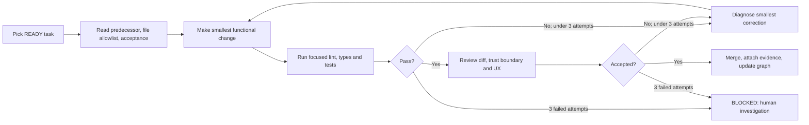
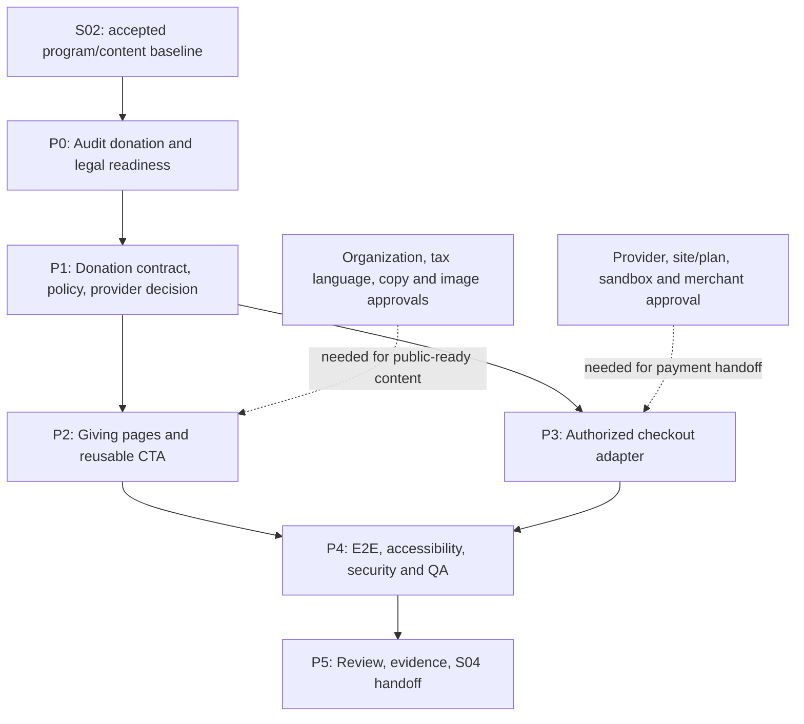
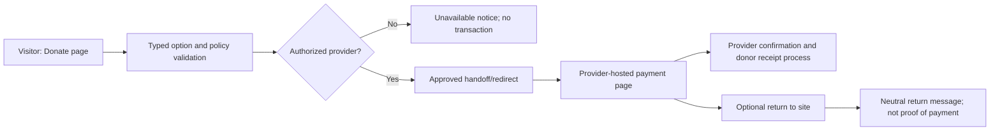
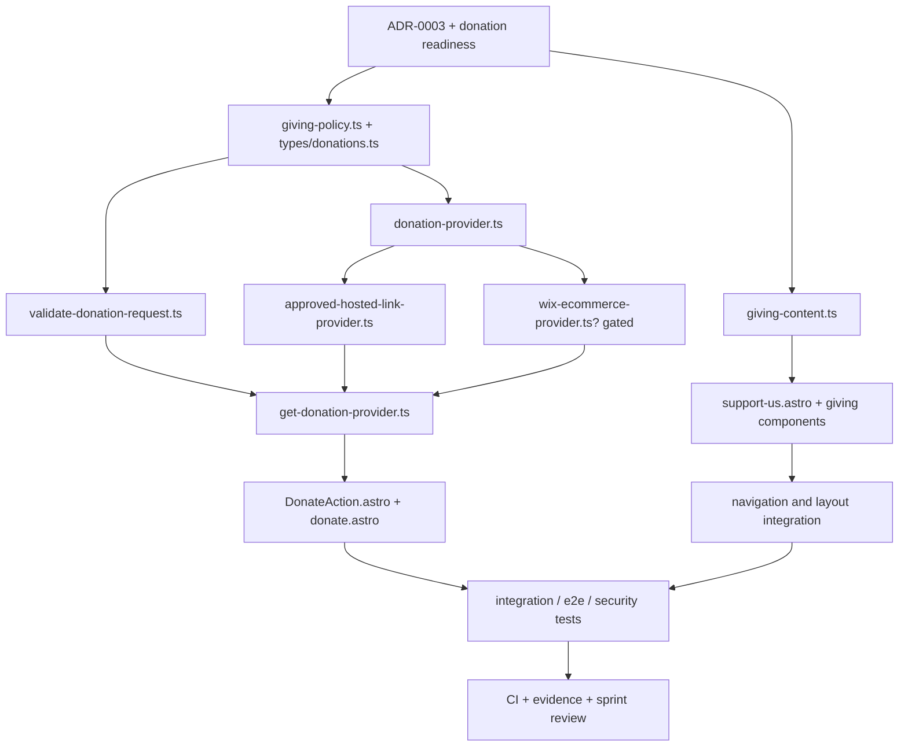

# Sprint 03 — Giving Experience and Secure Donation Handoff

**Project:** PostBaby Bliss Foundation Digital Platform  
**Delivery model:** One-week sprint, six gated execution phases  
**Engineering method:** Dependency-graph scheduling + bounded implementation/test/review loops  
**Baseline stack:** Astro, TypeScript, Tailwind CSS, selective React, Wix JavaScript SDK (when authorized), GitHub Actions, Vitest, Playwright  
**Primary outcome:** A complete, accessible **Support Us / Donate** experience with approved giving content, reusable donation components, provider-independent checkout contracts, a secured handoff to an approved hosted payment flow **when available**, and automated verification. **The existing live Wix website and fundraising configuration remain unchanged.**

> **Critical distinction.** The supplied Foundation website snapshot contains a **Donate** call to action and displays fundraising figures, but does not establish a verified merchant account, an approved public donation URL, present tax status, an active campaign, or permission to move payments onto a new frontend. Those details must be checked with the Foundation. A completed visual flow is not evidence of live payment processing.
>
> **Architecture condition.** The paths below follow the **Astro/Wix-managed Headless candidate** used in Sprints 01–02. Follow the accepted decision in `docs/architecture/ADR-0001-delivery-path.md`. If the actual approved path is Wix Editor/Studio + Velo, transpose the feature contracts, design requirements and tests into a signed-off Wix CLI/Velo file map **before development**. Do not deploy Astro routes inside a classic Wix Editor page tree.
>
> **Production protection.** Nothing in this sprint authorizes domain cutover, production checkout activation, modification of live donation campaigns, real payment tests, payment-provider credential sharing, or publishing unapproved tax-deductibility claims.

---

## 1. Sprint intent and expected increment

The first sprint established the planned shared layout, original visual system, CI and homepage/About foundation. The second sprint planned a typed Programs & Services experience and a read-only CMS data boundary. Sprint 03 turns that public-information foundation into a trustworthy **giving journey**, without prematurely building a donor database or a custom payment processor.

The Foundation's uploaded four-page website snapshot shows a **Support Us** navigation item, **Donate** and **Volunteer** invitations, a stated fundraising goal, and organizational content. These are source references for UX planning, **not verification of current donation totals, IRS recognition, active merchant services, or the right to use particular photos**. Review the actual Sprint 02 repository and its handoff documents before treating any preceding planned file as implemented.

### 1.1 Concrete sprint objectives

1. Create responsive `/support-us` and `/donate` pages using the established design system, with meaningful service-linked giving copy approved by the Foundation.
2. Centralize the donation CTA, destination, campaign content and supported amount/frequency choices in **typed, validated configuration**; never hard-code contradictory donation links throughout the site.
3. Put payment activity behind a **provider interface** with strict validation, approved HTTPS destination rules and an explicit unavailable state.
4. Verify whether the authorized Wix business and plan can use a supported **Wix Donations + eCommerce checkout** flow, or whether an approved third-party hosted donation page is more appropriate.
5. Implement the smallest safe end-to-end donor journey supported by those approvals; prefer **one-time giving first**. Add recurring giving only if the approved provider supports it and the terms/receipts are verified.
6. Deliver tested mobile, accessibility, security, messaging and analytics behavior without storing cardholder data or claiming a transaction succeeded because a visitor returned to the website.
7. Preserve a clear Sprint 04 handoff for volunteering, events, newsletter, news and broader engagement features.

### 1.2 Definition of the working increment

At the sprint review, a stakeholder can open the internal preview, follow **Home → Support Us → Donate**, understand how giving supports the Foundation, use keyboard navigation, and observe a safe provider handoff or an honest **donations currently unavailable** state. If authorized sandbox or hosted checkout access exists, the team additionally demonstrates a provider-approved nonproduction checkout path and captures integration evidence. The demo must not process a real charge without separate explicit authorization.

### 1.3 In scope and out of scope

| In this sprint | Explicitly excluded |
|---|---|
| `/support-us` and `/donate` public-facing pages | Collecting or transmitting raw card numbers, CVV or bank credentials through our app |
| Giving copy, verified tax/donation disclosures and approved images | Custom payment gateway, payment vault or homemade donor ledger |
| Shared giving CTA, simple giving-choice UI, disabled/unavailable state | Payment captures, refunds, reconciliation and donor administration dashboard |
| Provider contract and authorized hosted-checkout redirect | Member accounts, family case files, medical intake or protected health data |
| Checkout eligibility audit and provider sandbox/preview integration | Full volunteer applications, event registration and newsletter automation |
| Unit, integration, accessibility, link-safety and e2e tests | Public fundraising goal/counts unless confirmed current and approved |
| Event logging limited to non-sensitive page/CTA events | Live production activation, domain switch or mandatory real-money testing |

**Timebox priority:** A secure, functional one-time giving handoff is P0 **only once a provider and permissions have been verified**. If provider access is unavailable, the honest unavailable state, complete pages, tested provider contract and documented blocker form the accepted conditional increment. Do not use a fake payment gateway to meet a demo deadline.

---

## 2. Execution contract for loop and graph engineering

**Planning unit:** `Sprint → Phase → Task → dependency node → file allowlist → test command/evidence → reviewer → gate`  
**Task ID:** `S03-Pn-Tnn`, such as `S03-P3-T04`  
**Task status:** `TODO`, `READY`, `IN_PROGRESS`, `BLOCKED`, `IN_REVIEW`, `DONE`  
**File operations:** `C` create; `M` modify; `?` create/modify only if approved path supports it; `G` CLI-generated/managed  
**Priority:** `P0` core deliverable; `P1` authorization-gated integration; `P2` enhancement, never at the expense of correctness.

The file manifests describe **expected operations, not verified repository contents**. Confirm actual paths against Git and the installed Wix CLI/framework scaffold. Keep generated files in their authoritative locations, and record any replacement path in the graph and PR description. Never modify a file outside a task's allowlist without approval.

### 2.1 Bounded build–test–review loop



**Loop rules**

- Complete one vertical slice at a time: **approved text → route → CTA → validated destination → safe redirect → test**.
- Automated checks are necessary but not sufficient: a human must inspect payment-related changes, donor-facing claims, redirects and any permission/credential change.
- Cap corrective loops at **three attempts** before escalating, recording cause and evidence rather than repeatedly rewriting unrelated code.
- Never expose merchant secrets, donor names, transaction identifiers, payment card data or unpublished family records to AI agents, Git issues, fixtures, screenshots or logs.
- A task becomes `READY` only when every **hard** predecessor node is `DONE`. An external approval remains `BLOCKED` until evidence is recorded; it cannot be silently bypassed.
- Split pull requests by feature and file ownership. Never allow two coding agents to edit the same shared configuration simultaneously.

### 2.2 Task graph and critical decisions



**Critical path:** S02 baseline → P0 → P1 → P2 → P4 → P5. P3 is parallel after P1 but is **conditionally gated** by provider approval. If blocked, P4 tests that donation checkout is unavailable rather than pretending that an unverified payment flow works.

---

## 3. Five-day phase schedule

| Phase | Target | Specific phase objective | Required input | Completion gate |
|---|---|---|---|---|
| **S03-P0** | Day 1, first half | Establish factual, legal, provider and migration baseline | S02 review and site-owner input | `G0` — signed donation readiness decision |
| **S03-P1** | Day 1–2 | Define typed giving policy and provider abstraction | G0 | `G1` — tests pass for content and safe destinations |
| **S03-P2** | Day 2–3 | Deliver complete Support Us / Donate pages | G1, existing layout | `G2` — responsive, navigable journey |
| **S03-P3** | Day 3–4 | Implement authorized hosted checkout path or safely block | G1, merchant/access decision | `G3` — verified adapter or explicit blocker |
| **S03-P4** | Day 4–5 | Run accessibility, privacy, integration and regression checks | G2 and G3 disposition | `G4` — reviewable evidence, no critical defects |
| **S03-P5** | Day 5 | Demo, obtain acceptance and write Sprint 04 backlog | G4 | `G5` — sprint decision, code/evidence handoff |

**Concurrency:** P2 frontend owner and P3 integration owner may work in parallel once P1 stabilizes the provider interface. The technical lead owns the interface file; the content approver owns final donor-facing claims. Time estimates presume **2–3 contributors and prompt access decisions**. Reduce optional enhancements, not safety gates, if capacity is lower.

---

## 4. Phase-by-phase development specifications

### Phase S03-P0 — Audit donation readiness and predecessor delivery

**Objective.** Confirm the actual Sprint 02 code state, organizational facts, donation-provider capabilities and supported Wix deployment assumptions before coding the payment-facing feature.

**Tasks**

- `S03-P0-T01` (**P0**): Run the current repo; inspect `docs/reviews/sprint-02-review.md`, `docs/quality/sprint-02-acceptance.md`, `docs/backlog/sprint-03-candidates.md` and the real implemented service routes. Record unresolved issues without reassigning completed work.
- `S03-P0-T02` (**P0**): Verify the Foundation's approved legal name, tax-deductibility wording, authorized donation contact, privacy statement and receipt owner. The site screenshot's “501(c)(3)” label **is not independent verification** of IRS recognition.
- `S03-P0-T03` (**P0**): Inventory current donation destinations, installed Wix Donations/eCommerce capabilities, merchant onboarding state, site currency, supported recurring options and plan entitlements using the **actual account**. Do not assume the older Wix Editor payment setup transfers to a new headless business.
- `S03-P0-T04` (**P0**): Select a donor experience option: **A** approved provider-hosted URL, **B** Wix Donations integrated through Wix eCommerce Cart/Checkout plus supported redirect flow, or **C** temporarily disabled donations. Record costs, constraints, ownership and reason.
- `S03-P0-T05` (**P0**): Obtain editorial approval for giving text, allowable service claims, donor privacy notice, images, CTA labels and any campaign/goal amounts. Default to no live totals until an authoritative source is identified.
- `S03-P0-T06` (**P1**): Document whether U.S. state charitable-solicitation disclosures, external payment-provider terms, and receipt obligations need legal/finance signoff. Do not present this engineering plan as legal advice.

**File-operation manifest**

| Op | Exact repository path | Reason for change |
|---|---|---|
| M | `docs/reviews/sprint-02-review.md` | Link verified predecessor acceptance; preserve review history |
| M | `docs/architecture/ADR-0001-delivery-path.md` | Confirm current Astro/Wix choice and migration limits |
| C | `docs/architecture/ADR-0003-donation-provider-and-checkout.md` | Choose A/B/C, payment trust boundary, alternatives, approvals |
| C | `docs/audit/sprint-03-donation-readiness.md` | Record legal text, tax claims, merchant/plan status, receipt owner |
| C | `docs/content/giving-editorial-approval.md` | Giving narrative, CTA, photos, claims, approvals and exclusions |
| M | `docs/audit/asset-and-content-register.md` | Add images intended for giving pages and their permission status |
| M | `docs/audit/existing-site-inventory.md` | Record original Support Us/Donate URLs and any future redirect need |
| M | `docs/engineering/task-graph.md` | Add S03 nodes, dependencies, external-approval blockers |

**Gate `G0`.** A reviewer signs `ADR-0003` with one supported payment mode and names the payment/finance approver. If merchant integration is unverified, choose **C** for the working preview; do not invent capabilities or authorize real charges.

### Phase S03-P1 — Define validated giving data and checkout contract

**Objective.** Keep business policy, provider selection, donation options and navigation logic outside UI components, in types and functions that can be unit-tested without credentials.

**Tasks**

- `S03-P1-T01` (**P0**): Define `GivingPageContent`, `GivingCampaign`, `DonationOption`, `DonationFrequency`, `DonationCheckoutRequest` and `DonationHandoffResult` types. Distinguish provider-confirmed available features from editorial descriptions.
- `S03-P1-T02` (**P0**): Implement a single giving policy with approved minimum/maximum values **only if provider/finance has defined them**, supported currencies, frequency availability, active/inactive state and CTA destination. Avoid sample amounts on publicly accessible pages unless approved.
- `S03-P1-T03` (**P0**): Implement URL validation: require HTTPS, reject protocols such as `javascript:` and `data:`, reject embedded credentials, require an explicit approved-host allowlist, and block open redirects.
- `S03-P1-T04` (**P0**): Define a `DonationProvider` interface that returns a verified handoff URL or a typed unavailable/error result. Do not expose raw processor objects to UI components.
- `S03-P1-T05` (**P0**): Implement the unavailable provider and approved hosted-link provider. Hosted-link mode may use a fixed, verified donation URL; only allow variable amounts/frequency if the chosen provider documents a safe way to encode them.
- `S03-P1-T06` (**P0**): Test amount/frequency policies, unsupported modes, missing configuration, invalid URLs, allowlist mismatch, disabled campaigns and error handling. No real provider calls in unit tests.

**File-operation manifest**

| Op | Exact repository path | Reason for change |
|---|---|---|
| C | `src/types/donations.ts` | Canonical types and discriminated provider result types |
| C | `src/data/giving-content.ts` | Provisional, editorial-status-aware giving page content |
| C | `src/lib/donations/giving-policy.ts` | Central donation availability, campaigns and choices |
| C | `src/lib/donations/validate-donation-request.ts` | Validate amount/currency/frequency before provider handoff |
| C | `src/lib/donations/validate-checkout-url.ts` | Allowlisted HTTPS redirect validation |
| C | `src/lib/donations/donation-provider.ts` | Provider contract and typed errors |
| C | `src/lib/donations/get-donation-provider.ts` | Explicit provider selection; no silent production fallback |
| C | `src/lib/donations/providers/unavailable-provider.ts` | Safe unavailable behavior for blocked accounts |
| C | `src/lib/donations/providers/approved-hosted-link-provider.ts` | Fixed approved third-party or Wix-hosted URL adapter |
| C | `tests/unit/giving-policy.test.ts` | Policy tests |
| C | `tests/unit/donation-request-validation.test.ts` | Input, unsupported frequency/currency and boundary tests |
| C | `tests/unit/checkout-url-validation.test.ts` | Malicious, off-allowlist and malformed destination tests |
| C | `tests/unit/donation-provider.test.ts` | Provider contract/error tests |
| M | `src/lib/site-config.ts` | Add central giving route and approved public contact (if needed) |

**Illustrative TypeScript contract (not an instruction to store payment details):**

```ts
export type DonationFrequency = 'once' | 'monthly';

export type DonationCheckoutRequest = {
  campaignId: string;
  amountMinor?: number; // only when verified provider supports custom amount
  currency: string;
  frequency: DonationFrequency;
};

export type DonationHandoffResult =
  | { ok: true; redirectUrl: string; provider: 'hosted-link' | 'wix-ecommerce' }
  | { ok: false; code: 'NOT_CONFIGURED' | 'NOT_AVAILABLE' | 'INVALID_REQUEST' | 'PROVIDER_ERROR' };

export interface DonationProvider {
  createHandoff(request: DonationCheckoutRequest): Promise<DonationHandoffResult>;
}
```

`amountMinor` is an integer in the currency's minor units, **not card data**. For a hosted static campaign link, a provider may ignore amount/frequency and use the options on its own hosted checkout; the website must not imply those options were successfully passed.

**Gate `G1`.** The typed contract compiles; local policy/URL/provider tests pass; no payment keys, card fields or unapproved donation totals appear in public configuration.

### Phase S03-P2 — Build the original Support Us and Donate experience

**Objective.** Produce an accessible, responsive giving experience that communicates purpose clearly and respects the organization’s approved public claims.

**Tasks**

- `S03-P2-T01` (**P0**): Build `/support-us` with a concise mission-led hero, approved giving rationale, links to verified service pages, and clearly differentiated **Donate** and **Volunteer** actions. The volunteer action may link to a safe informational placeholder or existing verified destination; do not build application collection here.
- `S03-P2-T02` (**P0**): Build `/donate` with donor-facing explanations, approved giving options, a provider handoff CTA, external-checkout notice, and an accessible unavailable state. Do not fabricate “secure checkout” claims until the destination and provider are verified.
- `S03-P2-T03` (**P0**): Implement reusable `GivingHero`, `GivingImpactNarrative`, `DonationOptions`, `DonateAction` and `GivingFAQ` components; minimize client-side hydration where Astro markup suffices.
- `S03-P2-T04` (**P0**): Update shared navigation and homepage CTA to point to the stable routes. Validate working mobile navigation and `aria`/focus behavior.
- `S03-P2-T05` (**P0**): Include a transparent donor-information message: payment happens at a named approved provider; privacy, processing and receipts are governed by its verified flow. Include current legal copy only when approved.
- `S03-P2-T06` (**P0**): Add SEO title, description, canonical URLs and semantic headings; test the keyboard and screen-reader order at narrow and wide widths.
- `S03-P2-T07` (**P1**): Add approved, optimized imagery with accessible alt text only after rights verification. Do not automatically reuse identifiable parent/child images from the supplied attachments.

**File-operation manifest**

| Op | Exact repository path | Reason for change |
|---|---|---|
| C | `src/pages/support-us.astro` | Giving overview and routes to participation |
| C | `src/pages/donate.astro` | Main donation page and provider state |
| C | `src/components/giving/GivingHero.astro` | Section-level hero |
| C | `src/components/giving/GivingImpactNarrative.astro` | Approved, non-speculative impact narrative |
| C | `src/components/giving/DonationOptions.astro` | Available giving choices and explanatory labels |
| C | `src/components/giving/DonateAction.astro` | Secure handoff or unavailable CTA |
| C | `src/components/giving/GivingFAQ.astro` | Approved donor FAQs and receipt/processing explanations |
| M | `src/components/layout/SiteHeader.astro` | Add Support Us/Donate navigation without duplicating entries |
| M | `src/components/layout/SiteFooter.astro` | Approved giving links and required disclosures |
| M | `src/components/home/Hero.astro` | Harmonize homepage Donate CTA |
| M | `src/pages/index.astro` | Optional giving preview, using existing components |
| M | `src/lib/navigation.ts` | Centralize routes and link labels |
| M | `src/layouts/BaseLayout.astro` | Shared metadata/landmarks only if necessary |
| M | `src/styles/global.css` | Minimal giving-specific tokens/utilities; avoid redefining shared system |
| C | `src/lib/seo/giving-metadata.ts` | Controlled page title, description and canonical metadata |
| C | `public/images/giving/README.md` | Asset permissions, optimization sizes and descriptive filenames |
| C? | `public/images/giving/approved-hero.webp` | Create only from an approved source and verified permission |

**UX acceptance expectations**

- At 375 px, 768 px and 1440 px, `/support-us` and `/donate` have no layout-induced horizontal scroll and all CTAs remain reachable.
- Users can distinguish “learn about the mission,” “volunteer” and “donate”; no misleading urgency, countdown or invented fundraising outcome is present.
- At least one clear Donate CTA exists from Home and Support Us; no duplicate/conflicting payment destination appears in header/footer.
- If payment configuration is absent, the page clearly says online donations are not yet available and presents an approved alternate contact only when authorized.
- Users can tab through links, options and actions with visible focus; reduced-motion preferences are respected.

**Gate `G2`.** Pages are complete and reviewable with stable routes, approved or clearly marked preview-only content, accessible navigation and correct provider-state rendering.

### Phase S03-P3 — Integrate a verified hosted-checkout flow, if authorized

**Objective.** Provide a narrowly scoped payment handoff without collecting cardholder information in the PostBaby Bliss frontend.

**Integration options**

- **Mode A — Approved hosted donation link.** Link to a verified HTTPS donation page owned or authorized by the Foundation and the selected provider. Validate and allowlist the destination. This is the shortest path when account and donation URL are already live. Do not assume query-string customization of amounts or recurring plans.
- **Mode B — Wix Donations + Wix eCommerce.** Use the Wix Donations campaign API only for **campaign data**; to accept payments, integrate the supported Wix eCommerce Cart/Checkout APIs and, where appropriate, the Wix-hosted checkout redirect flow. Verify that the actual Wix-managed Headless project, installed apps, permissions, site currency, campaign IDs and required checkout redirects support the path. Wix documentation specifically notes that campaign APIs **do not themselves process payments**.
- **Mode C — No approved provider yet.** Render an honest disabled state. Complete provider-contract tests and record the activation blocker. Do **not** simulate success or redirect to an unknown payment domain.

**Tasks**

- `S03-P3-T01` (**P0**): Confirm selected mode and record its approved domain, owner, available currency, frequencies, content/receipt behavior, sandbox or test method, and post-payment navigation. Use `ADR-0003` as the authority.
- `S03-P3-T02` (**P0**): Bind `DonateAction` to the selected provider contract. Ensure no payment parameters are directly concatenated into an untrusted URL and no external URL is accepted from a visitor or arbitrary query string.
- `S03-P3-T03` (**P1; gated**): For Mode B, implement a Wix adapter only after consulting the installed SDK/API version and account-specific capabilities. Keep eCommerce calls on the supported trust boundary; no privileged API call from unauthenticated client code.
- `S03-P3-T04` (**P1; gated**): If the approved provider supports sandbox/preview, verify one-time donation initiation, cancellation/back navigation and provider errors in that environment. Recurring flow remains deferred until explicitly supported.
- `S03-P3-T05` (**P0**): Create a non-transactional `/donation-return` page that states that **the payment provider determines transaction status**; returning to the site is not proof of success. Do not display “Donation successful” unless a future independently verified payment confirmation feature is approved.
- `S03-P3-T06` (**P0**): Ensure error paths are humane and non-disclosing: provider unavailable, checkout timeout, invalid campaign, cancelled checkout, blocked redirect or disabled giving. Log only non-sensitive technical status.
- `S03-P3-T07` (**P0**): Document donor receipt/acknowledgment responsibility and finance verification; do not generate tax receipts from unverified frontend return parameters.

**File-operation manifest**

| Op | Exact repository path | Reason for change |
|---|---|---|
| M | `src/components/giving/DonateAction.astro` | Use approved provider result and accessible failure state |
| M | `src/lib/donations/get-donation-provider.ts` | Select only an explicitly configured provider |
| M | `src/lib/donations/providers/approved-hosted-link-provider.ts` | Apply verified destination/contract |
| C? | `src/lib/donations/providers/wix-ecommerce-provider.ts` | Gated Wix donation-to-checkout integration |
| C? | `src/pages/api/donations/handoff.ts` | Gated server endpoint if an approved runtime requires it; never expose secrets |
| C | `src/pages/donation-return.astro` | Neutral return page, not a payment-success assertion |
| C | `src/lib/donations/donation-errors.ts` | Standardized safe user-facing errors |
| C | `tests/integration/donation-handoff.test.ts` | Hosted URL/SDK adapter contract with mocks |
| C | `docs/quality/sprint-03-checkout-integration-evidence.md` | Account mode, staging proof, redirects and receipt responsibility |
| M | `docs/audit/sprint-03-donation-readiness.md` | Record verified merchant/plan findings and remaining blockers |
| M | `docs/architecture/ADR-0003-donation-provider-and-checkout.md` | Final decision, source links, approval and exception notes |

**Payment trust boundary**



**Gate `G3`.** The appropriate scenario is **explicitly recorded**: (A) approved hosted link tested, (B) authorized Wix sandbox integration demonstrated with evidence, or (C) integration blocked and safe unavailable behavior tested. **No live money movement is required or permitted for acceptance.**

### Phase S03-P4 — Test security, accessibility and payment handoff

**Objective.** Prove that the giving journey is stable, accessible and safe, and that provider errors never lead to false payment claims.

**Tasks**

- `S03-P4-T01` (**P0**): Add Playwright route, focus, navigation and narrow-screen tests for `/support-us`, `/donate`, `/donation-return`, header/footer/home CTAs.
- `S03-P4-T02` (**P0**): Run accessibility checks aligned to WCAG 2.2 AA: form/choice labeling, keyboard operation, focus indicators, contrast, reduced motion, error text and headings. Record manual checks as well as automated results.
- `S03-P4-T03` (**P0**): Test redirect allowlist against off-domain URLs, HTTP downgrade, encoded redirects, `javascript:`/`data:` schemes, protocol-relative URLs, malformed URL components and user-controlled redirect parameters.
- `S03-P4-T04` (**P0**): Confirm the repo contains no raw card data fields, secrets, merchant credentials, unapproved donor identifiers, health data or transaction details in logs/tests.
- `S03-P4-T05` (**P0**): Verify receipt/acknowledgment text does not assert deductibility or payment completion without proof. Confirm donated amount/frequency display matches only the provider's actual documented behavior.
- `S03-P4-T06` (**P0**): Run end-to-end disabled-mode and provider-error cases, plus the authorized nonproduction positive handoff when available; verify graceful degradation.
- `S03-P4-T07` (**P0**): Run regression tests for homepage, About, Programs list/detail, SEO, navigation and CI; capture screenshot/browser evidence and document failures.
- `S03-P4-T08` (**P1**): Review third-party scripts and checkout redirection with the payment provider/merchant owner; assess PCI applicability. A hosted page **reduces** direct card-data handling but does not by itself establish PCI compliance.

**File-operation manifest**

| Op | Exact repository path | Reason for change |
|---|---|---|
| C | `tests/e2e/support-us.spec.ts` | Giving overview and primary CTA path |
| C | `tests/e2e/donate.spec.ts` | Donation page behavior and unavailable/allowed modes |
| C | `tests/e2e/donation-navigation.spec.ts` | Homepage/header/footer routes, focus and link destinations |
| C | `tests/e2e/donation-accessibility.spec.ts` | Accessibility and narrow-screen checks |
| C | `tests/e2e/donation-return.spec.ts` | Neutral state and no false success assertion |
| C | `tests/integration/donation-redirect-security.test.ts` | Forbidden schemes/hosts and redirect test suite |
| M | `.github/workflows/ci.yml` | Include new tests and keep prior gates intact |
| M | `package.json` | Add scripts only if not already available |
| C | `docs/quality/sprint-03-acceptance.md` | G0–G5 signoff checklist |
| C | `docs/quality/sprint-03-test-evidence.md` | CI, viewport, keyboard, security and QA evidence |
| M | `docs/quality/sprint-03-checkout-integration-evidence.md` | Final tested payment mode / conditional blocker |
| M | `docs/engineering/task-graph.md` | Task statuses, edges and evidence links |

**Minimum required commands** (use the exact script names implemented in the repository):

```bash
npm ci
npm run check
npm run lint
npm run test
npm run build
npm run test:e2e
```

Do not add scripts with dummy success output to satisfy this list. If the predecessor uses `test:unit` or `typecheck` rather than `test`/`check`, record and use the actual command; CI must run equivalent gates. Hosted checkout tests use mocks or the provider's sanctioned sandbox, not personal payment cards.

**Gate `G4`.** All core commands pass; there are **zero known critical/serious accessibility issues on the new routes**, no unresolved open-redirect or payment-data findings, and clear evidence for either the tested provider handoff or the intentional unavailable state. No production release is implied.

### Phase S03-P5 — Review, accept and hand off

**Objective.** Finish one demonstrable increment, preserve unresolved account decisions and seed the next sprint with dependency-ready tasks rather than loose aspirations.

**Tasks**

- `S03-P5-T01` (**P0**): Demonstrate Home → Support Us → Donate → approved redirect (or unavailable state) → neutral return state as applicable, including keyboard/mobile review.
- `S03-P5-T02` (**P0**): Obtain separate design/content and technical review of claims, donation URLs, donor notices, payment mode, source code and test evidence.
- `S03-P5-T03` (**P0**): Compare actual changed files against ticket allowlists, merge accepted PRs and record deviations from this plan.
- `S03-P5-T04` (**P0**): Record what is genuinely functional versus blocked: donation URL verification, sandbox availability, recurring giving, receipt/acknowledgment ownership and live release approvals.
- `S03-P5-T05` (**P0**): Create a prioritized Sprint 04 candidate backlog for **Volunteer and Events** (plus editorial/news work if capacity permits); preserve unfinished donation activation as a separately owned blocker, not as an invisible dependency.

**File-operation manifest**

| Op | Exact repository path | Reason for change |
|---|---|---|
| C | `docs/reviews/sprint-03-review.md` | Demo, actual output, approvals, blockers, decisions |
| C | `docs/backlog/sprint-04-candidates.md` | Sequenced next features and prerequisites |
| M | `docs/quality/sprint-03-acceptance.md` | Final pass/fail and conditional acceptance |
| M | `docs/quality/sprint-03-test-evidence.md` | CI URLs, manual testing and screenshots |
| M | `docs/engineering/task-graph.md` | Close DONE nodes, carry BLOCKED nodes forward |
| M | `docs/architecture/ADR-0003-donation-provider-and-checkout.md` | Record accepted integration mode and deferred activation |
| M | `README.md` | Verified setup, preview commands and donation feature limitations |

**Gate `G5`.** The increment is accepted against real evidence. Remaining merchant/provider restrictions have an explicit owner and next action. The live Wix site, domain and existing donor handling stay untouched pending a separate, authorized release plan.

---

## 5. File-level dependency and ownership graph



### 5.1 Change ownership and merge order

| Owner/role | Primary files | Merge rule |
|---|---|---|
| Technical lead | `docs/architecture/ADR-0003-*`, `src/types/donations.ts`, `src/lib/donations/donation-provider.ts` | Contract and policy approved **before** provider/UI branches merge |
| Frontend developer | `src/pages/support-us.astro`, `src/pages/donate.astro`, `src/components/giving/*` | Cannot change provider trust boundary without lead approval |
| Integrations developer | `src/lib/donations/providers/*`, optional handoff endpoint | May proceed only after account permission and approved destination verification |
| QA developer | `tests/unit/*`, `tests/integration/*`, `tests/e2e/*`, evidence docs | May add tests in parallel; changes to acceptance rules require lead approval |
| Foundation content/finance approver | `docs/content/giving-editorial-approval.md`, `docs/audit/sprint-03-donation-readiness.md` | Approves donor-facing claims, receipt instructions, tax text and active payment destination |

**Ordering rule:** Core types and URL validation must merge before checkout adapters. Provider adapters must not modify UI to conceal errors. CI and tests are not postponed until a final large merge.

### 5.2 Repository file map (expected new paths)

```text
src/
  pages/
    support-us.astro
    donate.astro
    donation-return.astro
    api/donations/handoff.ts              # conditional; only if approved
  components/giving/
    GivingHero.astro
    GivingImpactNarrative.astro
    DonationOptions.astro
    DonateAction.astro
    GivingFAQ.astro
  types/donations.ts
  data/giving-content.ts
  lib/
    donations/
      giving-policy.ts
      validate-donation-request.ts
      validate-checkout-url.ts
      donation-provider.ts
      donation-errors.ts
      get-donation-provider.ts
      providers/
        unavailable-provider.ts
        approved-hosted-link-provider.ts
        wix-ecommerce-provider.ts        # conditional; only if approved
    seo/giving-metadata.ts
public/images/giving/
  README.md
  approved-hero.webp                     # conditional; only with image approval
tests/
  unit/
    giving-policy.test.ts
    donation-request-validation.test.ts
    checkout-url-validation.test.ts
    donation-provider.test.ts
  integration/
    donation-handoff.test.ts
    donation-redirect-security.test.ts
  e2e/
    support-us.spec.ts
    donate.spec.ts
    donation-navigation.spec.ts
    donation-accessibility.spec.ts
    donation-return.spec.ts
docs/
  architecture/ADR-0003-donation-provider-and-checkout.md
  audit/sprint-03-donation-readiness.md
  content/giving-editorial-approval.md
  quality/
    sprint-03-acceptance.md
    sprint-03-test-evidence.md
    sprint-03-checkout-integration-evidence.md
  reviews/sprint-03-review.md
  backlog/sprint-04-candidates.md
```

This map is intentionally specific for GitHub tasking, but does not override framework/SDK-generated paths or imply that optional files should be created without approvals. The exact directory structure may be amended by a reviewed ADR, not by an individual coding agent ad hoc.

---

## 6. GitHub issue / AI-agent task template

Use one issue per narrowly scoped, reviewable change. Include its dependency nodes and file allowlist in the issue body. Example:

```yaml
task_id: S03-P1-T03
title: "Validate authorized donation checkout destinations"
status: TODO
priority: P0
depends_on:
  - S03-P0-T04
  - S03-P1-T01
allowed_files:
  - src/lib/donations/validate-checkout-url.ts
  - tests/unit/checkout-url-validation.test.ts
objective: >
  Prevent redirects to unapproved payment hosts and unsafe URI schemes.
acceptance:
  - "HTTPS and explicit approved host required"
  - "Reject off-allowlist, javascript:, data:, protocol-relative, and malformed URLs"
  - "Reject user-controlled redirect URLs and embedded URL credentials"
  - "Document expected handling of paths and subdomains"
verification:
  - "npm run check"
  - "npm run test -- checkout-url-validation"
max_corrective_loops: 3
reviewer: "Technical lead"
evidence: "PR URL, test output and signed redirect allowlist"
```

**Merge evidence format:** `Task ID | prerequisite status | allowed files changed | checks run | accessibility/security notes | reviewer | PR/CI link | decision`.

**Graph maintenance:** Store both node status and edges in `docs/engineering/task-graph.md`. A single task may reopen on failure, along with only its dependent tests/reviews. Do not restart the entire sprint because one provider decision remains blocked.

---

## 7. UX and content governance

### 7.1 Page content hierarchy

**Support Us** should explain why postpartum community support matters, briefly link to the Foundation’s verified programs, present donor and volunteer options as distinct actions, and display only approved images/testimonials. Avoid speculative “every dollar provides X” assertions unless finance can substantiate those amounts.

**Donate** should clearly identify the recipient organization, explain the donation method and provider, state whether one-time or recurring giving is available, show any verified payment disclosures, link to privacy/terms where applicable, and make cancellation/return behavior understandable. Do not publish historical snapshot numbers as current campaign progress.

**Donation return** should not say that funds were received based solely on a URL query parameter or browser redirect. A donor may cancel, fail, or leave payment pending after returning. Payment success and receipt delivery are provider/finance-controlled unless a future verified webhook/transaction-status design is separately approved.

### 7.2 Safeguards for a U.S. nonprofit

- **Tax representations:** Confirm legal status and approved claims before describing donations as tax-deductible. IRS rules for donor acknowledgments include particular information for contributions of $250 or more; responsibility for compliant acknowledgments must be defined with Foundation finance/legal personnel.
- **Charitable solicitation:** Ask the Foundation to confirm whether additional state-specific registration or disclosure obligations apply to its solicitation footprint. This plan does not claim that a single federal registration resolves every state rule.
- **Privacy:** Do not ask donors about postpartum health, beneficiaries' case histories or children's details as part of the donation checkout. Minimize analytics and never put donor identifiers into public logs or marketing events.
- **Payments:** Prefer hosted payment collection by a validated provider; never implement homegrown card fields. Hosted checkout does not automatically mean the surrounding site meets every PCI obligation; the payment provider/merchant owner must assess applicability.
- **Accessibility:** Target WCAG 2.2 AA, with keyboard paths, clear error recovery, accessible labels, visible focus, adequate contrast and mobile usability.
- **Truthful metrics:** The uploaded screenshot's fundraising goal and amount raised are historical page content, not a trusted live feed. No publicly displayed counters without a verified source and update policy.

### 7.3 Non-sensitive analytics acceptance

If a consent-appropriate analytics mechanism is already approved, record only aggregate events such as `giving_page_viewed`, `donate_cta_clicked` and `checkout_handoff_attempted`, without names, email addresses, donation amounts, payment status or beneficiary information. Treat this as **P2** if consent configuration or Wix analytics integration remains unresolved; it must not block primary UX and security completion.

---

## 8. Acceptance criteria and readiness checks

### 8.1 Definition of Ready for a phase/task

- [ ] Actual Sprint 02 code and review evidence inspected.
- [ ] Task has a specific objective, owner, due window and prerequisite nodes.
- [ ] The proposed file path and operation are checked against the real repo.
- [ ] Payment-provider permission or a safe unavailable-state decision is recorded.
- [ ] Donor-facing copy/image rights are approved or clearly segregated as preview-only.
- [ ] Test evidence and reviewer are identified before code starts.

### 8.2 Definition of Done for every task

- [ ] Code touches only the approved file allowlist, or a documented exception is signed.
- [ ] Local focused tests, typecheck, lint and applicable accessibility checks pass.
- [ ] Security/privacy implications and new third-party dependencies have been reviewed.
- [ ] No secrets, cards, donor data or private family records are in Git, prompts, logs or fixtures.
- [ ] Human reviewer accepts the change and evidence is linked in task graph.
- [ ] Failing tasks or unresolved account checks are marked `BLOCKED`, not `DONE`.

### 8.3 Sprint 03 exit checklist

- [ ] `G0`–`G5` are accepted, with conditional gates honestly documented.
- [ ] `/support-us`, `/donate`, and `/donation-return` render and navigate at 375/768/1440 px.
- [ ] Donor pages contain only Foundation-approved claims, links and imagery.
- [ ] A single validated provider configuration drives payment CTA destinations.
- [ ] Unsafe URLs/open redirects are rejected by automated tests.
- [ ] No cardholder data is collected or stored in project code.
- [ ] A verified provider path works in sanctioned preview/sandbox **or** a tested unavailable state and named blocker are delivered.
- [ ] No donor-facing statement treats a redirect back to the site as confirmed payment.
- [ ] Sprints 01–02 route regression and CI checks still pass.
- [ ] Actual files and decisions are recorded in `docs/reviews/sprint-03-review.md`.
- [ ] Sprint 04 backlog is prioritized and ready for independent issue creation.
- [ ] Existing production Wix pages, domain and live donations remain unchanged.

**Failure condition:** Any unapproved live payment link, fabricated payment success, exposed financial credential, open redirect, or unverified tax-deductibility claim prevents acceptance even if the UI is visually finished.

---

## 9. Risks, mitigations and escalation

| Risk / dependency | Mitigation | Escalation owner |
|---|---|---|
| Current Wix plan and the proposed headless business may differ | Validate account, site ownership, donation app and plan before integration; preserve current site | Wix site owner / technical lead |
| Donation campaign exists but cannot process payments directly | Treat Wix Donations as campaign metadata; use supported eCommerce checkout or approved hosted link | Integrations lead |
| Live payment destination is missing or unverified | Render explicitly unavailable state; do not substitute a guessed URL | Foundation finance approver |
| Recurring donations unsupported by the selected provider | Show one-time option only; defer subscription management | Finance / integrator |
| Receipt wording or IRS status is not approved | Remove deductibility claims; obtain approved text and finance responsibility | Foundation finance/legal |
| Website visitor return is mistaken for completed payment | Neutral return state; provider confirmation is authoritative | Technical lead |
| Unapproved photographs show parents and children | Omit them pending rights/consent review | Foundation content approver |
| Provider account may have extra fees or payout delays | Record account-specific pricing/settlement obligations in ADR before activation | Finance owner |
| Overly complex custom checkout delays launch | Prefer fully hosted provider link with a single verified CTA | Product/technical lead |
| Premature release disrupts current donations | No domain cutover, no publishing over existing Wix site in this sprint | Site owner |

---

## 10. Daily build-first operating rhythm

**Day 1:** Inspect Sprint 02 acceptance, verify organization/payment details, sign `ADR-0003`, and create the giving content approval file. Begin types and policies after the account decision.

**Day 2:** Finish donation types, URL/policy/provider tests and foundation components. Demonstrate at least one functional Support Us → Donate route before day's end.

**Day 3:** Complete UI and layout integration; integration developer implements the approved hosted-link path or begins verified Wix sandbox adapter. Run mobile and keyboard smoke checks as PRs merge.

**Day 4:** Complete provider error/unavailable behavior and neutral return route. Run integration tests, unit tests, browser E2E, security cases and regression checks.

**Day 5:** Resolve blocking defects, collect content/technical review, demonstrate the full journey, record the exact checkout-mode status, and hand off Sprint 04 tasks.

**Daily stand-up:** 10–15 minutes focused on READY nodes, blocked approvals, PR queue and failing checks. Keep planning and documentation proportional to the code delivered. Conduct a mid-sprint clickable demo on Day 3 and a final acceptance review on Day 5.

---

## 11. Sprint 04 handoff contract

Recommended next bounded increment: **Volunteer Opportunities and Events**. Possible work includes public volunteer roles, informational registration routes, workshop/event listings and accessible RSVP or interest forms after the Foundation approves data collection. Editorial news/testimonial galleries may follow, subject to content and image rights. Sensitive family-assistance intake, internal application tracking and medical information require a separate privacy/data-handling architecture; they should not be smuggled into a public volunteer form.

Handoff artifacts:

- `docs/reviews/sprint-03-review.md`
- `docs/quality/sprint-03-acceptance.md`
- `docs/quality/sprint-03-test-evidence.md`
- `docs/quality/sprint-03-checkout-integration-evidence.md`
- `docs/backlog/sprint-04-candidates.md`
- `docs/architecture/ADR-0003-donation-provider-and-checkout.md`
- Merge and CI references in `docs/engineering/task-graph.md`

**Backlog rule:** Each Sprint 04 candidate includes its objective, user-facing result, predecessor ID, file path expectation, approval dependency, tests and estimate. Do not call a future sprint task `READY` while its approval dependency is unresolved.

---

## 12. Source notes and implementation references

**Foundation-specific source:** *Postpartum Care Support | PostBaby Bliss Foundation*, supplied four-page PDF snapshot dated November 12, 2026. Page 1 summarizes the Foundation's mission, page 2 lists postpartum support services, page 3 identifies resource/emergency/workshop descriptions and a Support Us navigation option, and page 4 shows Donate/Volunteer controls, a fundraising progress display and testimonials. These materials inform page hierarchy and provisional copy; they do not independently verify current transactions, charitable registration, image rights or approved donation mechanisms.

**Technical, compliance and testing references** (recheck installed SDK versions and account-specific policy before implementation):

1. Wix Developers — [Donation Campaigns API: Introduction](https://dev.wix.com/docs/api-reference/business-solutions/donations/donation-campaigns/introduction). Campaign records do not process payments; eCommerce Cart/Checkout handles payment acceptance.
2. Wix Developers — [Donation Campaigns: Sample Flows](https://dev.wix.com/docs/api-reference/business-solutions/donations/donation-campaigns/sample-flows?apiView=SDK). Documents campaign behavior, one-time/recurring support and eCommerce integration options.
3. Wix Developers — [Redirect to Wix-hosted Pages Using the JS SDK](https://dev.wix.com/docs/go-headless/business-solutions/wix-hosted-pages/redirect-using-the-js-sdk). Relevant when verified Wix checkout is selected.
4. Wix Developers — [Headless Redirects: Sample Flows](https://dev.wix.com/docs/api-reference/business-management/headless/redirects/sample-flows?apiView=SDK). Checkout ID, allowed return domain and provider redirect flow.
5. Wix Developers — [About the Astro Integration](https://dev.wix.com/docs/go-headless/wix-managed-headless/full-integration-astro/about-the-astro-integration). Authentication/permissions and supported Wix-managed Astro facilities.
6. Wix Developers — [Connect an Existing Astro Project](https://dev.wix.com/docs/go-headless/wix-managed-headless/full-integration-astro/get-started/connect-an-existing-astro-project). Headless linking can provision a distinct Wix business/site; do not assume existing site migration.
7. IRS — [Charitable Organizations: Substantiation and Disclosure Requirements](https://www.irs.gov/charities-non-profits/charitable-organizations/charitable-organizations-substantiation-and-disclosure-requirements). Required donor substantiation and certain disclosures.
8. IRS — [Charitable Contributions: Written Acknowledgments](https://www.irs.gov/charities-non-profits/charitable-organizations/charitable-contributions-written-acknowledgments). Elements of donor acknowledgments.
9. PCI Security Standards Council — [FAQ: SAQ A and iframe/hosted payment pages](https://www.pcisecuritystandards.org/faqs/1438/). PCI boundaries for hosted payment collection; hosted processing does not eliminate all merchant responsibilities.
10. PCI Security Standards Council — [FAQ: SAQ A script eligibility](https://www.pcisecuritystandards.org/faqs/1588/). Distinguishes redirect and embedded-payment risks.
11. W3C — [Web Content Accessibility Guidelines (WCAG) 2.2](https://www.w3.org/TR/WCAG22/). Accessibility benchmark.
12. Astro — [Testing Guide](https://docs.astro.build/en/guides/testing/). Vitest and Playwright setup patterns.

---

**Sprint 03 release rule:** A completed sprint delivers a **professional, tested giving experience and an honest, security-reviewed checkout integration state**. A live donation channel is launched **only** after the Foundation's site/finance owners approve the real provider, legal language, settlement and receipts, domain transition and production tests. This document is an implementation plan, not evidence that those approvals already exist.
