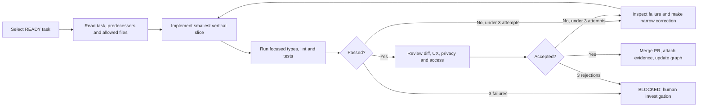
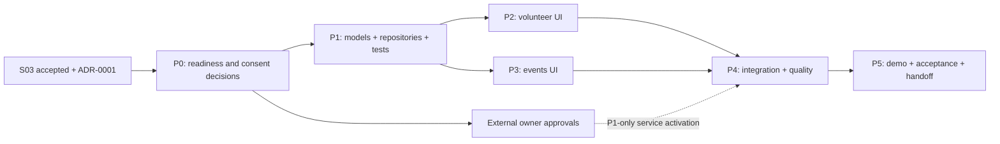
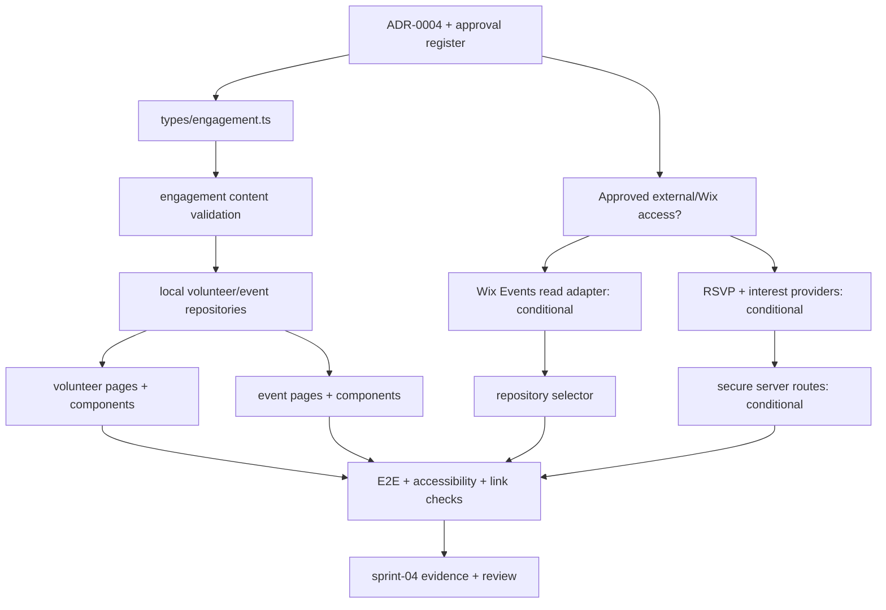

# Sprint 04 — Volunteer Opportunities and Events Management

**Project:** PostBaby Bliss Foundation Digital Platform  
**Delivery model:** One-week Agile sprint, six gated implementation phases  
**Engineering method:** Explicit dependency/file graphs and bounded build–test–review loops  
**Baseline stack:** Astro, TypeScript, Tailwind CSS, selective React only when needed, Wix JavaScript SDK where permitted, Vitest, Playwright, GitHub Actions  
**Primary outcome:** A complete, accessible **volunteer opportunities and events discovery experience** with reusable components, verified information, reliable registration destinations, and **optional, permission-gated** volunteer-interest and event RSVP integrations. The existing live Wix website remains unchanged.

> **Predecessor and architecture rule.** This is a plan, **not an assertion that Sprints 01–03 have been implemented**. Inspect the real GitHub branch, the completed reviews, and the applicable Architecture Decision Records (ADRs) before assigning work. Paths below follow the **Astro + Wix-managed Headless candidate** from the earlier sprint documents. If the site owner selected Wix Editor/Studio + Velo, first approve an alternative file manifest and carry across the same contracts, quality controls, and user journeys. Astro routes cannot simply be pasted into the Editor page tree.
>
> **Non-production rule.** This sprint does not authorize a domain cutover, public release, creation of live third-party accounts, changes to production Wix Events settings, unsolicited messages, collection of sensitive family information, or activation of application/RSVP forms without the Foundation's approval.

---

## 1. Sprint purpose, deliverables and scope

### 1.1 Rationale and continuity

Sprint 01 defined the initial frontend, design system, routing, and quality baseline. Sprint 02 defined Programs & Services and a CMS read boundary. Sprint 03 planned a giving experience with a provider-independent checkout handoff and approval gates. **Sprint 04 addresses nonfinancial community participation** through a single, coherent volunteer and events experience.

The Foundation's supplied website snapshot includes **Events**, **Careers**, **Support Us**, **Educational Workshops**, **Mommy Circles**, **Paint My Feelings**, and **Volunteer** navigation or calls to action. These establish reasonable *content categories*, not confirmed future dates, open volunteer roles, event capacity, registration links, staff assignments, or permission to collect personal information. Every public listing must originate from a Foundation-approved record or display a genuine empty state.

### 1.2 Specific sprint objectives

1. Deliver polished, mobile-first `/volunteer` and `/events` landing pages with coherent navigation from the existing homepage and Support Us experience.
2. Build reusable typed volunteer-opportunity and event models and a clear **local fixture → optional Wix adapter** data boundary, without inventing availability.
3. Support individual detail pages for approved volunteer roles and upcoming events with accurate status, location, time zone, accessibility notes, and actionable next steps.
4. Enable **one verified interaction path** per feature: either an approved external registration/interest destination or, when authorized and operational, a secure server-side submission/RSVP integration.
5. Handle unavailable, full, closed, past, canceled and unverified states honestly; no fabricated confirmations or promises of enrollment.
6. Apply U.S.-appropriate nonprofit practices for minimal data collection, privacy notice, separate marketing consent, spam controls, and event/volunteer safeguarding.
7. Deliver passing unit, integration, accessibility, regression and end-to-end tests, and publish a clear Sprint 05 handoff.

### 1.3 Minimum viable increment versus conditional enhancements

| Priority | Included outcome | Interpretation |
|---|---|---|
| **P0 — must ship to preview** | `/volunteer`, `/events`, approved listing/detail records, reusable components, responsive navigation, controlled local data, verification | All work possible without creating live vendor accounts or processing personal information |
| **P0 — must ship to preview** | Safe empty, unavailable, full, canceled, and past-event states; meaningful next-step links | UI does not overpromise opportunity availability or registration success |
| **P0 — must ship to preview** | Type validation, unit tests, Playwright journeys, WCAG 2.2 AA-oriented checks, CI and review records | No accessibility or security shortcuts to make the deadline |
| **P1 — approval-gated** | Wix Events read adapter and RSVP handoff; approved hosted external registration | Only after site permissions, installed products, registration type and destinations have been verified |
| **P1 — approval-gated** | Minimal adult volunteer-interest submission | Only with approved workflow, privacy notice, anti-abuse protection, access control and retention owner |
| **P2 — deferred when time constrained** | Rich month-grid calendar, saved opportunities, waitlist automation, notifications, volunteer-shift assignment | Candidates for subsequent sprints; never block a successful P0 release |

**Out of scope:** Volunteer background checks and identity-document uploads; medical or postpartum assessments; infant/child records; private case management; automated approval or assignment of volunteers; marketing campaign automation; ticket checkout or refunds; live video meeting integrations; donor payment changes; staff-only dashboards; production migration and domain switching. Event ticketing is a separately estimated integration if required later.

### 1.4 Acceptance demonstration

At the end of Day 5, a reviewer can start from the homepage, discover approved volunteer roles, open a role detail, navigate to approved events, open an event detail, understand its location and local time, and follow **a verified registration/interest route or an explicit unavailable state**. Tests prove correct filtering, accessible forms when enabled, graceful integration failure, and protection from duplicate or unauthorized submissions. A successful preview is **not** a live event RSVP or volunteer acceptance.

---

## 2. Loop engineering and graph engineering execution contract

### 2.1 Standard work unit

`Sprint → Phase → Task → prerequisite IDs → allowed file operations → test evidence → human review → phase gate`

- **Task IDs:** `S04-Pn-Tnn` (for example, `S04-P3-T04`).
- **Statuses:** `TODO`, `READY`, `IN_PROGRESS`, `BLOCKED`, `IN_REVIEW`, `DONE`.
- **Operations:** `C` create; `M` modify; `C/M` inspect before choosing; `?` conditional on approval; `G` CLI/framework-generated.
- **Priorities:** `P0` core; `P1` approval-gated; `P2` optional enhancement.
- **Authoritative source:** The accepted `ADR-0001`, the actual repository and the installed version of the Wix SDK/CLI. File paths in this plan are **target manifests**, not claims that files exist.
- **Task readiness:** A node becomes `READY` only after all its **hard** prerequisites are complete. An unmet vendor/legal approval is a `BLOCKED` dependency, not a task to route around by inventing a fake backend.

### 2.2 Bounded implementation loop



**Loop guardrails:**

1. One PR should complete an observable vertical slice (for example, *approved role fixture → role card → role details → validation → test*).
2. Limit corrective loops to **three evidence-based iterations**; pause on repeated failure rather than making speculative wide-ranging changes.
3. Require human review for external URL policies, any form that transmits personal information, Wix permission elevation, guest-registration writes and notifications.
4. Do not add unapproved dependencies, access tokens, identifiable volunteer/attendee samples, private contact details, or secret `.env` values to generated code, prompts or GitHub issues.
5. Keep unit and browser test fixtures synthetic, and never call live email or RSVP services during CI.
6. End every task with a commit/PR link, changed-files list, tests run, results, and gate decision.

### 2.3 Sprint dependency graph



**Critical path:** P0 → P1 → (P2 and P3 in parallel) → P4 → P5. Approved read integrations can run in parallel with page implementation once contracts and owner permissions exist. P1 external approvals must **not** block P0 local functionality, but they must block the corresponding registration feature from appearing active.

---

## 3. Timeboxed schedule and phase gates

| Phase | Target | Phase objective | Hard input | Demonstrable exit |
|---|---|---|---|---|
| **S04-P0** | Day 1, morning | Validate predecessor, content, Wix features and privacy decisions | Sprint 03 review and accessible repository | Approved architecture/content/data collection decision (`G0`) |
| **S04-P1** | Day 1 afternoon–Day 2 | Implement event/volunteer types, repositories, validation and fixtures | `G0` and known route conventions | Contract tests passing (`G1`) |
| **S04-P2** | Day 2–3 | Build volunteer listing/details and safe interest entry point | `G1` | Volunteer UI demo with approved or empty data (`G2`) |
| **S04-P3** | Day 2–4 | Build events index, details, status and registration action | `G1` | Events UI demo with safe registration state (`G3`) |
| **S04-P4** | Day 4–5 | Integrate approved adapters and run security/QA gates | `G2`, `G3`; owner approvals for P1 only | CI and functional/accessibility evidence (`G4`) |
| **S04-P5** | Day 5 | Review, accept, document deviations, hand off Sprint 05 | `G4` | Review decision and tagged accepted increment (`G5`) |

**Staffing assumption:** 2–3 contributors, plus responsive Foundation content/operations approval. If working solo, keep P0 pages, testable local repositories and safe CTA states; move approval-dependent adapters or P2 calendar enhancements to the backlog. This is a **five-day target**, not a guarantee that outside approvals or account configuration will arrive within a week.

---

## 4. Phase-by-phase development specifications

### Phase S04-P0 — Predecessor audit, service readiness and data governance

**Objective.** Inspect actual delivered code; resolve whether volunteer inquiries and event registration can lawfully and operationally be offered; confirm source-of-truth decisions before building a backend.

**Tasks**

- `S04-P0-T01` (**P0**): Review `docs/reviews/sprint-03-review.md`, `docs/quality/sprint-03-acceptance.md`, the real default branch, `ADR-0001`, and current CI. Record missing predecessor features rather than assuming they exist.
- `S04-P0-T02` (**P0**): Audit existing live URLs for Events, Careers, Volunteer and Support Us; compile approved role/event titles, descriptions, locations and links. Distinguish *currently open* from *historically mentioned* activities.
- `S04-P0-T03` (**P0**): Agree the editorial workflow: who can publish opportunities, verify organizers and dates, close roles, cancel events, and update availability. Record whether Wix CMS, Wix Events, or local data is authoritative.
- `S04-P0-T04` (**P0**): Define minimum voluntary-data fields, retention/access owners, privacy notice and consent handling. Exclude sensitive health, child, background-check and identity-document fields from this sprint.
- `S04-P0-T05` (**P1**): Verify the existing Wix business/site connection, Wix Events & Tickets availability, the exact event registration type, user permissions and any approved external volunteer form endpoint. Do **not** provision or modify a live Wix business without owner sign-off.
- `S04-P0-T06` (**P0**): Record `ADR-0004` with a clear separation among *public information*, *volunteer-interest collection* and *event RSVPs*. Set both integrations to `unavailable` until approved and technically verified.

**File-operation manifest**

| Op | Exact repository file | Planned change |
|---|---|---|
| M | `docs/engineering/task-graph.md` | Add S04 task, file and external-approval dependency nodes |
| M | `docs/audit/existing-site-inventory.md` | Inventory legacy Events/Careers/Volunteer URLs and migration implications |
| C | `docs/audit/sprint-04-engagement-readiness.md` | Verified environment, provider capability and unresolved decisions |
| C | `docs/architecture/ADR-0004-volunteer-events-engagement.md` | Source, integration, permissions and no-data-collection choices |
| C | `docs/content/sprint-04-opportunities-and-events-inventory.md` | Approved, draft and rejected records with owners |
| C | `docs/privacy/sprint-04-data-collection-and-retention.md` | Field minimization, notices, storage/access/retention decisions |
| M | `docs/content/editorial-approval.md` | Capture role/event copy and rights approval or link to an equivalent maintained register |
| M | `docs/architecture/ADR-0001-delivery-path.md` | Only if actual deployment decision has changed and owner signs off |

**Exit gate `G0`:** The team knows which listings may be previewed, who approves publishing, which collection/RSVP path (if any) is supported, and which forms must remain disabled. Any missing live content is represented as empty-state content, never invented opportunities.

### Phase S04-P1 — Typed domain models, date handling and data adapters

**Objective.** Isolate data from presentation; establish reliable availability and date rules so that both public pages can render without remote dependencies.

**Tasks**

- `S04-P1-T01` (**P0**): Define `VolunteerOpportunity` and `CommunityEvent` types with stable `id`, unique `slug`, visible `status`, safe contact/registration mode, approval marker and public metadata. Keep private submissions outside these content models.
- `S04-P1-T02` (**P0**): Validate required fields, stable slugs, approved HTTPS destinations, statuses and publication flags; reject duplicate IDs/slugs, malformed URLs and unapproved public claims.
- `S04-P1-T03` (**P0**): Implement local read-only volunteer and event repositories (`list`, `getBySlug`); return typed not-found/unavailable results rather than throwing unhandled errors.
- `S04-P1-T04` (**P0**): Implement safe date/time rendering with named IANA zones (for Houston, ordinarily `America/Chicago`) and distinguish event dates, times and online-event status. Store canonical instants/time-zone information rather than assuming the visitor's browser timezone is the event timezone.
- `S04-P1-T05` (**P0**): Add fixtures explicitly marked `approved`, `draft` or `example-only`. Do not publish illustrative dates or fabricated locations. The production/public read path excludes every unapproved item.
- `S04-P1-T06` (**P0**): Add deterministic unit tests for ordering, filtering to open/upcoming items, canceled/past/full status, timezone conversion, invalid destinations, duplicate slugs and repository failures.

**File-operation manifest**

| Op | Exact repository file | Planned change |
|---|---|---|
| C | `src/types/engagement.ts` | Public role/event/status/registration contracts |
| C | `src/lib/engagement/validate-engagement-content.ts` | Content, URL, status and publication checks |
| C | `src/lib/engagement/approved-destination.ts` | Strict `https:` and allowlist/approved-link validation |
| C | `src/lib/volunteer/volunteer-opportunity-repository.ts` | Read-only volunteer repository interface |
| C | `src/lib/volunteer/adapters/local-volunteer-repository.ts` | Validated local implementation |
| C | `src/lib/events/event-repository.ts` | Read-only event repository interface |
| C | `src/lib/events/adapters/local-event-repository.ts` | Validated local implementation |
| C | `src/lib/events/format-event-date.ts` | Date/status presentation, explicit IANA zone |
| C | `src/lib/engagement/get-engagement-repositories.ts` | Controlled source selection; no implicit production fallback |
| C | `src/data/volunteer-opportunity-fixtures.ts` | Approved or clearly unpublishable provisional role records |
| C | `src/data/community-event-fixtures.ts` | Approved or clearly unpublishable provisional event records |
| C | `tests/unit/engagement-content-validation.test.ts` | Content validation, bad URLs, visibility rules |
| C | `tests/unit/volunteer-repository.test.ts` | Role repository contract and ordering |
| C | `tests/unit/event-repository.test.ts` | Event repository and status contract |
| C | `tests/unit/event-date-formatting.test.ts` | Time zone, daylight saving and multi-day cases |
| M | `src/lib/site-config.ts` | Canonical routes and safe feature-state configuration |

**Implementation contract (illustrative, not a prescribed SDK schema):**

```ts
export type PublicationStatus = 'draft' | 'approved' | 'archived';
export type VolunteerStatus = 'open' | 'paused' | 'closed';
export type EventStatus = 'scheduled' | 'full' | 'canceled' | 'completed';
export type RegistrationMode = 'disabled' | 'approved-external' | 'wix-rsvp';

export type VolunteerOpportunity = {
  id: string;
  slug: string;
  title: string;
  summary: string;
  status: VolunteerStatus;
  publication: PublicationStatus;
  interestMode: 'disabled' | 'approved-external' | 'approved-form';
  interestUrl?: string; // only when verified and allowlisted
};

export type CommunityEvent = {
  id: string;
  slug: string;
  title: string;
  startsAt: string; // ISO date-time with offset or UTC
  endsAt?: string;
  timeZone: string; // IANA zone, such as America/Chicago
  status: EventStatus;
  publication: PublicationStatus;
  registrationMode: RegistrationMode;
  registrationUrl?: string; // approved external registration only
  wixEventId?: string; // only for a verified Wix Events record
};
```

These minimal types can be expanded after schema inspection; they must **not** be equated with an actual Wix SDK event/RSVP request body. Avoid creating database tables simply because the UI needs a few public records.

**Exit gate `G1`:** Clean typecheck and deterministic repository/validation tests pass. Public repositories exclude draft content. A role or event can be represented without any external API or collection of personal information.

### Phase S04-P2 — Build the volunteer opportunity experience

**Objective.** Deliver a trustworthy volunteer discovery journey, with useful next steps and no implied promise of recruitment or acceptance.

**Tasks**

- `S04-P2-T01` (**P0**): Create `/volunteer` with a mission-led introduction, approved overview, visible opportunity count only when derived from approved records, role listing and accessible empty state.
- `S04-P2-T02` (**P0**): Implement a semantic `OpportunityCard` and a responsive listing; label role, participation mode, status, and link with context—not just “Learn More.”
- `S04-P2-T03` (**P0**): Implement `/volunteer/[slug]` with responsibilities, time commitments, eligibility/conditions **only when supplied and approved**, location/accessibility notes and an explicit next step.
- `S04-P2-T04` (**P0**): Build one `VolunteerInterestAction` that chooses an **approved external link**, a separately authorized secure form, or an honest unavailable state. A disabled action must not look functional.
- `S04-P2-T05` (**P1**): Build a minimal accessible interest form UI **only after** P0 approves the data collection policy. Avoid resume uploads, full addresses, references, date of birth or free-text health history. Do not implement a submit-success screen before a verified backend succeeds.
- `S04-P2-T06` (**P0**): Integrate Volunteer into shared navigation, homepage and the `/support-us` CTA; check keyboard access, correct metadata and all responsive widths.

**File-operation manifest**

| Op | Exact repository file | Planned change |
|---|---|---|
| C | `src/pages/volunteer/index.astro` | Landing page and approved roles |
| C | `src/pages/volunteer/[slug].astro` | Role details and verified CTA mode |
| C | `src/components/volunteer/OpportunityCard.astro` | Reusable listing card |
| C | `src/components/volunteer/OpportunityList.astro` | Accessible listing and empty state |
| C | `src/components/volunteer/OpportunityDetail.astro` | Detail content and semantic structure |
| C | `src/components/volunteer/VolunteerInterestAction.astro` | Link/form/unavailable decision surface |
| ?/C | `src/components/volunteer/VolunteerInterestForm.astro` | Minimal approved form UI; no direct unsafe write |
| C | `src/lib/seo/volunteer-metadata.ts` | Page-specific title, description and canonical handling |
| C | `tests/e2e/volunteer.spec.ts` | Listing/detail links, empty state and mobile behavior |
| M | `src/lib/navigation.ts` | Volunteer route in approved primary navigation |
| M | `src/components/layout/SiteHeader.astro` | Accessible mobile/desktop nav item |
| M | `src/pages/index.astro` | Mission-aligned volunteer CTA if approved |
| M | `src/pages/support-us.astro` | Connect existing giving section to the volunteer route |
| M | `src/styles/global.css` | Shared tokens; avoid duplicate role-specific styling rules |
| M | `docs/content/sprint-04-opportunities-and-events-inventory.md` | Match on-screen records to approved copy |

**Exit gate `G2`:** A visitor can navigate Home/Support Us → Volunteer → valid opportunity → explicit next step or unavailable state. Unapproved roles do not appear; unknown slugs return a proper not-found response. Optional forms are nonoperational unless a real approved backend is present and tested.

### Phase S04-P3 — Build the events and workshop experience

**Objective.** Deliver an accurate, accessible event-discovery journey, separating *what happens* from *whether the visitor can register*.

**Tasks**

- `S04-P3-T01` (**P0**): Implement `/events` as a chronological upcoming-events list, with clear empty state and optional past-events area when records are approved. Do not prioritize a decorative calendar grid over a usable list.
- `S04-P3-T02` (**P0**): Implement `EventCard` and `EventList` with date, venue/online indicator, local event time and status. Do not list an unverified event or use a current-event label for an old photograph.
- `S04-P3-T03` (**P0**): Implement `/events/[slug]` with organizer-approved details, date/time and zone, location or online attendance note, accessibility information where known, event status and registration instructions.
- `S04-P3-T04` (**P0**): Build `EventRegistrationAction` with three explicit cases: closed/unavailable, approved external registration, or verified Wix RSVP. Block registration actions for canceled, completed, unavailable or full events unless a confirmed waitlist is configured.
- `S04-P3-T05` (**P0**): Handle daylight saving transitions, past-event boundaries, unknown end times, changing venues, canceled events and 404 slugs; show dates in a readable U.S. style with the named timezone.
- `S04-P3-T06` (**P0**): Add SEO/structured content as appropriate, and link from Programs & Services to events only where the editorial relationship is confirmed (e.g., educational workshops).
- `S04-P3-T07` (**P0**): Add browser tests for sorting, empty/closed/canceled states, detail routes, responsive layouts and accessible status messages.

**File-operation manifest**

| Op | Exact repository file | Planned change |
|---|---|---|
| C | `src/pages/events/index.astro` | Events index and upcoming/past states |
| C | `src/pages/events/[slug].astro` | Detail page for approved event |
| C | `src/components/events/EventCard.astro` | Event preview |
| C | `src/components/events/EventList.astro` | Semantic list by date/status |
| C | `src/components/events/EventDetail.astro` | Event body, attendance instructions, status |
| C | `src/components/events/EventRegistrationAction.astro` | Approved, closed and unavailable registration handling |
| C | `src/components/events/EventStatusNotice.astro` | Canceled, full, concluded and pending states |
| C | `src/lib/seo/event-metadata.ts` | Titles, canonical, share metadata for event pages |
| C | `tests/e2e/events.spec.ts` | Navigation, order, detail, error and responsive tests |
| C | `tests/e2e/events-accessibility.spec.ts` | Automated and keyboard/status checks |
| M | `src/lib/navigation.ts` | Events route registration |
| M | `src/components/layout/SiteHeader.astro` | Navigation and narrow-screen regression |
| M | `src/pages/programs/index.astro` | Approved workshop-to-event links where warranted |
| M | `src/styles/global.css` | Reusable event layout and focus styling |

**Exit gate `G3`:** Valid approved events render in ascending start order; date/time labels are unambiguous; visitors cannot accidentally register for a canceled or closed event; no event details or registration forms depend on imaginary provider responses.

### Phase S04-P4 — Approved integrations, privacy/security and regression testing

**Objective.** Replace isolated preview adapters only where operational approval exists, and run the full quality/security gate for both journeys.

**Tasks**

- `S04-P4-T01` (**P1**): When the Foundation has Wix Events & Tickets installed and approved permissions, integrate **read-only Events V3** behind the existing repository. Use explicit paging (query defaults may return zero records), publish-state filtering and safe error mapping.
- `S04-P4-T02` (**P1**): If an actual RSVP event is approved, implement an isolated server-side Wix RSVP provider. Retrieve the event's registration form schema first; submit only valid input names and mandatory values. Never try to create an RSVP for a ticketed event. Prohibit app-level permission elevation on the client.
- `S04-P4-T03` (**P1**): If a volunteer-interest workflow is approved, connect the form through a verified Wix Forms installation or another separately authorized provider. Require a configured form, server-side validation, anti-spam controls, restricted staff access, retention plan and explicit result handling. If not available, keep the informational action or disabled state.
- `S04-P4-T04` (**P0**): Test approved external destinations against server-side allowlists and prevent redirect injection; ensure any privileged endpoint rejects unauthenticated or unauthorized requests appropriately and cannot be invoked repeatedly without controls.
- `S04-P4-T05` (**P0**): Define separate operational acknowledgment vs. optional marketing subscription; default marketing permission to **not selected**, never silently add a volunteer/attendee to a mailing list.
- `S04-P4-T06` (**P0**): Add integration contract tests for vendor timeouts, 403/404 responses, duplicate submissions, closed registrations, invalid field mappings and denial-of-service/spam conditions. Mock all external writes in CI.
- `S04-P4-T07` (**P0**): Run Playwright navigation, form (if enabled), mobile, screen-reader-oriented accessibility, reduced-motion and error-state tests, plus regression against Home, About, Programs and Donate.
- `S04-P4-T08` (**P0**): Capture CI, browser, permission and approval evidence, update links/canonical metadata, and mark blockers without inventing successful RSVP or volunteer confirmation.

**File-operation manifest**

| Op | Exact repository file | Planned change |
|---|---|---|
| ?/C | `src/lib/events/adapters/wix-event-repository.ts` | Authorized read-only Wix Events integration |
| ?/C | `src/lib/events/map-wix-event.ts` | Validate/normalize remote schema; strip private fields |
| C | `src/lib/events/event-registration-provider.ts` | RSVP/external/unavailable typed interface |
| C | `src/lib/events/providers/unavailable-registration-provider.ts` | Explicit disabled behavior |
| C | `src/lib/events/providers/approved-external-registration-provider.ts` | Validated destination handoff |
| ?/C | `src/lib/events/providers/wix-rsvp-provider.ts` | Server-only, permission-gated RSVP implementation |
| C | `src/lib/volunteer/volunteer-interest-provider.ts` | Minimal typed submission contract and result states |
| C | `src/lib/volunteer/providers/unavailable-interest-provider.ts` | Non-collecting fallback |
| ?/C | `src/lib/volunteer/providers/approved-wix-forms-provider.ts` | Authorized form submission adapter |
| ?/C | `src/pages/api/engagement/volunteer-interest.ts` | Conditional secure server endpoint; never required to render landing page |
| ?/C | `src/pages/api/engagement/event-rsvp.ts` | Conditional server-side RSVP endpoint; deny without authorization |
| C | `src/lib/engagement/validate-interest-input.ts` | Allowlisted minimal form fields; bounds and sanitization |
| C | `tests/unit/registration-provider.test.ts` | Provider status, failure and safe-link behavior |
| C | `tests/unit/interest-input-validation.test.ts` | Input constraints and consent boundaries |
| C | `tests/integration/events-adapter.test.ts` | Remote shape/error normalization, mocked Wix responses |
| C | `tests/integration/engagement-submissions.test.ts` | Only synthetic fixtures; no real Wix writes in CI |
| C | `tests/e2e/engagement-navigation.spec.ts` | Cross-page navigation and CTA state tests |
| C | `tests/e2e/engagement-accessibility.spec.ts` | Contrast, forms, error status, keyboard access |
| M | `.github/workflows/ci.yml` | Add new unit/integration/E2E targets using existing workflow conventions |
| M | `package.json` | Verified scripts and only necessary, pinned integrations |
| M | `src/lib/engagement/get-engagement-repositories.ts` | Explicit approved adapter selection; no silent live-data fallback |
| M | `docs/privacy/sprint-04-data-collection-and-retention.md` | Final field controls, owner and privacy/retention gate |
| C | `docs/quality/sprint-04-acceptance.md` | Traceable exit checklist and approvals |
| C | `docs/quality/sprint-04-test-evidence.md` | CI/browser/manual test evidence |
| C | `docs/quality/sprint-04-integration-evidence.md` | Which Wix/external integrations were actually tested or blocked |

**Safety and capability conditions:**

- Wix Events V3 listing, RSVP V2 registration and Wix Forms submissions are **separate API domains**, each with app installation, permission and version requirements. Do not build a generic “submit anything” endpoint.
- For Wix RSVP, event `registration.initialType` must be `RSVP`. Wix documentation requires reading the event registration form (including `FORM` fields) and supplying matching names and mandatory values. `Manage Guest List` is a privileged permission; protect all credentials and any elevation on the server.
- Wix Forms submission requires the Wix Forms app and a real form definition. The SDK may change; match the *installed SDK version* and current API schema rather than implementing code from an outdated example.
- Visitor confirmation is shown **only** when the provider actually acknowledges an authorized submission. Timeouts, unavailability or validation failures must not be presented as successful registrations.
- An approved external destination can be a deliberate first-release alternative. A URL shown on the legacy site is not automatically an approved destination for this project.
- No personal submission payload should enter analytics, access logs, screenshots, fixture files, Git, public error messages, or AI debugging prompts. Retention/access control is the Foundation's decision and must be documented before accepting submissions.

**Exit gate `G4`:** Full CI, security review and accessibility checks pass. Every activated integration has explicit account approval and positive sandbox/preview evidence; every unactivated integration has a truthful unavailable state. The architecture is deploy-preview ready, not production-release approved.

### Phase S04-P5 — Review, sign-off and Sprint 05 handoff

**Objective.** Demonstrate working software, reconcile actual files with this plan, capture unresolved decisions and create the next dependency-aware backlog.

**Tasks**

- `S04-P5-T01` (**P0**): Demo Home/Support Us → Volunteer and Home/Programs → Events on mobile, tablet and desktop; show approved/empty/closed states and any authorized end-to-end form or RSVP path.
- `S04-P5-T02` (**P0**): Record defects, links, missing owner approvals, source-of-truth differences, Wix limitations and the exact registration mode achieved. Document unimplemented optional adapters rather than marking them done.
- `S04-P5-T03` (**P0**): Obtain technical, accessibility, security/privacy and content-owner acceptance; update the dependency graph and final tests. Close only tasks with evidence.
- `S04-P5-T04` (**P0**): Create Sprint 05 candidates for newsletter/contact/news or family-support resource navigation, and mark any sensitive intake or admin workflows as requiring separate privacy architecture.
- `S04-P5-T05` (**P0**): Tag accepted code (`sprint-04-review` or equivalent) and document reproducible local run/preview instructions. No automatic Wix production `release` or domain cutover.

**File-operation manifest**

| Op | Exact repository file | Planned change |
|---|---|---|
| C | `docs/reviews/sprint-04-review.md` | Demo, approvals, defects, decisions and actual delivery |
| C | `docs/backlog/sprint-05-candidates.md` | Prioritized, dependency-scoped future increments |
| M | `docs/quality/sprint-04-acceptance.md` | Final gate/exception decisions and named reviewers |
| M | `docs/quality/sprint-04-test-evidence.md` | Final passing checks and coverage evidence |
| M | `docs/quality/sprint-04-integration-evidence.md` | Precise provider status and validated permissions |
| M | `docs/engineering/task-graph.md` | Merge status, actual paths and blocked edges |
| M | `docs/architecture/ADR-0004-volunteer-events-engagement.md` | Final decisions and justified deviations |
| M | `README.md` | Verified development, environment and QA commands |

**Exit gate `G5`:** An inspectable, tested Sprint 04 preview exists; the Foundation has approved all claims presented as fact, and the review clearly distinguishes *completed public experience*, *working authorized registrations* and *integration work deferred for approval*.

---

## 5. File dependency graph, ownership and merge order

### 5.1 Data-to-UI graph



### 5.2 Worktree coordination and allowed owners

| Ownership group | Primary edit areas | Review constraint |
|---|---|---|
| Technical lead | `docs/architecture/ADR-0004-*`, `src/types/engagement.ts`, repository interfaces, feature flags | Must merge contracts before UI/provider changes |
| Frontend (volunteer) | `src/pages/volunteer/*`, `src/components/volunteer/*` | No alteration of private-data transport without security reviewer |
| Frontend (events) | `src/pages/events/*`, `src/components/events/*` | No ad-hoc RSVP POSTs from components |
| Integrations | `src/lib/events/adapters/*`, `src/lib/events/providers/*`, `src/lib/volunteer/providers/*`, conditional API handlers | Only after authorized account/service permissions and privacy gate |
| QA | `tests/*`, `docs/quality/*` | No weakening acceptance to fit a demo |
| Content/operations owner | `docs/content/sprint-04-*`, event/location/time approval, consent wording | May reject unverified opportunities and any guest/volunteer collection |

**Shared-file collision rule:** Assign a single integration owner to `src/lib/navigation.ts`, `src/styles/global.css`, `package.json`, `astro.config.mjs` (if needed), `src/lib/site-config.ts` and `.github/workflows/ci.yml`. Merge small UI branches early, rebase before editing shared code, and do not have concurrent agents overwrite shared files.

### 5.3 Planned repository structure (not an instruction to recreate existing files)

```text
src/
  types/
    engagement.ts
  lib/
    site-config.ts                         # modify existing
    navigation.ts                          # modify existing
    engagement/
      approved-destination.ts
      validate-engagement-content.ts
      validate-interest-input.ts
      get-engagement-repositories.ts
    volunteer/
      volunteer-opportunity-repository.ts
      volunteer-interest-provider.ts
      adapters/local-volunteer-repository.ts
      providers/
        unavailable-interest-provider.ts
        approved-wix-forms-provider.ts     # conditional
    events/
      event-repository.ts
      format-event-date.ts
      event-registration-provider.ts
      adapters/
        local-event-repository.ts
        wix-event-repository.ts           # conditional
      providers/
        unavailable-registration-provider.ts
        approved-external-registration-provider.ts
        wix-rsvp-provider.ts              # conditional
      map-wix-event.ts                    # conditional
    seo/
      volunteer-metadata.ts
      event-metadata.ts
  data/
    volunteer-opportunity-fixtures.ts
    community-event-fixtures.ts
  pages/
    volunteer/
      index.astro
      [slug].astro
    events/
      index.astro
      [slug].astro
    api/engagement/
      volunteer-interest.ts               # conditional
      event-rsvp.ts                       # conditional
  components/
    volunteer/
      OpportunityCard.astro
      OpportunityList.astro
      OpportunityDetail.astro
      VolunteerInterestAction.astro
      VolunteerInterestForm.astro         # conditional
    events/
      EventCard.astro
      EventList.astro
      EventDetail.astro
      EventRegistrationAction.astro
      EventStatusNotice.astro
tests/
  unit/
    engagement-content-validation.test.ts
    volunteer-repository.test.ts
    event-repository.test.ts
    event-date-formatting.test.ts
    registration-provider.test.ts
    interest-input-validation.test.ts
  integration/
    events-adapter.test.ts
    engagement-submissions.test.ts
  e2e/
    volunteer.spec.ts
    events.spec.ts
    events-accessibility.spec.ts
    engagement-navigation.spec.ts
    engagement-accessibility.spec.ts
docs/
  architecture/ADR-0004-volunteer-events-engagement.md
  audit/sprint-04-engagement-readiness.md
  privacy/sprint-04-data-collection-and-retention.md
  content/sprint-04-opportunities-and-events-inventory.md
  quality/
    sprint-04-acceptance.md
    sprint-04-test-evidence.md
    sprint-04-integration-evidence.md
  reviews/sprint-04-review.md
  backlog/sprint-05-candidates.md
```

**Astro route note:** For dynamic `[slug].astro` routes, choose prerendered `getStaticPaths()` or on-demand SSR according to the accepted rendering decision in `ADR-0002-content-source-and-rendering.md`. Do not leave a dynamic route without an implemented strategy for the selected deployment output.

---

## 6. Standard GitHub ticket / AI coding-agent contract

Use one issue per small verifiable feature; avoid assigning an entire phase as a single unrestricted agent prompt.

```md
## Task ID
S04-P3-T04

## Intent
Make event registration actions reflect approved registration modes and event status.

## Hard prerequisites
S04-P0-T06, S04-P1-T01, S04-P1-T02, S04-P3-T03

## Priority
P0 (UI state) / P1 (authorized provider handoff)

## Allowed files
- src/components/events/EventRegistrationAction.astro (C/M)
- src/lib/events/event-registration-provider.ts (C/M)
- tests/unit/registration-provider.test.ts (C/M)

## Excluded modifications
- Production Wix Events configuration
- Donation or payment provider files
- Analytics with attendee identity

## Acceptance
- A scheduled, approved event can show a verified destination.
- Full/canceled/past events cannot present an active registration CTA.
- Unknown/malformed URLs are rejected.
- The UI never claims registration success from a redirect alone.

## Verification
- npm run check
- npm run lint
- npm run test -- <relevant tests>   # adapt to installed test script
- npm run build

## Iteration limit
Three corrective build–test–review loops; escalate if not resolved.

## Evidence
PR, changed-files list, test output, screenshots without personal data,
reviewer sign-off, actual blocked dependencies.
```

**Agent permissions:** Only modify explicitly allowed files; do not install libraries, create vendor resources, push production secrets, deploy publicly, or modify donation checkout without a separate approved task. Prefer small PRs with focused tests over broad scaffold rewrites.

---

## 7. User journeys, content policy and U.S. operating safeguards

### 7.1 Primary public journeys

| Journey | Visitor expectation | Correct implementation |
|---|---|---|
| Home → Volunteer → Opportunity | Discover real volunteering options | Approved role copy, accurate status and a verified next step |
| Support Us → Volunteer | Find a nonfinancial way to help | Direct to `/volunteer`, not an obsolete placeholder |
| Home → Events → Event | Understand an upcoming activity | Real approved date, time zone, venue/online status and clear details |
| Programs → Educational Workshop → Event | Find a relevant session, if one is scheduled | Link only when Foundation confirms a matching event |
| Approved RSVP event → Register | Receive an authorized RSVP result | Supported Wix or approved third-party flow, no invented confirmation |
| No approved roles/events | Learn what to do next | Honest empty state and existing approved contact route |

### 7.2 Minimum information and consent specification

For an **approved adult volunteer-interest inquiry**, propose at most a name, contact email, opportunity identifier, concise availability category and explicit notice acknowledgment. Keep free text narrowly scoped or omit it. Never require exact home address, birth date, government ID, health details, infant information or household history. **The Foundation must define how to handle applications from minors, if accepted, through its safeguarding and consent policy; do not enable collection from children by default.**

Event registration fields are dictated by the verified event's official registration form and approved attendance policy. Do not add arbitrary questions to the Wix RSVP payload. Separate operational acknowledgments from marketing subscriptions, and require affirmative consent for any optional marketing enrollment. Confirm appropriate retention periods, deletion requests, access roles and responsible owner before activation.

### 7.3 Security and data handling

- Validate **on the server**, not only in the browser; bound request sizes and field lengths; reject unexpected fields.
- Apply anti-automation controls suitable for the selected provider (for example, provider-supported CAPTCHA/rate limits), and use idempotency/duplicate checks where appropriate.
- Do not allow the client to request privileged SDK permission elevation; keep any permission-elevated code on a protected server function.
- Restrict data access to authorized Foundation operators; do not expose guest lists, email addresses, form submissions or volunteer contact information through public repositories or endpoints.
- Avoid saving unneeded data in a separate PostgreSQL database or logging raw submissions merely for convenience. A separate database would require its own security, retention, backup and access model.
- Do not presume that ordinary Wix forms make handling clinical data compliant. The scope is public volunteering and event participation, not medical intake.
- Establish a clear owner review for any actual volunteer screening, background checks or contact with children; these are organizational procedures beyond this sprint's website features.

### 7.4 UX and accessibility criteria

- Keyboard focus, skip link, ordered headings, explicit labels, validation explanations, perceivable error summaries and no color-only status indicators.
- State changes such as a failed submission, canceled event or RSVP unavailable message are announced accessibly.
- Clear U.S. event date presentation, coupled with an explicit timezone; avoid bare times like “10 AM” without context.
- Responsive checks at **375 px**, **768 px** and **1440 px** with no horizontal overflow caused by the layout.
- Target **WCAG 2.2 AA**; pair automated tooling with keyboard and manual screen-reader-oriented checks. Automated scans alone cannot establish conformance.
- Performance: accessible list-first experience without loading a heavy calendar library for a basic events listing. Optimize approved images and avoid unnecessary React hydration.

### 7.5 Messaging and regulatory review

Before any volunteer or event notices are sent, verify the sender identity, delivery path, consent and relevant email classification. U.S. CAN-SPAM rules depend on a message's **primary purpose**; do not assume that every nonprofit-related email is automatically exempt from every obligation. Obtain privacy/legal review for applicable U.S. and state requirements, and do not label the website "HIPAA compliant" without a substantive role-based assessment and appropriate agreements.

---

## 8. Verification commands, acceptance metrics and gates

### 8.1 Reproducible checks

The existing repository's `package.json` scripts remain authoritative. Configure these or equivalent scripts as needed rather than promising commands that have not been installed:

```bash
npm ci
npm run check
npm run lint
npm run test
npm run build
npm run test:e2e
```

Suggested targeted tests can run using the installed Vitest/Playwright configuration. If Wix authorization is absent, test mocked adapters locally; mark live SDK verification `BLOCKED`, not `PASSED`.

### 8.2 Definition of Ready

A task is `READY` only if its owner, expected output, prerequisite nodes, file allowlist, approved content/fixture, validation target and reviewer are specified. Tasks touching real form data also require a documented privacy/retention owner. Tasks touching Wix Events or Forms require actual account permission evidence.

### 8.3 Definition of Done

An individual task is `DONE` only when: a working change is merged/reviewable; TypeScript and lint checks pass; focused tests pass; negative/error states are covered; accessibility is checked for user-facing UI; no unauthorized sensitive data is collected; no unexpected file changes occur; and evidence is linked to the task graph.

### 8.4 Sprint 04 exit checklist

- [ ] Previous sprints' actual deliverables and architecture decisions have been audited.
- [ ] `ADR-0004` and volunteer/event editorial approval inventory are complete.
- [ ] `/volunteer` displays only approved opportunity records or a factual empty state.
- [ ] `/volunteer/[slug]` works, and unknown slugs have a proper not-found outcome.
- [ ] `/events` shows accurate chronological approved listings or a factual empty state.
- [ ] `/events/[slug]` clearly displays event status, venue/online details and timezone.
- [ ] Closed, canceled, full or completed events cannot show an inappropriate registration action.
- [ ] Every outbound interest/RSVP URL is HTTPS and explicitly approved.
- [ ] Activated forms/RSVP flows have documented privacy, authorization, anti-abuse and positive provider test evidence.
- [ ] Unapproved/unavailable integrations never claim a request was submitted.
- [ ] No attendee, volunteer, clinical or child data appears in fixtures, logs, analytics or Git.
- [ ] Navigation from Home, Support Us and approved Programs is consistent and tested.
- [ ] Mobile, tablet, desktop, keyboard and manual accessibility checks are recorded.
- [ ] Unit, integration (mocked as necessary), E2E, typecheck, lint and build pass in CI.
- [ ] Product/content, technical and privacy reviewers have accepted the relevant gates.
- [ ] Sprint 05 candidates and unresolved external dependencies are recorded.
- [ ] The existing public Wix site, domain and production configuration remain untouched.

**Target quality:** Zero known critical/high-severity accessibility or security defects in released preview functionality, no broken internal navigation on newly delivered routes, and no false registration confirmations. The team may define a performance budget after taking an actual baseline; do not fabricate benchmark scores.

### 8.5 Gate outcomes

| Gate | Owner | Required evidence | Pass/blocked rule |
|---|---|---|---|
| `G0` Readiness | Lead + Foundation representative | ADR, content approval, privacy decisions | Public content sourced; form integrations may remain blocked |
| `G1` Data | Technical lead | Types, fixtures, unit test logs | Approved-only repositories and correct time/status rules |
| `G2` Volunteer UI | Frontend reviewer | Preview, navigation E2E, accessibility | Verified action or honest unavailable state |
| `G3` Events UI | Frontend reviewer | Chronological/status/browser tests | No false dates, capacities or registration claims |
| `G4` Verification | QA + privacy/integrations reviewer | CI, negative-path tests, authorized provider evidence or blocker | Optional provider cannot be passed without authorization |
| `G5` Acceptance | Project lead + Foundation representative | Sprint review, sign-offs, graph and backlog | Correctly classified working increment ready for next sprint |

---

## 9. Principal risks, fallback rules and escalation

| Risk | Consequence | Mitigation and owner |
|---|---|---|
| Sprints 01–03 exist only as plans | Expected files may not be present | Inspect default branch at P0; deliver or defer missing foundation before editing dependent routes — technical lead |
| Existing Wix account lacks required Events app or permissions | RSVP integration unavailable | Keep approved listings and unavailable/verified external action; do not forge Wix success — Wix owner |
| Wix-managed Astro linking creates an unintended separate Wix site | Wrong backend/site data | Follow accepted ADR and current existing-site migration guide; never provision without owner approval — lead/site owner |
| Wix Editor page code/forms do not auto-migrate to headless | Lost features after eventual cutover | Inventory legacy form and event widgets; rebuild and test as part of a later migration gate — lead |
| Opportunity/event information is outdated | Misleads visitors | Publish only approved time-sensitive records; add editorial expiry/closure review — operations owner |
| Unverified time zone causes wrong attendance times | Missed sessions | Use canonical instants, explicit IANA zone and DST test coverage — frontend/QA |
| Form submissions collect unnecessary personal information | Privacy and operational exposure | Minimize fields, require privacy review and retention owner; default to no collection — Foundation/privacy reviewer |
| Public UI calls privileged RSVP/Forms endpoints | Unauthorized submissions/data access | Keep privileged operations behind protected server endpoints and least privilege — integrations lead |
| Multiple form retries create duplicates | Confusing or duplicated outreach | Provider-supported idempotency, duplicate controls and reliable error states — integrations/QA |
| External RSVP link redirects to untrusted destination | User safety/security risk | Approve domain and exact destination; allowlist and reject malformed/off-domain URLs — lead |
| Five-day scope becomes overloaded | UI or tests left unfinished | Prioritize list/detail/CTA and tests; defer calendar grid, auto-email and advanced CRM work — project lead |

**Escalation threshold:** Any real PII exposure, unauthorized data access, misleading guest confirmation, unverified payment/charity claim or unapproved production change is a **STOP** condition. Do not proceed based solely on an AI-agent suggestion or passing unit tests.

---

## 10. Lean daily execution rhythm

**Day 1:** Review predecessor GitHub artifacts; decide data scope and architecture; inspect approved Wix capabilities; start typed contracts. Hold a short role/event content approval review.

**Day 2:** Finish repositories, fixtures and validation tests. Build the volunteer list/detail journey; start event cards in parallel once contracts merge.

**Day 3:** Demonstrate Volunteer and Events preview pages. Integrations work only on signed-off, permission-ready paths; UI always supports explicit unavailable states.

**Day 4:** Complete detail interactions, status rules, link safety and conditional provider adapters. Run unit/integration/browser/accessibility tests and identify blockers.

**Day 5:** Fix critical failures, validate optional integrations when access exists, complete acceptance, demonstrate actual results and prepare Sprint 05 tasks.

**Ceremony budget:** 10–15-minute daily readiness/PR check; a focused Day 3 clickable demo; one Day 5 stakeholder review. Keep most of each day reserved for implementation and verification.

---

## 11. Handoff to Sprint 05

Recommended next increment: **Contact, Resources, News and Communications**, with the final choice dependent on organizational priorities and the Sprint 04 result. Candidate deliverables include a contact directory, FAQ/resource navigation, editorial/news entries, an approved newsletter subscription journey and operational inquiry routing. Keep any postpartum health intake, case tracking, family records, identity verification or staff dashboards in separately authorized architecture and privacy workstreams.

**Required handoff artifacts**

- `docs/reviews/sprint-04-review.md`
- `docs/quality/sprint-04-acceptance.md`
- `docs/quality/sprint-04-test-evidence.md`
- `docs/quality/sprint-04-integration-evidence.md`
- `docs/architecture/ADR-0004-volunteer-events-engagement.md`
- `docs/privacy/sprint-04-data-collection-and-retention.md`
- `docs/backlog/sprint-05-candidates.md`
- Updated `docs/engineering/task-graph.md` with actual completion, paths, hard dependencies and blocked approvals.

Each Sprint 05 issue should contain a user-facing objective, acceptance criteria, allowed files, data/authorization requirements, tests, owner and estimate. Do not mark speculative future work `READY` merely because the sprint calendar has advanced.

---

## 12. References and source provenance

### 12.1 Organization-specific evidence

The supplied *Postpartum Care Support | PostBaby Bliss Foundation* four-page website PDF (snapshot dated November 12, 2026) is the project-specific basis for the Foundation's mission and content categories. Page 2 names **Educational Workshops**, **Mommy Circles**, and **Paint My Feelings**; page 3 describes workshops and community resources and displays a navigation menu with **Events**; page 4 includes **Volunteer** and **Donate** calls to action. The accompanying photographs show community activities but do not establish approved future event dates, current roles or publication rights. This sprint introduces **proposed engineering and compliance safeguards** beyond the snapshot; those are design decisions, not claims already verified from the Foundation.

### 12.2 Current technical references (verified for planning on 2026-11-13)

1. Wix Developers — [About Wix-Managed Headless](https://dev.wix.com/docs/go-headless/wix-managed-headless/about-wix-managed-headless): managed infrastructure and custom-frontend migration route.
2. Wix Developers — [Connect an Existing Astro Project](https://dev.wix.com/docs/go-headless/wix-managed-headless/full-integration-astro/get-started/connect-an-existing-astro-project): connecting may provision a new business/site; follow the existing-site migration path when applicable.
3. Wix Developers — [Post-Migration Checklist: Wix Studio and Editor Sites to Headless](https://dev.wix.com/docs/go-headless/wix-managed-headless/full-integration-astro/get-started/post-migration-checklist-wix-studio-and-editor-sites-to-headless): legacy widgets, forms and page code do not automatically carry over.
4. Wix Developers — [About the Astro Integration](https://dev.wix.com/docs/go-headless/wix-managed-headless/full-integration-astro/about-the-astro-integration): managed authentication and server-side permission elevation.
5. Wix Developers — [Events V3 Query Events](https://dev.wix.com/docs/api-reference/business-solutions/events/event-management/events-v3/query-events): read permissions, filtering and explicit paging limit.
6. Wix Developers — [Events Registration Overview](https://dev.wix.com/docs/api-reference/business-solutions/events/registration/introduction): RSVP, ticketing, guest lifecycle and registration distinctions.
7. Wix Developers — [Create RSVP V2](https://dev.wix.com/docs/api-reference/business-solutions/events/registration/rsvp-v2/create-rsvp?apiView=SDK): RSVP-only event type, form-field mapping and privileged guest-list permission.
8. Wix Developers — [Form Submissions API](https://dev.wix.com/docs/sdk/backend-modules/forms/submissions/introduction): required Wix Forms app and submission integration.
9. W3C — [Web Content Accessibility Guidelines (WCAG) 2.2](https://www.w3.org/TR/WCAG22/): target accessibility benchmark.
10. W3C WAI — [Form Instructions](https://www.w3.org/WAI/tutorials/forms/instructions/): perceivable accessible input instructions and labels.
11. Federal Trade Commission — [CAN-SPAM Compliance Guide](https://www.ftc.gov/business-guidance/resources/can-spam-act-compliance-guide-business): guidance on message classification, accurate sender information and opt-out rules for covered commercial emails.
12. Astro — [Routing](https://docs.astro.build/en/guides/routing/): dynamic paths and server/prerender decisions.

**Implementation caution:** These references support architectural planning; SDK packages, permissions, account entitlements and provider capabilities must be checked again against the **actual installed versions** and the Foundation's verified Wix business before coding privileged integrations. Legal and privacy items require organizational review, not a blanket compliance claim.

---

**Sprint 04 release rule:** A successful sprint produces a **tested and professionally presented volunteer/events experience** and correctly reports what is actually connected. Volunteer and attendee submissions become operational **only** after approved privacy, permissions, provider setup and verification. No production deployment or domain replacement is authorized by this Markdown plan.
