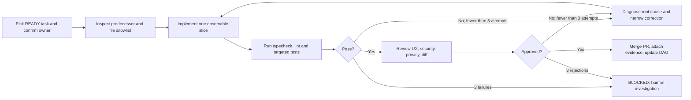
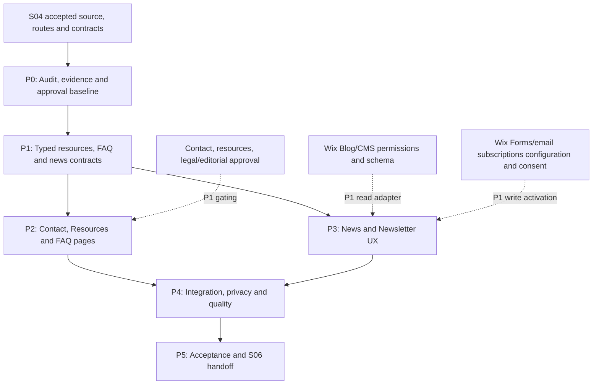
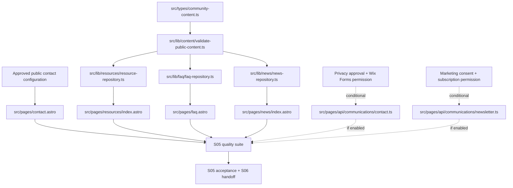

# Sprint 05 — Contact, Resources, News and Communications

**Project:** PostBaby Bliss Foundation Digital Platform  
**Delivery model:** One-week Agile sprint; six gated phases, with independent vertical slices  
**Engineering model:** Dependency/ownership graphs, bounded implementation–test–review loops and evidence-based acceptance  
**Baseline stack:** Astro, TypeScript, Tailwind CSS, selective React only for genuinely interactive experiences, Wix JavaScript SDK when verified, Git/GitHub, GitHub Actions, Vitest and Playwright  
**Primary outcome:** A coherent, accessible public information and communication experience: **Contact**, **Resources**, **FAQ**, and **News & Updates**, with a trustworthy newsletter opt-in surface and optional real contact/newsletter integrations **only when approved, configured and tested**. The live Wix website remains unchanged.

> **Scope and evidence disclaimer.** This is the **Sprint 05 execution plan**, not a claim that earlier sprints have been implemented. The available files contain detailed plans for Sprints 01–04 and 08, but not a verified development repository or acceptance evidence. Before coding, confirm actual S04 source, routes, ADRs, CI checks, and sign-offs in GitHub. All file paths below are proposed operations against the **Astro + Wix-managed Headless candidate**. If `ADR-0001` selected Wix Editor/Studio + Velo instead, create an approved alternative manifest; Astro files cannot be transplanted into Wix Editor pages.
>
> **Source distinction.** The Foundation's supplied four-page site PDF mentions **Contact Us**, **FAQ**, **Updates & News**, **Resource Navigation** and contact details; it does not authorize publication of every existing claim, contact number, photograph, medical/referral entry, email list, sender account or visitor form. All such facts need owner verification. Requirements below are project design decisions, not historical facts established by the attachment.
>
> **Nonproduction rule.** Do not send external newsletters, mail individual inquiries to live staff, collect family/medical records, enable a new CRM subscription, activate marketing automation, change live Wix settings, or switch the domain without specific approvals and a verified provider workflow. This sprint authorizes safe local development and preview only.

---

## 1. Purpose, scope and expected working increment

### 1.1 Why Sprint 05 exists

Sprints 01–04 planned a foundation of original site components, programs, donation handoffs, volunteer opportunities and events. The next user journeys are equally important: visitors need **credible ways to contact the Foundation**, identify **reviewed postpartum-related resources**, find answers to common questions, understand **current verified organizational news**, and optionally consent to receiving updates. A polished site that publishes unsupported referral data, promises a contact request was delivered when it was not, or subscribes visitors without consent is not a usable nonprofit service.

This sprint provides the smallest robust end-to-end public journeys while keeping provider-dependent transactions behind clear gates. In particular, **public content must remain usable without a configured CRM or mailing provider**. The more sensitive case-intake and staff administration workflows belong to separately approved work in Sprint 06 or later.

### 1.2 Sprint objectives

1. Build responsive `/contact`, `/resources`, `/faq`, and `/news` routes, adding a `/resources/[slug]` or `/news/[slug]` detail route only where a maintained content source and approved records justify it.
2. Establish consistent, typed, tested content repositories for approved resources, FAQs and news, including a deliberately documented Wix CMS or Wix Blog adapter decision.
3. Present accurate, Foundation-verified public contact methods and accessible navigation from the shared header/footer, Programs, Events and Support Us pages.
4. Provide a **safe public contact journey**: approved contact options at minimum and a controlled **nonclinical inquiry form only if** the Foundation approves its data fields, destination, privacy notice, anti-abuse controls and retention owner.
5. Publish only reviewed, attributable and time-appropriate organizational updates. No fabricated events, partner endorsements, impact totals or health advice may be introduced to fill layout gaps.
6. Design a newsletter subscription user journey that uses **separate, affirmative marketing consent**, with real subscription writes/confirmations gated by provider permissions and actual nonproduction verification.
7. Enforce clear states for empty content, stale/disabled links, form errors, blocked provider connections, unavailable opt-in and provider timeouts; never fabricate delivery or subscription success.
8. Demonstrate WCAG 2.2 AA-oriented accessible UI, safe URL handling, metadata and link hygiene, mobile responsiveness, test coverage, review evidence, and a dependency-aware Sprint 06 handoff.

### 1.3 Delivery tiers and exclusions

| Tier | Work that can be accepted | Constraint |
|---|---|---|
| **P0 — preview baseline** | Contact details and safe verified links, Resources directory, FAQ, News index, consistent menus/footer, typed repositories/fixtures, accessible newsletter invitation, automated tests | All displayed content is approved or replaced by a truthful empty state; no live form writes necessary |
| **P0 — content trust** | Editorial review inventory; resource/date/source metadata; explicit publication policy; screenshot and file-permission evidence | Snapshot information alone is not ongoing verification |
| **P1 — owner-approved contact integration** | Nonclinical contact form posting to an existing approved Wix Form, or to a documented trusted contact-provider endpoint | Only after field map, installed app, correct form ID, permission, abuse protection, routing and retention are proven |
| **P1 — owner-approved newsletter integration** | Explicit opt-in connected to the site's approved Wix email-subscription/CRM pathway or equivalent provider | Requires separate subscription consent, verified status semantics, suppressions and sender/process approval |
| **P1 — live editorial read** | Approved Wix CMS/Blog read adapter for published resource/news records | Must respect access permissions, published-only filtering and stable routes; not a blocker to vetted local preview |
| **P2 — defer** | Keyword search, topic filters, long-form resource detail pages, rich archive pagination, live chat, auto-email campaigns | Add only if the P0 journey and the provider approvals are already complete |

**Explicitly out of scope:** Medical triage, diagnosis, lactation advice, symptom intake, pregnancy or infant health histories, family case management, case-worker assignment, claims of licensed referrals, protected document uploads, authenticated family dashboards, contact center/live chat, automated outbound campaigns, new analytics profiles of vulnerable families, advanced CRM reporting, production Wix migration, and unrestricted CMS write permissions.

### 1.4 Five-minute end-of-sprint acceptance demo

A reviewer opens the protected preview at a mobile viewport, navigates **Home → Resources → FAQ → News → Contact**, sees approved and properly dated resources/news, inspects a valid and invalid resource/news URL where detail routes exist, returns to the header/footer, and finds a reliable contact method. The newsletter interface explains its purpose and current availability. If an approved nonproduction provider is connected, a synthetic inquiry/opt-in is submitted and verified in the provider dashboard; otherwise the demo **explicitly** shows an unavailable state and a documented `BLOCKED` integration node. The reviewer watches a targeted automated test pass and inspects the acceptance ledger. A visually convincing toast alone is **not** submission evidence.

---

## 2. Loop engineering, task graph and coding-agent contract

### 2.1 Execution unit

`Sprint → Phase → Task ID → hard prerequisites → permitted files → smallest vertical slice → focused verification → human review → evidence → gate`

- **Task IDs:** `S05-Pn-Tnn`, e.g. `S05-P2-T05`.
- **States:** `TODO`, `READY`, `IN_PROGRESS`, `BLOCKED`, `IN_REVIEW`, `DONE`; `DEFERRED` needs documented scope-owner approval.
- **File operations:** `C` create, `M` modify, `C/M` inspect then decide, `G` framework/tool-generated; `C?`, `M?` and `G?` are conditional versions allowed only after the specified architectural or external approval. These are planned operations, not verified filesystem facts.
- **Priorities:** `P0` core; `P1` only when an external service/content approval exists; `P2` optional enhancement.
- **Definition of a dependency:** A task cannot be `READY` unless its hard predecessors are accepted. A provider/consent decision is a named **external** graph node; it cannot be bypassed by a fake API, fabricated data or AI-generated declaration.
- **Merge policy:** One owner per shared file/branch at a time. Review types/repositories before components; review provider contract before submission code; merge tests with each vertical slice.
- **Source of truth:** Git repository and accepted ADRs, not example commands in this plan or an assistant's earlier claims of completion.

### 2.2 Bounded build–test–review loop



**Loop guardrails**

1. A pull request should deliver a visible vertical slice, such as `validated resource → approved listing card → live route → negative tests`, not a monolithic phase dump.
2. Permit **three evidence-based correction attempts** per failure, then stop and escalate with diagnostics. Do not endlessly regenerate unrelated code.
3. Never commit private submissions, addresses of service recipients, sender credentials, phone/email lists, secrets or screenshots containing personal data. Synthetic tests only.
4. The right to **read** published Wix Blog/CMS content does not imply approval to **write** contacts, subscriptions, forms, campaigns or private data.
5. Never add React or a separate PostgreSQL database merely to render static FAQs, articles or contact details.
6. A passing unit test is not proof that a third-party email was delivered or that subscription status changed. Mark those verifications separately and attach provider-side evidence.
7. A public resource entry must never be invented to make a grid appear full. Prefer an honest, accessible empty state or approved evergreen Foundation-owned educational link.
8. A P1 service integration may be deferred without blocking P0 **only when** safe public contact methods and relevant user journeys are complete.

### 2.3 Sprint dependency graph



**Critical path:** Accepted S04 baseline → P0 → P1 → P2/P3 (parallel after interface acceptance) → P4 → P5. External integration approvals are conditional dependencies; they must block only the features that truly need them. The site itself can be completed to a useful P0 preview with **no real-data processing**.

### 2.4 Dependency/ownership rules for parallel work

| Lane | Primary ownership | Can start after | Must not change without coordination |
|---|---|---|---|
| Content/data | `src/types/community-content.ts`, `src/lib/resources/**`, `src/lib/faq/**`, `src/lib/news/**`, approved fixtures | P0/G0 | Shared navigation and page layout |
| Public UI | `src/pages/contact.astro`, `src/pages/resources/**`, `src/pages/faq.astro`, `src/components/resources/**`, `src/components/faq/**` | P1/G1 | Provider submission contracts |
| Editorial/communications | `src/pages/news/**`, `src/components/news/**`, `src/components/communications/**` | P1/G1 | Direct privileged writes to Wix |
| Integration/security | `src/lib/contact/**`, `src/lib/communications/**`, conditional `/api` endpoints | Approved interfaces + external consent | Content fixtures and global layout without review |
| Quality | `tests/**`, `docs/quality/**`, CI checks | In parallel with each slice | Acceptance thresholds or permissions without lead approval |
| Foundation approver | `docs/content/**`, `docs/privacy/**` and evidence records | P0 onwards | Source code, secrets, live service setup without developer present |

---

## 3. Five-day phase schedule and gates

| Day | Phase | Core outcome | Hard gate |
|---|---|---|---|
| **Day 1 AM** | **S05-P0 — Readiness and content authorization** | Verified S04 baseline, approved content policy and source/provider decisions | `G0` — architecture/content/data rules accepted |
| **Day 1 PM–Day 2** | **S05-P1 — Contracts and repositories** | Typed resources, FAQs and news; local adapters; validation and unit tests | `G1` — tested public data boundary |
| **Day 2–Day 3** | **S05-P2 — Contact, Resources and FAQ** | Accessible public journeys and safe contact options | `G2` — complete P0 pages and negative states |
| **Day 3–Day 4** | **S05-P3 — News and Newsletter** | Published-only news, subscription UX and guarded adapters | `G3` — informative UX, no false confirmations |
| **Day 4–Day 5 AM** | **S05-P4 — QA, security and provider verification** | Automated tests, manual accessibility checks and real integration evidence where authorized | `G4` — quality and privacy gate |
| **Day 5 PM** | **S05-P5 — Sprint review and S06 handoff** | Demo, acceptance record, merged PRs and typed backlog | `G5` — agreed release-increment sign-off |

**Capacity assumption:** Two to three developers, an available Foundation content approver and an agreed architecture. If working with one developer or missing external approvals, **protect the P0 public pages and tests**; defer provider writes and advanced article/search UI. The calendar estimates work, it does not override readiness or security gates.

---

## 4. Phase-by-phase implementation specifications

### Phase S05-P0 — Audit Sprint 04 and approve public communication boundaries

**Objective.** Establish authoritative repository paths, verify all public-facing facts and choose a minimal content/provider architecture before any user data is handled.

**Specific tasks**

- `S05-P0-T01` (**P0**): Inspect the actual branch and `docs/reviews/sprint-04-review.md`, `docs/quality/sprint-04-acceptance.md`, `docs/architecture/ADR-0001-delivery-path.md`, `ADR-0002` and `ADR-0004`. Run existing smoke scripts. Mark any missing predecessor as `BLOCKED`; do not assume documentation equals delivery.
- `S05-P0-T02` (**P0**): Inventory legacy Wix URLs for Contact, FAQ, Updates & News, and Resource Navigation. Record redirects for Sprint 08 only; **do not** modify the live domain.
- `S05-P0-T03` (**P0**): Confirm public contact information (organization name, verified email address, public phone and city/office details) with the Foundation. The uploaded snapshot's contact block is **provisional** until checked.
- `S05-P0-T04` (**P0**): Create an editorial register of resources, news posts, FAQ answers and image rights; record source URL, owner, review date, publication status and next-review due date. Establish who can approve or withdraw an urgent/corrected article.
- `S05-P0-T05` (**P0**): Decide *one* primary source per content type: `local approved content` or `Wix CMS` for resources/FAQ; `approved local editorial records`, `Wix Blog` or `Wix CMS` for news. Document rendering mode from `ADR-0002`, stable slug strategy and content-visibility policy.
- `S05-P0-T06` (**P1**): Audit existing Wix Forms, contact routing, CRM/email subscriptions and verified marketing sender. Identify a suitable **existing** form ID before making a new form; document whether the form/list can be used safely with the headless frontend.
- `S05-P0-T07` (**P0**): Agree a **nonclinical communication policy**: what fields may be collected, whether a contact form is enabled, who has inbox access, response expectations, retention/deletion process, approved privacy notice, consent wording, and escalation for messages that unexpectedly contain sensitive details.

**File-operation manifest**

| Op | Exact repository file | Responsibility |
|---|---|---|
| M | `docs/engineering/task-graph.md` | Add S05 tasks, hard dependencies, status and external approvals |
| M | `docs/audit/existing-site-inventory.md` | Record old Contact, FAQ, News, Resources URLs and planned redirect candidates |
| C | `docs/audit/sprint-05-communications-readiness.md` | Architecture, installed apps, account permissions, verified contact info and provider status |
| C | `docs/architecture/ADR-0005-public-information-and-communications.md` | Content-source decisions, read/write trust boundary, forms/newsletter activation policy |
| C | `docs/content/sprint-05-public-information-inventory.md` | Approved/pending/rejected FAQs, resources, news, links, copy and asset consent |
| C | `docs/privacy/sprint-05-inquiry-subscription-policy.md` | Minimal fields, consent, authorized access, logging, retention, incident handling |
| M | `docs/audit/asset-and-content-register.md` | Photograph ownership, permissions and allowable uses |
| M | `docs/content/editorial-approval.md` | Link S05 editorial sign-off to the established approval register |
| M | `docs/architecture/ADR-0002-content-source-and-rendering.md` | Only if the actual rendering/source decision requires a reviewed change |

**Exit gate `G0`.** The team has a demonstrably working baseline, signed content/contact governance, a decision for each content repository, and a written permission matrix for any P1 form/newsletter feature. If the Foundation has not approved public contact details, represent the `/contact` page as a pending draft in preview; do not publish guessed information. No new live provider traffic occurs.

### Phase S05-P1 — Build typed content models and validated read repositories

**Objective.** Make public information predictable, publication-aware and independently testable without coupling Astro components to Wix SDK responses.

**Specific tasks**

- `S05-P1-T01` (**P0**): Define canonical `PublicResource`, `FaqItem`, `NewsArticle` and `PublicationState` types with stable identifiers, slugs, reviewed attribution, ordering, publication dates and safe outbound CTA fields. No individual family record belongs in these models.
- `S05-P1-T02` (**P0**): Implement validation for required fields, URL protocols, duplicate slugs, publication visibility, metadata dates, accessible link names and review status; prevent arbitrary executable/unsafe HTML from reaching templates.
- `S05-P1-T03` (**P0**): Define read-only repository contracts (`listPublished()`, `getPublishedBySlug()` where relevant); use typed empty/not-found/error results and consistent ordering. No write methods on visitor-facing repositories.
- `S05-P1-T04` (**P0**): Add local adapters and **clearly identified editorial fixtures** using approved Foundation copy only. Provisional entries are `draft` and never appear in public read results. Never manufacture health-service partners or live news dates.
- `S05-P1-T05` (**P0**): Implement explicit selection between local and verified remote adapters, respecting the `ADR-0002` SSR/static strategy. A production Wix outage should never silently show possibly stale test fixtures.
- `S05-P1-T06` (**P0**): Add deterministic unit tests for slug uniqueness, draft suppression, safe outbound URLs, date ordering, FAQ ordering, error states, missing resources, and metadata validation.
- `S05-P1-T07` (**P1**): If the Wix site's data source is approved, implement a read-only CMS or Wix Blog adapter using installed SDK types and the actual collection schema. Published-only filtering occurs **server-side**; confirm pagination, permissions and preview behavior with a nonproduction account.

**File-operation manifest**

| Op | Exact repository file | Responsibility |
|---|---|---|
| C | `src/types/community-content.ts` | `PublicResource`, `FaqItem`, `NewsArticle`, source/approval types |
| C | `src/lib/content/validate-public-content.ts` | Required fields, slugs, safe links, dates and publication rules |
| C | `src/lib/resources/resource-repository.ts` | Public resource read contract |
| C | `src/lib/resources/adapters/local-resource-repository.ts` | Local resource implementation |
| C | `src/lib/faq/faq-repository.ts` | Public FAQ read contract |
| C | `src/lib/faq/adapters/local-faq-repository.ts` | Local FAQ implementation |
| C | `src/lib/news/news-repository.ts` | Public news read contract |
| C | `src/lib/news/adapters/local-news-repository.ts` | Local news implementation |
| C | `src/lib/content/get-public-information-repositories.ts` | Controlled local/Wix repository selection |
| C | `src/data/resource-fixtures.ts` | Approved or unpublished provisional resource records |
| C | `src/data/faq-fixtures.ts` | Approved or unpublished provisional FAQ answers |
| C | `src/data/news-fixtures.ts` | Approved or unpublished provisional news records |
| C | `tests/unit/public-content-validation.test.ts` | Unsafe URLs, duplicate slugs, missing fields and draft visibility |
| C | `tests/unit/resource-repository.test.ts` | Resource ordering, by-slug, empty and missing data |
| C | `tests/unit/faq-repository.test.ts` | FAQ categorization, stable order and publication |
| C | `tests/unit/news-repository.test.ts` | Publish-state filtering and chronologically correct news |
| C? | `src/lib/resources/adapters/wix-cms-resource-repository.ts` | **Conditional:** read-only CMS adapter after schema approval |
| C? | `src/lib/faq/adapters/wix-cms-faq-repository.ts` | **Conditional:** read-only CMS adapter after schema approval |
| C? | `src/lib/news/adapters/wix-blog-news-repository.ts` | **Conditional:** use if Wix Blog is approved as the news source |
| C? | `src/lib/news/adapters/wix-cms-news-repository.ts` | **Alternative:** only if Wix CMS, not Wix Blog, is the chosen news source |
| C? | `src/lib/news/map-wix-news-item.ts` | **Conditional:** map exact installed SDK response to `NewsArticle` |
| M | `src/lib/site-config.ts` | Content-source modes and route configuration, excluding secrets |
| M? | `package.json` | Installed SDK or test dependency if genuinely required |
| G? | `package-lock.json` | Generated only after approved dependency installation |

**Illustrative domain contract (not an exact Wix CMS field schema):**

```ts
export type PublicationState = 'draft' | 'approved' | 'published' | 'archived';

export interface PublicResource {
  id: string;
  slug: string;
  title: string;
  summary: string;
  category: string;
  sourceName: string;
  sourceUrl?: string;       // verified HTTPS destination
  reviewedAt: string;       // date or ISO date-time
  publication: PublicationState;
  detailEnabled: boolean;
  displayOrder: number;
}

export interface FaqItem {
  id: string;
  question: string;
  answerParagraphs: string[]; // reviewed plain text / trusted structured copy
  category: string;
  displayOrder: number;
  publication: PublicationState;
}

export interface NewsArticle {
  id: string;
  slug: string;
  title: string;
  excerpt: string;
  bodyParagraphs: string[]; // no untrusted CMS HTML injection
  publishedAt: string;      // ISO instant or date; explicit display rule
  publication: PublicationState;
  authorLabel?: string;     // Foundation-approved attribution
  image?: { src: string; alt: string; approvalRef: string };
}
```

**Publishing rule.** `approved` means content was reviewed internally; **only** `published` content appears on the public pages. A resource with an outdated review date is held for reapproval according to the Foundation's policy. Do not claim a source URL establishes a partner/referral relationship. All local fixtures remain editorial artifacts, not simulated live CMS records.

**Exit gate `G1`.** Contract tests pass, public repositories exclude unpublished content, URL/date formatting is deterministic and rendering remains possible from verified local data without a live Wix connection. Source selection and any API permissions are explicit in `ADR-0005`.

### Phase S05-P2 — Implement Contact, Resources and FAQ journeys

**Objective.** Deliver polished, accurate public routes and reliable contact actions using the shared design system, without making sensitive-data processing a prerequisite.

**Specific tasks**

- `S05-P2-T01` (**P0**): Create `/contact` with approved email/telephone links, Houston service-area phrasing if confirmed, accessible headings, plain-language contact scope, contact availability, and a notice discouraging medical or sensitive personal details in general inquiries. Do not imply an office is open for walk-ins without confirmation.
- `S05-P2-T02` (**P0**): Implement a reusable `ContactMethodCard` with accessible `mailto:`/`tel:` display, descriptive names and safe fallback text if a method is unverified.
- `S05-P2-T03` (**P0**): Build `/resources` as a responsive directory of reviewed categories, source attribution, last-reviewed dates and clearly labeled official/community links. Only show a `/resources/[slug]` route if detail content and the rendering strategy are approved; otherwise use direct approved external sources.
- `S05-P2-T04` (**P0**): Build `/faq` with logical, non-duplicative questions on the Foundation's services, eligibility/inquiry process when verified, donating, volunteering, and program contact routes. Do not publish unconfirmed fee, medical, or program-availability answers.
- `S05-P2-T05` (**P0**): Connect Contact, Resources and FAQ through `src/lib/navigation.ts`, the shared footer, and relevant Program/Event pages; preserve consistent route names and accessibility states. Update existing pages narrowly.
- `S05-P2-T06` (**P1**): Implement a minimal **nonclinical contact form** only when legal/privacy review and routing are approved. Validate on both client and server; prefer an approved existing Wix Forms integration; use `POST` with anti-abuse controls, rate limits, minimal logging and neutral public errors. The form must never use a mocked provider in release mode.
- `S05-P2-T07` (**P0**): Test empty resources, stale/no contact method, invalid destination, accordion keyboard usage, 404 detail route behavior when present, and mobile layouts at 375/768/1440 px.

**File-operation manifest**

| Op | Exact repository file | Responsibility |
|---|---|---|
| C | `src/pages/contact.astro` | Verified Foundation contact page and nonclinical guidance |
| C | `src/pages/resources/index.astro` | Resource directory with attribution and empty state |
| C? | `src/pages/resources/[slug].astro` | Conditional approved detail route; obey `ADR-0002` rendering mode |
| C | `src/pages/faq.astro` | FAQ page using approved repository data |
| C | `src/components/contact/ContactMethodCard.astro` | Accessible email/phone/link display |
| C | `src/components/contact/ContactNotice.astro` | Appropriate inquiry scope, response expectation and privacy cue |
| C | `src/components/resources/ResourceCard.astro` | Public resource title, citation, review date and link |
| C | `src/components/resources/ResourceGrid.astro` | Semantic responsive resources list |
| C? | `src/components/resources/ResourceDetail.astro` | Conditional long-form detail component |
| C | `src/components/faq/FaqList.astro` | Semantic FAQ list, native details/summary or equivalent accessible UX |
| C? | `src/components/contact/ContactInquiryForm.astro` | **Conditional:** approved nonclinical fields and error/confirmation state |
| C? | `src/types/communications.ts` | Contact/consent request and response contracts, if forms approved |
| C? | `src/lib/contact/validate-inquiry.ts` | Server-side nonclinical form schema validation |
| C? | `src/lib/contact/contact-provider.ts` | Abstract `submitInquiry()` provider contract |
| C? | `src/lib/contact/providers/unavailable-contact-provider.ts` | Honest non-delivery state, not false confirmation |
| C? | `src/lib/contact/providers/approved-wix-forms-provider.ts` | Conditional server-side Wix Forms adapter after ID/permissions verification |
| C? | `src/pages/api/communications/contact.ts` | **Conditional:** POST handler, safe response, anti-abuse and no secrets in client |
| M | `src/lib/navigation.ts` | Add approved Contact/Resources/FAQ routes |
| M | `src/components/layout/SiteFooter.astro` | Verified contact and relevant navigation links |
| M | `src/styles/global.css` | Scoped responsive and focus treatment as needed |
| C | `tests/e2e/contact.spec.ts` | Verified links, unavailable/authorized form states |
| C | `tests/e2e/resources.spec.ts` | Directory, navigation, empty/not-found, safe links |
| C | `tests/e2e/faq.spec.ts` | Keyboard, accessible question/answer interaction |

**Implementation conditions**

- Do not introduce address maps, geolocation prompts, uncontrolled third-party embeds or chat widgets just for visual polish.
- For contact inquiries, use **minimum requested data** (for example: name, reply address, nonclinical topic and a brief message *if approved*). No birth dates, baby names, diagnoses, documents or health history fields. Tell users not to include such details in free text.
- Do not show `Message sent` until the authorized provider actually confirms acceptance. On provider timeout, show `We could not confirm delivery` with an alternate verified contact method.
- Rate limiting, origin validation, spam mitigation and retention must be tested for a deployed public form; one-side-only client validation is not sufficient.
- If the Foundation does not approve a form within this sprint, **publish a functional `/contact` page with trustworthy contact methods**; do not enable the form.

**Exit gate `G2`.** Contact, Resources and FAQ can be demonstrated with keyboard and mobile. Every public contact destination and resource link is approved; nothing looks like a clinical intake portal. Any form integration is either accepted with real provider evidence or clearly unavailable/deferred.

### Phase S05-P3 — Publish News & Updates and build a consent-based newsletter experience

**Objective.** Make organizational updates easy to discover, appropriately sourced and readable, and expose a controlled email-update workflow without premature mass messaging.

**Specific tasks**

- `S05-P3-T01` (**P0**): Build `/news` as an accessible, publication-date-ordered index of **published and verified** announcements, with a helpful empty state and no fabricated dates or story titles.
- `S05-P3-T02` (**P0**): Build `/news/[slug]` only if approved full article bodies exist. Follow `ADR-0002` for `getStaticPaths()` versus SSR and ensure unpublished/unknown slugs return not-found rather than leaked draft copy.
- `S05-P3-T03` (**P0**): Create reusable `NewsCard`, `NewsList` and optional `NewsDetail` components, with approved images, meaningful alternative text, title, visible dates and source attribution.
- `S05-P3-T04` (**P0**): Add a newsletter invitation to the appropriate page/footer location; explain what visitors will receive and link to the privacy notice. Initially render either a verified existing hosted subscription destination or an explicit unavailable state.
- `S05-P3-T05` (**P1**): With approved provider, build an email-only subscription form with an **unchecked and separate** marketing-consent control where needed; server-side validation; safe request throttling; and provider-status-aware messaging. Follow the provider's confirmed opt-in/double-opt-in semantics rather than asserting automatic subscription.
- `S05-P3-T06` (**P1**): Verify the Foundation's Wix email-subscription API availability, allowed permission elevation, confirmation flow, suppression/unsubscribe behavior and account settings. **Do not** send a campaign or alter a production mailing list as part of the preview.
- `S05-P3-T07` (**P0**): Add page SEO metadata, accessible social preview information, approved source links and homepage/footer News CTA. Treat legacy URL redirects as Sprint 08 migration inventory, not in-sprint deployment work.

**File-operation manifest**

| Op | Exact repository file | Responsibility |
|---|---|---|
| C | `src/pages/news/index.astro` | Published News & Updates listing |
| C? | `src/pages/news/[slug].astro` | Conditional full article route |
| C | `src/components/news/NewsCard.astro` | Article preview card with date and source context |
| C | `src/components/news/NewsList.astro` | Semantic responsive news list/empty state |
| C? | `src/components/news/NewsDetail.astro` | Full editorial article component, approved content only |
| C | `src/components/communications/NewsletterInvite.astro` | Nontransacting/linked invitation and notice |
| C? | `src/components/communications/NewsletterSignupForm.astro` | Conditional real provider-connected consent form |
| C | `src/lib/seo/community-metadata.ts` | Contact, FAQ, Resources, News metadata composition |
| C? | `src/lib/communications/newsletter-provider.ts` | Conditional subscription provider interface |
| C? | `src/lib/communications/validate-newsletter-signup.ts` | Conditional email, consent and submission validation |
| C? | `src/lib/communications/providers/unavailable-newsletter-provider.ts` | Honest disabled state, no fake subscription |
| C? | `src/lib/communications/providers/approved-wix-email-subscriptions-provider.ts` | Conditional server-only Wix SDK adapter after approval |
| C? | `src/pages/api/communications/newsletter.ts` | Conditional `POST`, anti-abuse, safe responses and server-side permissions |
| M | `src/components/layout/SiteFooter.astro` | Newsletter invitation, News link and privacy link |
| M | `src/lib/navigation.ts` | News navigation entry and consistent labels |
| M | `src/pages/index.astro` | Approved News preview/CTA only; avoid overexpanding home scope |
| C | `tests/e2e/news.spec.ts` | Published-only, correct order, details and 404 |
| C | `tests/e2e/newsletter.spec.ts` | Consent, unavailable, success/error states when provider exists |
| C | `tests/unit/newsletter-consent.test.ts` | Conditional provider-independent consent validation |

**News source choice:** If the organization maintains Wix Blog with actual published entries, use the **read-only Wix Blog API** (installed `@wix/blog`, permissions verified). Otherwise, if approved, use Wix CMS or local approved articles; do not simultaneously maintain two competing sources for the same news route. The legacy snapshot's brief Harris County update **does not** establish a complete publishable article, permission to identify participants, a verified partnership, or permission to copy image content from an event. Its inclusion requires fresh editorial approval.

**Subscription semantics:** Email sign-up is not a contact-inquiry opt-in. A visitor's contact form submission must **never** automatically subscribe them to marketing. Prevent including email addresses in URL query strings, analytics payloads and error logs. Do not claim the user is subscribed if the provider reports pending confirmation or a failed write; present a neutral confirmation instruction appropriate to the provider's actual response.

**Exit gate `G3`.** News and newsletter UI are navigable and accessible; published records are approved and dated; newsletter writes, if enabled, are authorized, consent-aware and verifiably reported. Otherwise, the interface clearly shows the unavailable/hosted-link state and an external-approval blocker.

### Phase S05-P4 — Integration verification, accessibility, security and regression

**Objective.** Verify the complete public journeys and any approved writes without allowing test infrastructure, dummy success handlers or unauthorized data collection to masquerade as operational readiness.

**Specific tasks**

- `S05-P4-T01` (**P0**): Extend deterministic unit tests for content validation, publication suppression, source errors, safe URL schemes, date formatting, FAQ sorting and reusable metadata.
- `S05-P4-T02` (**P0**): Run Playwright navigation tests for Home → Contact, Home → Resources → FAQ, Home → News, footer CTA and conditional slug details. Verify desktop/tablet/mobile with no horizontal overflow.
- `S05-P4-T03` (**P0**): Test keyboard-only navigation, skip link, visible focus, heading hierarchy, semantic FAQ expansion, descriptive links, alt text and reduced-motion behavior. Run automated accessibility scans and document a manual pass; **automation does not establish complete WCAG conformance**.
- `S05-P4-T04` (**P0**): Conduct privacy/security review: malicious URLs, HTML escaping, open redirects, draft content leakage, accidental disclosure in logs/screenshots, referrer behavior, and cache policy for error/form responses. Confirm no secrets are exposed to the browser or repository.
- `S05-P4-T05` (**P1**): For approved contact writes, test synthetic successful submission, invalid fields, duplicate/abuse protection, wrong method, provider timeout, failure response and verification **in the designated nonproduction Wix Forms inbox**. Protect write methods behind server-only permissions.
- `S05-P4-T06` (**P1**): For approved newsletter writes, test separately granted/withdrawn consent, duplicate address behavior, suppression and provider status, timeout/retry behavior, unsubscribed states and provider-side confirmation in nonproduction. **Never send a real bulk campaign during CI**.
- `S05-P4-T07` (**P0**): Confirm component size and performance budgets on representative routes, preserve reduced JavaScript for mostly static pages, and verify correctly optimized and authorized photography. Defer intensive performance engineering to Sprint 07.
- `S05-P4-T08` (**P0**): Run the repository's complete quality pipeline (`check`, `lint`, unit/integration, build and browser smoke tests), record baseline/known failures and produce a privacy-safe evidence packet for Sprint 06/07.

**File-operation manifest**

| Op | Exact repository file | Responsibility |
|---|---|---|
| C | `tests/integration/public-content-adapters.test.ts` | Source mapping, unavailable, published-only and error cases |
| C? | `tests/integration/contact-submission.test.ts` | Conditional synthetic contact provider/endpoint verification |
| C? | `tests/integration/newsletter-subscription.test.ts` | Conditional consent/provider write contract and errors |
| C | `tests/e2e/community-navigation.spec.ts` | Links across all new and prior public routes |
| C | `tests/e2e/community-accessibility.spec.ts` | Automated keyboard/accessibility checks; manual evidence separately |
| C | `tests/e2e/community-responsive.spec.ts` | Representative mobile/tablet/desktop routes |
| C | `tests/unit/community-metadata.test.ts` | Canonicals, titles, descriptions and no sensitive data |
| C? | `tests/unit/contact-inquiry-validation.test.ts` | Conditional form validation, privacy-safe error handling |
| C | `docs/quality/sprint-05-test-evidence.md` | Test commands, CI run links, outcomes, defects and limitation notes |
| C | `docs/quality/sprint-05-integration-evidence.md` | Wix IDs/versions, owner approvals, provider outcome and blocked branches; no secrets |
| C | `docs/quality/sprint-05-accessibility-review.md` | Keyboard/manual checks, WCAG findings and retest evidence |
| C | `docs/quality/sprint-05-acceptance.md` | Gate ledger, risk owner and unresolved P0/P1 |
| M | `.github/workflows/ci.yml` | Only if actual CI requires a reviewed workflow adjustment |
| M | `package.json` | Add scripts only if absent; preserve previous sprint scripts |
| G? | `package-lock.json` | Lockfile updates only from documented dependency changes |
| M? | `src/pages/**`, `src/components/**`, `src/lib/**` | Narrow, ticket-linked fixes only; never blanket refactors |

**Testing commands (only when the repository scripts exist):**

```bash
npm ci
npm run check
npm run lint
npm run test
npm run build
npm run test:e2e
```

Use installed Vitest/Playwright configurations to run targeted specs. If the chosen test environment cannot call an approved Wix service, simulate providers with dependency injection and mark **live integration proof `BLOCKED`**, not `PASSED`. For a live integration approval, the provider-side confirmation is a separate auditable artifact; protect identifiers, inbox content and screenshots.

**Exit gate `G4`.** All P0 quality checks pass, public route behavior is consistent, no unsafe form/newsletter state is enabled, no P0 security/accessibility defects remain, and P1 integrations are explicitly accepted with actual nonproduction evidence or declared blocked/deferred.

### Phase S05-P5 — Demonstrate, accept, merge and hand off to Sprint 06

**Objective.** Close the sprint with a working, traceable public increment and explicit administration/integration prerequisites for the next sprint.

**Specific tasks**

- `S05-P5-T01` (**P0**): Demo four public routes at desktop and mobile, showing approved content, empty/404 states, newsletter availability, contact link function and any authorized nonproduction provider transaction.
- `S05-P5-T02` (**P0**): Present the editorial and privacy ledger to the Foundation; identify who owns contact information updates, resource verification, news publication, email consent and the response inbox.
- `S05-P5-T03` (**P0**): Close or defer every task graph node with links to PR, changed-files manifest, verification command, test result, reviewer and explicit blocker. Never mark an integration accepted on UI evidence alone.
- `S05-P5-T04` (**P0**): Merge reviewed source into the approved nonproduction branch; document startup/build commands and any changed routes/data schema. **Do not** trigger a live migration, subscriber campaign or email send.
- `S05-P5-T05` (**P0**): Prepare Sprint 06 administration/integration candidates with minimum permissions, dashboard ownership, content-editing workflows, form routing, subscription suppression handling, audit traceability and any deferred provider gate.

**File-operation manifest**

| Op | Exact repository file | Responsibility |
|---|---|---|
| C | `docs/reviews/sprint-05-review.md` | Demo, approvals, changes, blockers, accepted increment |
| C | `docs/backlog/sprint-06-candidates.md` | Prioritized work with task prerequisites and owners |
| M | `docs/quality/sprint-05-acceptance.md` | Final `G0`–`G5` decisions and named sign-offs |
| M | `docs/quality/sprint-05-test-evidence.md` | Final CI links and regression evidence |
| M | `docs/quality/sprint-05-integration-evidence.md` | Explicit connected, blocked or deferred status |
| M | `docs/engineering/task-graph.md` | Done/blocked nodes and future S06 edges |
| M | `docs/content/sprint-05-public-information-inventory.md` | Final approved-versus-pending content map |
| M | `docs/architecture/ADR-0005-public-information-and-communications.md` | Final source/consent/permission decisions |
| C | `docs/handoff/sprint-05-communications-operations.md` | Content ownership, nonclinical inquiry routing and owner actions |

**Exit gate `G5`.** An authorized reviewer confirms P0 usefulness, production safety, test evidence and owner responsibilities. All unapproved providers remain disabled or use an approved hosted link. Sprint 06 receives actual contracts and evidence, not inferred readiness.

---

## 5. File-dependency graph, path map and merge order

### 5.1 Data-to-interface and conditional write graph



### 5.2 File operations by phase — compact cross-check

| Phase | Main created routes or contracts | Shared files modified | Evidence/gate |
|---|---|---|---|
| P0 | `docs/architecture/ADR-0005-public-information-and-communications.md`, content and privacy inventories | `docs/engineering/task-graph.md`, site/content inventory | G0 approval records |
| P1 | `src/types/community-content.ts`, three repository families and fixtures | `src/lib/site-config.ts`; package files only if necessary | G1 typed tests |
| P2 | `src/pages/contact.astro`, `src/pages/resources/index.astro`, `src/pages/faq.astro`, components | `src/lib/navigation.ts`, `SiteFooter.astro`, styles as needed | G2 public UX |
| P3 | `src/pages/news/index.astro`, news components, newsletter invitation and optional API | Footer, navigation, homepage and metadata as needed | G3 editorial/consent review |
| P4 | Test suites and Sprint 05 quality reports | CI and precise fixes only | G4 proof packet |
| P5 | Sprint review, S06 backlog and communications runbook | Task graph, approval/evidence documents | G5 signed handoff |

### 5.3 Planned repository tree (only additions relevant to Sprint 05)

```text
src/
  types/
    community-content.ts
    communications.ts                            # conditional
  data/
    resource-fixtures.ts
    faq-fixtures.ts
    news-fixtures.ts
  lib/
    content/
      validate-public-content.ts
      get-public-information-repositories.ts
    resources/
      resource-repository.ts
      adapters/
        local-resource-repository.ts
        wix-cms-resource-repository.ts           # conditional
    faq/
      faq-repository.ts
      adapters/
        local-faq-repository.ts
        wix-cms-faq-repository.ts                # conditional
    news/
      news-repository.ts
      adapters/
        local-news-repository.ts
        wix-blog-news-repository.ts              # conditional, alternative to CMS
        wix-cms-news-repository.ts               # conditional, alternative to Blog
      map-wix-news-item.ts                       # conditional
    contact/
      validate-inquiry.ts                        # conditional
      contact-provider.ts                        # conditional
      providers/
        unavailable-contact-provider.ts          # conditional
        approved-wix-forms-provider.ts           # conditional
    communications/
      newsletter-provider.ts                     # conditional
      validate-newsletter-signup.ts             # conditional
      providers/
        unavailable-newsletter-provider.ts       # conditional
        approved-wix-email-subscriptions-provider.ts # conditional
    seo/
      community-metadata.ts
  components/
    contact/
      ContactMethodCard.astro
      ContactNotice.astro
      ContactInquiryForm.astro                    # conditional
    resources/
      ResourceCard.astro
      ResourceGrid.astro
      ResourceDetail.astro                       # conditional
    faq/
      FaqList.astro
    news/
      NewsCard.astro
      NewsList.astro
      NewsDetail.astro                           # conditional
    communications/
      NewsletterInvite.astro
      NewsletterSignupForm.astro                  # conditional
  pages/
    contact.astro
    resources/
      index.astro
      [slug].astro                               # conditional
    faq.astro
    news/
      index.astro
      [slug].astro                               # conditional
    api/
      communications/
        contact.ts                               # conditional
        newsletter.ts                            # conditional

tests/
  unit/
    public-content-validation.test.ts
    resource-repository.test.ts
    faq-repository.test.ts
    news-repository.test.ts
    community-metadata.test.ts
    contact-inquiry-validation.test.ts           # conditional
    newsletter-consent.test.ts                   # conditional
  integration/
    public-content-adapters.test.ts
    contact-submission.test.ts                   # conditional
    newsletter-subscription.test.ts              # conditional
  e2e/
    contact.spec.ts
    resources.spec.ts
    faq.spec.ts
    news.spec.ts
    newsletter.spec.ts
    community-navigation.spec.ts
    community-accessibility.spec.ts
    community-responsive.spec.ts

docs/
  audit/
    sprint-05-communications-readiness.md
  architecture/
    ADR-0005-public-information-and-communications.md
  content/
    sprint-05-public-information-inventory.md
  privacy/
    sprint-05-inquiry-subscription-policy.md
  quality/
    sprint-05-test-evidence.md
    sprint-05-integration-evidence.md
    sprint-05-accessibility-review.md
    sprint-05-acceptance.md
  reviews/
    sprint-05-review.md
  handoff/
    sprint-05-communications-operations.md
  backlog/
    sprint-06-candidates.md
```

**File-manifest priority rule:** When the real GitHub tree differs from a path shown here, inspect existing architecture decisions and record the corrected location in the ticket/PR. Never create a parallel duplicate just to satisfy the textual file map. Files tagged `conditional` must **not** be created or configured until the applicable owner-approved integration or route strategy is chosen.

### 5.4 Stable merge sequence

1. `ADR-0005`, inventory and content approval baseline.
2. Canonical types, validation and local repository contracts with tests.
3. Contact, resource, FAQ and news UI vertical slices; review navigation/footer conflicts in one PR owner.
4. Optional read-only Wix adapters (after schema and permission verification).
5. Optional contact form and newsletter providers (after consent/privacy/abuse controls); **separate** elevated-permission PRs.
6. Integrated tests, accessibility and acceptance evidence; review and merge to preview branch.

---

## 6. Content rules, field maps and U.S. operating safeguards

### 6.1 Public resource editorial minimum

Each **published** resource must have a verified title, useful summary, suitable category, publishing owner/attribution, reviewed date, and an approved destination or reviewed on-site explanation. If the source is external, make it clear that it is an external source rather than a formally endorsed partner; do not imply eligibility or medical assurance. Avoid republishing third-party articles verbatim, scraping patient stories, or copying images without rights.

Suggested **project-level CMS fields** (not guaranteed Wix names):

| Public type | Required fields | Optional fields | Rule |
|---|---|---|---|
| Resource | `id`, `slug`, `title`, `summary`, `category`, `sourceName`, `reviewedAt`, `publication` | `sourceUrl`, `displayOrder`, `detailEnabled` | `published` only; external URL must be approved HTTPS |
| FAQ | `id`, `question`, `answerParagraphs`, `category`, `displayOrder`, `publication` | `reviewedAt`, source reference | Publish only verified statements; no unsupported eligibility claims |
| News | `id`, `slug`, `title`, `excerpt`, `publishedAt`, `publication` | reviewed body, image, author label, attribution | Publish only approved complete articles; no fabricated event dates |
| Public contact | Approved displayed method and label | Response hours, street address, alternate channel | Verify current details; do not expose private staff phone or location |
| Newsletter form | Approved email + affirmative consent | Provider-specific proof of confirmation | Store only if authorized; no automatic marketing sign-up from Contact |

### 6.2 Contact and privacy design

- Establish whether Foundation communications are ordinary **nonclinical general inquiries** and whether a visitor might disclose health information in free text. Obtain legal/privacy assessment and documented organizational handling rules before collecting sensitive information. The project does **not** assume HIPAA applies or does not apply merely because the organization works with postpartum families.
- At a minimum, the public contact route can show verified email/phone and service links. An inquiry form is an enhancement with a separate security and operational acceptance gate.
- If a form is approved: use an explicit `POST` endpoint; validate on server; minimal fields; appropriate abuse controls; controlled error messages; authenticated/authorized staff access in the provider dashboard; retention/deletion ownership; and no PII in analytics or client-visible URLs.
- A general inquiry must not be treated as a service enrollment, clinical referral, appointment booking or guaranteed timely response. Never claim a user has been accepted into a support program.
- Confirm whether the Wix Forms app is actually installed and the existing form ID is mapped to the same intended fields. Forms or widgets on the Editor site **do not automatically appear** on the new headless frontend.
- Review whether the site's privacy policy and notices accurately describe the deployed form/vendor, recipients, retention and marketing use. The Foundation is responsible for legal approval.

### 6.3 Newsletter consent and email conduct

- Subscription is a separate purpose from general inquiries, donations or event registration. Use affirmative opt-in and record the exact consent statement and time/method when the approved platform supports it.
- Ensure the sender identity and unsubscribe/suppression behavior are configured by the Foundation in its selected email service. Provider APIs can expose subscription status, but their presence is not authorization to launch campaigns.
- Before campaign sending, obtain legal/communications review of the message's **primary purpose** and any applicable CAN-SPAM and state requirements. Do not assume all messages from nonprofits have identical legal treatment.
- A `pending confirmation` provider state is **not** the same as `subscribed`. A service timeout is **not** a success. Separate UI copy and tests for each state.
- Keep campaign composition, contact segmentation, bulk sending and outbound marketing workflows **outside** Sprint 05. The first deliverable is a consent-safe *entry point*, not an email automation suite.

### 6.4 Source-of-truth and Wix integration rules

1. The existing Wix business site and actual installed apps determine which content APIs are available. Headless migration preserves some business data but not Editor page widgets, page code or form UI automatically.
2. For news, prefer a single primary editorial source. Wix Blog's published-post read APIs are a candidate only if Wix Blog is installed and approved; otherwise use approved Wix CMS or local structured content. Check installed SDK version and actual method/field names.
3. CMS and Blog reads may be server-side; any elevation must be least privilege and server-only. No blanket `auth.elevate()` around visitor-write endpoints.
4. For contact, `@wix/forms` requires Wix Forms installed. A `200` HTTP response or mocked service method is not proof of an inbox entry; verify the actual permitted provider result.
5. For newsletter, use the actual subscription API and status semantics. No direct secrets, contact-list exports or unauthorized list updates in the frontend.
6. For resources/news dynamic routes, follow `ADR-0002`: if prerendered, use `getStaticPaths()` and documented rebuild requirements; if SSR, confirm the Wix-managed Astro runtime's route support and caching.
7. During development keep the current live Wix Editor site intact. Sprint 08 owns domain migration, redirects and post-migration verification.

### 6.5 Accessibility, SEO and performance

- Target **WCAG 2.2 AA** through semantics, keyboard access, visible focus, proper error association, meaningful link names, accessible `details/summary` or equivalent FAQ controls, and live-region announcements for dynamic form states.
- No text as images for essential information, no generic “Click here” links, and no misleading button where only an external link exists.
- Default to static Astro rendering for text-heavy content when permitted; avoid a client-side search framework or React hydration without a demonstrated requirement.
- Keep page titles/descriptions unique and accurate. Use source dates only when verified; do not display a PDF screenshot time as the date of an article publication.
- Optimize only **licensed/approved** imagery with meaningful `alt` text, stable sizing and no unnecessary remote tracking. Record content and image review in the editorial register.

---

## 7. Verification matrix, definition of ready/done and acceptance

### 7.1 Test matrix

| User journey / failure state | Automated test | Manual / external evidence | Required tier |
|---|---|---|---|
| Contact page lists verified public methods | `tests/e2e/contact.spec.ts` | Foundation sign-off of links and published details | P0 |
| Contact form missing/disabled | `tests/e2e/contact.spec.ts` | Correct unavailable state, never false “sent” | P0 if provider absent |
| Contact form approved write | `tests/integration/contact-submission.test.ts` | Authorized test submission visible in nonproduction provider | P1 if enabled |
| Resource listing renders published records | `tests/unit/resource-repository.test.ts` + `tests/e2e/resources.spec.ts` | Source attribution/review date check | P0 |
| Invalid/unsafe external URLs rejected | `tests/unit/public-content-validation.test.ts` | Link inventory review | P0 |
| FAQ keyboard navigation | `tests/e2e/faq.spec.ts` | Keyboard/manual screen-reader pass | P0 |
| News sorting/draft filtering/404 | `tests/unit/news-repository.test.ts` + `tests/e2e/news.spec.ts` | Editorial ledger and publication date check | P0 |
| Newsletter is unavailable safely | `tests/e2e/newsletter.spec.ts` | Link/status copy approval | P0 if provider absent |
| Newsletter consent/write and errors | `tests/unit/newsletter-consent.test.ts` + integration test | Provider status evidence, not a mocked response | P1 if enabled |
| Responsive routes and focus | `tests/e2e/community-responsive.spec.ts` + accessibility | Manual 375/768/1440 px and keyboard check | P0 |
| Regression from previous sprints | Existing tests plus `tests/e2e/community-navigation.spec.ts` | Named reviewer checks links to existing program/event/donation pages | P0 |

### 7.2 Definition of Ready

A task can move to `READY` only when a specific user-visible goal, task owner, prerequisites, exact file allowlist, priority, expected test, reviewer and sample/approved data are identified. Integration work additionally needs the actual provider and site permissions, form/collection IDs and an approved privacy/retention policy. If any is missing, that branch remains `BLOCKED`.

### 7.3 Definition of Done

A task is `DONE` only when the implementation is reviewed, the touched files match its allowed manifest, TypeScript/lint/targeted tests pass, error and empty states are covered, accessible controls are checked, content is traceable to approval, no secrets/PII leak, and a PR/commit plus evidence is recorded. For external writes, provider-side nonproduction proof is necessary.

### 7.4 Sprint 05 exit checklist

- [ ] Actual Sprint 04 acceptance, repository architecture and required decisions verified.
- [ ] `ADR-0005` records approved public content sources and external service boundaries.
- [ ] `/contact` displays Foundation-approved public contact details or a clearly held draft.
- [ ] `/resources` displays reviewed resources with attribution and useful empty state.
- [ ] `/faq` shows reviewed answers, semantic structure and keyboard access.
- [ ] `/news` shows approved published articles only, with correct visible dates.
- [ ] Detail routes, if enabled, handle unknown and unpublished slugs with real not-found outcomes.
- [ ] Every external link uses approved destinations; invalid protocols are rejected.
- [ ] Content source selector never masks a production CMS error with stale test fixtures.
- [ ] Header, footer, homepage and relevant existing pages link consistently to new routes.
- [ ] News/FAQ/resource content and accompanying imagery have editorial and rights sign-off.
- [ ] Contact form is either authorized, guarded and nonproduction-tested **or clearly disabled**.
- [ ] Newsletter opt-in is separate from inquiry/other consent and is either verified or unavailable.
- [ ] No actual recipient message, mass email or campaign has been sent without approval.
- [ ] No medical, infant, clinical or protected family data is requested or logged.
- [ ] Mobile, tablet and desktop views pass layout and interaction testing.
- [ ] Focus order, keyboard navigation, label/error semantics and manual accessibility review are documented.
- [ ] Unit, integration where applicable, e2e, typecheck, lint and build pass in CI.
- [ ] `G0`–`G5` gate ledger, review links, blockers and Sprint 06 handoff are complete.

### 7.5 Gate outcomes and escalation

Each gate is `PASS`, `PASS_WITH_APPROVED_P1_DEFERRAL`, or `BLOCKED`. `PASS_WITH_APPROVED_P1_DEFERRAL` is possible only when the public P0 experience remains accurate and safe; it is **not** acceptable for an unverified public contact address, sensitive-data exposure, nonworking navigation, broken accessible form or misleading subscription confirmation.

Any unauthenticated access to private submissions, exposed secrets, unapproved message sending, unauthorized contacts/marketing enrollment, fabricated charity/news claims or unapproved production change is an immediate **STOP** and security/organizational review condition.

---

## 8. Risk register and fallback actions

| Risk | Consequence | Prevention / fallback | Decision owner |
|---|---|---|---|
| No existing Wix Forms app or suitable form ID | No supported general inquiry write | Use verified public contact methods; log P1 integration blocker | Wix site owner / development lead |
| CMS or Wix Blog unreadable/unsupported | Public news/resources unavailable via SDK | Use only approved local structured content for preview; document deployment strategy | Architecture lead / editor |
| Unapproved contact details | Misrouted or inaccessible inquiries | Hold draft; request confirmation; no guessed phone/address | Foundation communications owner |
| Unverified resource links | Incorrect or unsafe referrals | Withhold entry, verify source and review date; useful empty state | Program/content reviewer |
| Contact form receives health information unexpectedly | Sensitive-data exposure | Minimize free text; warning, staff workflow, access/retention review | Foundation privacy lead |
| Newsletter provider treats pending as subscribed | False consent/expectation | Map precise provider statuses; show pending/error states | Communications + technical lead |
| Duplicate Wix Editor and headless form logic | Lost messages on migration | Rebuild frontend UI using approved existing form mapping; verify in migration plan | Wix operator / S08 lead |
| Email/CRM scope not approved | Unauthorized contact creation | Keep opt-in disabled/hosted external destination only if approved | Foundation account admin |
| Two developers edit shared footer/nav simultaneously | Merge conflicts and broken routes | Assign a single file owner; merge small PRs in agreed order | Development lead |
| One-week schedule compression | Missing QA or unsafe shortcuts | Defer P1 provider writes and P2 enhancements; preserve P0, tests and sign-off | Product/engineering lead |

---

## 9. Standard GitHub issue / coding-agent task template

Create issues in the form below; one issue should encompass one independently testable vertical slice, never an entire phase with uncontrolled file access.

```md
### Task ID
S05-Pn-Tnn

### Objective / user value
[One observable public or technical outcome.]

### Priority and current state
P0 | P1 (owner-approval-gated) | P2; TODO | READY | BLOCKED | IN_PROGRESS | IN_REVIEW | DONE

### Hard prerequisites and evidence
- [Accepted predecessor task/ADR or reviewer approval]
- [Actual Wix app/permission/form ID if task performs real reads or writes]

### Exact allowed files and operations
- C: `path/to/new-file.ts`
- M: `path/to/existing-file.astro`
- Forbidden: unrelated routes, production Wix configuration, secrets or data exports

### Implementation loop
1. Inspect contracts and previous tests.
2. Implement smallest working vertical slice.
3. Run typecheck, lint and focused tests.
4. Fix only the demonstrated failure (max 3 attempts).
5. Human review, merge and update task graph.

### Acceptance assertions
- [Visible correct output / negative state]
- [Published-only or consent rule, as applicable]
- [Accessible and mobile behavior]
- [No unauthorized provider traffic, PII, or content claims]

### Verification and evidence
- Commands and output summary:
- CI run:
- Preview route/screenshots (no personal data):
- Provider-side proof (P1 only, redact identifiers):
- PR/commit:
- Reviewer / date:

### Stop conditions and next dependency
[Missing permission, sensitive-data risk, repeated test failure or other blocker.]
```

The task graph should include **directed edges** for prerequisites and explicit `EXTERNAL_APPROVAL` nodes. A coding agent may mark a local test pass, but it cannot self-authorize newsletter sending, privacy policy changes, privileged Wix SDK calls or production data processing. Human review owns these gates.

---

## 10. Lean daily execution rhythm

**Day 1:** Inspect S04 evidence, confirm route/source architecture and public contact details, inventory assets/FAQ/resources/news, record privacy and provider permissions. Begin typed content models.

**Day 2:** Complete repository contracts, validated fixtures and unit tests. Implement Contact and Resources pages; FAQ work can proceed in parallel after contract merge.

**Day 3:** Finish Contact/Resources/FAQ preview and accessible navigation. Build News list and approved article details. Demonstrate the public journey to a content reviewer and fix inaccuracies early.

**Day 4:** Finish newsletter invitation and optional approved provider adapters. Run unit/integration/e2e tests, keyboard and responsive checks; stop provider writes if account/consent evidence is missing.

**Day 5:** Complete regression and security review, capture provider-side evidence where authorized, demonstrate the finished pages, close gate records and create the Sprint 06 backlog.

**Coordination overhead:** 10–15 minute daily readiness check, a short Day 3 clickable demo, and a single focused Day 5 stakeholder acceptance review. Reserve the rest for code, tests and targeted defect fixes.

---

## 11. Required handoff to Sprint 06 — Administration and Integrations

**Sprint 06's starting point:** A verified public information/communications frontend with clear data contracts, content owner assignments and explicit integration states. Sprint 06 may then build **approved administrative workflows**, publication/approval processes, role-based content operations, inquiry-routing governance and platform integrations. It must not assume that private case-management or clinical intake is permitted simply because a general contact form exists.

**Required handoff artifacts**

1. `docs/reviews/sprint-05-review.md` — delivered user journeys, commit and approved demo.
2. `docs/quality/sprint-05-acceptance.md` — `G0`–`G5` gate decisions and signed exceptions.
3. `docs/quality/sprint-05-test-evidence.md` — reproducible checks and CI references.
4. `docs/quality/sprint-05-integration-evidence.md` — what truly connects to Wix, with blocked provider branches.
5. `docs/quality/sprint-05-accessibility-review.md` — manual and automated findings.
6. `docs/architecture/ADR-0005-public-information-and-communications.md` — data source, privileges, chosen providers and limitations.
7. `docs/privacy/sprint-05-inquiry-subscription-policy.md` — field minimization, consent, retention and escalation rules.
8. `docs/content/sprint-05-public-information-inventory.md` — published content and links with named editorial owners.
9. `docs/handoff/sprint-05-communications-operations.md` — who maintains pages, receives inquiries and monitors subscriptions.
10. `docs/backlog/sprint-06-candidates.md` — ranked tasks with dependencies, owners, accepted risks and exact likely files.
11. `docs/engineering/task-graph.md` — actual `DONE`/`BLOCKED` statuses and S06 dependency edges.

**Candidate S06 tasks:** staff-only content moderation/workflow where supported, audited publish/unpublish operations, safe inquiries overview in existing Wix dashboards, service-integration health and error monitoring, and analytics with privacy-preserving measurement. A new standalone admin portal or PostgreSQL backend should require an ADR establishing the business need and operational security ownership.

**Relationship to Sprint 08:** Sprint 08's release plan treats Contact, FAQ, Resources, News and communications as **the actual S05 results**, not guaranteed capabilities. S05 must pass its own review before S08 uses these routes in the public launch manifest. The eight-sprint roadmap remains intact; this plan does not introduce a ninth sprint.

---

## 12. Technical sources and provenance

### 12.1 Foundation-specific input

The uploaded *Postpartum Care Support | PostBaby Bliss Foundation* four-page PDF dated November 12, 2026 supplies the intended organizational context and website categories. Page 2 describes **Resource Navigation** and postpartum service categories; page 3 contains **Contact Us**, **FAQ**, **Updates & News**, and a Houston contact block; page 4 features program and support links. Contact values and testimonials in that snapshot are **not independently verified current facts**. The user-provided photographs are potential design assets, **not proof of publication permission, consent, active services or any individual identity**.

### 12.2 Official reference links (consulted for planning on 2026-11-13)

1. **Wix Developers — About Wix-Managed Headless**: https://dev.wix.com/docs/go-headless/wix-managed-headless/about-wix-managed-headless — managed custom frontend and migration option.
2. **Wix Developers — Post-Migration Checklist: Wix Studio and Editor Sites to Headless**: https://dev.wix.com/docs/go-headless/wix-managed-headless/full-integration-astro/get-started/post-migration-checklist-wix-studio-and-editor-sites-to-headless — Editor forms/widgets, Velo and page code not automatically carried over; redirects/consent/analytics review.
3. **Wix Developers — About the Astro Integration**: https://dev.wix.com/docs/go-headless/wix-managed-headless/full-integration-astro/about-the-astro-integration — visitor identity, SDK calls, server-only permission elevation and extensions.
4. **Wix Developers — About the Wix Data API**: https://dev.wix.com/docs/develop-websites-sdk/code-your-site/work-with-data/data-api/about-the-data-api — CMS operations and collection access.
5. **Wix Developers — Data Items API Setup**: https://dev.wix.com/docs/sdk/data-items-sdk/data/items/query — version-sensitive `@wix/data` usage; follow installed SDK.
6. **Wix Developers — Wix Blog Posts and Stats API**: https://dev.wix.com/docs/sdk/backend-modules/blog/posts/setup — published post retrieval/roles.
7. **Wix Developers — Wix Forms Submission API**: https://dev.wix.com/docs/sdk/backend-modules/forms/submissions/introduction — requires Wix Forms installed; inspect actual form and permissions.
8. **Wix Developers — Wix CRM Email Subscriptions API**: https://dev.wix.com/docs/api-reference/crm/communication/email-subscriptions/introduction?apiView=SDK — consent/status handling, unsubscribe and email subscription objects.
9. **Wix Developers — Wix Email Marketing**: https://dev.wix.com/docs/api-reference/business-management/marketing/emails/email-marketing/about-email-marketing — verified sender identity, subscription/suppression behavior and account requirements.
10. **W3C — WCAG 2.2**: https://www.w3.org/TR/WCAG22/ — accessibility target; requires manual and automated verification.
11. **W3C WAI — Form Instructions**: https://www.w3.org/WAI/tutorials/forms/instructions/ — accessible labels, instructions and error context.
12. **FTC — CAN-SPAM Act: Compliance Guide for Business**: https://www.ftc.gov/business-guidance/resources/can-spam-act-compliance-guide-business — message primary-purpose classification, opt-out and covered commercial mail; nonprofit applicability requires actual review.
13. **Astro Documentation — Routing**: https://docs.astro.build/en/guides/routing/ — file-based route organization and dynamic route prerender/SSR decisions.

**Version and permissions caution:** External documentation may change. Validate package versions, method signatures, site entitlements, app installation and server-side permissions in the **actual project**. Source references inform technical design but do not substitute for U.S. legal advice or Foundation organizational approval.

---

**Sprint 05 completion rule:** A successful sprint delivers a **usable, original, professionally designed Contact/Resources/FAQ/News experience** with a consent-aware newsletter entry point, passing tests and documented editorial/privacy decisions. Real inbox submissions and newsletter enrollment are operational **only if** their approved provider integrations have been proven. Sprint 05 alone does not authorize production publishing, mass communication or the final Wix domain cutover.
