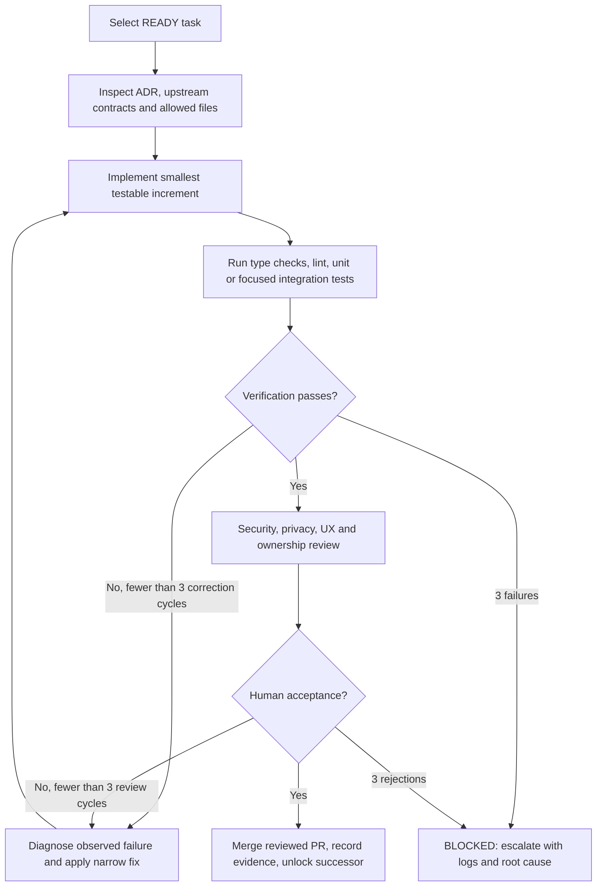
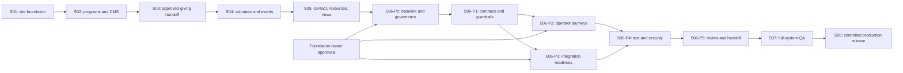
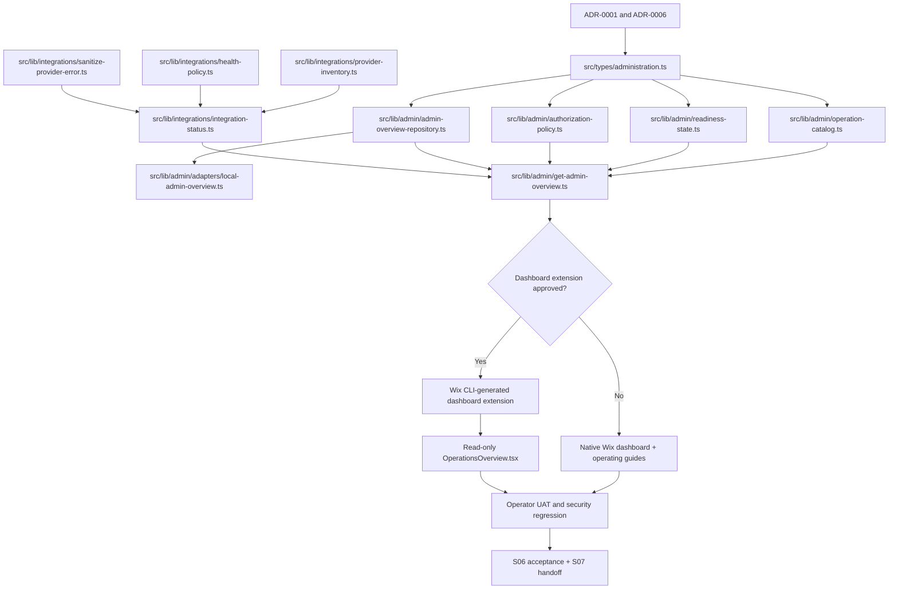
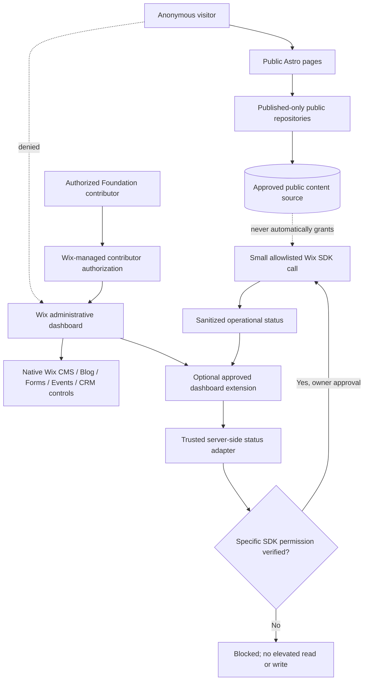
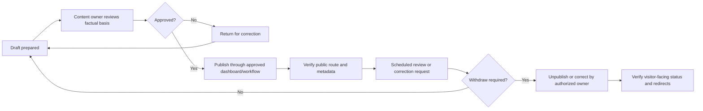

# Sprint 06 — Administration, Governance and Integrations

**Project:** PostBaby Bliss Foundation Digital Platform  
**Sprint duration:** One working week, six gated implementation phases  
**Engineering methodology:** Loop Engineering (bounded implement–validate–review cycles) and Graph Engineering (explicit dependency, ownership and data-flow graphs)  
**Candidate stack:** Astro, TypeScript, Tailwind CSS, limited React, Wix-managed Headless with Wix Astro integration, Wix native dashboard and approved SDK services; Node.js tooling, GitHub Actions, Vitest and Playwright  
**Primary outcome:** An **operator-ready administrative workflow** for publishing approved content, overseeing supported volunteer/event/communication operations, understanding integration health, and managing access and escalation without creating a second, insecure admin portal. Conditional Wix dashboard extensions are permitted only when a verified operational requirement cannot be met through native tools.

> **Evidence and architecture boundary.** This is an engineering *plan*, not evidence that any prior sprint has been built. Inspect the actual GitHub repository, accepted Sprint 05 gate report, approved ADRs, and current Wix project before beginning. The proposed file paths follow the Astro + Wix-managed Headless candidate established in Sprints 01–05. If `ADR-0001` chose Wix Editor/Studio + Velo, the lead must write and approve an alternative path manifest while preserving the objectives, access controls and tests. Never create a parallel directory just because a path appears in this plan.
>
> **Scope boundary.** This sprint is for nonprofit website operations, content administration, provider integration checks, and governance. It does **not** authorize collecting or managing private postpartum clinical records, infant information, financial card data, government IDs, volunteer-screening dossiers, or confidential family case files. U.S. regulatory compliance must be evaluated against the organization's actual data, role and jurisdiction; a website platform or a claim of “secure hosting” does not independently establish HIPAA compliance.
>
> **Deployment boundary.** All work remains in development/preview. No live site migration, domain cutover, mass email, donations, production data export, contact-list import, elevated API permission change, or unrestricted business-data write is authorized by this plan. Sprint 08 owns production release and operational sign-off.

---

## 1. Purpose, outcomes and scope of Sprint 06

### 1.1 Why this sprint exists

The first five planned sprints establish the public experience: core presentation, program information, giving handoffs, volunteering and events, and contact/resource/news communication. A public nonprofit website also requires **reliable human operation**. The Foundation must be able to correct program descriptions, publish timely updates, manage approved inquiries, inspect the state of its Wix-connected services, assign appropriate access, and know what happens when an integration is unavailable. A polished frontend without those operating pathways creates ongoing content, security and accountability risks.

The most effective initial architecture is **dashboard-first**: reuse Wix CMS, Blog, Forms, CRM and Events administration where these products are installed, configured and approved. A custom management UI is justified only for a documented gap that native Wix tools cannot meet. This choice reduces implementation time, duplicate persistence, long-term maintenance, and the chance of exposing contributor-only functions on a visitor route.

### 1.2 Specific sprint objectives

1. Verify the actual deliverables, repository state, data providers and approvals from Sprints 01–05 before adding administrative code.
2. Map each public module to its authoritative content source, named Foundation owner, update procedure, service state and escalation path.
3. Document and verify **least-privilege Wix contributor access**; prove that visitors and unauthorized users cannot perform editorial or business-data administration.
4. Establish typed, read-oriented operation/integration status contracts and stable **supported / unavailable / blocked / degraded** states, with no fabricated provider health.
5. Make public-content editing and publishing operational through existing Wix dashboards (or the selected locally approved content workflow), with explicit approval and withdrawal steps.
6. Integrate basic provider-readiness checks across the modules already selected in Sprints 02–05 without creating unauthorized external writes.
7. Deliver an optional, read-only Wix **dashboard extension** only if an approved gap analysis requires it and the actual Astro/Wix integration supports its registration and preview.
8. Demonstrate access controls, sensitive-data minimization, error handling, accessible operator interfaces, tests, logs/evidence and recovery guidance.
9. Produce a complete evidence pack and auditable handoff to Sprint 07, which will conduct comprehensive release-wide QA and security/performance hardening.

### 1.3 Prioritized delivery tiers

| Priority | Working increment | Eligibility and boundary |
|---|---|---|
| **P0 — essential** | Accepted S05 handoff, permissions matrix, provider inventory, source-of-truth map and administrative operating instructions | Foundation owner verifies actual Wix products and assigned roles |
| **P0 — essential** | Typed integration status model, deterministic read-only checks, safe degraded-state reporting, unit/integration tests | No privileged public endpoint and no PII in status results |
| **P0 — essential** | Tested content approval/publication/withdrawal journey using **existing Wix dashboard facilities** or the approved local editorial workflow | Does not require writing a second CMS |
| **P0 — essential** | Access-control negative tests, operational fallback runbooks and acceptance records | Unsupported integrations are recorded `BLOCKED`, not silently simulated |
| **P1 — approval-gated** | Read-only Wix Dashboard operations overview extension | Only with installed Astro/Wix integration, confirmed extension support and owner sign-off |
| **P1 — approval-gated** | Restricted administrative actions such as a verified Wix CMS update or issue triage | Requires action-specific authorization, server-side checks, explicit approval, audit/rollback plan and tests |
| **P2 — defer** | Rich reporting dashboard, staff workflow automations, queue management, custom RBAC service, external PostgreSQL, scheduled syncing | Requires a separate architectural and operational business case |

**Expected output by Day 5:** A Foundation operator can identify each module's owner, use an approved administrative interface to edit/publish or withdraw test content, locate an authorized inquiry/event/donation administration destination where applicable, inspect factual integration readiness, and follow documented fallback procedures. The team can prove that unsupported or unauthorized features do **not** expose private data or pretend to succeed.

### 1.4 Explicit non-goals

The sprint does not deliver a public `/admin` route, replace Wix CRM with a separate PostgreSQL database, create staff passwords, build a private patient portal, process healthcare records, authorize payments, send automated donor emails, conduct volunteer checks, make high-volume data exports, or publish a new production version. It does not invent an audit-trail feature that the selected Wix product cannot supply. When full immutable auditing is required, define the requirement and record a follow-up architectural decision instead of claiming that local console logs satisfy it.

---

## 2. Loop Engineering and Graph Engineering execution standard

### 2.1 Granularity of work

`Sprint → Phase → Task → Explicit prerequisite nodes → Allowed file operations → Observable increment → Tests → Human review → Gate decision`

- **Task identifier:** `S06-Pn-Tnn` (for example, `S06-P3-T04`).
- **Statuses:** `TODO`, `READY`, `IN_PROGRESS`, `BLOCKED`, `IN_REVIEW`, `DONE`, `DEFERRED`.
- **File operations:** `C` create, `M` modify, `C/M` inspect before choosing, `G` generated by Wix CLI, `?` conditional/approval-gated, `D` dashboard-only operation documented in Markdown.
- **Severity:** `S1` (critical security, privacy or data integrity), `S2` (material access or operational failure), `S3` (noncritical UX/documentation); S1 and S2 block acceptance.
- **Priority:** `P0` required, `P1` activated by approved provider/extension, `P2` deferred.
- **Source of truth:** Actual repository, accepted ADRs, real environment and official Wix SDK version—not a copied file list or unverified AI-generated API call.
- **Completion evidence:** A PR/commit, focused test output, relevant CI run, sanitized preview or dashboard screenshot, reviewer and date, and task graph transition to `DONE`.

### 2.2 Bounded implementation loop



**Loop guardrails:**

1. Keep one ticket/PR to one observable vertical slice; never grant a coding agent unrestricted repository or Wix dashboard control.
2. Record actual failure causes rather than blindly repeating a build or toggling permissions.
3. Every external service write, elevated SDK call, Wix permission addition, third-party connection, release or secret operation requires a separately named human approval.
4. Use fictional/synthetic test data; do not put donor details, personal inquiries, email-list exports, API secrets or staff credentials in Git, screenshots, terminal transcripts or AI coding prompts.
5. Use mocks/stubs **only for automated local tests**, clearly labeled; a mock passing does not establish a live connection.
6. Merge only after checked dependency nodes and test evidence; repeat a failed task up to three focused iterations, then escalate instead of broadening changes.

### 2.3 Cross-sprint dependency graph



**Critical rule:** A predecessor `.md` document does not equal completed source code. P0 checks the accepted branch, CI artifacts, deployed preview, data-source schemas and named approvals. If these are absent, stop dependent tasks and document the missing work rather than manufacturing compatibility.

### 2.4 Five-day execution calendar

| Working day | Phase and primary activity | Demonstrable output | Main gate |
|---|---|---|---|
| **Day 1** | **P0** baseline, administrative capability inventory, permissions, process decisions | Reviewed module/owner/access map and gap decision | `G0` governance and readiness |
| **Day 1–2** | **P1** typed status contracts, safe adapters, test fixtures | Working status/permission model and unit tests | `G1` contract and trust boundary |
| **Day 2–3** | **P2** content/communications operating journeys; conditional dashboard extension | Verified operator workflow; approved preview extension if justified | `G2` operational usability |
| **Day 3–4** | **P3** provider checks, graceful fallback, support evidence | Readiness matrix for actual services with diagnostics | `G3` truthful integration behavior |
| **Day 4–5** | **P4** security, integration, regression, accessibility, CI | Test evidence and risk/defect ledger | `G4` quality and security |
| **Day 5** | **P5** review, handover, S07 backlog | Signed acceptance and executable handoff | `G5` Sprint 06 closure |

The team may run independent P2 and P3 work in parallel after P1 contracts are accepted, provided all shared files have a single accountable owner and are merged in an agreed order.

---

## 3. Detailed phase implementation specifications

### Phase S06-P0 — Verify predecessor, operational responsibilities and architecture

**Objective.** Establish a factual administrative baseline from the actual Wix site and GitHub project before implementing privileged or owner-facing capabilities.

**Entry criteria:** The selected repository, S05 handoff and existing Wix account access are available to authorized staff. This planning document does not grant that access.

**Task breakdown:**

| Task ID | Priority | Specific objective and activity | Hard dependencies | Observable proof |
|---|---|---|---|---|
| `S06-P0-T01` | P0 | Inspect S01–S05 acceptance, ADR-0001/0002/0004/0005, installed packages, routes and branch protections. Run existing checks, record any missing evidence. | Actual GitHub repository and approved reader access | Baseline and blockers listed with commit/CI refs |
| `S06-P0-T02` | P0 | Inventory each existing Wix business product: CMS, Blog, Forms, CRM, Events, eCommerce/donations, site analytics and installed apps; distinguish installed, configured, permitted and unused states. | `T01`, site owner | Provider inventory with no guessed capabilities |
| `S06-P0-T03` | P0 | Map content responsibilities: Programs, News, Resources, FAQ, Events, Volunteer listings, Giving, Contact details and image permissions. Assign editor, approver and backup owner. | `T01`, Foundation operations | Named role *responsibilities* (not passwords) and approved workflow |
| `S06-P0-T04` | P0 | Audit Wix dashboard contributors and permissions with an authorized administrator. Identify least-privilege roles, account recovery owner and immediately inappropriate access; do not change roles in this task. | `T02`, authorized administrator | Redacted access matrix and change requests |
| `S06-P0-T05` | P0 | Decide dashboard-first administration versus custom extension. Document the precise unmet need before approving any dashboard UI work. | `T02`–`T04` | ADR-0006 with `NATIVE_ONLY` or `EXTENSION_APPROVED` decision |
| `S06-P0-T06` | P0 | Review data sensitivity, retention and communications policies from S03–S05. Identify any inquiry/volunteer/event content that must remain outside dashboard reports or logs. | S03–S05 privacy records and owner | Approved operational data-minimization and incident boundaries |
| `S06-P0-T07` | P0 | Construct S06 dependency nodes, service-readiness gates and file ownership. Confirm original Wix production site remains unchanged. | `T01`–`T06` | Graph and phase G0 signed by development lead/site owner |

**Exact file-operation manifest:**

| Op | Repository file | Intended change |
|---|---|---|
| M | `docs/engineering/task-graph.md` | Add S06 task IDs, predecessors, owners and approval nodes |
| M | `docs/audit/existing-site-inventory.md` | Document actual Wix administration and current app inventory |
| C | `docs/audit/sprint-06-admin-readiness.md` | Baseline branch, SDK/version, dashboard capabilities and blockers |
| C | `docs/architecture/ADR-0006-administration-and-integrations.md` | Native-first administrative strategy, reasons and alternatives |
| C | `docs/operations/sprint-06-module-ownership.md` | Program/editorial/contact/donation/events operational ownership |
| C | `docs/security/sprint-06-access-matrix.md` | Read-only redacted permission and role review evidence |
| C | `docs/privacy/sprint-06-operational-data-policy.md` | Approved sensitive-data exclusion, retention and incident rules |
| M | `docs/backlog/sprint-06-candidates.md` | Mark S05 handoff issues accepted, blocked or deferred |
| M | `docs/handoff/sprint-05-communications-operations.md` | Add precise S06 operational dependencies only, if required |

**Gate `G0` — Governance and architecture approved.** The real data sources, current Wix entitlements, staff responsibilities, approval owners, and gaps are documented. Public content and all active P1 integrations have traceable sources. Any missing predecessor or unapproved privileged workflow is `BLOCKED` with an owner and next action; no new integration permissions have been granted.

---

### Phase S06-P1 — Build operation contracts, permission rules and safe repository boundaries

**Objective.** Represent administrative readiness in typed code with predictable, testable behavior and strict separation between public display, backend diagnostics and dashboard-only operations.

**Task breakdown:**

| Task ID | Priority | Specific objective and activity | Hard dependencies | Observable proof |
|---|---|---|---|---|
| `S06-P1-T01` | P0 | Define `OperationalModule`, `IntegrationKey`, `ReadinessState`, `OperatorAction`, `OwnerAssignment` and `ReadinessSnapshot` types. Exclude PII and business secrets from all snapshot fields. | `G0` | Typed contracts compile with documented schema |
| `S06-P1-T02` | P0 | Define an operation catalog mapping each public module to its source repository, approved administrative destination, required role category and supported actions. | `T01`, P0 ownership records | Catalog entries resolve without guessed URLs or access grants |
| `S06-P1-T03` | P0 | Implement pure eligibility rules for `not-configured`, `configured-unverified`, `verified`, `degraded`, `blocked`, and `unavailable` states. Do not label provider connectivity `verified` merely because a mock returns data. | `T01` | Deterministic status tests and safe default |
| `S06-P1-T04` | P0 | Create a read-only repository interface for module statuses and separate local synthetic fixture adapter; production selection must be explicit and never silently substitute fixtures. | `T01`–`T03` | Unit tests for source selection and error states |
| `S06-P1-T05` | P0 | Implement an authorization policy **model** for access requirements (not a client-side privilege grant). Document enforcement location for native dashboard and any Wix extension. | `T02`, P0 access matrix | Policy matrix tests; protected actions not authorized by UI flags |
| `S06-P1-T06` | P0 | Add a safe diagnostics mapper that removes emails, form contents, donor fields, tokens and vendor identifiers not needed for operational decisions. | `T01`, data policy | Redaction/allowlist tests and negative examples |
| `S06-P1-T07` | P0 | Introduce explicit `getAdministrativeOverview()` composition only on a trusted server/dash context; never expose it as unprotected `/api/admin` JSON. | `T02`–`T06` | Trust-boundary review and server import checks |
| `S06-P1-T08` | P0 | Validate package, TypeScript and test baselines; write contract tests for malformed status, missing source, forbidden roles, stale timestamps and provider timeouts. | `T01`–`T07` | Green test suite and audited PR |

**Exact file-operation manifest:**

| Op | Repository file | Intended change |
|---|---|---|
| C | `src/types/administration.ts` | Canonical module, ownership, action, readiness and audit-summary types |
| C | `src/lib/admin/operation-catalog.ts` | Approved module-to-workflow mapping |
| C | `src/lib/admin/readiness-state.ts` | Pure readiness state machine with conservative defaults |
| C | `src/lib/admin/authorization-policy.ts` | Declarative action requirements; no client-generated authorization |
| C | `src/lib/admin/admin-overview-repository.ts` | Read-only trusted overview interface |
| C | `src/lib/admin/adapters/local-admin-overview.ts` | Synthetic-only test/preview source with explicit labeling |
| C | `src/lib/admin/get-admin-overview.ts` | Composition boundary for trusted dashboard/server usage |
| C | `src/lib/admin/sanitize-operational-status.ts` | Safe allowlist serializer; avoid raw SDK data in logs |
| C | `src/data/admin-readiness-fixtures.ts` | Fictional and marked local fixtures, never real donor/contact values |
| C | `tests/unit/admin-operation-catalog.test.ts` | Catalog and source map correctness |
| C | `tests/unit/admin-readiness-state.test.ts` | Failure and status transition behavior |
| C | `tests/unit/admin-authorization-policy.test.ts` | Unprivileged and denied action matrix |
| C | `tests/unit/admin-status-sanitization.test.ts` | Sensitive-field stripping and serialized error safety |
| C | `tests/unit/admin-overview-repository.test.ts` | Fixture/provider selection, timeouts, empty results |
| M? | `src/lib/site-config.ts` | Only add approved admin provider feature configuration if truly needed |
| M? | `package.json` and `package-lock.json` | Only required, version-checked packages; never replace working scripts wholesale |

**Core state contract:**

```ts
// Illustrative domain type, not a Wix SDK signature.
type ReadinessState =
  | 'not-configured'
  | 'configured-unverified'
  | 'verified'
  | 'degraded'
  | 'blocked'
  | 'unavailable';

type ReadinessSnapshot = {
  module: 'programs' | 'giving' | 'volunteer' | 'events' |
          'contact' | 'resources' | 'news' | 'newsletter';
  state: ReadinessState;
  checkedAt: string | null;
  evidenceRef?: string;  // Internal reviewed reference, not a secret URL.
  publicMessage?: string;
};
```

**Trust rule:** The browser or dashboard card may *display* a permission-aware state, but only Wix's actual permission model and approved backend service boundaries may authorize privileged actions. Never treat `role=admin` in a request, cookie, client storage or query string as trustworthy. Never rely on Astro middleware alone to authorize a sensitive server-side mutation.

**Gate `G1` — Contracts and trusted boundaries verified.** All types, read-only adapters and negative tests pass. Every sensitive data field is explicitly excluded, all mock statuses are labeled nonproduction, and any planned write capability remains disabled until reviewed independently.

---

### Phase S06-P2 — Implement operator workflows and optional dashboard extension

**Objective.** Give Foundation staff a practical, documented way to administer already-built features using existing Wix tools, adding a small custom dashboard view only if its value and security are justified.

**Task breakdown:**

| Task ID | Priority | Specific objective and activity | Hard dependencies | Observable proof |
|---|---|---|---|---|
| `S06-P2-T01` | P0 | Verify how an authorized editor updates program descriptions, news, resources, FAQs and published contact details in each selected content source. | `G1`, content source ADRs | Video/screenshot-free process steps or sanitized screenshots |
| `S06-P2-T02` | P0 | Define editorial lifecycle `draft → review → approved → published → corrected/withdrawn`, including named approver and rollback/withdrawal owner. Map to native Wix states actually available. | P0 ownership + S05 editorial policy | Review checklist and approved operating procedure |
| `S06-P2-T03` | P0 | Map volunteers/events, general contact/Forms, CRM newsletters and donations to their existing Wix administrative destinations when installed. Document unavailable destinations accurately. | P0 provider inventory | Verified link/destination register, no guessed pages |
| `S06-P2-T04` | P0 | Create a read-only operations overview specification showing module/source/status/last-verified and a safe operator next step; test it as a local UI model or static documentation even if custom extension is declined. | P1 types and source catalog | Testable status model and UX acceptance script |
| `S06-P2-T05` | P1 | If ADR-0006 authorizes an extension, generate a **dashboard page extension with Wix CLI** and inspect resulting files before editing. Never manually invent extension IDs or registration files. | Owner approval, actual Astro integration + extension support | Generated file manifest and preview dashboard registration evidence |
| `S06-P2-T06` | P1 | Build an accessible **read-only** React operations overview inside the generated dashboard extension, backed by trusted read contracts. No contact lists, donor identities or raw form submissions. | `T05`, P1 trusted composition | Dashboard card states, keyboard behavior and reviewed screenshots |
| `S06-P2-T07` | P0 | Document and verify staff handoff of editing, publication, moderation and escalation, including the procedure when an owner is absent or a provider is unavailable. | `T01`–`T04` | Operator exercises completed by named representatives |

**Exact file-operation manifest:**

| Op | Repository file | Intended change |
|---|---|---|
| C | `docs/operations/sprint-06-editorial-workflow.md` | Content review, approval, publishing, corrections and withdrawal |
| C | `docs/operations/sprint-06-operator-navigation.md` | Real dashboard destinations and access limitations by module |
| C | `docs/operations/sprint-06-operator-acceptance-script.md` | Reproducible no-PII staff walkthrough |
| C | `docs/content/sprint-06-publishing-approval-matrix.md` | Who approves what and required editorial evidence |
| C | `src/components/admin/OperationsOverview.tsx` | **Conditional P1** reusable read-only UI; only if extension approved |
| G? | `src/extensions/dashboard/pages/operations-overview/operations-overview.extension.ts` | **Conditional P1** target of Wix CLI generation; actual location/name must match generated output |
| G? | `src/extensions/dashboard/pages/operations-overview/operations-overview.tsx` | **Conditional P1** dashboard page content; generated path is authoritative |
| M? | `src/extensions.ts` | **Conditional P1** Wix CLI-generated extension registration; modify only if generated and appropriate |
| C? | `tests/unit/operations-overview.test.tsx` | **Conditional P1** presentational states and no-PII contract |
| C? | `tests/e2e/admin-dashboard-access.spec.ts` | **Conditional P1** dashboard preview access test using permitted test identities |
| M? | `docs/architecture/ADR-0006-administration-and-integrations.md` | Record final extension/no-extension decision and its rationale |

**Why a custom dashboard page is optional:** The Wix-managed Astro integration supports dashboard extensions, but the extension must be generated/registered through the supported CLI and its functions tested in the actual project; a fabricated `src/pages/admin.astro` is neither a Wix dashboard extension nor a safe substitute. If Wix already supplies adequate CMS/Blog/Forms/Events controls, shipping excellent operator documentation and verification is the faster, more maintainable result.

**Gate `G2` — Operator journey demonstrated.** An authorized Foundation representative successfully completes an approved test publication/correction/withdrawal procedure in the selected environment and finds the operational status of each active module. An unauthorized person cannot access management functionality. If custom extension permission or preview support is missing, record `P1 BLOCKED` and accept the native-only operator workflow; do not force a public admin page.

---

### Phase S06-P3 — Verify cross-module integrations, failure handling and operations observability

**Objective.** Provide truthful, minimal administrative diagnostics for the APIs and provider connections that previous sprints actually activated, without adding unnecessary integrations or storing sensitive data.

**Task breakdown:**

| Task ID | Priority | Specific objective and activity | Hard dependencies | Observable proof |
|---|---|---|---|---|
| `S06-P3-T01` | P0 | Create a provider inventory adapter that reports **configured/unverified** from local configuration and **verified** only from permitted test evidence. Include installed-app checks as warranted. | `G1`, P0 inventory | Explicit states for each supported module |
| `S06-P3-T02` | P0 | Validate the approved CMS/Blog/resource read boundary and its published-only behavior, linking to S02/S05 repository tests. | S02/S05 accepted repository contracts | Published/draft/unauthorized/error matrix |
| `S06-P3-T03` | P0 | Verify the current donation handoff destination and owner-admin path without creating charges, impersonating donors or storing payment data. | S03 payment ADR + owner | Correct destination and safe unavailable state |
| `S06-P3-T04` | P0 | Verify volunteer/event/registration provider states against S04, including full/closed/canceled conditions. No fabricated RSVP acknowledgment or admin export. | S04 provider contracts + owner | State and fallback tests |
| `S06-P3-T05` | P0 | Verify contact and newsletter provider statuses from S05; test only with mock or explicitly approved synthetic submissions, and ensure consent states remain separate. | S05 communications approvals | Disabled and verified states correctly surfaced |
| `S06-P3-T06` | P0 | Implement failure taxonomy and resilient read behavior: timeout, missing permission, unsupported app, malformed response, stale status, transient provider failure. Return sanitized, actionable errors, never secrets or personal data. | `T01`–`T05` | Contract-based negative-path integration tests |
| `S06-P3-T07` | P0 | Add privacy-preserving operational telemetry specification: error category, module, elapsed time and correlation reference only; define retention and who investigates. Avoid raw request payloads. | S06 data policy, `T06` | Telemetry review with synthetic sample and log assertions |
| `S06-P3-T08` | P1 | If a supported backend route or dashboard extension requires service checks, implement a **server-only, access-controlled** adapter with a narrow allowlist and explicit per-call permission elevation approval. No public diagnostics endpoint. | `T06`, formal approval | Independent authorization test + integration proof |

**Exact file-operation manifest:**

| Op | Repository file | Intended change |
|---|---|---|
| C | `src/lib/integrations/integration-status.ts` | Typed provider status/readiness aggregation |
| C | `src/lib/integrations/provider-inventory.ts` | Actual installed/configured provider map (redacted output) |
| C | `src/lib/integrations/health-policy.ts` | Status transitions, timeout/permission/unavailable categorization |
| C | `src/lib/integrations/sanitize-provider-error.ts` | Safe messages, logging allowlist and incident categories |
| C | `src/lib/integrations/sprint-06-readiness-report.ts` | Trusted read-only module readiness aggregation |
| C | `src/lib/integrations/adapters/fixture-readiness-adapter.ts` | Synthetic-only contract tests; never active as real production health |
| C? | `src/lib/integrations/adapters/wix-readiness-adapter.ts` | **Conditional P1** actual supported Wix diagnostic/read calls |
| C | `tests/unit/integration-readiness.test.ts` | Status, stale, disabled and timeout states |
| C | `tests/unit/provider-error-sanitization.test.ts` | Secrets/PII never serialized |
| C | `tests/integration/admin-providers.test.ts` | Contract tests for mocked and approved test-environment providers |
| C | `tests/integration/admin-degraded-mode.test.ts` | Missing app/permission and outage fallback behavior |
| M? | `src/lib/content/get-public-information-repositories.ts` | Only if real provider discovery requires an approved safe extension |
| M? | `src/lib/admin/get-admin-overview.ts` | Integrate inspected readiness results into trusted overview |
| C | `docs/quality/sprint-06-provider-readiness.md` | Per-service verified/blocked status and redacted evidence |
| C | `docs/operations/sprint-06-integration-recovery.md` | Practical incident handling and escalation paths |
| C | `docs/security/sprint-06-privileged-call-review.md` | Record whether elevated SDK calls exist, exact use cases and reviewer |

**Readiness meaning (non-negotiable):**

| Status | Interpretation | Permitted UI/operational behavior |
|---|---|---|
| `not-configured` | No approved provider or setup exists | Show setup requirement; avoid enabling a transaction |
| `configured-unverified` | Settings exist but flow/permission has not passed a real test | Never claim the service is operational |
| `verified` | Approved test in the intended environment passed, with dated evidence | Show factual limited status, not unlimited availability |
| `degraded` | Previously verified service is partially failing or evidence is stale | Warn operator; present permitted fallback |
| `blocked` | Missing owner approval, required privacy decision or permission | Stop privileged execution and escalate |
| `unavailable` | Service currently cannot perform its intended operation | Disable unsafe action, preserve public information if possible |

**Provider-specific safeguards:**

- **Wix Data/CMS:** Show only published public records in public pages. Privileged content writes must not be triggered by arbitrary visitor input.
- **Wix Blog:** Use the actual configured Blog product and published post APIs, or keep the approved local repository; never mix two unsynchronized authoritative news sources.
- **Wix Forms/CRM:** Native Wix may retain real submissions and contacts; status diagnostics must not pull contact lists or form contents just to assert the service exists. A form ID being present is not proof that a submission was delivered.
- **Wix Events:** Distinguish discoverability, a linked registration destination and successfully recorded RSVP. Availability is a server/provider fact, not a hardcoded frontend flag.
- **Giving:** The hosted checkout/provider owns payment authorization. A redirect, webhook failure or landing-page return must never be interpreted as a confirmed donation.
- **Newsletter:** Subscription consent, email deliverability and marketing automation are distinct states. A preview form should never silently add a recipient to a live marketing list.
- **Analytics:** Do not use personal email, free-text inquiry content or infant/family details as analytics event properties. Applicable cookie/consent requirements are reviewed before any tracking is enabled.

**Gate `G3` — Integration truthfulness established.** Every enabled integration has a recorded provider, environment, permissions, check type, observed result, evidence and owner. All missing approvals remain `BLOCKED`; no real-world contact, donation, attendee or donor data were used in local test fixtures.

---

### Phase S06-P4 — Security, authorization, accessibility and regression testing

**Objective.** Test the administrative trust boundaries and cross-module operations before handing the project to Sprint 07 for independent full-system QA.

**Task breakdown:**

| Task ID | Priority | Specific objective and activity | Hard dependencies | Observable proof |
|---|---|---|---|---|
| `S06-P4-T01` | P0 | Execute TypeScript, lint, unit, integration and build checks against the exact branch; adapt to installed package scripts. | `G2`, `G3` | Passing CI links and local summary |
| `S06-P4-T02` | P0 | Test denial of access for visitor, unapproved contributor, inactive/removed user and missing privileges. Validate policy enforcement in trusted Wix contexts, not just a hidden button. | P1 policy, P2 operator flow | Unauthorized negative-test evidence |
| `S06-P4-T03` | P0 | Verify that public endpoints, static routes, hydration payloads and browser bundles contain no operational dashboard data, secrets, private forms or sensitive records. | All phase code | No high-severity data exposure findings |
| `S06-P4-T04` | P0 | Exercise provider unavailable, timeout, revoked permission, missing app, malformed payload and request retry scenarios without live side effects. | P3 readiness contracts | Graceful documented error/fallback states |
| `S06-P4-T05` | P0 | Review script injection, external URL integrity, unsafe HTML and SSR-versus-client boundaries; test sanitization and safe status messages. | Shared public content + P3 | No untrusted HTML execution or leaking diagnostics |
| `S06-P4-T06` | P0 | Conduct responsive and accessibility checks of conditional dashboard UI and all changed public status surfaces; keyboard focus, labels, announcements, contrast and zoom. | P2 UI if built | WCAG 2.2 AA-oriented checklist and findings |
| `S06-P4-T07` | P0 | Run regression around Programs, Giving, Volunteer/Events, Contact, News and newsletter; confirm no new provider writes or marketing sends. | S01–S05 accepted test baselines | Stable existing journeys and no side effects |
| `S06-P4-T08` | P0 | Perform operational UAT with a Foundation approver using **nonproduction** content and sanitized evidence; record defects and owner sign-off. | `T01`–`T07` | UAT evidence, severity triage and gate decision |

**Exact file-operation manifest:**

| Op | Repository file | Intended change |
|---|---|---|
| C | `tests/integration/admin-access-boundary.test.ts` | Trusted authorization and denied paths |
| C | `tests/integration/admin-status-redaction.test.ts` | No secrets/PII in responses or logs |
| C | `tests/e2e/admin-operator-workflow.spec.ts` | Approved operator journeys without real visitor data |
| C | `tests/e2e/admin-accessibility.spec.ts` | **Conditional** dashboard-extension UI accessibility |
| C | `tests/e2e/admin-regression.spec.ts` | Core public journeys remain intact |
| C | `docs/quality/sprint-06-test-evidence.md` | Commands, test outcomes, CI artifact links |
| C | `docs/quality/sprint-06-security-review.md` | Auth/permission/client-bundle/log exposure findings |
| C | `docs/quality/sprint-06-accessibility-review.md` | Automated plus manual findings, with exceptions |
| C | `docs/quality/sprint-06-operator-uat.md` | Approved operator verification script results |
| C | `docs/quality/sprint-06-integration-evidence.md` | Real versus simulated tests, installed product/permission record |
| M? | `.github/workflows/ci.yml` | Add test commands only if current CI omits relevant suites |
| M? | `playwright.config.ts` | Add restricted test-project fixtures without live credential leakage |
| M? | `package.json` | Adjust tested npm scripts without breaking Wix-generated commands |
| M | `docs/engineering/task-graph.md` | Test failures, blocked dependencies and completed nodes |

**Required test matrix:**

| Requirement | Unit | Integration | Browser/manual | Pass criterion |
|---|---|---|---|---|
| Permission policy | Role/action matrix | Denied trusted API calls | Unauthorized navigation | No administrative data/action exposed |
| Content publication | Publication states | Actual selected source contract | Approve/publish/withdraw test item | State matches provider truth |
| Integration readiness | All status transitions | Missing app, revoked permission, timeout | Operator states | Accurate state and next step |
| Sanitization | Schema allowlist | Mocked sensitive provider response | Inspect network and logs | No PII/secrets exported |
| Giving and registration | Disabled/safe handoff | Provider state stubs | Existing public regression | No fabricated success |
| Accessibility | Component semantics | N/A | Keyboard, zoom, assistive technology sampling | No critical barriers; issues triaged |
| Deployment safety | Feature flags | CI mocks only | Preview smoke | No production-side change |

**Baseline commands** (only when the scripts exist; otherwise use approved equivalents):

```bash
npm ci
npm run check
npm run lint
npm run test
npm run build
npx playwright test
```

Do not paste production credentials into CI. Never make unit or Playwright test runs perform live payments, mass marketing sends, data exports, role modifications or privileged dashboard writes. If the provider requires real verification, use an authorized nonproduction configuration with synthetic records and a documented clean-up procedure.

**Gate `G4` — Security and quality verified.** All P0 tests and representative workflows pass; no S1/S2 defect remains open; privileged data is absent from browser/client output; sensitive data is absent from logs/evidence; the site owner approves any conditional P1 test/extension exposure. If not, leave the sprint `BLOCKED` with a concrete remediation path.

---

### Phase S06-P5 — Acceptance, operator handover and Sprint 07 preparation

**Objective.** Produce the evidence and operating knowledge needed for independent full-site quality assurance and a controlled production launch in Sprint 08.

**Task breakdown:**

| Task ID | Priority | Specific objective and activity | Hard dependencies | Observable proof |
|---|---|---|---|---|
| `S06-P5-T01` | P0 | Demonstrate editorial update/withdrawal through the approved admin tool, plus each module's status and fallback route. | `G4` | Recorded five-minute script and reviewer notes |
| `S06-P5-T02` | P0 | Review module owners, permissions, approved provider accounts, support contacts, privacy incidents and backup-operator path; do not publish account secrets. | P0–P4 evidence | Signed operational responsibility matrix |
| `S06-P5-T03` | P0 | Freeze a precise route/module/integration manifest: shipped, owner-approved unavailable, blocked, deferred. Separate local mock proof from real provider proof. | P3 and P4 | S07-ready inventory with evidence refs |
| `S06-P5-T04` | P0 | Create a ranked S07 security, accessibility, performance and regression backlog with explicit source files and acceptance targets. | P4 defect ledger | Groomed, dependency-aware S07 candidate list |
| `S06-P5-T05` | P0 | Record final architecture decisions, accepted P1 alternatives, compensating controls, and signed exceptions; update graph to `DONE` only with evidence. | `T01`–`T04` | G0–G5 ledger, reviewer names and dates |
| `S06-P5-T06` | P0 | Merge reviewed code to the designated preview/integration branch, tag/snapshot candidate state as per project policy; hand off to S07 without changing live Wix domain. | `G4`, PR approvals | Clean CI, review link, release-free handover |

**Exact file-operation manifest:**

| Op | Repository file | Intended change |
|---|---|---|
| C | `docs/reviews/sprint-06-review.md` | Delivered outcomes, demo, known limits and links |
| C | `docs/quality/sprint-06-acceptance.md` | Formal G0–G5 gate register and decisions |
| C | `docs/handoff/sprint-06-admin-operations.md` | Operator ownership, native dashboards, recovery and checks |
| C | `docs/handoff/sprint-06-to-sprint-07.md` | Accurate handoff contract with outstanding risks |
| C | `docs/backlog/sprint-07-candidates.md` | Prioritized QA, security, accessibility and optimization work |
| C | `docs/audit/sprint-06-module-feature-inventory.md` | What genuinely exists per route/product, no assumed services |
| M | `docs/engineering/task-graph.md` | Accepted dependencies and S07 entry nodes |
| M | `docs/architecture/ADR-0006-administration-and-integrations.md` | Final decision/status for dashboard extensions and providers |
| M | `docs/operations/sprint-06-module-ownership.md` | Named owner acceptance and backup coverage |
| M? | `README.md` | Concise operator/development environment links only |

**Gate `G5` — Sprint 06 acceptance.** The development lead, Foundation operations representative and Wix site owner accept the implemented administrative workflow and security evidence. The handoff names all conditional integrations not activated, all provider permissions and any S1/S2 defects or high-priority acceptance gaps that must be resolved before S07/S08. **No production release is implied.**

---
## 4. File-dependency graph, ownership and planned repository additions

### 4.1 Administrative data and user-interface graph



### 4.2 Sensitive operation trust graph



A diagram edge indicates the intended **dependency or trust relationship**, not a guarantee of a Wix API capability. In particular, **dashboard placement alone does not make a backend operation authorized**; app identities and permissions must be verified according to the actual Wix project and SDK context.

### 4.3 Primary file ownership rules

| Logical area | Single accountable code owner | Coordination rule |
|---|---|---|
| `src/types/administration.ts`, `src/lib/admin/*` | Engineering lead / platform integrator | Contract changes merge first; downstream UI adapts after review |
| `src/lib/integrations/*` | Integration engineer | No production writes or unreviewed elevated calls |
| `src/extensions/**` when approved | Wix extension engineer | CLI-generated paths and extension IDs remain authoritative |
| `src/components/admin/*` when approved | Frontend engineer | No direct privileged SDK operations in browser components |
| `tests/**` and `.github/workflows/ci.yml` | Quality/security owner | Review fixture provenance and no secret/log leakage |
| `docs/security/**`, `docs/privacy/**` | Foundation privacy/security reviewer | Business owner controls policy approvals |
| `docs/operations/**`, `docs/content/**` | Foundation operations and editorial lead | Operators validate real day-to-day workflow |
| `docs/engineering/task-graph.md` | Sprint lead | Single merged task-state ledger |

Do not edit S01–S05 public page templates or shared layout files unless a test proves a narrow change necessary and the file owner approves it. Integration diagnostics must **consume** S02–S05 contracts, not rewrite the previous sprints into a new design.

### 4.4 Planned addition tree

Only the principal new paths are displayed; task manifests above describe the complete approved changes. Files marked `?` exist **only** after their P1 approval and, for extensions, the Wix CLI generation step.

```text
src/
  types/
    administration.ts
  data/
    admin-readiness-fixtures.ts
  lib/
    admin/
      operation-catalog.ts
      readiness-state.ts
      authorization-policy.ts
      admin-overview-repository.ts
      get-admin-overview.ts
      sanitize-operational-status.ts
      adapters/
        local-admin-overview.ts
    integrations/
      integration-status.ts
      provider-inventory.ts
      health-policy.ts
      sanitize-provider-error.ts
      sprint-06-readiness-report.ts
      adapters/
        fixture-readiness-adapter.ts
        wix-readiness-adapter.ts                  # ? P1
  components/
    admin/
      OperationsOverview.tsx                    # ? P1
  extensions/
    dashboard/
      pages/
        operations-overview/
          operations-overview.extension.ts      # ? generated; actual CLI path governs
          operations-overview.tsx                # ? generated; actual CLI path governs

tests/
  unit/
    admin-operation-catalog.test.ts
    admin-readiness-state.test.ts
    admin-authorization-policy.test.ts
    admin-status-sanitization.test.ts
    admin-overview-repository.test.ts
    integration-readiness.test.ts
    provider-error-sanitization.test.ts
    operations-overview.test.tsx                # ? P1
  integration/
    admin-providers.test.ts
    admin-degraded-mode.test.ts
    admin-access-boundary.test.ts
    admin-status-redaction.test.ts
  e2e/
    admin-dashboard-access.spec.ts              # ? P1
    admin-operator-workflow.spec.ts
    admin-accessibility.spec.ts                 # ? P1
    admin-regression.spec.ts

docs/
  architecture/
    ADR-0006-administration-and-integrations.md
  audit/
    sprint-06-admin-readiness.md
    sprint-06-module-feature-inventory.md
  security/
    sprint-06-access-matrix.md
    sprint-06-privileged-call-review.md
  privacy/
    sprint-06-operational-data-policy.md
  operations/
    sprint-06-module-ownership.md
    sprint-06-editorial-workflow.md
    sprint-06-operator-navigation.md
    sprint-06-operator-acceptance-script.md
    sprint-06-integration-recovery.md
  content/
    sprint-06-publishing-approval-matrix.md
  quality/
    sprint-06-provider-readiness.md
    sprint-06-test-evidence.md
    sprint-06-security-review.md
    sprint-06-accessibility-review.md
    sprint-06-operator-uat.md
    sprint-06-integration-evidence.md
    sprint-06-acceptance.md
  handoff/
    sprint-06-admin-operations.md
    sprint-06-to-sprint-07.md
  backlog/
    sprint-07-candidates.md
  reviews/
    sprint-06-review.md
```

**Create-versus-modify contract:** Every file listed as `C` must first be checked for an equivalent existing module. If an equivalent exists, adapt that file under a reviewed ticket (`M`) and update this manifest; do **not** duplicate it. A `G?` file name is only an anticipated CLI output: run the real versioned CLI generator after approval and record the actual generated paths. Never handcraft an extension manifest to imitate an undocumented Wix CLI result.

### 4.5 Safe merge sequence

1. **PR 1 — Foundations:** P0 audit, ADR-0006, owner/access/privacy decisions and task graph.
2. **PR 2 — Pure contracts:** P1 types, catalogs, readiness model, sanitized result mapping and unit tests.
3. **PR 3 — Operator workflow:** P2 native dashboard instructions, approval and withdrawal tests and staff sign-off.
4. **PR 4 — Integration diagnostics:** P3 provider readiness, error taxonomy and negative-path tests; no live provider mutations.
5. **PR 5 — Optional dashboard extension:** Only when P1 is approved and generated by Wix CLI; separate review for extension identity/permissions.
6. **PR 6 — Verification and handover:** P4 security/regression tests plus P5 UAT, final evidence and S07 backlog.

### 4.6 Prior-sprint dependencies that must remain stable

| Prior sprint | Existing contract to inspect | Sprint 06 rule |
|---|---|---|
| S01 | `src/lib/navigation.ts`, `src/lib/site-config.ts`, `.github/workflows/ci.yml`, ADR-0001 | Do not replace framework, design system or quality pipeline |
| S02 | Programs CMS read adapter, ADR-0002 and approved publication fields | Preserve read-only public boundaries and content source-of-truth |
| S03 | Donation provider adapter and approved checkout handoff | Admin status is **not** evidence of donation settlement |
| S04 | Volunteer/event repositories, status models, approved registration destinations | No invented registrants, event capacities or volunteer approvals |
| S05 | `src/lib/content/get-public-information-repositories.ts`, contact/newsletter provider decisions, ADR-0005 | Honor consent, published-only access, status semantics and provider restrictions |
| S08 | `docs/operations/*`, final release gate and rollback plan | Produce honest evidence, but do not execute migration in S06 |

---

## 5. Administrative information architecture and human operating model

### 5.1 Module-to-operator workflow map

The precise Wix menu labels and app availability **must be validated in the currently connected dashboard**. The examples below describe desired owner actions; they are not evidence that the listed app is installed.

| Area | Operational task | Preferred source/tool | Data-handling restriction | Expected fallback |
|---|---|---|---|---|
| Programs | Edit service text and withdraw stale offerings | Existing Wix CMS or approved local content workflow | Publish only approved content, no unverified clinical claims | Use reviewed local content or approved unavailable status |
| News & Updates | Prepare, review, publish, correct or archive posts | Selected Wix Blog or CMS, not both unsynchronized | Confirm date, source, image rights and editorial approval | Retain verified published articles; hide unknown drafts |
| Resources / FAQs | Verify links and review content | Approved CMS/local repositories | No unsafe external links or personal family-case data | Display approved alternatives/empty state |
| Events | Update published program/event information | Existing Wix Events and/or approved CMS model | Do not export participant information for diagnostics | Display truthful cancellation/full/unavailable states |
| Volunteer | Update verified roles and approved participation links | Approved opportunity repository or configured product | No screening documents or contact data in public lists | Show no-current-opportunity state |
| Contact | Route permitted nonclinical inquiries | Approved Wix Forms and authorized staff inbox | Minimal fields; private submissions not exposed publicly | Clearly show verified alternative contact method |
| Newsletter | Verify subscription and consent workflow | Approved Wix CRM/email subscription products | No opt-in without separate affirmative consent | Disable signup; keep informational pages accessible |
| Giving | Verify checkout destination and fundraising content | Approved hosted payment/donation provider and Wix settings | Do not process/store card data in custom code | Display safe donation-unavailable notice |
| Monitoring | Check user-visible module state and act on incidents | Wix monitoring where supported + S06 evidence | No direct raw visitor payloads or member dumps | Manual owner review and escalation |

### 5.2 Role and responsibility model

The following are **project-level functional responsibilities**, not claims about Wix's predefined role names. The site owner must map them to actual contributor roles and confirm permissions in the installed Wix products.

| Responsibility | Appropriate permission intention | Disallowed by default |
|---|---|---|
| Editorial contributor | Draft and edit assigned public content | Unreviewed publication, access to private form submissions |
| Editorial approver | Approve/reject content and corrections | Unnecessary billing/user administration |
| Community coordinator | Manage approved public events/opportunities and consented responses | Exporting donor/clinical data |
| Communications coordinator | Review approved news/subscription processes | Bulk-send without sender/consent approval |
| Site operator | Observe technical status and report incidents | Unreviewed policy changes or broad data export |
| Wix site owner / billing owner | Manage account-wide authorized decisions and recovery | Sharing credentials or bypassing access review |
| Developer / CI service | Work on approved preview code and tests | Permanent production admin rights without need |

Before any role change, the authorized site administrator must confirm an alternative recovery owner, document the scope, obtain human approval and test that the adjusted permission behaves as intended. An audit of contributor lists should be stored as a **redacted summary**; never commit actual login credentials or unnecessary staff identifiers.

### 5.3 Content lifecycle and emergency corrections



Editorial approvals need a reviewer, date, changed content reference, rights/consent state for images and required expiry/review date. A request to withdraw misleading program or emergency contact information must have a named backup decision-maker; public visitors should never see an edit as live merely because a local fixture changed.

### 5.4 Operator workflow acceptance stories

- **Story A — Program accuracy:** An approved editor corrects a service description, the approver signs off, and the public preview reflects the reviewed text without exposing drafts.
- **Story B — Event change:** A coordinator marks an event canceled (where the chosen provider supports it); the public page presents cancellation accurately and disables any invalid registration action.
- **Story C — Communication safety:** An operator can identify where a permitted general inquiry lands and whom to contact if that route fails; the test never uses actual family information.
- **Story D — Integration failure:** When a provider is unavailable or denied, the operator sees an actionable `blocked/degraded/unavailable` state and visitors receive a truthful fallback without success claims.
- **Story E — Unauthorized access:** An anonymous browser cannot open privileged operations, read contact lists or trigger changes; a contributor outside the approved role also receives denial.

---

## 6. Security, privacy, compliance and operating controls

### 6.1 Least privilege and separation of environments

Use Wix's installed contributor/SDK permission system as the authority for privileged operations. A visitor's automatic authenticated session in the Wix Astro integration is a **visitor identity**, not a dashboard administrator. Server-side permission elevation, if explicitly necessary, must occur only within an approved backend context and must be independently authorized for the specific business operation. Keep secrets in the approved Wix secrets/environment mechanism; never in Git, a browser bundle, a Markdown file or an AI prompt.

The `preview`, `test` and `production` environment names must reflect **actual deployment boundaries**, not merely a boolean flag in JavaScript. A preview frontend might still query the business data of the parent Wix site during migration; therefore, preview does **not** automatically mean test data. Before running any provider test, verify which account/site and dataset the code addresses. Do not assume a `wix.config.json` preview site ID identifies the source of business data.

### 6.2 Private data and clinical boundaries

- Keep all public browsing and operational diagnostics **nonclinical**. No postpartum health histories, infant records, medical triage or eligibility scoring are introduced in this sprint.
- Access to Wix Forms or CRM, if granted, must be restricted to the smallest appropriate set of Foundation operators. Do not retrieve or summarize actual visitor submissions in local previews, public logs or sprint evidence.
- If sensitive information is unexpectedly submitted through an approved general contact route, follow the Foundation's designated escalation and deletion/retention process rather than copying it into tickets or dashboards.
- Do not assume the organization is or is not a HIPAA-covered entity or business associate; that requires a fact-specific assessment. No compliance claim should be published without authorized legal/privacy review.
- Preserve email unsubscribe/suppression and positive-consent requirements from Sprint 05. A native CMS editing role is not permission to run email marketing.
- U.S. nonprofit tax-exempt/deductibility wording remains subject to Foundation-approved verification; this sprint's admin screen must not automatically infer legal status.

### 6.3 Threat scenarios and mitigating controls

| Risk scenario | Mitigation | Required evidence |
|---|---|---|
| Public diagnostic endpoint reveals provider or contact information | No public privileged endpoint; allowlisted sanitized status only | Negative route/response tests |
| Contributor performs action outside assigned role | Trusted identity and provider permission checks; deny by default | Matrix of rejected operations |
| App-level elevated SDK call permits broad writes | Narrow approved call, server-only context, review and regression tests | `sprint-06-privileged-call-review.md` |
| Inaccurate “verified” integration state | Dated evidence requirement; source-level readiness classification | State transition tests and owner review |
| CMS draft appears publicly | Published-only read contract and approval workflow | Draft visibility integration tests |
| Error logging captures personal inquiry text | Allowlist telemetry fields, redaction, access/retention policy | Log sanitization tests |
| Missing app silently breaks workflow | Explicit unavailable state, owner notification and fallback instructions | Provider failure tests |
| Extension registration affects production unexpectedly | Approved CLI-generated extension and separate release gate; do not use production deployment for S06 experimentation | Reproducible preview plan and owner review |

### 6.4 Accessibility and usability standard

Target **WCAG 2.2 Level AA** for any custom interface. Operator components must use visible labels, correct tab/focus order, meaningful headings, accessible control names, no color-only states, sufficient contrast, and understandable errors. Run automated tools where possible and manual keyboard and screen-reader-oriented checks. If only Wix native dashboards are used, inspect the actual operator experience and document any platform limitation rather than claiming an independent WCAG certification for Wix itself.

### 6.5 Operational ownership and incident response

Every active integration needs a named Foundation function responsible for reauthorization, vendor billing, service changes, incident triage and fallback decisions. Document the difference between a user-facing failure, a provider-side outage and a missing integration permission. Maintain a response procedure for publishing inaccurate urgent contact information or accidentally exposing private data. Security/privacy incidents must follow the organization's approved escalation policy, not a promise that a developer will independently investigate production records.

---

## 7. Verification, measurable acceptance and Definition of Done

### 7.1 Quantitative or binary release-quality targets

| Criterion | Sprint 06 target | Measurement approach |
|---|---|---|
| Task coverage | **44 of 44** task records resolved as `DONE`, `BLOCKED` or explicitly `DEFERRED` (P1/P2 only) | Audited task graph and signed gate ledger |
| Essential completion | **All P0** tasks `DONE` with evidence; unresolved P0 blocks G5 | Gate decisions and linked test artifacts |
| High severity defects | **Zero open S1 or S2** defects in S06 changes | Security/defect ledger |
| Provider provenance | **100% of enabled integrations** have approved owner, source and validation evidence | Provider readiness matrix |
| Sensitive-data exposure | **Zero** exposed secrets, private submissions or contact lists in public responses, test fixtures, screenshots and logs reviewed | Test logs, bundle/network inspection, privacy review |
| Permission enforcement | **All enumerated unauthorized cases denied** | Role/action matrix and integration tests |
| Core operator stories | **5/5** acceptance stories documented; conditional stories may be `NOT_APPLICABLE` only with approval | UAT script and reviewer sign-off |
| Automated checks | Existing typecheck/lint/unit/integration/build and relevant Playwright checks pass | Exact commit SHA and CI run |
| Responsive/accessibility | All custom S06 interfaces pass critical keyboard/label/focus tests; no high-severity barrier open | Manual + automated review |
| Documented rollback | Approved ability to undo S06 preview code/config changes; no claimed domain rollback | Written operational fallback evidence |

A target is **not** evidence of actual achievement. Record the observed result after implementation. A project cannot meet a target by changing the denominator or relabeling a failed test as skipped without a reviewed reason.

### 7.2 Phase gates

| Gate | Required sign-off | Objective acceptance |
|---|---|---|
| `G0` — P0 | Engineering lead + Wix owner + Foundation operations | Existing architecture, provider inventory, permissions and scope verified |
| `G1` — P1 | Engineering lead + code reviewer | Pure contracts, safe read boundary and unit tests pass |
| `G2` — P2 | Foundation editorial/operations approver | Actual native operator workflow works; conditional extension justified or deferred |
| `G3` — P3 | Integration lead + service owner | Truthful provider status, negative-path behavior and redaction verified |
| `G4` — P4 | QA/security reviewer + engineering lead | Regression, accessibility and access-control evidence; no S1/S2 open |
| `G5` — P5 | Development lead + Foundation representative + Wix owner | Final demo, handoff and signed exceptions complete |

### 7.3 Definition of Ready (task level)

A task is `READY` only when its predecessor gates are accepted, actual target files are inspected, user-visible value and permissions are defined, test environment/fixtures exist, no unknown live vendor action is required, and the file allowlist plus acceptance assertions are documented.

### 7.4 Definition of Done (task level)

A task is `DONE` only when the intended behavior is implemented in the approved source location, relevant automated checks pass, negative states are tested, privacy/permission review is complete, the PR is reviewed and merged, and traceable evidence is linked in `docs/engineering/task-graph.md`.

### 7.5 Definition of Done (sprint level)

- [ ] G0–G5 gates have explicit results and authorized reviewers.
- [ ] All mandatory P0 behavior demonstrably works in the selected preview/test environment.
- [ ] A named operator can follow the publication/withdrawal workflow using actual approved Wix controls or the approved local editorial process.
- [ ] The public site has no privileged admin entry point and no private data exposure.
- [ ] Integration state summaries reflect real permissions/tests; mocks are clearly identified.
- [ ] Optional dashboard extension is either approved and tested **or** explicitly not built.
- [ ] S01–S05 user journeys remain operational; no critical regression.
- [ ] Access, privacy, provider ownership, operational fallback and test documents are complete.
- [ ] S07 backlog and handoff include unresolved defects, acceptance risks and exact affected files.
- [ ] The existing Wix public domain and production site remain unchanged.

---

## 8. Risk register and contingency decisions

| Risk | Likelihood / impact | Preventive action | Fallback / decision authority |
|---|---|---|---|
| S05 planned but not implemented or unaccepted | Medium / High | Inspect real branch, CI and sign-offs at G0 | Block dependent S06 tasks; engineering lead resolves predecessor |
| Wix plan/app/role lacks needed feature | Medium / High | Inventory installation and permissions before design | Native-only or documented unavailable path; site owner decides |
| Custom dashboard extension exceeds one-week scope | Medium / Medium | Require gap justification and isolate P1 branch | Defer extension; retain tested native dashboard operator workflow |
| Privileged SDK method behaves differently than expected | Medium / High | Validate installed SDK/API/auth context and review each elevation | Do not activate privileged call; use authorized native control |
| Preview uses real parent-site business data | Medium / High | Verify client ID/site mapping and environment before tests | Use approved synthetic test pathway only; owner blocks unsafe tests |
| Personal inquiry/event/donor data exposed in health checks | Low–Medium / Critical | Sanitization allowlists, denied-path tests, no data exports | Stop deployment, follow privacy incident owner escalation |
| Contact/newsletter functionality unapproved | Medium / Medium | Preserve S05 disabled state and consent policies | Display honest unavailable state; communications owner reviews |
| Admin instructions become inaccurate after Wix UI changes | Medium / Medium | Record revision date and staff review cadence | Update operating guide based on live UI without changing code |
| Security/performance problems found late | Medium / High | Add negative tests early and reserve P4 time | Escalate to S07 with severity; unresolved S1/S2 blocks G5 |
| Unapproved production changes during testing | Low / High | Permissions, branch protection, no release scripts in CI | Halt tasks, preserve evidence, notify site owner |

**Scope control:** An unplanned PostgreSQL service, custom identity provider, staff portal, analytics warehouse, or cross-system data sync is a new architecture decision requiring its own ownership, maintenance and threat model. It is not an acceptable short-cut merely to complete Sprint 06 within five days.

---

## 9. GitHub issues and AI coding-agent task contract

Use one ticket per independently testable vertical slice. A ticket can be assigned to a human developer or a supervised coding agent, but no coding agent may authorize its own production account changes or secret access.

```md
### Task identifier
S06-Pn-Tnn

### User/operational value
[One observable result for an approved Foundation operator or a testable safety property.]

### Priority and risk level
P0 | P1 owner-approval-gated | P2 deferred
S1 | S2 | S3

### Current status
TODO | READY | IN_PROGRESS | BLOCKED | IN_REVIEW | DONE

### Hard prerequisites
- [Named task IDs / accepted phase gate]
- [Actual installed app / provider and verified environment]
- [Explicit approval for any elevated permission or provider write]

### Allowed file operations
- C: `exact/new/path.ts`
- M: `exact/existing/path.ts`
- G?: `real/Wix-CLI/generated/file` (only after approved generation)

### Forbidden operations
- Production release, domain cutover, bulk email or real payments
- Secret downloads, donor exports, family case data or contact dumps
- Unapproved SDK permission elevation or invented admin routes
- Unrelated file changes outside the reviewed task allowlist

### Implementation loop
1. Inspect existing code/ADR and accepted provider contract.
2. Implement the minimum executable change.
3. Run the smallest relevant validation, then wider regression.
4. Correct the observed failure (maximum three cycles).
5. Obtain human security/operations review and merge.

### Acceptance assertions
- [Working authorized path]
- [Working denied/unavailable path]
- [No private fields in logs or client]
- [Actual provider state never confused with mock state]

### Test and review evidence
- Commit/PR:
- Installed SDK version / selected integration:
- Exact commands and result:
- CI artifact:
- Redacted preview/dashboard proof:
- Reviewed owner and date:

### Stop / escalate conditions
[Missing approval, repeated failing tests, unexpected real data,
unauthorized provider behavior or unresolved S1/S2 risk.]
```

**Daily working rhythm:** A 10–15-minute readiness/dependency review in the morning; small PRs and test loops during most of the day; a short owner demo at the end of Day 3; and a focused acceptance and handoff review on Day 5. Reserve time for developing and testing, not lengthy ceremonies.

---

## 10. Sprint 07 handoff and the final eight-sprint sequence

### 10.1 Required handoff packet

Sprint 07 should not infer that a feature is complete because a plan mentions it. Provide the **actual evidence** for the branch to be tested, with accurate enabled/disabled status:

1. `docs/reviews/sprint-06-review.md` — demo results, delivered modules, PRs, commit SHA, reviewers and limitations.
2. `docs/quality/sprint-06-acceptance.md` — G0–G5 acceptance ledger, unresolved blockers and approved deferments.
3. `docs/quality/sprint-06-test-evidence.md` — commands, CI artifacts and local/test-only limitations.
4. `docs/quality/sprint-06-security-review.md` — authorization and data-exposure findings, including negative tests.
5. `docs/quality/sprint-06-integration-evidence.md` and `docs/quality/sprint-06-provider-readiness.md` — source-level provider status and verification dates.
6. `docs/quality/sprint-06-accessibility-review.md` — any custom admin interface gaps and manual test results.
7. `docs/architecture/ADR-0006-administration-and-integrations.md` — final native-versus-extension decision, permissions and rationale.
8. `docs/security/sprint-06-access-matrix.md` and `docs/security/sprint-06-privileged-call-review.md` — reviewed role/access boundaries without secrets.
9. `docs/operations/sprint-06-editorial-workflow.md`, `docs/operations/sprint-06-operator-navigation.md` and `docs/operations/sprint-06-integration-recovery.md` — executable staff procedures.
10. `docs/privacy/sprint-06-operational-data-policy.md` — prohibited data, allowed diagnostics, retention and escalation owner.
11. `docs/audit/sprint-06-module-feature-inventory.md` — exact implemented routes and service state for S07/S08.
12. `docs/backlog/sprint-07-candidates.md` and `docs/handoff/sprint-06-to-sprint-07.md` — ranked defects and quality targets mapped to source paths.
13. `docs/engineering/task-graph.md` — final S06 task states and S07 dependency edges.

### 10.2 Sprint 07 entry criteria

Sprint 07 may begin only when the project has a reproducible branch/preview, an approved route/module inventory, recorded privacy/permission decisions, no concealed privileged API call, and accurate provider activation statuses. S07's mandate is broader, independent verification of functionality, accessibility, security, responsive behavior, performance and operational resilience. It is **not** responsible for silently finishing missing S06 administrative development.

### 10.3 Relationship to Sprint 08

Sprint 08 remains the **eighth and final planned sprint** for controlled production migration, release verification and operator handover. Sprint 06's runbooks and evidence feed that final gate. Changes to Wix hosting, SEO/domain cutover, production migration, rollback and public publication happen only in Sprint 08 under the applicable approvals, not in this sprint.

---

## 11. Technical sources and provenance

### 11.1 Foundation and project inputs

- Uploaded *Postpartum Care Support | PostBaby Bliss Foundation* four-page PDF, page 2 (program categories and community-support mission), page 3 (Events, Contact, FAQ, Updates & News, Resource Navigation) and page 4 (support/donation and testimonials). This snapshot defines organizational context but **does not establish actual back-office access, the existence of specific installed Wix apps, contact-list permissions, exact event data, live collection schemas or the Foundation's medical-data obligations**.
- `PostBabyBliss_Sprint_01_Development_Plan.md` — frontend and architecture foundation.
- `PostBabyBliss_Sprint_02_Development_Plan.md` — typed program/public content repository boundaries.
- `PostBabyBliss_Sprint_03_Development_Plan.md` — donation/checkout integration constraints.
- `PostBabyBliss_Sprint_04_Development_Plan.md` — volunteer/events and approved registration states.
- `PostBabyBliss_Sprint_05_Development_Plan.md` — public communication models, privacy, repository paths and S06 handoff.
- `PostBabyBliss_Sprint_08_Development_Plan.md` — anticipated final release gates and production handover, *not* proof of completed S06/S07 work.

### 11.2 Official technical and security references (reviewed for planning, 2026-11-13)

1. **Wix Developers — About Wix-Managed Headless**  
   https://dev.wix.com/docs/go-headless/wix-managed-headless/about-wix-managed-headless  
   Explains custom Wix-hosted frontends, migration and site/business-data continuity.
2. **Wix Developers — About the Astro Integration**  
   https://dev.wix.com/docs/go-headless/wix-managed-headless/full-integration-astro/about-the-astro-integration  
   Clarifies automatic visitor/member authentication, identity boundaries, server-only privilege elevation and extension availability.
3. **Wix Developers — About Extensions**  
   https://dev.wix.com/docs/go-headless/wix-managed-headless/full-integration-astro/extensions/about-extensions  
   Describes Wix CLI-generated dashboard/backend extensions and registration/deployment requirements.
4. **Wix Developers — Dashboard Page Extension Files and Code**  
   https://dev.wix.com/docs/go-headless/wix-managed-headless/full-integration-astro/extensions/dashboard/dashboard-pages/dashboard-page-extension-files-and-code  
   Describes generated dashboard page files and React-based extension UI patterns.
5. **Wix Developers — Post-Migration Checklist: Wix Studio and Editor Sites to Headless**  
   https://dev.wix.com/docs/go-headless/wix-managed-headless/full-integration-astro/get-started/post-migration-checklist-wix-studio-and-editor-sites-to-headless  
   Documents cross-site business-data context, form/migration code differences, analytics/consent checks and unsupported UI features.
6. **Wix Developers — Auth Quick Reference**  
   https://dev.wix.com/docs/overview/auth-permissions/auth-quick-reference  
   Distinguishes visitor, member, Wix user, app and elevated SDK execution contexts.
7. **Wix Developers — Contacts API Introduction**  
   https://dev.wix.com/docs/sdk/frontend-modules/crm/contacts/setup  
   Explains CRM contact behavior; do not use contact reads as general status probes.
8. **Wix Developers — Forms Submissions API**  
   https://dev.wix.com/docs/sdk/backend-modules/forms/submissions/introduction  
   Notes installed Wix Forms dependency and submission management functions.
9. **Wix Developers — Reserved URL Paths for Astro Integration**  
   https://dev.wix.com/docs/go-headless/wix-managed-headless/full-integration-astro/development/reserved-url-paths-for-the-astro-integration  
   Avoids routing conflicts with Wix-managed authentication/admin/checkout/SEO paths.
10. **W3C — Web Content Accessibility Guidelines (WCAG) 2.2**  
    https://www.w3.org/TR/WCAG22/  
    Accessibility target for custom user-facing and operator-facing components.
11. **OWASP — Application Security Verification Standard (ASVS)**  
    https://owasp.org/www-project-application-security-verification-standard/  
    General reference for authentication/authorization, input validation, logging and data protection controls.

**Reference limitations:** APIs, extension generated file paths, Wix account entitlements, prices and package versions change. Before code is written, inspect the installed SDK, CLI documentation, project permissions and the live dashboard's app inventory. These references establish possible technology patterns, not confirmation that any particular feature is currently enabled on the Foundation's Wix site.

---

## 12. Final sprint execution statement

**Sprint 06 is complete only when a real Foundation operator can operate the approved site content and service pathways, the development team can prove trustworthy integration and access boundaries, all mandatory P0 tasks and gates have acceptance evidence, and Sprint 07 receives a reproducible implementation with an honest risk inventory.**

The optimized delivery path is to **reuse native Wix administration first**, add code only where it creates an independently testable operational improvement, and keep all privileged changes behind owner authorization. The five-day plan does not authorize a premature live release; Sprint 07 validates the assembled platform and Sprint 08 governs final production launch.
