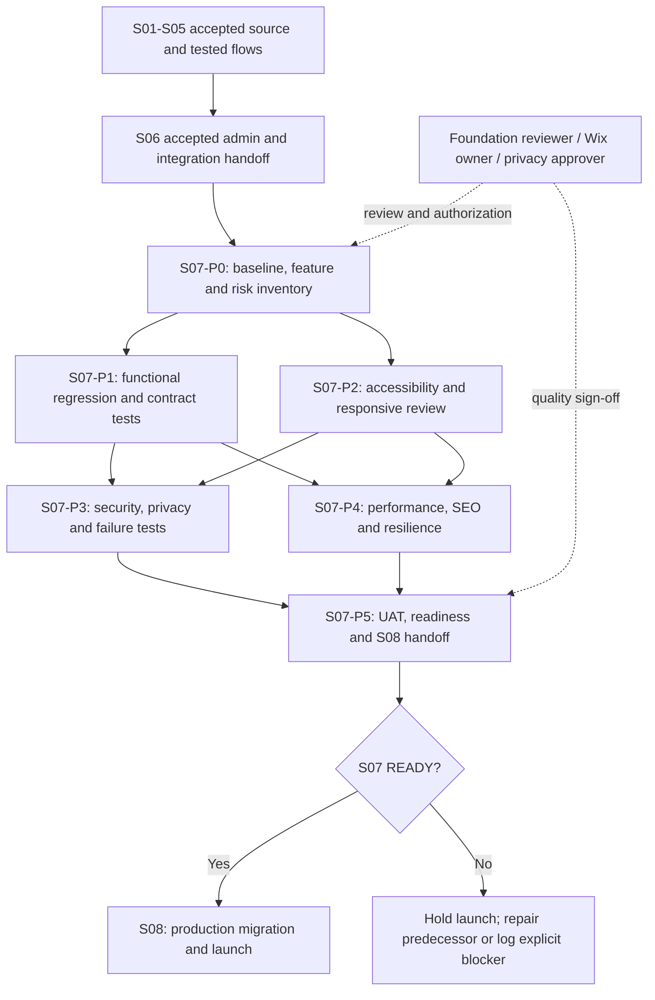
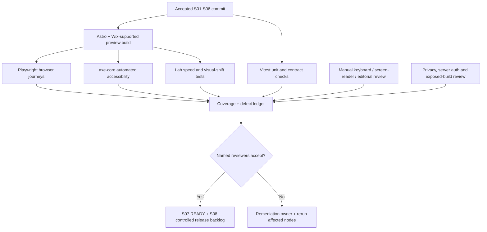
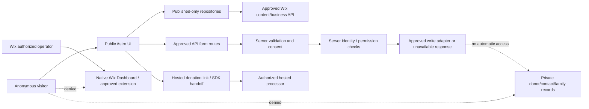
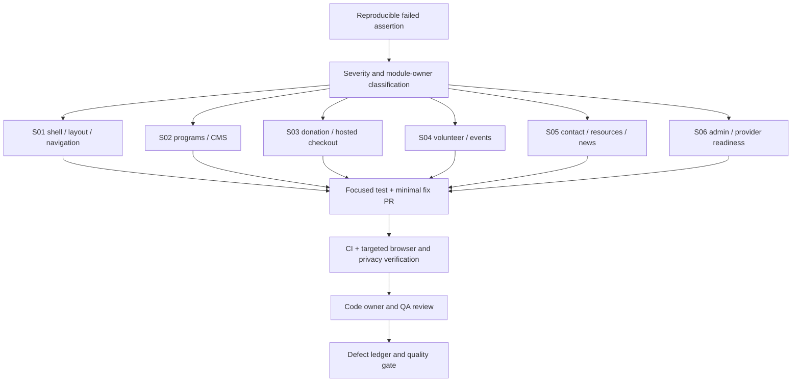

# Sprint 07 — Full-System Quality Assurance, Security, Accessibility and Performance

**Project:** PostBaby Bliss Foundation Digital Platform  
**Delivery model:** One-week engineering sprint divided into six independently gated phases  
**Engineering method:** Graph Engineering (dependency and risk graphs) + Loop Engineering (bounded defect-to-verification loops)  
**Working stack:** Astro, TypeScript, selective React, Tailwind CSS, approved Wix-managed Headless/Astro integration, Wix CMS/CRM/business services, Node.js tooling, GitHub Actions, Vitest, Playwright, axe-core and optional Lighthouse CI  
**Primary outcome:** An independently tested, release-candidate **preview build** with reproducible regression evidence, documented accessibility and privacy/security reviews, measured performance, closed high-severity defects and a formal handoff to Sprint 08's controlled Wix production launch.

> **Planning is not implementation.** Earlier sprint documents describe intended work. Their existence does **not** mean the corresponding modules, workflows, tests, Wix entitlements, backend services or integrations have been implemented or accepted. All S07 tasks begin from the **actual repository, approved ADRs, source commit and verified preview**, not invented files or mocked successes.
>
> 
> **Architecture condition.** The file manifests assume **Option A: Astro with Wix-managed Headless** approved in `docs/architecture/ADR-0001-delivery-path.md`. If that ADR instead selected Wix Editor/Studio with Velo or self-managed Headless, retain the QA outcomes but **replace Astro-specific command/path assumptions** with a reviewed deployment-specific test map before assigning work. This sprint does **not** authorize `wix finalize-migration`, production-domain changes, payment settlement, CRM exports or live form submissions.
>
> 
> **U.S. nonprofit safeguard.** The Foundation serves postpartum families. Tests must use synthetic, non-identifying fixtures and must **not** collect, expose, seed or export medical details, donor payment data, private family submissions, credentials or real contact records. Accessibility is assessed against **WCAG 2.2 Level AA** as a voluntary engineering target, subject to independent legal review of any applicable obligations; a passing automated scanner is not a certification of legal compliance.

---

## 1. Purpose, inherited scope and testable outcomes

### 1.1 Problem addressed by Sprint 07

By the end of Sprints 01–06, the team expects to have constructed the Foundation's public experience and approved administration workflows: home/about pages, programs, donations, volunteers, events, contact/resources/FAQ/news, optional communications and Wix-backed operations. Even if the features function separately, their integration may introduce broken routes, contradictory states, inaccessible controls, security gaps, sensitive-data leakage, slow loading, consent failures, failed navigation, or regressions in existing user journeys. A satisfactory local build alone cannot establish production readiness. This sprint subjects the **entire approved MVP surface** to repeatable tests and human verification before Sprint 08 begins migration and release operations.

### 1.2 Specific sprint objectives

1. Establish a factual source-of-truth inventory of implemented routes, enabled integrations, versions, owners, risks and predecessor acceptance artifacts at a pinned Git commit.
2. Expand deterministic unit, integration and end-to-end regression coverage across the public MVP, including honest states for unavailable provider connections.
3. Conduct automated **and manual** accessibility verification of public routes, forms, content controls, dialogs, error messages and any approved administrative extension.
4. Exercise security and privacy boundaries: server-side authorization, input validation, redirects, consent controls, error sanitization, public-data scoping and secret exposure prevention.
5. Measure responsive usability and performance using documented lab configurations, representative pages, realistic media and network conditions.
6. Verify SEO and content integrity, including route titles, descriptive metadata, canonical behavior, broken links and the **preview's** protection from accidental indexing where appropriate.
7. Fix defects through bounded change–test–review loops, preserving original feature ownership and maintaining a transparent severity ledger.
8. Deliver a signed release-readiness package for S08, including unresolved dependencies, operational risks, evidence and an explicit **READY / NOT READY** conclusion.

### 1.3 Expected feature inventory and provenance

The following routes are **candidates from S01–S06 plans** and must be confirmed against the running repository; a route or test that was planned but never implemented is marked `MISSING` and routed to the responsible sprint or a separately approved remediation ticket.

| Source sprint | Candidate public/admin surface | Main verification goal | Provider-sensitive scenarios |
|---|---|---|---|
| S01 | `/`, `/about`, shared layout/navigation/footer | Responsive, accessible primary navigation and credible organizational content | Public-site information, approved contact methods |
| S02 | `/programs`, `/programs/[slug]`, missing-slug/404 | CMS or local approved content maps to valid pages | Publish-only records; CMS unavailable/empty/invalid item |
| S03 | `/support-us`, `/donate`, `/donation-return` if implemented | Giving copy, approved hosted checkout handoff, explicit non-transaction states | No card collection, unapproved destinations or false donation success |
| S04 | `/volunteer`, `/volunteer/[slug]`, `/events`, `/events/[slug]` | Listings, event times, registration/interest states | No claimed registration success without provider confirmation |
| S05 | `/contact`, `/resources`, `/resources/[slug]`, `/faq`, `/news`, `/news/[slug]` | Usable public information, published-only articles and resources | Explicit contact/newsletter consent; no clinical-case intake |
| S06 | Wix native dashboard and optional approved dashboard extension | Operator workflow, role boundaries and accurate integration status | No anonymous access to privileged operations or private CRM data |
| Cross-cutting | `/404`, all site navigation, error/empty/loading states | Safe, accessible failure behavior; consistent SEO and language | No leaking SDK errors, stack traces, secrets or user data |

**No unapproved capability is made mandatory solely because it appears above.** A documented `APPROVED_UNAVAILABLE` state is acceptable for explicitly optional integrations, but an undisclosed missing core page, broken mandatory service or false success state blocks readiness.

### 1.4 Exclusions and the launch boundary

Sprint 07 is a **stabilization sprint, not a new feature sprint**. It does not build a custom family case-management portal, new email service, real donor transaction processor, PostgreSQL database, new identity provider, custom CRM, production analytics implementation, medical record storage or new organization-wide design. It does not change the Foundation's domain, switch the Wix storefront, execute live migration or claim completion of S08. An essential missing feature is explicitly escalated as a predecessor gap, not quietly built under a test ticket. Production-only tests that cannot safely run on preview are recorded as **S08 follow-up gates** with their exact verification steps and owners.

---

## 2. Engineering control model

### 2.1 Work-item schema and file operation legend

Every task follows:

`Sprint → Phase → Task → Dependency nodes → Allowed file changes → Test assertion → Evidence → Human review → Gate`.

- **Task IDs:** `S07-P0-T01` through `S07-P5-T08` (48 planned tasks).
- **State:** `TODO`, `READY`, `IN_PROGRESS`, `BLOCKED`, `IN_REVIEW`, `DONE`, `DEFERRED`.
- **Priority:** `P0` mandatory, `P1` conditional/approved, `P2` future backlog.
- **Operation codes:** `C` create; `M` modify; `C/M` inspect and reuse before creating; `G` generated by tooling; `?` only if approved/not already present; `D` manual/dashboard procedure captured as evidence.
- **Defect severity:** `S1` critical (privacy/security/data integrity or unsafe giving), `S2` high (essential route inaccessible, major UX/accessibility problem, broken mandatory workflow), `S3` moderate and `S4` cosmetic. Open **S1/S2** defects block S07 acceptance and S08 release readiness.
- **Evidence:** Exact commit SHA, command/configuration, CI URL or artifact, browser/viewport, observed output, screenshot/trace with PII removed, reviewer, date and pass/fail result.

**File ownership principle:** Existing source and test paths are authoritative. A planned `C` path must first be checked for equivalent code; reuse or modify that code and update the manifest rather than creating competing utilities. Never overwrite Wix CLI-generated files without inspecting the current toolchain. Site-owner permissions and environment boundaries supersede plan text.

### 2.2 Bounded Loop Engineering contract

A typical loop for each test or remediation ticket:

1. **Observe:** Reproduce an issue at a pinned commit and capture an exact failure assertion; classify severity and route owner.
2. **Constrain:** Identify the smallest allowed file set and a hypothesis; inspect existing tests, provider interfaces and ADRs.
3. **Implement:** First write a failing regression test for an observable defect where practical; make the smallest production-code change.
4. **Verify locally:** Run targeted unit/integration/e2e tests, typecheck and lint. Include at least one negative or degraded-provider state.
5. **Verify interaction:** Use browser and keyboard evidence on representative routes and device widths; run the relevant accessibility/security checks.
6. **Review and merge:** A reviewer checks architecture, privacy, accessibility and the targeted diff; CI reruns all mandatory checks.
7. **Record:** Attach test result, fix commit and decision to `docs/quality/sprint-07-defect-ledger.md`; update `docs/engineering/task-graph.md` and the readiness matrix.

**Bounded retries:** At most **three implementation attempts per hypothesis**. After three failed attempts, stop automatic rework, mark `BLOCKED`, document the evidence and assign an engineering lead. Never silence, exclude or replace a failing security/accessibility test merely to obtain a green pipeline. A flaky test is quarantined only with reviewer approval, a defect ID, an owner and a time-bound correction plan; a flaky **critical journey** blocks the release gate.

### 2.3 Sprint dependency graph



**Critical path:** Verified S06 handoff → P0 → P1 → P3 → P5, with parallel P2/P4 only when their dependencies and review resources permit. A blocked integration does not hold unrelated public-content tests; it does hold approval of its mandatory live behavior.

### 2.4 One-week schedule

| Working day | Phase allocation | Demonstrable deliverable | Gate |
|---|---|---|---|
| Day 1 | P0; start P1 | Verified routes/providers, fixed test target and initial matrix | **G0** baseline approved |
| Day 2 | Complete P1; start P2 | End-to-end regressions and contract test results | **G1** functional coverage accepted |
| Day 3 | Complete P2; start P3 | Accessibility evidence, visual/responsive issues, security test cases | **G2** accessibility reviewed |
| Day 4 | Complete P3; P4 | Security/privacy report, performance and SEO evidence | **G3/G4** risk and quality checks |
| Day 5 | Finish P4; P5 | Release-readiness report, accepted defect disposition, S08 handoff | **G5** READY or NOT READY |

The schedule assumes **2–3 contributors**, available Wix credentials where authorized, a stable preview and timely stakeholder decisions. If those assumptions fail, retain security and acceptance gates rather than declaring quality achieved by the calendar. Continuous integration runs throughout the week.

---

## 3. Phase-level engineering specifications

### Phase S07-P0 — Verify predecessor delivery and freeze the quality baseline

**Timing:** Day 1, first half.  
**Phase objective:** Make the scope of testing factual, reproducible and traceable to a real repository state. Establish what is implemented, enabled, disabled, approved, or missing; do not permit feature plans to substitute for evidence.

**Entry prerequisites:** Access to the working source repository, current preview URL or a reproducible local startup, actual S01–S06 review/acceptance artifacts and the authorized Wix architecture decision. If S06 acceptance is absent, only non-invasive inventory and documentation may proceed; P1–P5 cannot be approved for release readiness.

| Task ID | Priority | Development or review objective | Planned file operations | Dependencies / required verification |
|---|---|---|---|---|
| **S07-P0-T01** | P0 | Verify accepted S01–S06 commit lineage and handoff; flag incomplete work instead of assuming it exists. | `docs/quality/sprint-07-entry-audit.md` **C**; `docs/handoff/sprint-06-to-sprint-07.md` **M** only if inaccuracies are found | Review actual review reports, ADR-0001 through ADR-0006, CI status and SHA; attach missing-evidence list |
| **S07-P0-T02** | P0 | Inventory real public routes, approved admin surfaces and their S01–S06 owners. | `docs/quality/sprint-07-route-inventory.md` **C**; `scripts/qa/inventory-routes.mjs` **C?** | Cross-check `src/pages/**`, build output, navigation, 404 handling and actual site responses |
| **S07-P0-T03** | P0 | Map each route to approved provider-state and environment source, including fallback/unavailable behavior. | `docs/quality/sprint-07-provider-matrix.md` **C**; `docs/quality/sprint-06-provider-readiness.md` **M?** only to correct source evidence | Inspect S02 CMS, S03 giving, S04 event/volunteer, S05 forms/newsletter and S06 admin integration records |
| **S07-P0-T04** | P0 | Build a risk-ranked user-journey inventory with positive, negative, error and keyboard flows. | `docs/quality/sprint-07-test-matrix.md` **C** | Tie each journey to route, actor/role, test ID, data sensitivity and expected result |
| **S07-P0-T05** | P0 | Record permitted test environments, synthetic-fixture rules, safe provider toggles and credential handling. | `docs/quality/sprint-07-test-data-policy.md` **C**; `.env.example` **M?** placeholders only | No real submissions, identifiable people, medical details, payment data or committed credentials |
| **S07-P0-T06** | P0 | Inspect installed test dependencies and scripts without upgrading framework or Wix SDK by assumption. | `package.json` **M?**; `package-lock.json` **G?**; `docs/quality/sprint-07-tool-versions.md` **C** | Confirm Node/Astro/Wix CLI versions from actual repo; run existing baseline checks and record output |
| **S07-P0-T07** | P0 | Establish defect severity, daily triage ownership, evidence convention and exception approval rules. | `docs/quality/sprint-07-defect-ledger.md` **C**; `docs/engineering/task-graph.md` **M** | Every defect includes repro, linked route, owner, severity, ETA/deferment rationale and test path |
| **S07-P0-T08** | P0 | Obtain baseline gate approval and create a stable test target identified by commit and preview environment. | `docs/quality/sprint-07-baseline-approval.md` **C**; `docs/reviews/sprint-07-review.md` **C** (initial) | Engineering lead and Wix owner approve baseline; unverifiable endpoints remain `BLOCKED` |

**Implementation notes:** Generate route inventory from source/build artifacts where practical, but compare manually against rendered navigation. Record whether external integrations are `ACTIVE_VERIFIED`, `APPROVED_UNAVAILABLE`, `DISABLED`, `MOCK_ONLY`, `MISSING` or `BLOCKED`. Never treat a mocked checkout or form response as real provider acceptance. The preview site may connect to the parent site's business data; confirm safe fixture isolation before running any write paths.

**Gate G0 — Entry and scope acceptance:** S06 handoff and selected architecture are confirmed; exact commit, route/module inventory, synthetic-data policy, test matrix, severity rules and owners exist. If not, record `G0: BLOCKED` and limit work to harmless inventory.

---

### Phase S07-P1 — Full-system regression tests and service-contract verification

**Timing:** Day 1–2.  
**Phase objective:** Prove the public experience works end to end, unchanged modules remain functional, and each provider pathway reports truthful success, failure, unavailable and denied conditions.

**Entry prerequisites:** Gate G0; reproducible local test runtime; route matrix and fixtures approved. No live donation, email or family intake test is allowed without a separately authorized sandbox or provider-approved test mode.

| Task ID | Priority | Development objective | Planned file operations | Dependencies / acceptance assertions |
|---|---|---|---|---|
| **S07-P1-T01** | P0 | Organize a stable cross-route browser test suite and configure browser projects, artifact capture and isolation. | `playwright.config.ts` **M**; `tests/e2e/fixtures/public-site.ts` **C**; `tests/e2e/s07-public-navigation.spec.ts` **C** | G0; no arbitrary sleeps, deterministic base URL, trace on failure, test data isolation |
| **S07-P1-T02** | P0 | Verify homepage, About, layout, footer, 404 and every implemented public navigation link. | `tests/e2e/s07-core-routes.spec.ts` **C**; existing `tests/e2e/home.spec.ts`, `tests/e2e/about.spec.ts` **M?** | All approved required pages return expected content; no dead internal links or fatal client errors |
| **S07-P1-T03** | P0 | Regress program listing, detail slugs, unavailable content, bad CMS responses and published-only filters. | `tests/e2e/s07-programs.spec.ts` **C**; `tests/integration/s07-cms-contracts.test.ts` **C** | S02 repository contracts; stale/unpublished records never appear as public program claims |
| **S07-P1-T04** | P0 | Regress giving navigation, CTA handoff, URL allowlisting, canceled/failed return and no false success state. | `tests/e2e/s07-giving.spec.ts` **C**; `tests/integration/s07-checkout-states.test.ts` **C** | S03 ADR and payment adapter; no card input in custom UI, no donation-success claim without verified evidence |
| **S07-P1-T05** | P0 | Regress volunteer and event listings, date/time display, unavailable registration and provider confirmation semantics. | `tests/e2e/s07-engagement.spec.ts` **C**; `tests/integration/s07-engagement-contracts.test.ts` **C** | S04 contracts; test past/empty/unavailable events, invalid slug and time zone consistency |
| **S07-P1-T06** | P0 | Regress Contact, FAQ, Resources, News and newsletter public states including empty collections and consent validation. | `tests/e2e/s07-community.spec.ts` **C**; `tests/integration/s07-communications-contracts.test.ts` **C** | S05 contracts; public content renders without authorization; no implied successful submission on backend failure |
| **S07-P1-T07** | P0 | Verify admin access boundaries and public route isolation with permitted test roles or explicit native-dashboard evidence. | `tests/integration/s07-admin-boundaries.test.ts` **C**; `tests/e2e/s07-admin-smoke.spec.ts` **C?** only if approved extension exists | S06 role matrix; logged-out users cannot reach privileged UI; no fabricated `/admin` page |
| **S07-P1-T08** | P0 | Consolidate contract/route results, fix reproducible S1/S2 regressions in their owning modules and run broad CI suite. | `.github/workflows/ci.yml` **M**; `docs/quality/sprint-07-regression-results.md` **C**; `src/**` **M?**, narrowed per defect ticket | Named reports, CI SHA, exact failures, linked fix PRs and verified re-runs |

**Implementation notes:** Prefer existing unit and integration tests over copying them to another folder. S07-specific tests should span boundaries not previously tested; a defect fix goes into the original owner module with a focused regression assertion. Simulate provider timeouts/network failures at controlled adapters; do not call unaudited third-party endpoints. Test donation-return states as **navigational** outcomes rather than proof of settlement.

**Gate G1 — Functional confidence:** All implemented mandatory journeys pass on pinned preview/local build; all enumerated S1/S2 functional defects are fixed and independently retested. Optional disabled integrations show an accurate, accessible alternative. Missing required predecessor functionality remains a `BLOCKED` gate rather than a pass.

---

### Phase S07-P2 — Accessibility, responsive behavior and visual-content integrity

**Timing:** Day 2–3.  
**Phase objective:** Make the site usable with assistive technology, keyboard navigation and small screens; ensure that visual improvements do not compromise reading order, content clarity or truthful imagery.

**Entry prerequisites:** G0; working public routes; P1 route matrix available. Automated scans are supplementary; manual assessment is mandatory for release-critical journeys.

| Task ID | Priority | Development objective | Planned file operations | Dependencies / acceptance assertions |
|---|---|---|---|---|
| **S07-P2-T01** | P0 | Integrate axe-core scans on representative public and dynamic detail routes using Playwright. | `tests/e2e/s07-accessibility-axe.spec.ts` **C**; `package.json` **M?**; `package-lock.json` **G?** | Use `@axe-core/playwright` if approved; no critical/serious automated findings on required pages |
| **S07-P2-T02** | P0 | Manually audit headings, landmarks, skip link, focus order, visible focus, navigation and keyboard-only usability. | `docs/quality/sprint-07-manual-accessibility.md` **C**; `src/components/layout/SiteHeader.astro`, `src/layouts/BaseLayout.astro` **M?** | Record route, keyboard steps, screen reader/browser, observed issue and fix evidence |
| **S07-P2-T03** | P0 | Verify forms, errors, consent, required fields, live announcements and disabled-submission messaging. | `tests/e2e/s07-form-accessibility.spec.ts` **C**; `src/components/contact/ContactInquiryForm.astro`, `src/components/communications/NewsletterSignupForm.astro` **M?** | Labels/relationships and inline errors are perceivable; unavailable providers do not fake success |
| **S07-P2-T04** | P0 | Test responsive layout across standard breakpoints and 200–400% zoom/reflow where practicable. | `tests/e2e/s07-responsive.spec.ts` **C**; `docs/quality/sprint-07-responsive-matrix.md` **C** | At 320, 375, 768, 1024 and 1440 CSS px, no clipped mandatory actions or unintended horizontal overflow |
| **S07-P2-T05** | P0 | Evaluate visual states and contrast including hover, focus, disabled, validation and reduced-motion behavior. | `tests/e2e/s07-visual-regression.spec.ts` **C?**; `docs/quality/sprint-07-visual-review.md` **C**; `src/styles/global.css` **M?** | Snapshot baselines are approved, deterministic and reviewed, not blindly accepted after changes |
| **S07-P2-T06** | P0 | Audit image alt text, captions, testimonial permissions, content reading level and non-deceptive service claims. | `docs/content/sprint-07-content-image-audit.md` **C**; `src/data/**`, `src/components/**` **M?** only with editorial approval | No invented testimonials, clinical claims, staff identities, statistics or implied medical diagnosis |
| **S07-P2-T07** | P0 | Evaluate at least one screen-reader/browser combination and key dynamic flows manually; record gaps in assistive technology support. | `docs/quality/sprint-07-assistive-technology-review.md` **C**; `tests/e2e/s07-accessibility-axe.spec.ts` **M?** | Include results for navigation, form feedback, dialogue/accordion if present and errors; manual sign-off required |
| **S07-P2-T08** | P0 | Fix accessibility S1/S2 defects in owning UI files; rerun route/browser audit and publish WCAG evidence matrix. | `docs/quality/sprint-07-wcag-22-aa-matrix.md` **C**; `docs/quality/sprint-07-accessibility-acceptance.md` **C**; affected `src/**` **M?** | Each tested success criterion references method and result; unresolved barriers prohibit readiness |

**Implementation notes:** WCAG 2.2 AA is the testing target, not a claim that all U.S. nonprofits automatically fall under a particular statute. Verify keyboard focus after route changes; distinguish decorative images from informative ones; validate reduced-motion preference; ensure no accessibility regressions are introduced by animation or lazy-loaded media. Color contrast testing applies even if the *project documentation* uses only black text. Avoid blanket `aria-label` overrides that replace meaningful visible labels.

**Gate G2 — Accessible and responsive MVP:** Critical journeys work using keyboard only, representative routes pass automated checks without critical/serious findings, high-severity manual findings are closed, mobile layouts remain usable, and remaining minor findings have owner, remediation plan and explicit reviewer acceptance. A green axe report alone is **insufficient**.

---

### Phase S07-P3 — Security, privacy, authorization and integration failure testing

**Timing:** Day 3–4.  
**Phase objective:** Verify that a public nonprofit website is not exposing private family, volunteer, donor or staff data and that the selected Wix/Headless integration honors server-side trust boundaries and graceful failure states.

**Entry prerequisites:** G0, functional/permission inventory, synthetic test fixtures and approved testing boundaries. Security tests must be scoped to the team's own development or explicitly authorized staging environment, **not production penetration testing**.

| Task ID | Priority | Development objective | Planned file operations | Dependencies / acceptance assertions |
|---|---|---|---|---|
| **S07-P3-T01** | P0 | Establish a trust-boundary and threat checklist covering visitor, member, operator, server endpoint, Wix SDK and third-party handoff. | `docs/security/sprint-07-threat-model.md` **C**; `docs/security/sprint-07-test-plan.md` **C** | Map routes/actions to identity, data class, server-side authorizer and failure outcome; align to S06 access matrix |
| **S07-P3-T02** | P0 | Verify public endpoints reject invalid methods/inputs and never execute privileged operations without an authorized server-side decision. | `tests/integration/s07-input-and-method-validation.test.ts` **C**; `tests/integration/s07-authorization-denials.test.ts` **C** | Only test owned endpoints; reject malformed payloads and unauthorized role/action combinations |
| **S07-P3-T03** | P0 | Verify donor checkout allowlisting, tampered redirect inputs, return-route ambiguity and unauthorized provider activation. | `tests/integration/s07-checkout-security.test.ts` **C**; `src/lib/donations/validate-checkout-url.ts` **M?** | No open redirect, unexpected origin or false payment-confirmed state; backend status remains authoritative |
| **S07-P3-T04** | P0 | Verify contact/newsletter/engagement consent and input minimization; detect accidental clinical or infant case-field collection. | `tests/integration/s07-public-form-privacy.test.ts` **C**; `docs/privacy/sprint-07-data-minimization.md` **C** | No extra sensitive data fields, no hidden marketing consent, no submission when provider is unavailable |
| **S07-P3-T05** | P0 | Scan repository/build artifacts for secrets, PII-like fixtures, debug pages, verbose logs and source-map exposure. | `scripts/qa/check-public-artifacts.mjs` **C**; `.github/workflows/ci.yml` **M**; `docs/security/sprint-07-exposure-review.md` **C** | Only approved local/repo paths; CI scans with redacted output, no raw secrets in evidence |
| **S07-P3-T06** | P0 | Validate degraded provider states, timeouts, rate-limit errors, unexpected responses and fallback behavior. | `tests/integration/s07-provider-failures.test.ts` **C**; `tests/e2e/s07-error-states.spec.ts` **C** | Verify S02–S06 adapters produce safe error boundaries and actionable public copy without success spoofing |
| **S07-P3-T07** | P0 | Inspect preview authentication/session behavior and approved third-party scripts, consent settings and web security headers where controllable. | `docs/security/sprint-07-auth-consent-headers-review.md` **C**; `src/layouts/BaseLayout.astro` **M?** | Document which controls Wix owns; do not forge header support or imply Editor cookie banner carries over |
| **S07-P3-T08** | P0 | Triages findings and implement narrowly scoped fixes in responsible source files; obtain privacy/security reviewer sign-off. | `docs/quality/sprint-07-security-privacy-acceptance.md` **C**; `docs/quality/sprint-07-defect-ledger.md` **M**; affected `src/**` **M?** | S1/S2 zero open; no accidental live writes; logged-out and insufficient-role cases demonstrably denied |

**Implementation notes:** Do not build a toy scanner that performs intrusive probing or exposes credentials. Use source inspection, lint/static checks, fixture-based integration tests and approved staging behavior. Prefer the existing secure hosted checkout over custom card handling. A Wix-authenticated visitor **is not** a staff member; a Wix dashboard extension is not inherently authorized to read all contacts. A frontend `disabled` button is not server-side authorization. Preview tests must not mutate the parent site's real business data, which may be shared across a managed Headless migration.

**Gate G3 — Privacy and security control:** Threat matrix covers all enabled data flows; no S1/S2 issue remains; unauthorized/invalid/consent-negative paths are exercised; error responses do not expose secrets or personal data; approved reviewer signs the security/privacy report. Any pending interpretation of legal/privacy obligations is explicitly assigned to Foundation counsel/owner and cannot be silently classified as compliant.

---

### Phase S07-P4 — Performance, SEO, reliability and operational resilience

**Timing:** Day 4–5.  
**Phase objective:** Produce evidence that representative public pages load quickly, render stable content, remain searchable when live, and degrade gracefully when permitted CMS/business services fail.

**Entry prerequisites:** G0, representative populated pages, correct preview configuration and at least an initial regression build. Tests must distinguish **lab** performance from real-user field metrics unavailable before launch.

| Task ID | Priority | Development objective | Planned file operations | Dependencies / acceptance assertions |
|---|---|---|---|---|
| **S07-P4-T01** | P0 | Define repeatable lab budgets, measured routes, device/network profile and no-PII performance reporting. | `docs/quality/sprint-07-performance-budget.md` **C**; `docs/quality/sprint-07-performance-baseline.md` **C** | Record real baseline rather than claim targets met; use at least homepage, programs, giving and one dynamic route |
| **S07-P4-T02** | P0 | Add a controlled performance measurement runner and review if Lighthouse CI is appropriate for installed tooling. | `lighthouserc.json` **C?**; `package.json` **M?**; `scripts/qa/run-performance.mjs` **C?** | Local/CI automation must never point at live donor/payment or private administrative URLs |
| **S07-P4-T03** | P0 | Audit large images, fonts, JS hydration, layout shift, cache behavior and broken media for real public pages. | `docs/quality/sprint-07-asset-audit.md` **C**; `src/components/**`, `src/styles/global.css` **M?** | Preserve quality of authentic imagery; add explicit image dimensions/lazy loading where correct; do not change assets without rights/approval |
| **S07-P4-T04** | P0 | Fix proven top performance bottlenecks and rerun measurement under the same configuration. | `src/pages/**`, `src/layouts/BaseLayout.astro`, `src/components/**`, `astro.config.mjs` **M?** (only approved bottlenecks) | Compare before/after values and check for accessibility or SEO regressions |
| **S07-P4-T05** | P0 | Verify titles, descriptions, canonical URLs, structured-data applicability, sharing previews, headings and broken internal links. | `tests/e2e/s07-seo-and-links.spec.ts` **C**; `docs/quality/sprint-07-seo-audit.md` **C**; SEO source files **M?** | All published routes have approved metadata and safe canonical plan; preview not indexed inadvertently |
| **S07-P4-T06** | P0 | Verify Wix reserved paths, preserved old URL inventory, planned redirects and migration-sensitive forms/consent limitations. | `docs/quality/sprint-07-wix-migration-gap-audit.md` **C**; `docs/operations/sprint-07-route-to-s08-map.md` **C** | Identify tasks requiring live validation in S08; do not create a competing `robots.txt` or assume redirects are already active |
| **S07-P4-T07** | P0 | Exercise empty/outage/timeouts, 404 and navigation failure recovery and document Wix-owned reliability boundaries. | `tests/e2e/s07-resilience.spec.ts` **C**; `tests/integration/s07-cache-fallback.test.ts` **C?** if relevant | Visitors receive useful safe states; no unhandled errors; record which fault recovery needs live-domain check in S08 |
| **S07-P4-T08** | P0 | Produce performance/SEO/reliability acceptance records and escalate remaining blockers to S08 with explicit ownership. | `docs/quality/sprint-07-performance-acceptance.md` **C**; `docs/quality/sprint-07-seo-reliability-acceptance.md` **C**; `docs/quality/sprint-07-defect-ledger.md` **M** | Comparable measurements, tested links, remediation notes and sign-off; no unverifiable “100% optimized” claim |

**Suggested performance acceptance budgets:** Test on a consistent mid-range mobile profile and throttled network with 3 runs, record median and range. Target representative page **Lighthouse Performance ≥ 85** where feasible, **LCP ≤ 2.5 s** and **CLS ≤ 0.1** in measured lab runs; use a transparent exception if business widgets or network variance prevent a test from meeting the target. **INP ≤ 200 ms** is a *field* Core Web Vitals target; do not label an isolated lab interaction test as a measured 75th-percentile INP. For field reporting after deployment, assess LCP, INP and CLS at the 75th percentile when sufficient user data exists. Set resource budgets according to baseline, rather than inventing fixed byte counts. Major quality regression blocks G4 even if one Lighthouse score happens to pass.

**Wix-specific quality requirement:** An Astro preview does not guarantee parity with an Editor site. Before S08, list all original Wix Forms, Velo page/backend code, unsupported widgets, metadata, analytics, consent banner and redirects that require recreation or verification. Since some Wix-managed SEO paths and authentication paths are reserved, inspect the official integration rules; do not assume custom Astro routes can override Wix-managed endpoints.

**Gate G4 — Performance and operational confidence:** Target metrics are measured on defined routes with a reproducible configuration; significant bottlenecks and broken links are fixed or explicitly blocked; preview search-index controls and Wix migration gaps are documented; no S1/S2 performance/reliability defect remains.

---

### Phase S07-P5 — Independent acceptance, release-candidate evidence and Sprint 08 handoff

**Timing:** Day 5.  
**Phase objective:** Decide whether the entire preview is sufficiently verified to enter controlled production release preparation, and provide Sprint 08 with exact, reproducible evidence rather than informal assurances.

**Entry prerequisites:** G0–G4 results, final code candidate, defect ledger and named Foundation reviewers. An unresolved G0–G4 blocker results in a **NOT READY** handoff and no S08 migration approval.

| Task ID | Priority | Development objective | Planned file operations | Dependencies / acceptance assertions |
|---|---|---|---|---|
| **S07-P5-T01** | P0 | Freeze a candidate commit and rerun clean install, typecheck, lint, unit, integration, browser and production build checks. | `.github/workflows/ci.yml` **M?**; `docs/quality/sprint-07-final-ci-evidence.md` **C** | Record SHA, exact commands, CI links, dependencies, test counts, failures, skips and approvals |
| **S07-P5-T02** | P0 | Run Foundation acceptance stories for visitor, donor, volunteer, event participant and staff operator using safe data. | `docs/quality/sprint-07-foundation-uat-script.md` **C**; `docs/quality/sprint-07-foundation-uat-results.md` **C** | Human review of correctness, clarity, brand trust, nonclinical support routes and disabled-state honesty |
| **S07-P5-T03** | P0 | Inspect remaining defects, security findings, failed tests, unapproved workflows and exceptions. | `docs/quality/sprint-07-defect-ledger.md` **M**; `docs/quality/sprint-07-exceptions.md` **C** | Every open issue has owner, severity, evidence and launch impact; S1/S2 cannot be waived into READY |
| **S07-P5-T04** | P0 | Summarize accessible design and technical quality evidence with gaps and explicitly limited claims. | `docs/quality/sprint-07-accessibility-acceptance.md` **M**; `docs/quality/sprint-07-security-privacy-acceptance.md` **M**; `docs/quality/sprint-07-performance-acceptance.md` **M** | Reviewer validates no unsupported certification or fabricated measured result |
| **S07-P5-T05** | P0 | Deliver definitive release route inventory and source/service activation matrix for S08-P0. | `docs/handoff/sprint-07-release-scope.md` **C**; `docs/quality/sprint-07-route-inventory.md` **M**; `docs/quality/sprint-07-provider-matrix.md` **M** | Routes tagged `SHIPPED`, `APPROVED_UNAVAILABLE`, `DEFERRED` or `BLOCKED`, each with owning sprint |
| **S07-P5-T06** | P0 | Prepare explicit S08 work package: migration gaps, live-only verifications, redirects, rollback questions and responsible approvers. | `docs/handoff/sprint-07-to-sprint-08.md` **C**; `docs/backlog/sprint-08-candidates.md` **C** | No unauthorized live test; S08 tasks reference correct Wix cutover runbook and acceptance gates |
| **S07-P5-T07** | P0 | Hold formal quality gate with development lead, independent QA/security reviewer and Foundation representative. | `docs/quality/sprint-07-acceptance.md` **C**; `docs/reviews/sprint-07-review.md` **M** | Sign-offs, dissenting findings, decision timestamp and exact preview/SHA included |
| **S07-P5-T08** | P0 | Archive sanitized evidence and mark all task graph nodes honestly; determine if S08 may begin. | `docs/engineering/task-graph.md` **M**; `docs/quality/sprint-07-evidence-index.md` **C**; `README.md` **M?** | Return `READY` or `NOT READY`, not an unqualified “complete”; reviewer can reproduce test command and evidence |

**Gate G5 — Sprint 07 closure:** `READY` only when all required gate assertions have evidence, no S1/S2 defect is open, high-risk integrations are truthful, human accessibility/UAT checks are documented, the release scope is fixed, and S08 receives an owned and reproducible migration-issues inventory. A `NOT READY` result is a valid **honest engineering outcome** but does not authorize a production launch. Do not declare S08's controlled cutover, rollback proof or post-launch monitoring complete in Sprint 07.

---

## 4. Graph Engineering: dependencies, change ownership and merge control

### 4.1 Test architecture and production trust graph





These edges represent **intended data and trust relationships**, not proof that a particular Wix API is configured or authorized. Test both allowed and denied flows; do not assume that calling an SDK method means the caller is privileged.

### 4.2 File-ownership and defect routing graph



**Parallelism rule:** P1 route testing, P2 visual/accessibility review and P3 static/privacy inspections may run in parallel once G0 is met and file writes do not conflict. Tests can be authored in independent paths; **production-code fixes are serialized per owned file/module**. Never have multiple agents simultaneously modify `src/layouts/BaseLayout.astro`, `src/lib/navigation.ts`, the same form component or a shared Wix provider adapter.

### 4.3 Ownership matrix

| Change area | Accountable owner | Required second reviewer / coordination |
|---|---|---|
| `tests/e2e/**`, `playwright.config.ts` | QA automation lead | Module owner and accessibility reviewer for UI impacts |
| `tests/integration/**`, `tests/unit/**` | Test/integration engineer | Provider owner and architecture reviewer |
| `src/pages/**`, `src/components/**`, `src/styles/**` | Original feature/UI owner | Accessibility and content reviewer |
| `src/lib/donations/**`, `src/pages/api/**` | Trusted integration owner | Security/privacy reviewer; Wix owner for provider changes |
| `src/lib/admin/**`, `src/lib/integrations/**` | S06 integration owner | Independent access-control reviewer |
| `.github/workflows/**`, `package.json`, `astro.config.mjs` | Engineering/CI lead | Platform owner and code reviewer; lockfile must match changes |
| `docs/quality/**`, `docs/security/**`, `docs/privacy/**` | QA/security owner | Foundation communications/operations approver as applicable |
| `docs/handoff/**`, `docs/reviews/**`, `docs/engineering/task-graph.md` | Sprint lead | Development lead + Foundation representative |

### 4.4 Planned repository file tree (principal new files)

This is a **change plan**, not evidence that any file currently exists. `M` items appear after the tree in the modification ledger.

```text
docs/
  quality/
    sprint-07-entry-audit.md
    sprint-07-route-inventory.md
    sprint-07-provider-matrix.md
    sprint-07-test-matrix.md
    sprint-07-test-data-policy.md
    sprint-07-tool-versions.md
    sprint-07-defect-ledger.md
    sprint-07-baseline-approval.md
    sprint-07-regression-results.md
    sprint-07-manual-accessibility.md
    sprint-07-responsive-matrix.md
    sprint-07-visual-review.md
    sprint-07-assistive-technology-review.md
    sprint-07-wcag-22-aa-matrix.md
    sprint-07-accessibility-acceptance.md
    sprint-07-performance-budget.md
    sprint-07-performance-baseline.md
    sprint-07-asset-audit.md
    sprint-07-seo-audit.md
    sprint-07-wix-migration-gap-audit.md
    sprint-07-performance-acceptance.md
    sprint-07-seo-reliability-acceptance.md
    sprint-07-final-ci-evidence.md
    sprint-07-foundation-uat-script.md
    sprint-07-foundation-uat-results.md
    sprint-07-exceptions.md
    sprint-07-acceptance.md
    sprint-07-evidence-index.md
  security/
    sprint-07-threat-model.md
    sprint-07-test-plan.md
    sprint-07-exposure-review.md
    sprint-07-auth-consent-headers-review.md
  privacy/
    sprint-07-data-minimization.md
  content/
    sprint-07-content-image-audit.md
  operations/
    sprint-07-route-to-s08-map.md
  handoff/
    sprint-07-release-scope.md
    sprint-07-to-sprint-08.md
  backlog/
    sprint-08-candidates.md
  reviews/
    sprint-07-review.md
scripts/
  qa/
    inventory-routes.mjs                      # conditional if not needed by existing build
    check-public-artifacts.mjs
    run-performance.mjs                      # conditional if accepted by tooling

tests/
  e2e/
    fixtures/
      public-site.ts
    s07-public-navigation.spec.ts
    s07-core-routes.spec.ts
    s07-programs.spec.ts
    s07-giving.spec.ts
    s07-engagement.spec.ts
    s07-community.spec.ts
    s07-admin-smoke.spec.ts                  # conditional if extension exists
    s07-accessibility-axe.spec.ts
    s07-form-accessibility.spec.ts
    s07-responsive.spec.ts
    s07-visual-regression.spec.ts           # conditional with approved snapshots
    s07-error-states.spec.ts
    s07-seo-and-links.spec.ts
    s07-resilience.spec.ts
  integration/
    s07-cms-contracts.test.ts
    s07-checkout-states.test.ts
    s07-engagement-contracts.test.ts
    s07-communications-contracts.test.ts
    s07-admin-boundaries.test.ts
    s07-input-and-method-validation.test.ts
    s07-authorization-denials.test.ts
    s07-checkout-security.test.ts
    s07-public-form-privacy.test.ts
    s07-provider-failures.test.ts
    s07-cache-fallback.test.ts              # conditional if this adapter exists

# Existing / expected source files potentially MODIFIED only for proven defects:
playwright.config.ts
.github/workflows/ci.yml
package.json
package-lock.json                       # generated in sync with package.json
astro.config.mjs
src/layouts/BaseLayout.astro
src/styles/global.css
src/lib/navigation.ts
src/lib/donations/validate-checkout-url.ts
src/components/layout/SiteHeader.astro
src/components/contact/ContactInquiryForm.astro
src/components/communications/NewsletterSignupForm.astro
src/pages/**
src/components/**
src/lib/**
README.md

automated test reports / traces / screenshots = generated evidence, NOT committed with sensitive data
```

**Path harmonization:** S01–S06 plans use test locations within `tests/e2e/`, `tests/integration/` and `tests/unit/`. If the actual repository uses an established different convention, honor it and document the remap in `docs/quality/sprint-07-entry-audit.md`. Do not introduce multiple Playwright configurations, competing package managers, duplicate axe runners or a separate test framework without an approved justification.

### 4.5 Safe merge sequence

1. **PR 1 — G0 traceability:** Baseline, route/provider/risk inventories, data policy, QA matrix; no production-code change.
2. **PR 2 — Public regression:** Focused S07 browser/contract tests and CI wiring; failing tests triaged, not ignored.
3. **PR 3 — Accessibility:** Manual evidence, axe checks and verified UI remediations in owner-reviewed components.
4. **PR 4 — Security/privacy:** Trust model, denied-path tests, output/secret review, narrowly scoped fixes; independent reviewer.
5. **PR 5 — Performance/SEO:** Measured baseline, limited performance fixes, route/SEO and migration gap report.
6. **PR 6 — Acceptance:** Final comprehensive test run, signed UAT, no-open-S1/S2 check, S08 handoff and release-readiness decision.

PRs may run in parallel where prerequisites and file ownership allow. **Merge into the protected integration branch only after relevant reviews and checks succeed.** Do not commit secrets, live API tokens, medical data, real donor profiles, or large unredacted tracing artifacts.

---

## 5. Acceptance metrics, assertions and measurement policy

### 5.1 Measurable S07 acceptance thresholds

| Quality dimension | S07 target | Verification and limitation |
|---|---|---|
| Sprint task accounting | **48/48** planned task records have documented final state; **all P0** tasks that are applicable have proof of `DONE` | `task-graph.md`, CI artifacts; a task blocked by missing predecessor is not passed |
| Critical issues | **0 open S1; 0 open S2** for the release candidate | Defect ledger and security/privacy reviewer sign-off |
| Mandatory routes | **100% of approved required routes** load and fulfill their required user acceptance story | Real route inventory and Playwright, not placeholder pages |
| High-priority regression | **100% of mandatory scenarios pass** on pinned commit; rerun after fixes | Playwright/Vitest with pass/fail/skip counts recorded |
| Provider states | **100% of enabled integrations** have verified success and failure semantics; disabled ones present truthful UI | Approved provider matrix and contract tests; avoid real private submissions |
| Accessibility | WCAG 2.2 AA-targeted manual matrix; **0 critical/serious automated findings**; no open major manual blocker | axe + keyboard + screen reader; no blanket declaration of compliance |
| Responsive coverage | Representative user journeys checked at **320, 375, 768, 1024 and 1440 CSS px**; keyboard usability at zoom/reflow | E2E screenshots and manual evidence; no blocked CTAs or unintended horizontal overflow |
| Privacy exposure | **0 confirmed leaks** of secrets, private contact/donor/family records or clinical information in public outputs/tests | Source/build inspection, fixture review and owner-approved sandbox tests |
| Performance lab | Documented 3-run baseline and targets for representative pages; aim Lighthouse Performance ≥85, lab LCP ≤2.5 s, CLS ≤0.1 | Configuration and page list recorded; exceptions require reviewer approval |
| Core Web Vitals field goal | Future 75th percentile: **LCP ≤2.5 s; INP ≤200 ms; CLS ≤0.1** where data permits | **Not** asserted measured before production/field data; hand off to S08/post-launch monitoring |
| SEO and navigation | **0 unresolved broken mandatory internal links**; approved metadata on public routes | Browser/link tests; live sitemap and redirects verified in S08 |
| Availability and degradation | All tested provider-unavailable/error scenarios show safe non-deceptive states | Synthetic fixtures; operational vendor availability isn't guaranteed by lab tests |
| Release decision | **One signed `READY` or `NOT READY` verdict** tied to exact SHA | G0–G5 ledger plus Foundation representative acknowledgement |

**Interpretation:** A numerical target is a proposed threshold, not a reported result. All measured values remain blank until test execution, and deviations must include context and an explicit decision. A high Lighthouse score does not compensate for missing consent, broken functionality, inaccessible forms or security vulnerabilities.

### 5.2 Sample verification commands (adapt to installed package scripts)

```bash
# Clean reproducible install on an approved Node version.
npm ci

# Use actual package.json scripts; these are recommended names only.
npm run typecheck
npm run lint
npm run test
npm run build

# Browser checks, if Playwright is installed and configured.
npx playwright test
npx playwright test tests/e2e/s07-giving.spec.ts
npx playwright test tests/e2e/s07-accessibility-axe.spec.ts

# Optional approved performance runner.
# npm run test:performance
```

Do not add a new `test:performance` script or `lighthouserc.json` merely because the examples appear here: first determine compatibility with the build, preview environment, installed Node/Astro version and CI resource budget. Wix-managed Headless CLI build/preview commands must match the **installed supported version**, and they are **not** automatically invoked against production.

### 5.3 Deterministic testing rules

- Fix test data to known dates, identifiers, provider responses and publication states; mock only at intended adapter boundaries.
- Do not assert exact external news, donor totals, fundraising numbers, live event capacities or changing hosted-checkout HTML.
- Distinguish a **unit/integration stub** from an approved real SDK sandbox integration. Never present a stubbed green test as proof of vendor readiness.
- Configure test screenshots/traces only on failure or approved review paths; scrub names, email addresses, IP metadata, cookies and sensitive headers before sharing.
- Use Playwright locator assertions and realistic wait-for-state conditions. A retrying flaky test is not evidence of reliable feature behavior; triage flakes.
- Version-pin relevant test tooling via the lockfile and record exact tested tool versions with the acceptance report.
- Do not disable tests for convenience. A skip must include issue ID, owner, justification, expected resolution and acceptance impact.

### 5.4 Human QA journey checklist

| Journey | Human observations to capture | Expected status |
|---|---|---|
| Find support | Visitor reaches program overview and a valid detail page; understands availability, not promised care | Clear, inclusive, truthful copy; accessible navigation |
| Learn about organization | Visitor can find mission, contact methods and actual organizational credentials | No fabricated 501(c)(3) verification or impact figures |
| Donate | Visitor understands approved handoff or disabled state, with no false settled-payment message | No direct capture of payment card data |
| Volunteer | Visitor can view verified openings and complete only an approved interest workflow | Clear consent and actual submission acknowledgement |
| Events | Visitor finds accurate event time zone and registration status | No phantom registration confirmation |
| Contact and subscribe | Visitor understands privacy notice, form limits, confirmation and unsubscribe/consent semantics | No hidden enrollment or clinical case intake |
| Read news/resources | Visitor accesses published, non-promotional and approved information | No unpublished Wix records or misleading medical guidance |
| Operate content | Authorized staff can use verified Wix dashboard or a permitted extension and withdraw test content | Denied public access, actual owner and safe fallback |

---

## 6. U.S. nonprofit, privacy and release-specific quality safeguards

### 6.1 Facts, approvals and content provenance

The supplied four-page Foundation website snapshot describes a Houston-based nonprofit offering postpartum support, six principal service categories, community programs, donation/volunteer invitations, testimonials and a news section. It **does not independently verify** current IRS exemption, healthcare professional licensing, regulatory obligations, donation transaction capabilities, real leadership identities or the authenticity of testimonial permissions. Therefore S07 requires a claim-and-image review register without introducing assumptions:

- Any 501(c)(3), deductibility, tax receipt or certification claim must be approved against actual organizational records before publication.
- Verify public email/phone details against the Foundation's current approved contact sheet, not solely an old web capture.
- Confirm image licenses and specific consent for identifiable adults, children and families before using photographs, quotes or case histories.
- Avoid clinical assessment, emergency medical triage or infant health questions in generic public contact forms until a formally approved privacy/security architecture exists.
- Validate that donation outcomes, statistics, events and testimonials reflect approved current data rather than design placeholders.

### 6.2 Approval-dependent privacy and accessibility controls

- WCAG 2.2 AA is a prudent target. **Legal applicability of ADA, Section 508, HIPAA, state privacy laws and charitable-solicitation rules must be evaluated by authorized counsel/owners in the Foundation's circumstances.** Do not promise universal compliance on the basis of a developer checklist.
- Use data-minimizing public forms with meaningful purpose-specific consent; keep marketing/newsletter choices distinct from service inquiries and preserve provider-specific opt-out mechanisms.
- Do not expose administrative health/status endpoints that contain CRM, donation, event registration or other personal records.
- Where the Wix-managed preview uses the parent site's business data, use read-only calls and approved test identities or provider test mode; no real data mutation without explicit written authorization.
- Make disabled/unavailable interactions transparent. Avoid UI labels that say “Thank you, submitted” when a backend did not accept the request.

### 6.3 Non-functional risk register

| Risk | Severity if realized | S07 preventive test | Gate or fallback |
|---|---|---|---|
| S06 acceptance missing or partial | High | P0 evidence audit, SHA and role matrix | `G0 BLOCKED`; no S08 readiness |
| Existing Editor page/form/widgets do not migrate | High | P4 Wix gap inventory and route mapping | Assign S08-specific cutover tests and recreate required UI before GO |
| Hosted checkout is unverified | Critical | P1/P3 handoff and return-state checks | Approved disabled state or block mandatory giving launch |
| Public health-related inquiry collects excessive data | Critical | P3 form-field and privacy review | Remove unsafe fields; owner/legal review |
| Privileged SDK call reachable by anonymous visitor | Critical | P1/P3 denied-path and code review | Stop release, remediate server boundary |
| Test leaks real contact/member data | Critical | Synthetic fixtures and output scan | Stop test, restrict evidence, notify privacy owner |
| Accessibility scanner misses keyboard obstruction | High | P2 manual keyboard/screen reader | Block release-critical route until resolved |
| Slow mobile pages due to imagery/hydration | Moderate–High | P4 baseline and representative mobile lab | Prioritize high-impact fixes; document constraints |
| Test suite is flaky or depends on live changing content | Moderate–High | P1 fixture isolation and retry diagnostics | Remove nondeterminism, do not hide release-critical flake |
| Preview SEO indexed or canonical misconfigured | Moderate–High | P4 preview SEO audit | Correct preview control, verify live SEO in S08 |
| Unapproved production deployment during QA | High | Branch protection, no-live-release rule | Halt and escalate to Wix site owner |
| One-week sprint capacity overstretched | Moderate | Risk-first graph scheduling and bounded loops | Deliver accurate NOT READY, never waive critical gates |

---

## 7. Definition of Ready, Definition of Done and G0–G5 gate ledger

### 7.1 Definition of Ready (per task)

- [ ] Actual path exists or its absence is verified; the file operation is accurate.
- [ ] Upstream phase gates and any third-party authorization have a recorded result.
- [ ] One testable assertion, severity, owner and allowed file diff are stated.
- [ ] Synthetic test data/fixtures and environment are safe and available.
- [ ] No unauthorized privileged call, parent-site write, live donation or production migration is required.

### 7.2 Definition of Done (per task)

- [ ] Expected behavior is reproducibly demonstrated at a recorded SHA.
- [ ] Failing behavior is covered by a suitable test and negative/degraded state where applicable.
- [ ] Targeted and appropriate broad tests pass; failures/skips are accounted for.
- [ ] Code owner and relevant QA/privacy/accessibility reviewer approve the change.
- [ ] Defect ledger and dependency graph are updated and linked to PR/evidence.

### 7.3 Phase gates

| Gate | Approval holders | Required evidence | Result field |
|---|---|---|---|
| **G0 — Baseline** | Engineering lead + Wix owner | Accepted predecessor, commit, route/provider matrix, test-data approval | `PENDING / PASS / BLOCKED` |
| **G1 — Functional** | QA lead + module owners | Cross-sprint Playwright/contract results, mandatory paths and no high-severity functional gaps | `PENDING / PASS / BLOCKED` |
| **G2 — Accessibility** | Accessibility reviewer + Foundation content representative | Automated/manual WCAG matrix, keyboard and responsive tests, corrected barriers | `PENDING / PASS / BLOCKED` |
| **G3 — Security/privacy** | Security/privacy reviewer + engineering lead | Denied paths, consent/data minimization, exposure scan, issue disposition | `PENDING / PASS / BLOCKED` |
| **G4 — Performance/SEO** | QA/performance lead + content owner | Reproducible measurements, broken-link checks, Wix migration gap inventory | `PENDING / PASS / BLOCKED` |
| **G5 — S08 handoff** | Development lead + independent QA + Foundation representative | Final UAT, zero open S1/S2, accepted scope and owned migration backlog | `READY / NOT READY` |

Record **real observed** values and signatures in `docs/quality/sprint-07-acceptance.md` during execution. This plan intentionally leaves gate fields unevaluated; they are not predetermined pass results.

### 7.4 Sprint-level closure checklist

- [ ] Actual S01–S06 code and accepted handoff inspected; no planned artifact mistaken for working code.
- [ ] All 48 S07 task IDs have honest final status, and P0 acceptance work has proof.
- [ ] All mandatory routes, forms, disabled integration states and staff workflows pass the approved regression matrix.
- [ ] S1/S2 defects are **zero open**; no severe finding relabeled as cosmetic.
- [ ] Manual and automated accessibility reviews complete for critical journeys.
- [ ] No secrets, donor details, health-related submissions or private CRM content in public responses or QA evidence.
- [ ] Lab performance and SEO reports are reproducible, and field metrics are not falsely asserted.
- [ ] Wix Editor-to-Headless gaps are cataloged, including forms, Velo code, redirects, consent, analytics and unsupported apps.
- [ ] Exact preview SHA, tested Node/tool versions, CI artifact links and reviewers recorded.
- [ ] Sprint 08 receives `docs/handoff/sprint-07-to-sprint-08.md` and explicit `READY / NOT READY` verdict.
- [ ] Existing Wix production website and its domain remain untouched by S07.

---

## 8. GitHub ticket and AI coding-agent contract

Use a single GitHub issue per independently testable task or tightly related group. A planning document is not an instruction for an agent to rewrite a sprint wholesale.

```markdown
### Task ID
S07-Px-Tyy

### Outcome and user-facing risk
Describe the behavior, affected route and risk without speculative platform assumptions.

### Current evidence
Commit SHA, preview environment, failing test/trace, actual relevant files.

### Graph dependencies
Upstream task IDs, G0–G5 gate, service permissions and provider approvals.

### Scope and file allowlist
C: path/to/new-test.spec.ts
M?: path/to/original-module.ts (only after owner-approved defect reproduction)
Forbidden: unrelated source files, live Wix migration, real data, credentials.

### Implementation loop
Observe -> reproduce -> regression assertion -> minimal fix -> targeted tests -> broader checks -> review.
Maximum three attempts before escalation.

### Acceptance assertions
One or more deterministic positive, negative and unavailable/error results.

### Security/privacy/accessibility impact
Data class, test identities, consent, keyboard/ARIA consequences, secrets.

### Evidence to close
CI link, command, run date, browser/device, trace/screenshot (sanitized), PR and reviewer.

### Status / escalation
TODO | READY | IN_PROGRESS | BLOCKED | IN_REVIEW | DONE | DEFERRED
Block on unapproved provider writes, persistent S1/S2 or missing predecessor.
```

**Human review minimum:** At least one independent code reviewer for material implementation changes; security/privacy reviewer for privileged, form or giving changes; editorial reviewer for changed organizational claims/images; QA lead for acceptance evidence. A tool-generated “all tests passed” statement without exact run artifacts is not enough.

---

## 9. Sprint 08 handoff contract and eight-sprint closure alignment

### 9.1 Mandatory S07-to-S08 artifacts

Sprint 08 may prepare production migration only after receiving these implemented-and-reviewed S07 outputs:

1. `docs/quality/sprint-07-acceptance.md` — signed G0–G5 ledger, decision and exact SHA.
2. `docs/quality/sprint-07-evidence-index.md` and `docs/quality/sprint-07-final-ci-evidence.md` — reproducible run links, environment and tool versions.
3. `docs/handoff/sprint-07-release-scope.md` — exact delivered route inventory and provider activation states.
4. `docs/quality/sprint-07-defect-ledger.md` — unresolved low-risk issues and confirmation of zero open S1/S2.
5. `docs/quality/sprint-07-accessibility-acceptance.md` and `docs/quality/sprint-07-wcag-22-aa-matrix.md` — automated/manual findings and exceptions.
6. `docs/quality/sprint-07-security-privacy-acceptance.md` and `docs/security/sprint-07-auth-consent-headers-review.md` — reviewed trust boundaries, data/minimization and consent issues.
7. `docs/quality/sprint-07-performance-acceptance.md` and `docs/quality/sprint-07-seo-reliability-acceptance.md` — lab performance, SEO, resilience and broken-link results.
8. `docs/quality/sprint-07-wix-migration-gap-audit.md` and `docs/operations/sprint-07-route-to-s08-map.md` — Wix migration-sensitive work and old-to-new route plan.
9. `docs/quality/sprint-07-foundation-uat-results.md` — independent content, program and CTA acceptance.
10. `docs/handoff/sprint-07-to-sprint-08.md` and `docs/backlog/sprint-08-candidates.md` — assigned live-only checks, release-blocking gaps and site-owner decisions.
11. `docs/reviews/sprint-07-review.md` and `docs/engineering/task-graph.md` — closed sprint evidence and dependency state.

### 9.2 What Sprint 08 must still do

S07 does **not** perform S08's owner-authorized migration/cutover, live URL redirects, production checkout testing, release UAT under the public domain, verified rollback/fallback, final operator training or post-release monitoring. S08's separate plan governs those steps. Wix-managed Headless migration may retain a parent site's business data while the custom frontend runs from a separate preview site; **the handoff must make this context explicit** to avoid wrong-site SDK calls. Approval to run browser QA is **not** approval to publish.

### 9.3 Eight-sprint program reference

| Sprint | Principal deliverable | S07 dependency role |
|---|---|---|
| 01 | Engineering foundation, public shell and About/home | Shared design/navigation baseline |
| 02 | Programs, services and approved CMS reads | Public-data correctness and slug behavior |
| 03 | Giving and safe approved checkout handoff | Payment/redirect and status integrity |
| 04 | Volunteer and events experience | Engagement content and registration states |
| 05 | Contact, Resources, News and communications | Consent, forms, public content and newsletter boundaries |
| 06 | Administration, governance and integrations | Native operations, role boundaries, provider readiness |
| **07** | **Independent full-system verification and release candidate** | **Current sprint** |
| 08 | Controlled Wix production launch and organizational handover | Final approved migration and MVP closure |

A ninth implementation sprint is not assumed. If S07 identifies unresolved material defects or missing prerequisites, the owner and team may move launch dates, reduce **optional** scope through approved change control, or commission remediation; they must not treat unresolved security, accessibility or mandatory functionality as completed.

---

## 10. Sources, technical references and constraints

### 10.1 Foundation and engineering-plan sources

- Supplied *Postpartum Care Support | PostBaby Bliss Foundation* four-page website PDF (organizational overview, service categories, contact/news/volunteer/donate experience); source of **public-context candidates**, not proof of regulatory status or current app configuration.
- `PostBabyBliss_Sprint_01_Development_Plan.md` — repository, ADR-0001, frontend foundation and initial CI/browser testing.
- `PostBabyBliss_Sprint_02_Development_Plan.md` — program models, CMS-read adapters, publish-only content testing.
- `PostBabyBliss_Sprint_03_Development_Plan.md` — giving models, checkout security and authorized hosted destination constraints.
- `PostBabyBliss_Sprint_04_Development_Plan.md` — volunteer/event models, date rules, signup/RSVP boundaries.
- `PostBabyBliss_Sprint_05_Development_Plan.md` — public resources, contact/newsletter consent, blog/CMS adapters.
- `PostBabyBliss_Sprint_06_Development_Plan.md` — accepted admin/provider inventory required at S07 entry; S06's handoff lists precise predecessor evidence.
- `PostBabyBliss_Sprint_08_Development_Plan.md` — final launch, migration validation, acceptance and handover gates that S07 must prepare for, **not** execute.

### 10.2 Official references reviewed for the test design

1. **Wix Developers — Post-Migration Checklist: Wix Studio and Editor Sites to Headless**  
   https://dev.wix.com/docs/go-headless/wix-managed-headless/full-integration-astro/get-started/post-migration-checklist-wix-studio-and-editor-sites-to-headless  
   Identifies missing Editor assets/code after migration, Forms/consent/analytics/SEO differences, parent-site business data, URLs, authentication and live-only verification responsibilities.
2. **Wix Developers — About the Astro Integration**  
   https://dev.wix.com/docs/go-headless/wix-managed-headless/full-integration-astro/about-the-astro-integration  
   Describes managed authentication and extensions; inspect current permissions rather than assuming elevated access.
3. **Wix Developers — About Wix-Managed Headless**  
   https://dev.wix.com/docs/go-headless/wix-managed-headless/about-wix-managed-headless  
   Explains managed custom frontends and migration options; account-specific compatibility remains unverified until the site's owner checks.
4. **W3C — Web Content Accessibility Guidelines (WCAG) 2.2**  
   https://www.w3.org/TR/WCAG22/  
   Source for technology-neutral Level A and AA accessibility success criteria and limits of any one audit method.
5. **Playwright — Accessibility Testing**  
   https://playwright.dev/docs/accessibility-testing  
   Documents `@axe-core/playwright` and explicitly notes manual testing is still necessary.
6. **Playwright — Configuration**  
   https://playwright.dev/docs/test-configuration  
   Browser project configuration, CI reporting, trace-on-retry and deterministic test setup.
7. **web.dev — Web Vitals**  
   https://web.dev/articles/vitals  
   Defines LCP, INP and CLS targets and the 75th-percentile distinction between field metrics and lab assessment.
8. **OWASP — Application Security Verification Standard (ASVS 5.0.0)**  
   https://asvs.owasp.org/  
   Requirements framework for defensible security verification, access controls and data protection; adapt to actual site functionality rather than claiming certification.

**Documentation freshness caveat:** Wix CLI, Astro framework compatibility, Wix plan eligibility, vendor tooling versions, endpoint behavior and available permissions can change. The implementation team must check the currently installed dependencies, relevant up-to-date vendor documentation, source control and live-site ownership before implementing or enabling provider interactions. Links are engineering references, **not proof of activated products**.

---

## 11. Final execution statement

**Sprint 07 succeeds only when the existing implementation has been independently examined at a specific commit, its essential public and administrative workflows are supported by reproducible regression evidence, its major security/accessibility defects are resolved, its performance and migration limits are documented truthfully, and named reviewers approve a clear readiness decision.** It does not promise a live website or perform the last sprint's deployment.

**Final handoff:** `docs/handoff/sprint-07-to-sprint-08.md` plus the evidence indexed in Section 9. This is the formal **entry package for Sprint 08 — Production Launch, Migration Validation and Operational Handover**.
