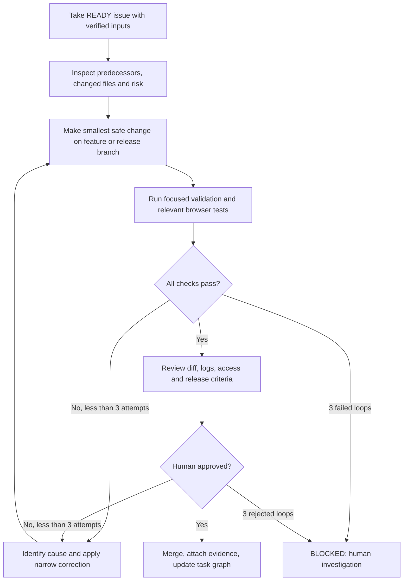
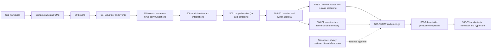
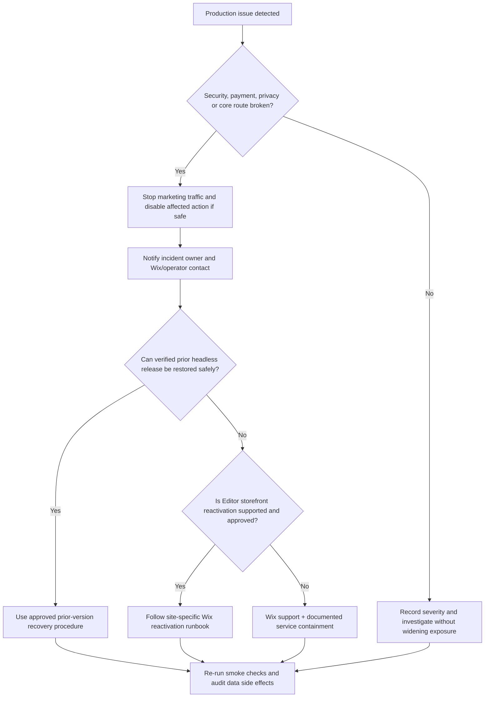
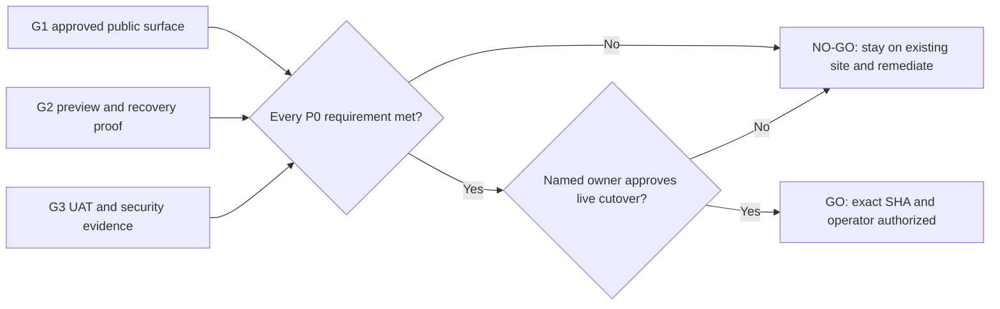
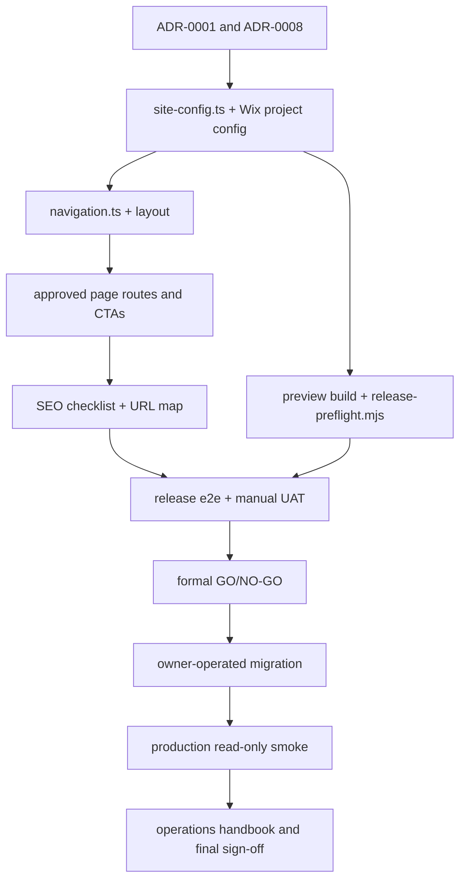

# Sprint 08 — Production Launch, Migration Validation and Operational Handover

**Project:** PostBaby Bliss Foundation Digital Platform  
**Delivery model:** One-week Agile sprint; six gated phases; operational watch assigned beyond sprint close  
**Engineering method:** Dependency-graph execution, bounded implementation–verification loops, evidence-based release gates  
**Target stack:** Astro, TypeScript, Tailwind CSS, selective React, Wix-managed Headless/Astro integration, Wix CMS and approved business APIs, Node.js tooling, GitHub Actions, Vitest, Playwright  
**Primary outcome:** Launch the approved **first public release** of the Foundation's custom website under its existing public domain, while protecting donor, volunteer and family information; preserving valid links; documenting reversal steps; and transferring operational responsibility to named Foundation personnel.

> **Final-sprint declaration.** Sprint 08 is the **eighth and final sprint of the originally estimated eight-sprint MVP program**. It closes a clearly defined first release; it does not promise that every enhancement conceived for the long-term platform will be present. Subsequent maintenance, routine monitoring and discretionary feature enhancements are managed as operations or a separately approved roadmap, **not an automatically required ninth sprint**.
>
> 
> **Evidence limitation.** The available planning artifacts contain concrete Sprints 01–04; there is no verified completed work or accepted Markdown execution plan for Sprints 05–07 in the materials used to author this document. Nothing here asserts those sprints were implemented or passed. The release cannot proceed until the actual GitHub repository, S05/S06/S07 acceptance reports, architecture decisions and Foundation approvals are inspected. Missing evidence is a **hard gate**.
>
> 
> **Platform condition.** All file paths below assume the **Astro + Wix-managed Headless** path introduced in the earlier sprint plans and approved in `ADR-0001`. If the Foundation selected Wix Editor/Studio + Velo or self-managed headless instead, do not run the Astro-to-Wix migration procedure. Approve a replacement manifest and provider-specific deployment/rollback runbook first. The filenames are **planned operations**, not claims that those files already exist.

---

## 1. Mission, scope and release contract

### 1.1 Problem Sprint 08 solves

A technically functional preview is not a production-ready nonprofit website. Replacing the Foundation's current Wix-built public site requires control over the connected domain, continuity of approved content and URLs, integration behavior, accessibility and security verification, payment and form safeguards, predictable incident response, and named staff who can operate the site after the development team finishes. A rushed domain cutover can leave visitors with broken program pages, failed volunteer/event actions, misleading donation states, unapproved health-related forms, or inaccessible services. This sprint converts the completed implementation into an **audited, reversible, owned public service**.

### 1.2 Public release scope: minimum acceptable version

The production release must include the **features that have actually been completed, approved and tested**; the expected MVP route inventory is:

| Public experience | Intended route or route group | Release expectation | Source sprint |
|---|---|---|---|
| Homepage | `/` | Approved mission, credible CTAs, navigation and mobile layout | S01 |
| About | `/about` | Approved background and identity claims | S01 |
| Programs listing and details | `/programs`, `/programs/[slug]` | Published, approved service content; safe 404s; no unverified care claims | S02 |
| Giving | `/support-us`, `/donate`, `/donation-return` | Approved hosted donation handoff **or clearly disabled giving state**; no invented payment-success indication | S03 |
| Volunteering | `/volunteer`, `/volunteer/[slug]` | Approved opportunities or useful empty state; only authorized signup action | S04 |
| Events | `/events`, `/events/[slug]` | Approved listings, time zones and safe registration status | S04 |
| Contact | `/contact` **if actually built** | Accurate, approved contact methods; guarded form only if authorized | S05 candidate |
| Resources, FAQ, updates and communication | **Actual route inventory from S05** | Published approved material; no fabricated resources or newsletters | S05 candidate |
| Administrative handling and integrations | **Actual operational/admin surfaces from S06** | Authenticated access where applicable; least privilege; reviewed service boundaries | S06 candidate |
| Site-wide quality and release readiness | All in-scope routes | Completed S07 regression, privacy, accessibility, performance and security evidence | S07 candidate |

**Do not invent missing routes or functionality solely to make this list look complete.** At S08-P0, generate a definitive route inventory from the actual repository and the approved feature matrix; record what is `SHIPPED`, `APPROVED_UNAVAILABLE`, `DEFERRED`, or `BLOCKED`. A public CTA must not link to an unfinished private workflow.

**A safe disabled state may be sufficient** for an approved optional integration, but **not** for the core mission, reachable contact information, essential navigation, critical security controls, or another feature the Foundation has expressly made mandatory for launch.

### 1.3 Explicit exclusions

This sprint does **not** introduce a new family case-management database, medical history intake, new payment processor, custom card-data collection, member area, major UI redesign, volunteer screening workflow, advanced reporting, translation expansion, or new newsletter service. No live personal or financial information should be used as test fixtures. Legal/privacy approval is not delegated to the software team or coding agent.

### 1.4 Non-negotiable definition of production readiness

A release is eligible for approval only when all of the following are true:

1. The actual deployed framework and Wix migration path are approved by the Foundation's authorized site owner.
2. S01–S07 deliverables and defect/acceptance evidence are traceable to a reviewed commit; no missing predecessor is silently marked `DONE`.
3. The existing live domain has been inventoried, preserved in preview, and mapped to equivalent new pages or authorized redirects.
4. All public claims, images, testimonials, nonprofit/tax statements, contacts, service descriptions and calls to action have named editorial approvals.
5. All mandatory routes, navigation, mobile views and critical interactions pass acceptance tests; no open **Sev-1 or Sev-2** defect remains.
6. Donation interactions use an authorized hosted processor/flow or a clearly non-transacting state. The page must never assert a donation succeeded merely because a browser returned.
7. Every public form is authorized and tested, or disabled; no unapproved collection of health, infant or family-case data.
8. Applicable privacy notices, consent management, role permissions, logging and incident contacts have been reviewed by responsible Foundation personnel.
9. A step-by-step rollback/fallback **is verified for this site's specific Wix migration route**, including which steps require Wix support; a generic `git revert` is not sufficient to reverse a domain migration.
10. Production operator, communications approver, deployment operator and on-call responder are named and accept handover.

---

## 2. Engineering controls and authoritative sources

### 2.1 Standard task contract

`Sprint → Phase → Task ID → Hard prerequisites → Allowed file operations → Implement → Test → Human review → Evidence → Gate decision`

- **Task IDs:** `S08-Pn-Tnn`, e.g., `S08-P3-T04`.
- **Statuses:** `TODO`, `READY`, `IN_PROGRESS`, `BLOCKED`, `IN_REVIEW`, `DONE`, `WAIVED` (only by named risk owner for a noncritical item).
- **File operations:** `C` = create; `M` = modify; `C/M` = inspect first; `?` = conditional on the approved implementation; `D` = dashboard-only change, tracked in a Markdown evidence file; `G` = tool-generated. Each change should be scoped to the ticket's allowlist.
- **Priorities:** `P0` blocks the release; `P1` required only where a feature is enabled; `P2` can be deferred with owner acceptance.
- **Architecture authority:** `docs/architecture/ADR-0001-delivery-path.md` and the actual `wix.config.json`/installed Wix CLI, never a guessed command copied from a planning note.
- **Completion authority:** GitHub CI evidence, browser/manual verification, approved screenshots and named human sign-off—not an AI assistant's self-report.

### 2.2 Bounded loop engineering



**Safety:** No AI agent may access production secrets, rotate domain settings, issue live payments, change Wix consent policies, enable outbound bulk email, run data migrations, or invoke a production cutover on its own. Those actions require a site-owner-authorized operator, a change record and a witnessed verification checklist. Test data is synthetic; logs must not include request bodies or private fields.

### 2.3 Sprint and external-approval dependency graph



**Critical path:** accepted predecessors → P0 → (P1 ∥ P2) → P3 → **GO/NO-GO** → P4 → P5. A missing approval blocks only its dependent edge until it is obtained. The team may still complete safe documentation and preview verification, but it must **not** reinterpret a blocker as implicit permission.

### 2.4 Five-day execution calendar

| Phase | Window | Main outcome | Gate |
|---|---|---|---|
| **S08-P0** | Day 1, first half | Evidence-based release baseline, authority, exact route inventory | **G0**: predecessors verified |
| **S08-P1** | Day 1–2 | Final content, navigation, redirects and SEO readiness | **G1**: public surface approved |
| **S08-P2** | Day 2–3, parallel with P1 | Preview deployment, site-migration rehearsal and documented rollback/fallback | **G2**: safe operating plan proven |
| **S08-P3** | Day 3–4 | End-to-end UAT, security and accessibility sign-off, formal decision | **G3**: GO or NO-GO |
| **S08-P4** | Day 4, approved release window only | Owner-authorized cutover and immediate production checks | **G4**: release healthy or rollback activated |
| **S08-P5** | Day 5 | Post-launch verification, documentation, training and MVP closure | **G5**: accepted handover |

A 72-hour monitoring watch begins with the release and may finish after Day 5. Its named owner and escalation contact are mandatory for sprint closure; the team must not falsely mark the 72-hour check as complete before it has occurred. If launch is delayed by a gate, Sprint 08 remains **NO-GO/PENDING** rather than declaring success on schedule alone.

---

## 3. Phase execution specifications

### Phase S08-P0 — Baseline verification, release authority and evidence freeze

**Phase objective.** Establish the actual release candidate, its eligible functionality, known defects and authorized change owners. Identify and isolate all outstanding work before any production action.

**Entry conditions:** Repository read access, named technical lead and Foundation site owner. Sprints 05–07 can be *audited* while not accepted; they cannot be assumed complete.

**Development tasks**

| ID | Priority | Engineering action | Required evidence / exit test |
|---|---|---|---|
| `S08-P0-T01` | P0 | Clone the actual repository, record release candidate SHA, runtime/CLI versions, branch protections, existing Wix project IDs in a **redacted** inventory. | Reproducible install/build proof; SHA matches CI. |
| `S08-P0-T02` | P0 | Inspect S01–S07 reviews, acceptances, test reports and ADRs; identify absent S05–S07 artifacts without manufacturing them. | Signed predecessor matrix: accepted / conditional / missing. |
| `S08-P0-T03` | P0 | Build a definitive route and feature matrix from source files and observed preview; classify available, disabled and deferred functionality. | Reviewer checks every route and CTA against inventory. |
| `S08-P0-T04` | P0 | Confirm site-owner/co-owner authority, connected-domain eligibility, subscription implications, preview/parent distinction and approved launch architecture. | Owner-approved migration decision; no assumption of free upgrade. |
| `S08-P0-T05` | P0 | Review all open defects, third-party approvals, asset rights, published impact data, nonprofit tax language, form privacy and donor receipt responsibilities. | Release-blocking items have owners and decisions. |
| `S08-P0-T06` | P0 | Freeze new feature development. Establish release branch/tag policy and the exact allowed change categories: defects, compliance, data correctness, navigation and operational readiness. | Reviewed release scope and change-control register. |
| `S08-P0-T07` | P0 | Assign explicit release roles, incident ownership, donor/payment verifier, contact/form verifier, privacy approver, editorial approver and after-hours contact. | Named RACI and witnessed sign-off. |

**File-operation manifest**

| Operation | Path | Purpose |
|---|---|---|
| C | `docs/releases/sprint-08-release-baseline.md` | SHA, versions, Wix environment, freeze timestamp, evidence index |
| C | `docs/releases/v1-feature-and-route-matrix.md` | Actual delivered routes and enabled/disabled feature statuses |
| C | `docs/releases/v1-release-checklist.md` | Master G0–G5 checklist and sign-off fields |
| C | `docs/releases/v1-open-defects-and-exceptions.md` | Defect IDs, severities, mitigation, risk owner and disposition |
| C | `docs/releases/v1-roles-and-contacts.md` | **Role/contact references only**; avoid publishing private personal contacts in a public repository |
| C | `docs/architecture/ADR-0008-production-release-and-migration.md` | Approved Wix migration, deployment and rollback/fallback decision |
| M | `docs/engineering/task-graph.md` | S08 nodes, evidence edges, human approval blockers |
| M | `docs/audit/existing-site-inventory.md` | Verified domain, current paths and legacy integrations |
| M | `docs/architecture/ADR-0001-delivery-path.md` | Only if authorized architecture change is necessary |
| M | `README.md` | Document verified supported build and preview entry points |

**Gate G0 — Release-candidate readiness.** A named owner signs the scope, all predecessor sprint evidence is located or outstanding deliverables are completed and retested, and no essential requirement is marked `UNKNOWN`. If S05, S06 or S07 has not been implemented, **stop at G0** and complete that work first; this document is not a shortcut around missing development.

---

### Phase S08-P1 — Final content, accessibility, SEO and route continuity

**Phase objective.** Produce an accurate, accessible, link-complete public surface that preserves the Foundation's identity and discoverability while correcting defects found during final review.

**Entry conditions:** G0. Only approved scope and content may be published.

**Development tasks**

| ID | Priority | Engineering action | Required evidence / exit test |
|---|---|---|---|
| `S08-P1-T01` | P0 | Match the approved copy and visual assets against the actual route matrix; remove placeholders, fabricated fundraising claims, provisional testimonials and unlicensed photos. | Editorial register with approvals by page and media asset. |
| `S08-P1-T02` | P0 | Validate foundation name, contact details, physical-location disclosure (if approved), accessible footer, privacy and accessibility links; verify that no user-facing links are dead. | Link audit and page-by-page sign-off. |
| `S08-P1-T03` | P0 | Create old→new redirect map for every published Editor URL; mark 301 target, preserved URL, or intentional 410/404 handling. Verify Wix Reserved URL Paths. | Link mapping table; test no broad, irrelevant home-page redirects. |
| `S08-P1-T04` | P0 | Correct title/description, canonical URL, open-graph, link text, image alt and heading structure for core pages; distinguish Wix-managed SEO settings from code-owned metadata. | Metadata audit for every launch route. |
| `S08-P1-T05` | P0 | Verify the Wix-managed SEO sitemap/`robots.txt` ownership and preview `noindex` behavior; do not commit a custom `public/robots.txt` that conflicts with a Wix-reserved platform path. | Preview/production indexing checklist and target canonical URLs. |
| `S08-P1-T06` | P0 | Verify donation/volunteer/event action labels against real availability and destination allowlists; no fake registration or donation success state. | Tests for safe actions and unavailable states. |
| `S08-P1-T07` | P0 | Review consent and notices with the Foundation; ensure analytics/cookie behavior is understood before cutover, and private form submissions are disabled if not approved. | Approved notice, consent state and form inventory. |
| `S08-P1-T08` | P1 | Resolve final responsive defects at 320, 375, 768 and 1440 CSS px and 200% zoom; check keyboard-only access and manual screen-reader smoke review. | Before/after images and verified defect closures. |

**File-operation manifest**

| Operation | Path | Purpose |
|---|---|---|
| C | `docs/releases/v1-editor-to-headless-url-map.csv` | Complete original URL / new URL / redirect / owner mapping |
| C | `docs/releases/v1-content-and-claims-approval.md` | Final public text, impact, nonprofit status and media approval ledger |
| C | `docs/releases/v1-seo-and-discoverability-checklist.md` | Canonicals, SEO dashboard, sitemap, robots, Search Console, socials |
| C | `docs/privacy/v1-public-form-and-consent-register.md` | Form IDs, public fields, data handling, consent, responsible owner |
| C | `tests/e2e/release-navigation.spec.ts` | Representative route, 404 and CTA regression checks |
| C | `tests/e2e/release-responsive.spec.ts` | Multi-viewport tests on approved launch paths |
| M | `src/lib/navigation.ts` | Correct current public route list and accessible names |
| M | `src/lib/site-config.ts` | Canonical host and audited public configuration, if needed |
| M | `src/layouts/BaseLayout.astro` | Site-wide metadata/landmark fixes; avoid duplicated tags |
| M | `src/components/layout/SiteHeader.astro` | Navigation and accessible focus corrections, if needed |
| M | `src/components/layout/SiteFooter.astro` | Contact, legal and footer-route corrections, if needed |
| M | `src/pages/404.astro` | Meaningful 404 and recovery navigation, if needed |
| M | `src/styles/global.css` | Only targeted accessibility/responsive defect fixes |
| M | `docs/content/editorial-approval.md` | Record real sign-offs, not assumed approval |
| M | `docs/audit/asset-and-content-register.md` | Licensing and consent outcomes |
| ?/M | `src/lib/seo/giving-metadata.ts`, `src/lib/seo/event-metadata.ts`, `src/lib/seo/volunteer-metadata.ts` | Update only if these actual modules exist and metadata is incorrect |
| D | Wix SEO & GEO / Redirect Manager / consent settings | Record exact reviewed dashboard changes; **never pretend these are repository code** |

**Gate G1 — Public surface approval.** Every released URL has approved content, a valid destination or intentional unavailable state, coherent metadata and no critical navigation or accessibility defect. The old-to-new mapping includes all verified legacy public URLs. The privacy reviewer has accepted the actual collection and consent behavior, or disallowed forms are disabled.

---

### Phase S08-P2 — Deployment rehearsal, environment hardening and recovery design

**Phase objective.** Prove that the release candidate can be built, previewed and validated without affecting the existing live Wix Editor site; document a feasible incident containment and rollback path **for the approved account and Wix migration flow**.

**Entry conditions:** G0; known CLI project configuration; the site owner's delegated release operator is identified. P1 may continue in parallel.

**Development tasks**

| ID | Priority | Engineering action | Required evidence / exit test |
|---|---|---|---|
| `S08-P2-T01` | P0 | Verify exact Node/Astro/Wix CLI versions against current supported Wix documentation and project's lockfile; run clean install and framework checks. | Version report and clean CI build. |
| `S08-P2-T02` | P0 | Review secret handling and Wix environment separation; inspect `.env.example`, `.gitignore`, GitHub permissions, action secrets and `wix.config.json` references. | Secret scan and least-privilege review; no value copies in logs. |
| `S08-P2-T03` | P0 | Run supported Wix build and **preview-only** deployment on the migration preview site; record generated preview URL as a private release artifact where needed. | Preview URL, CLI version, build SHA, deployed route checks. |
| `S08-P2-T04` | P0 | Validate migration staging correctly reads the **existing parent-site data**, not an empty preview-site data set, where Wix's migration procedure requires it. | Read-only sample records and parent/preview mapping. |
| `S08-P2-T05` | P0 | Rehearse smoke checks and simulate failure conditions: missing content, disabled donation provider, unavailable event registration, invalid route, API timeouts. | Test report with safe failure evidence. |
| `S08-P2-T06` | P0 | Determine and document actual available reversal: reverting an already released headless code version, switching storefront back to Editor if allowed, or escalating to Wix support. **Do not claim any automatic one-click rollback.** | Site owner validates steps, required permissions and impact on Wix business data. |
| `S08-P2-T07` | P0 | Add manual GitHub release workflow with environment protection/approval if compatible; no PR-triggered production release, no unattended migration command. | Dry run and reviewer-confirmed job permissions. |
| `S08-P2-T08` | P1 | Record DNS, SSL, site-email dependencies and third-party service settings. Avoid changing MX/SPF/DKIM/DMARC unless separately authorized and documented. | Environment inventory and no unexpected DNS/email changes. |

**File-operation manifest**

| Operation | Path | Purpose |
|---|---|---|
| C | `docs/operations/v1-deployment-runbook.md` | Manual preview/build/release/migration procedure with owner checkpoints |
| C | `docs/operations/v1-rollback-and-containment-runbook.md` | Realistic recovery actions for failed headless release or cutover |
| C | `docs/operations/v1-environment-and-access-inventory.md` | Redacted permissions, system owners, domains and vendor dependencies |
| C | `docs/quality/sprint-08-preview-deployment-evidence.md` | Test release SHA, preview URL reference, commands, outcomes |
| C | `scripts/release-preflight.mjs` | Read-only checks for required env **names**, manifest and route map; never print secret values |
| C | `scripts/check-public-routes.mjs` | Idempotent, read-only HTTP route smoke checks with safe output |
| C | `.github/workflows/release-candidate.yml` | Manually triggered, protected preview validation/release prep; production step never autonomous |
| C | `tests/integration/release-config.test.ts` | Verify environment-dependent options and fail-closed feature state |
| M | `.github/workflows/ci.yml` | Retain all existing gates; add only necessary release-candidate checks |
| M | `package.json` | Add `release:preflight` / `test:smoke` scripts after verifying toolchain |
| M | `package-lock.json` | Tool-managed dependency changes only if necessary |
| M | `.env.example` | Public non-secret variable names and descriptions only |
| M | `.gitignore` | Ignore `.env.local`, exported logs and local secrets |
| ?/M | `wix.config.json` | Only authorized site-link changes approved through Wix; no guessed IDs |
| D | Wix Headless Settings, Dashboard and Secrets Manager | Validate site linking, settings, approved release permissions and migration prompts |

**Supported CLI rehearsal pattern** (run only in an authorized **linked Astro headless** project; confirm syntax against its installed CLI version):

```bash
npm ci
npm run check --if-present
npm run lint --if-present
npm test --if-present
npm run build
npx wix build
npx wix preview
```

Do not blindly execute all commands if the scaffold's scripts differ; use the actual repository scripts and current Wix documentation. `npx wix release` **publishes** the linked project's site and is deliberately **excluded from automatic preview CI**. For an existing Editor-site-to-headless migration, **do not substitute a release to the preview site for finalizing migration to the parent site**. Wix's documented `wix finalize-migration` flow requires site-owner initiation in Headless Settings; the operator must use only the actual flags provided by that dashboard prompt.

**Rollback/containment decision tree:**



**Gate G2 — Preview and recoverability.** The preview runs against the intended service context, the build is reproducible, automated and manual smoke checks pass, and a named Wix-capable operator confirms the actual rollback/fallback is **available and tested to the extent safely possible**. If reversing the storefront cannot be established, the site owner must not authorize cutover merely because version control exists.

---

### Phase S08-P3 — Release-candidate UAT, independent verification and GO/NO-GO

**Phase objective.** Confirm that the actual release candidate satisfies the signed MVP contract and regulatory/operational safeguards before the domain is touched.

**Entry conditions:** G1 and G2. A verified, fixed commit SHA and separate operator/reviewer are required.

**Development tasks**

| ID | Priority | Engineering action | Required evidence / exit test |
|---|---|---|---|
| `S08-P3-T01` | P0 | Run complete typecheck, lint, unit, integration, browser regression and dependency/security checks on the exact release SHA. | Green CI run with archived artifact IDs. |
| `S08-P3-T02` | P0 | Conduct manual keyboard and screen-reader testing on representative complete pages; inspect labels, errors, focus order, meaningful headings and responsive reflow against WCAG 2.2 AA target. | Manual accessibility review and zero unresolved critical/serious issues. |
| `S08-P3-T03` | P0 | Verify program details, approved content and CMS read behavior; confirm 404 and removed/hidden records do not expose drafts. | Content and CMS route matrix signed. |
| `S08-P3-T04` | P0 | Verify donation checkout in supported sandbox/test mode where available; ensure external destination is approved and return page never claims payment success without provider confirmation. | Payment owner signs transaction/receipt responsibility; no real card data in CI. |
| `S08-P3-T05` | P0 | Verify public forms/events/volunteer actions with **synthetic** submissions only where explicitly approved; inspect admin access, consent and rejection behavior. | End-to-end form or documented disabled-state acceptance. |
| `S08-P3-T06` | P0 | Test security baselines: no secrets in client bundle, constrained external redirects, validation, authentication/authorization of any admin endpoints, no private content in logs or error pages. | Security checklist with defect links. |
| `S08-P3-T07` | P0 | Measure representative mobile and desktop performance under documented test conditions and fix material regressions introduced by S08. | Lighthouse/browser evidence, budget comparison and justified exceptions. |
| `S08-P3-T08` | P0 | Verify SEO/URL migration plan, DNS/domain ownership and communications approval; rehearse production switch as a verbal/read-through checklist, not a live cutover. | Signed migration checklist and release-communications draft. |
| `S08-P3-T09` | P0 | Conduct short UAT with Foundation users (site owner, communications reviewer, services/volunteer owner and donation owner). | Recorded pass/fail for each required user journey. |
| `S08-P3-T10` | P0 | Hold a formal GO/NO-GO decision meeting. Freeze SHA, named operator, backup data state, release window and incident response contact. | **Written** GO or NO-GO with individual approvers and timestamp. |

**File-operation manifest**

| Operation | Path | Purpose |
|---|---|---|
| C | `docs/quality/sprint-08-uat-script.md` | Human-readable end-to-end journeys, actors, inputs and expected outcomes |
| C | `docs/quality/sprint-08-acceptance.md` | Testable G0–G5 criteria and named sign-offs |
| C | `docs/quality/sprint-08-test-evidence.md` | CI, a11y, browser, security and performance evidence links |
| C | `docs/quality/sprint-08-security-privacy-review.md` | Issue closure and reviewer approval for enabled sensitive surfaces |
| C | `docs/quality/sprint-08-accessibility-review.md` | Manual keyboard/screen reader evidence and known exceptions |
| C | `docs/releases/v1-go-no-go-record.md` | Frozen SHA, meeting decision, conditions, owners and time |
| C | `tests/e2e/release-smoke.spec.ts` | Public launch-path smoke suite, designed to avoid writes by default |
| C | `tests/e2e/release-accessibility.spec.ts` | Automated critical route accessibility gates |
| C | `tests/e2e/release-giving-and-engagement.spec.ts` | Safe donor/volunteer/event handoff-state regression |
| M | `docs/releases/v1-release-checklist.md` | G3 reviewed and dated evidence |
| M | `docs/releases/v1-open-defects-and-exceptions.md` | Final severity, dispositions, owners |
| M | `docs/engineering/task-graph.md` | Finish accepted nodes and mark residual blockers |
| ?/M | `playwright.config.ts` | Separate preview and production read-only settings, if necessary |
| ?/M | `src/lib/donations/get-donation-provider.ts` | Only if UAT discovers a verified provider-state defect |
| ?/M | `src/lib/engagement/get-engagement-repositories.ts` | Only if an actual engagement adapter regression exists |

**Minimum UAT matrix**

| Journey | Required condition | Fail condition |
|---|---|---|
| Home → About → Programs → Detail | Correct text, stable URL, keyboard accessibility | Broken route, unapproved claim or inaccessible core content |
| Home → Donate | Approved secure handoff or plainly unavailable | Wrong domain, false success message or exposed payment secrets |
| Home → Volunteer opportunity | Approved detail and truthful availability | Fabricated opportunity or unapproved private-data collection |
| Home → Event detail | Correct status, time zone and location | Fake RSVP confirmation or stale open registration |
| Contact/Resources/News (only if shipped) | Valid approved destinations and controlled inputs | Broken essential contact channel or unsafe input handling |
| Unknown URL | Meaningful 404, no personal information | Sensitive details, broken recovery or misleading 200 page |
| Mobile, keyboard, screen reader | Main journey can be completed | Keyboard trap, hidden focus, severe screen reader failure |
| External service unavailable | Safe, understandable fallback | Blank screen, unhandled exception or user-misleading outcome |

**Objective release thresholds (project policy, not a claim of legal certification):**

- **Defects:** 0 open severity-1 or severity-2; any lower-priority exception explicitly approved and recorded.
- **Security/privacy:** 0 known exposed secrets, unauthorized data flows, critical unresolved vulnerabilities or payment-state misrepresentations.
- **Accessibility:** no known critical/serious issue on release routes; documented manual review against the WCAG 2.2 AA target. Automated scans alone do not establish conformance.
- **Reliability:** 100% of documented P0 user journeys pass on the release-candidate environment; no unexplained 4xx/5xx on approved routes.
- **SEO:** canonical domain, allowed indexing, sitemap ownership and redirect map signed off.
- **Performance:** no material regression against the S07 baseline; as aspirational field targets, Core Web Vitals LCP ≤2.5 s, INP ≤200 ms, CLS ≤0.1 at the 75th percentile **when real-user data is available**; synthetic scores are diagnostic, not guarantees.
- **Approvals:** technical lead + Foundation site owner + designated privacy/content owner; donation owner also signs if live giving is enabled.

**GO/NO-GO logic**



**Gate G3 — Formal release authorization.** A signed `GO` is permitted only after all P0 criteria pass. A `NO-GO` retains the existing public Wix site and issues defect remediation tickets. No deadline can override a privacy, payment, data-integrity or rollback blocker.

---

### Phase S08-P4 — Controlled Wix production cutover and launch verification

**Phase objective.** Publish the approved custom frontend to the Foundation's existing public-domain experience, following the account-specific Wix migration procedure, without losing access to the existing organization's backend business data.

**Entry conditions:** G3 is explicitly `GO`, the frozen SHA is unchanged, owner/operator are present, recovery and communications runbooks are open, and a site-specific authorized release window is agreed.

**Release sequence**

1. **Pre-flight freeze.** Record timestamp, production URL and its key screenshots; confirm Wix Editor site is still serving and existing donor/contact actions work; save the last-known-good published release reference and configuration evidence.
2. **Final safe build.** Pull the exact approved commit, run `npm ci`, project checks, `npx wix build` and preview validation from the linked headless project. Verify release metadata and no unexpected diff.
3. **Owner-confirmed migration.** Open **Headless Settings → Complete Migration** for the appropriate existing Wix site. Follow the live dashboard's instructions and copy only the generated `--app-id` and `--site-id` flags into the authorized operator's terminal. The operator runs `wix finalize-migration` **only after the owner has opened and authorized that dialog**. Do not embed those flags in this document, a public issue, or an AI prompt.
4. **Observe Wix result.** Confirm the completion output, published URL/domain binding and the new frontend on the expected custom domain. If this is **not** an Editor-to-managed-Headless migration, follow the separately approved ADR-specific release procedure; do not force `finalize-migration`.
5. **First-10-minute read-only checks.** Homepage, Programs, About, Support Us, Volunteer, Events, Contact (if shipped), 404, HTTPS, core asset loading, no unexpected `noindex`, canonical host, approved forms and donation link state. Use the read-only smoke test script.
6. **Post-migration platform checklist.** Verify Wix SEO/robots/sitemap, analytics/consent, forms and automations, member access if actually in scope, hosted checkout, redirects, Wix/legacy Velo backend replacements, unsupported apps, third-party scripts, accessibility and performance.
7. **Communications.** Only after healthy checks, publish the Foundation-approved website launch notice. If a serious issue appears, pause communications and initiate the incident runbook rather than declaring success.
8. **Record the production deployment.** Timestamp, SHA, approved operator, version, observed URL, smoke outcomes, dashboard changes, exceptions and incident state.

**Development tasks and operational actions**

| ID | Priority | Engineering action | Required evidence / exit test |
|---|---|---|---|
| `S08-P4-T01` | P0 | Confirm final SHA, production owner authority, outage/rollback contacts and live-site baseline. | Signed preflight record. |
| `S08-P4-T02` | P0 | Perform the **approved Wix migration/cutover** manually; no repository workflow or AI agent may trigger it unattended. | Wix completion result and owner confirmation. |
| `S08-P4-T03` | P0 | Apply verified URL redirects using Wix's site-level Redirect Manager for routes the platform reserves or intercepts. | URL-by-URL redirect test and status codes. |
| `S08-P4-T04` | P0 | Verify live HTTPS, SEO tags, sitemap, canonical, robots and indexability. | Production URL audit; Search Console action owner. |
| `S08-P4-T05` | P0 | Verify any enabled live hosted donation flow without using real personal card data in automated tests; Foundation payment owner handles authorized production verification. | Hosted destination, receipt/confirmation responsibility and correct states. |
| `S08-P4-T06` | P0 | Verify live contact, newsletter, volunteer and RSVP workflows only if previously approved and enabled; use permitted synthetic test records and clean them up under policy. | Admin visibility, notification owner and consent review. |
| `S08-P4-T07` | P0 | Observe logs/errors and performance for the initial launch period; initiate containment if a critical user path fails. | Health log; incident/no-incident decision. |
| `S08-P4-T08` | P0 | Issue authorized communications after successful health check and record final launch result. | Approved announcement or documented suppression. |

**File-operation manifest**

| Operation | Path | Purpose |
|---|---|---|
| C | `docs/releases/v1-production-cutover-record.md` | Step-by-step timestamps, SHA, outcomes, operator and changes |
| C | `docs/releases/v1-production-smoke-results.md` | Routes, redirects, forms, provider and SEO observations |
| C | `docs/operations/v1-production-health-log.md` | Release health checks and deviations |
| C | `docs/communications/v1-launch-announcement.md` | Draft and final approved organization announcement |
| M | `docs/releases/v1-release-checklist.md` | G4 go-live tasks with actual evidence |
| M | `docs/operations/v1-deployment-runbook.md` | Exact commands/buttons observed, revised after launch |
| M | `docs/operations/v1-rollback-and-containment-runbook.md` | Actual possible recovery steps/contacts after cutover |
| M | `docs/releases/v1-editor-to-headless-url-map.csv` | Confirm redirect outcome or note intentionally removed URLs |
| M | `docs/engineering/task-graph.md` | Close release nodes and link evidence |
| D | Wix Headless Settings / live Editor site / Redirect Manager | Authorized migration and dashboard-only redirection changes |
| D | Wix SEO & GEO and Search Console | Verify indexing/sitemaps after release |
| ?/M | `src/lib/site-config.ts` | Only a separately approved critical configuration hotfix, with full test/review |

**Gate G4 — Healthy live release or contained failure.** The launched site serves approved primary journeys on the intended public domain and key Wix-backed workflows behave correctly; the Foundation acknowledges the cutover. If a Sev-1/Sev-2 defect or unapproved data collection is discovered, release state becomes `INCIDENT`, the assigned operator executes the approved containment/recovery plan, and closure is deferred until re-verification.

---

### Phase S08-P5 — Operational handover, immediate hypercare and eight-sprint MVP closure

**Phase objective.** Transfer a stable, documented, observable website to Foundation operators with sufficient access and procedures to update content, handle safe inquiries, monitor incidents, and request fixes without dependence on the original developers.

**Entry conditions:** G4 is `HEALTHY`, or a formally documented recovery path is active; operations staff are available to test handover.

**Development tasks**

| ID | Priority | Engineering action | Required evidence / exit test |
|---|---|---|---|
| `S08-P5-T01` | P0 | Run Day-5 live regression and review first-day logs/errors, public links, mail delivery and provider status. | Daily health status and verified URLs. |
| `S08-P5-T02` | P0 | Train designated Foundation editor(s) to update program descriptions, approved events/news, images, CTA states and CMS draft/publish processes. | Training attendance and successful supervised edit/publish exercise. |
| `S08-P5-T03` | P0 | Train technical/operational owner to view alerts, classify incidents, collect useful evidence without sensitive data, disable a failing public feature and contact vendors. | Operator completes runbook tabletop exercise. |
| `S08-P5-T04` | P0 | Confirm operational access and least privilege, admin recovery method, GitHub ownership, Wix billing/subscription accountability and domain renewal owner. | Signed access/ownership matrix; **no credentials in Git**. |
| `S08-P5-T05` | P0 | Set 72-hour post-launch watch cadence and named owners, plus 7/30-day review tasks; record that future checks are pending, not already completed. | Watch handoff accepted with alert thresholds and contact route. |
| `S08-P5-T06` | P0 | Finalize runbooks, privacy/consent operations, donation reconciliation ownership, media approval procedure, backups and incident escalation. | Operations guide approved by owner. |
| `S08-P5-T07` | P0 | Produce the eight-sprint MVP completion report: shipped items, exclusions, limitations, accepted risks and outstanding maintenance issues. | Owner acceptance and tagged release (only when code is final). |
| `S08-P5-T08` | P1 | Move deferred enhancements to an optional, value-ranked post-MVP backlog without silently committing to Sprint 09. | Prioritized maintenance/enhancement queue with scope owners. |

**File-operation manifest**

| Operation | Path | Purpose |
|---|---|---|
| C | `docs/operations/operations-handbook.md` | Content edits, deployment, monitoring, access, vendor and support workflows |
| C | `docs/operations/v1-incident-response.md` | Severity classification, decision tree, containment and escalation |
| C | `docs/operations/v1-monitoring-and-maintenance.md` | First 72 hours, 7-/30-day reviews and recurring checks |
| C | `docs/operations/v1-editor-training-guide.md` | Foundation editors' tested content-publishing tasks |
| C | `docs/operations/v1-access-and-ownership-matrix.md` | Role-based account/service ownership, no passwords |
| C | `docs/reviews/sprint-08-review.md` | Demo, accepted deliverables, exceptions and final sign-off |
| C | `docs/releases/v1-mvp-completion-report.md` | Eight-sprint closure, verified outcomes and exclusions |
| C | `docs/backlog/post-mvp-maintenance-and-enhancements.md` | Clearly optional improvements and incident-driven work |
| M | `README.md` | Verified install, build, preview, release and support references |
| M | `docs/releases/v1-release-checklist.md` | Final G5 acceptance and post-launch watch owner |
| M | `docs/engineering/task-graph.md` | Final DAG state and unresolved optional successors |
| M | `docs/operations/v1-production-health-log.md` | Day-5 status and alert handoff |
| M | `docs/operations/v1-rollback-and-containment-runbook.md` | Real tested recovery assumptions |
| ?/M | `.github/CODEOWNERS` | Add actual maintainers if governance and GitHub permission allow |

**Gate G5 — Final MVP acceptance.** The Foundation has an operational website on its intended domain; relevant core user journeys are healthy; the support and edit workflows have been demonstrated; the named operator accepts monitoring/incident responsibility; and the final report is signed. Mark the eight-sprint MVP `RELEASED AND HANDED OVER` only after G5. A `NO-GO`, uncompleted migration or unmanaged incident must be labelled honestly.

---

## 4. File dependency graph and release-safe merge order

### 4.1 Configuration, page and operational dependency graph



### 4.2 Cross-functional ownership and file boundaries

| Workstream | Primary file ownership | Requires review from |
|---|---|---|
| Release governance | `docs/releases/*`, `docs/architecture/ADR-0008*` | Foundation site owner + technical lead |
| Content, SEO, redirects | `src/lib/navigation.ts`, `src/lib/site-config.ts`, `docs/releases/*map.csv`, content ledgers | Foundation communications owner |
| Frontend defect fixes | `src/layouts/*`, `src/components/*`, `src/pages/*`, `src/styles/*` | Frontend lead + QA reviewer |
| Test automation and CI | `tests/e2e/release*`, `tests/integration/release*`, `.github/workflows/*` | QA/security reviewer |
| Wix integration and deployment | `wix.config.json` if authorized; `docs/operations/*` | Wix site owner and release operator |
| Donations and private submissions | Related adapter modules only when defects verified; privacy register | Donation/data owner + privacy approver |
| Handover and incident operations | `docs/operations/*`, `docs/reviews/*` | Foundation operational owner |

**Merge policy:** Only reviewed defect fixes can enter the release branch after freeze. All checks rerun after each release-candidate SHA change. A GO decision tied to an earlier SHA is invalidated by a code change and must be reapproved (a narrow documented reapproval is acceptable for nonfunctional documentation edits). A production release is never merged automatically on every push.

### 4.3 Planned repository additions in Sprint 08

```text
project-root/
├── .github/
│   └── workflows/
│       ├── ci.yml                                 [M]
│       └── release-candidate.yml                  [C]
├── docs/
│   ├── architecture/
│   │   └── ADR-0008-production-release-and-migration.md   [C]
│   ├── releases/
│   │   ├── sprint-08-release-baseline.md          [C]
│   │   ├── v1-feature-and-route-matrix.md         [C]
│   │   ├── v1-content-and-claims-approval.md      [C]
│   │   ├── v1-editor-to-headless-url-map.csv      [C]
│   │   ├── v1-seo-and-discoverability-checklist.md [C]
│   │   ├── v1-release-checklist.md                [C]
│   │   ├── v1-open-defects-and-exceptions.md      [C]
│   │   ├── v1-roles-and-contacts.md               [C]
│   │   ├── v1-go-no-go-record.md                  [C]
│   │   ├── v1-production-cutover-record.md        [C]
│   │   ├── v1-production-smoke-results.md         [C]
│   │   └── v1-mvp-completion-report.md            [C]
│   ├── operations/
│   │   ├── v1-deployment-runbook.md               [C]
│   │   ├── v1-rollback-and-containment-runbook.md [C]
│   │   ├── v1-environment-and-access-inventory.md [C]
│   │   ├── v1-production-health-log.md           [C]
│   │   ├── v1-incident-response.md                [C]
│   │   ├── v1-monitoring-and-maintenance.md      [C]
│   │   ├── v1-editor-training-guide.md           [C]
│   │   ├── v1-access-and-ownership-matrix.md      [C]
│   │   └── operations-handbook.md                 [C]
│   ├── privacy/
│   │   └── v1-public-form-and-consent-register.md [C]
│   ├── quality/
│   │   ├── sprint-08-preview-deployment-evidence.md [C]
│   │   ├── sprint-08-uat-script.md                [C]
│   │   ├── sprint-08-acceptance.md                [C]
│   │   ├── sprint-08-test-evidence.md             [C]
│   │   ├── sprint-08-security-privacy-review.md   [C]
│   │   └── sprint-08-accessibility-review.md      [C]
│   ├── reviews/
│   │   └── sprint-08-review.md                    [C]
│   ├── communications/
│   │   └── v1-launch-announcement.md             [C]
│   └── backlog/
│       └── post-mvp-maintenance-and-enhancements.md [C]
├── scripts/
│   ├── release-preflight.mjs                      [C]
│   └── check-public-routes.mjs                    [C]
├── tests/
│   ├── integration/
│   │   └── release-config.test.ts                 [C]
│   └── e2e/
│       ├── release-navigation.spec.ts             [C]
│       ├── release-responsive.spec.ts             [C]
│       ├── release-smoke.spec.ts                   [C]
│       ├── release-accessibility.spec.ts           [C]
│       └── release-giving-and-engagement.spec.ts   [C]
├── src/                                         [M existing files only for approved defects]
├── README.md                                    [M]
├── package.json                                 [M if needed]
├── package-lock.json                            [G if needed]
└── wix.config.json                              [?/M only via owner-approved CLI]
```

A directory such as `src/pages/contact.astro` is intentionally **not** created by Sprint 08 solely because a route was proposed in Sprint 05. Resolve such work in its owning sprint and retest it. The directory tree is a **planned change manifest**, not an instruction to erase or rename existing generated files.

---

## 5. Test automation and deployment implementation guidance

### 5.1 Example package-script contract (adapt to installed tooling)

```json
{
  "scripts": {
    "check": "astro check",
    "lint": "eslint .",
    "test": "vitest run",
    "test:e2e": "playwright test",
    "build": "astro build",
    "release:preflight": "node scripts/release-preflight.mjs",
    "test:smoke": "node scripts/check-public-routes.mjs"
  }
}
```

**Implementation rule:** This snippet illustrates names only; do not replace a working `package.json` wholesale. Respect Wix-generated scripts, the installed Astro/Wix integration, Node version and actual repository conventions. If a script would invoke live services, move it out of automatic CI and behind explicit authorization.

### 5.2 Scope of the read-only production smoke script

`scripts/check-public-routes.mjs` should accept an **explicit** `BASE_URL` from a reviewed environment, enforce `https:` and an allowlisted host in production, and perform only GET/HEAD calls to the approved *public* route set. It should validate expected redirects/statuses, no 5xx, HTML content type on HTML pages, the absence of accidentally retained preview `noindex`, and basic structural landmarks where feasible. It must never crawl private endpoints, follow third-party donation checkout past the approved landing point, submit forms, log cookies, read credentials or create business records. Provide bounded request timeouts, redacted output, and a nonzero exit code on a P0 failure.

`scripts/release-preflight.mjs` should require the route map, feature status ledger, approved SHA, and owner gate record to be present before allowing a release-**candidate** job to run. It **cannot** make a final GO decision itself or authorize a migration. Human sign-off remains mandatory.

### 5.3 GitHub Actions policy

- PR jobs may run `npm ci`, lint, types, unit/integration tests, Playwright against local/mock/test infrastructure, dependency scanning and `npm run build`.
- A **manually dispatched** release-candidate workflow may run signed preview-only checks using GitHub protected environments and the least possible access.
- No production cutover from ordinary PR pushes or merge-to-main; a migration from an Editor site must follow the Wix dashboard-initiated procedure.
- Keep personal identifiers, API secrets, production tokens and Wix dashboard-exported data out of GitHub artifacts, pull-request comments and AI-agent prompts.
- Tag a version such as `v1.0.0` only after actual production acceptance; never reuse an unapproved tag for a different commit.

### 5.4 Proof-of-completion evidence packet

Every P0 issue needs: task ID, objective, `git diff --name-only` file list, commit/PR SHA, CI run link, targeted test results, reviewer name, gate impact and approved closure note. Screenshots must not expose children, private form submissions, donor identities or user contact information. Store redacted evidence in version control and sensitive operational details in a restricted Foundation repository or access-controlled system.

---

## 6. Migration-specific acceptance checklist for Wix

For a **Wix Editor/Studio → Wix-managed Headless Astro** migration, Wix's official post-migration guidance states that the custom frontend replaces the Editor's rendered pages and that Editor page code, widgets and form UI do **not** automatically carry over. Verify each of these groups; mark `NOT_APPLICABLE` only when evidence establishes the feature was never present.

| Area | Before cutover | After cutover |
|---|---|---|
| Parent vs preview site | Confirm Wix business data remains on the **parent** and preview reads intended parent data | Verify live frontend queries the correct business site |
| Editor pages and menus | Full public URL inventory | Verify new route or proper Wix-level 301; no unexplained 404s |
| SEO & GEO | Approved metadata mapping, canonical strategy | Verify sitemap, platform-served `robots.txt`, canonical, social tags, Search Console |
| Privacy/cookies | Review consent policy **before** first visitor reaches headless site | Verify banner/preferences and event tracking settings behave as approved |
| Wix Forms | Inventory original form IDs, field mappings and automations | Rebuilt frontend UI submits to approved same form and notifications work |
| Checkout/donations | Verify merchant status, hosted destination and donor receipt owner | Test approved provider handoff and neutral return-state correctness |
| Events | Check status, event details and registration destination | Verify applicable Wix API/hosted RSVP integration or accurate unavailable state |
| Members | Inventory member routes if used | Reimplement/test login, account and access controls only if in MVP scope |
| Velo | Identify page `$w`, `.jsw`, `http-functions.js`, hooks and jobs | Port required logic to compatible headless patterns; verify old URLs/callers |
| Third-party scripts | Inventory tags, embeds, chat and marketing scripts | Reinstall only approved supported functions; verify consent-dependent tracking |
| Accessibility | Run full route review independent of original Editor settings | Keyboard/screen reader smoke review on live domain |
| Operational email | Inventory notifications, domain DNS mail records | Verify operational delivery without breaking MX/SPF/DKIM/DMARC |

**Important:** The site owner's existing Wix subscription, connected-domain rights and vendor-supported reversal procedure must be confirmed **on the actual account**. This document cannot guarantee that an Editor plan will accept a migration unchanged or that reversal will be instantaneous.

---

## 7. Incident severity, escalation and rollback thresholds

| Severity | Example | Required response |
|---|---|---|
| **Sev-1 — Critical** | Private data exposed; unauthorized payment collection; active security compromise; broad production outage | Immediately stop/contain affected flows; alert owner; initiate recovery; preserve safe evidence; no marketing launch |
| **Sev-2 — High** | Donation handoff broken; essential contact flow unavailable; most users cannot reach program content; severe accessibility blocker | Hold launch or initiate approved post-launch rollback/containment; named incident leader required |
| **Sev-3 — Moderate** | Important but nonessential layout/link issue, recoverable noncritical feature defect | File issue with owner and deadline; release only if explicitly accepted |
| **Sev-4 — Low** | Minor copy or noncritical visual polish | Place in operations backlog; fix through normal workflow |

**Incident first response (operational contract):** Observe → classify → stop harmful action if feasible → notify named incident owner → use the account-specific recovery runbook → verify primary journeys → record timeline and corrective actions. For data exposure or legal concerns, the Foundation's designated privacy/legal contact decides notification duties. Do not put identifying visitor/donor health details into the public incident log.

### 7.1 Release hold conditions

A single unresolved **Sev-1 or Sev-2**, missing domain/migration authorization, absent predecessor QA evidence, unverified donation recipient/processor, uncertain handling of sensitive intake information, unreviewed consent configuration, or unestablished rollback path is sufficient to mark `NO-GO`.

### 7.2 Successful rollback/fallback proof

A technically successful recovery means the intended public domain again serves a safe, functioning site, approved contact and giving paths are accurate, no unauthorized service remains enabled, and logs show no continuing compromise. A code deployment reversal alone does not prove the Editor frontend, Wix business state, redirects, or third-party webhooks have been restored. Record each separately.

---

## 8. Final acceptance, day-by-day evidence and sprint closure

### 8.1 Gate ledger

| Gate | Responsible sign-off | Evidence | Pass rule |
|---|---|---|---|
| `G0` | Technical lead + site owner | Predecessor matrix, SHA, role inventory | S01–S07 accepted; architecture/permissions verified |
| `G1` | Editorial + privacy reviewer | Approved content, URLs, notices, images | No unpublished claims or broken essential journeys |
| `G2` | Deployment operator + Wix site owner | Preview, build, redacted env audit, recovery plan | Safe preview and viable incident response |
| `G3` | Site owner + technical + relevant business owners | UAT, security, a11y, GO/NO-GO record | Written GO; zero open P0 blockers |
| `G4` | Operator + site owner | Cutover record, read-only smoke and service checks | Healthy approved public-domain release |
| `G5` | Foundation operations owner + technical lead | Training, handbook, support handoff, completion report | Website operational and owned; 72-hour watch assigned |

### 8.2 Concrete daily demo requirement

- **Day 1:** Show repository baseline, exact release candidates/defects and signed ownership; demonstrate route inventory.
- **Day 2:** Walk through approved public content, redirects, canonical metadata and read-only smoke tests on preview.
- **Day 3:** Show deploy-preview evidence, tested failure states and a genuine recovery decision tree with the Wix operator.
- **Day 4:** Run full UAT and formal GO/NO-GO. Only if approved, perform monitored production migration and immediate production smoke tests.
- **Day 5:** Train editors/operators, check production health, sign the closure report, assign 72-hour watch and publish release summary.

### 8.3 Final Definition of Done

- [ ] The production release is on the **approved** domain and matches a frozen, reviewed SHA.
- [ ] The original Editor URL inventory and redirect outcomes are documented; legacy high-value links still work.
- [ ] All mandatory first-release features are functioning or approved as honest disabled states.
- [ ] A complete public journey has been tested on mobile, desktop and keyboard-only navigation.
- [ ] Unapproved health/family forms, unpublished program claims and unsafe donor workflows are not live.
- [ ] No known open Sev-1/Sev-2 defects; risk acceptance is explicit for lower-severity exceptions.
- [ ] Operational forms/notifications and approved payment/donation handoffs are tested by their owners.
- [ ] Privacy/cookie policy and relevant analytics setup are reviewed and working as intended.
- [ ] Search-engine settings, sitemap, redirects and canonical domain have been verified.
- [ ] A site-specific recovery and incident runbook exists and has named operators.
- [ ] Ownership of domain renewal, Wix billing, GitHub, CMS editing, data access and donor reconciliation is assigned.
- [ ] Final user training and first-day health checks are complete.
- [ ] The 72-hour watch is assigned and pending later checks are not misrepresented as complete.
- [ ] `docs/releases/v1-mvp-completion-report.md` is signed by the Foundation.

**If these criteria are not met:** Close the week's planning window with a truthful `NO-GO` report, keep the existing Wix Editor site serving visitors, and execute a focused remediation/release plan. The original **eight sprint estimate remains the planned MVP development scope**; a blocked launch is a delayed release, not proof that production was achieved or an automatic mandatory ninth feature sprint.

---

## 9. Ready-to-use GitHub ticket and AI coding-agent template

Copy this section into each scoped issue. Do **not** issue a single prompt such as “perform Sprint 08 and deploy everything”; tasks must be isolated and supervised.

```markdown
### Task ID
S08-P{phase}-T{number}

### Goal and value
Describe exactly one release-readiness outcome and its observable effect.

### Priority and risk
P0/P1/P2; legal/privacy/payment/domain risk explicitly identified.

### Hard prerequisites
List accepted predecessor task IDs, architecture ADR and human approvals.

### Allowed file operations
- [C/M] path/to/authorized-file
- No other changes without reviewer authorization.

### Forbidden operations
No production migration, Wix billing changes, domain/DNS edits, real payment
submission, personal-data export, bulk email or secret disclosure.

### Implementation approach
Smallest change; preserve existing architecture and Wix-generated files.

### Verification
Exact build/type/lint/unit/E2E commands and manual expected result.

### Review gate
Named code reviewer and Foundation approver when needed.

### Loop limit
Maximum three evidence-based corrections; then BLOCKED and escalate.

### Evidence on closure
Commit SHA, diff summary, CI link, screenshots (redacted), reviewer, gate status.
```

---

## 10. Post-MVP operating roadmap (not Sprint 09)

After release, the project enters a **maintenance and improvement** regime. The Foundation may independently prioritize advanced support intake, authenticated family accounts, volunteer shift management, donor dashboards, extended impact reporting, deeper CRM automation or additional languages. Each requires a fresh scope, privacy assessment, budget and an estimate based on actual operational feedback. None is an implicit requirement for accepting the eight-sprint MVP.

The initial operational sequence is: an assigned **72-hour watch**, a **7-day** error/content/analytics review, and a **30-day** accessibility, SEO and stakeholder-outcome review. These are post-launch duties owned by the Foundation, not promises that developers will perform background work after the sprint without a separate commitment.

---

## 11. Official technical, accessibility and operating references

The following resources are planning references; implementation must be checked against the installed versions and the site's actual Wix account on release day.

1. **Wix — Choose Your Development Path.** Describes managed versus self-managed headless options and replacing an existing Editor frontend.  
   https://dev.wix.com/docs/go-headless/get-started/choose-your-development-path
2. **Wix — Post-Migration Checklist: Wix Studio and Editor Sites to Headless.** Parent/preview behavior, owner-initiated migration, redirects, forms, Velo, consent, analytics, checkout and accessibility.  
   https://dev.wix.com/docs/go-headless/wix-managed-headless/full-integration-astro/get-started/post-migration-checklist-wix-studio-and-editor-sites-to-headless
3. **Wix — Build and Deploy with the CLI.** CLI build, preview, release and release-versus-preview limitations.  
   https://dev.wix.com/docs/go-headless/wix-managed-headless/full-integration-astro/development/build-and-deploy-with-the-cli
4. **Wix — `wix release` command reference.** Release publishes the linked project's site.  
   https://dev.wix.com/docs/wix-cli/cli-for-headless/command-reference/project-commands/release
5. **Wix — Environment variables with Wix CLI.** Sensitive environment management and `.env.local`.  
   https://dev.wix.com/docs/wix-cli/cli-for-headless/command-reference/project-commands/env
6. **Google Search Central — Site Moves with URL Changes.** Mapping, server-side redirects, sitemaps, canonical and search monitoring.  
   https://developers.google.com/search/docs/crawling-indexing/site-move-with-url-changes
7. **W3C — Web Content Accessibility Guidelines 2.2.** Level AA accessibility target and requirement that checks include the complete page.  
   https://www.w3.org/TR/WCAG22/
8. **IRS — Charitable Organizations Substantiation and Disclosure Requirements.** Donation acknowledgment and disclosure requirements, subject to organizational eligibility and review.  
   https://www.irs.gov/charities-non-profits/charitable-organizations/charitable-organizations-substantiation-and-disclosure-requirements
9. **Existing sprint plans and Foundation sources:** `PostBabyBliss_Sprint_01_Development_Plan.md` through `PostBabyBliss_Sprint_04_Development_Plan.md`, plus the supplied website/PDF and approved imagery. S05–S07 file-level plans and acceptance results must be obtained from the real project before G0.

---

## 12. Closing release statement

**This is the final sprint of the eight-sprint MVP roadmap.** Its central product is not another cluster of features; it is a **verified public launch with intact service boundaries, trustworthy content, functioning core user journeys, an accountable owner, and a realistic recovery plan**. The release is complete only when evidence and the Foundation's formal acceptance—not the calendar—establish that result.

**Next artifact after implementation:** `docs/releases/v1-mvp-completion-report.md`, populated from actual test results, migration evidence, approvals and operational handover. No additional development sprint is mandatory by default.
